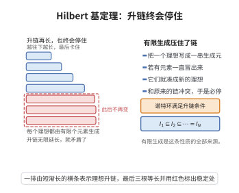

# Hilbert基定理

> **一句话大白话**：如果基础环"齐整"（每个理想都有限生成），那么往它上面加一个未知数做成的多项式环也照样齐整——"干净的农场地，长出干净的多项式田"，不会长出无穷无尽推不动的理想。
>
> **小例子**：$\mathbb{Z}$ 是诺特环，于是 $\mathbb{Z}[x]$ 乃至逐层加变量的 $\mathbb{Z}[x_1,\dots,x_n]$ 都仍是诺特环，保证任意多项式理想都是有限生成的。

## 介绍

Hilbert基定理（Hilbert's Basis Theorem）是交换代数中的基本定理，由大卫·希尔伯特于 1888 年证明。该定理断言：若 $R$ 是诺特环，则多项式环 $R[x]$ 也是诺特环。这一定理在代数几何中具有根本性意义——它保证了仿射空间中的代数集可以由有限个多项式方程定义，是代数几何中"有限生成"性质的基础。

## 几何直观

图意在说明：有限生成把无限升链卡死，一旦理想链不再变长，整条链就只能停在那里。

## 分析

**前置依赖**：诺特环、多项式环、理想、有限生成模。

**数学内涵**：

**定理内容**：设 $R$ 是诺特环（即 $R$ 中的每个理想都是有限生成的），则 $R[x]$ 也是诺特环。

**推广**：由归纳法，$R[x_1, \ldots, x_n]$ 是诺特环。

**数学内涵**：Hilbert基定理表明，诺特性在添加多项式变量的操作下保持不变。这是代数几何中"有限基"性质的基础，确保每个代数簇都可以由有限个方程定义。

**证明策略**：设 $I \subseteq R[x]$ 是理想，考虑首项系数生成的理想链，利用 $R$ 的诺特性证明 $I$ 有限生成。

## 思考过程

Hilbert基定理的证明通过分析多项式理想中多项式的首项系数来实现。给定 $R[x]$ 中的理想 $I$，考虑所有 $I$ 中多项式的首项系数生成的 $R$ 中的理想 $J$。由于 $R$ 是诺特环，$J$ 有限生成，由这些生成元对应的多项式以及次数限制，可以证明 $I$ 本身也是有限生成的。

这个证明是非构造性的——它证明了理想是有限生成的，但没有给出具体的生成元。这正是希尔伯特著名的"存在性证明"风格的典范，曾引起当时数学界的广泛讨论。

## 证明过程

**定理**（Hilbert基定理）：设 $R$ 是诺特环，则多项式环 $R[x]$ 也是诺特环。

**证明**：

设 $I \subseteq R[x]$ 是理想。需要证明 $I$ 是有限生成的。

**步骤 1**：考虑首项系数理想。对每个非负整数 $n$，设
$$
L_n = \{a \in R \mid \text{存在 } f(x) \in I, \deg f = n, \text{ 首项系数为 } a\} \cup \{0\}
$$
则 $L_n$ 是 $R$ 的理想。

**步骤 2**：理想链。由于若 $f \in I$ 且 $\deg f = n$，则 $x f \in I$ 且 $\deg(xf) = n+1$，故 $L_n \subseteq L_{n+1}$。因此得到 $R$ 中理想的升链：
$$
L_0 \subseteq L_1 \subseteq L_2 \subseteq \cdots
$$

**步骤 3**：诺特性。由于 $R$ 是诺特环，该升链稳定，即存在 $N$ 使得 $L_N = L_{N+1} = L_{N+2} = \cdots$。

**步骤 4**：有限生成性。对每个 $0 \le n \le N$，$L_n$ 是 $R$ 中的理想，故有限生成，设生成元为 $a_{n,1}, \ldots, a_{n,k_n}$。对每个 $a_{n,i}$，取 $f_{n,i} \in I$ 使得 $\deg f_{n,i} = n$ 且首项系数为 $a_{n,i}$。

**步骤 5**：证明这些 $f_{n,i}$ 生成 $I$。

设 $J = \langle f_{n,i} \mid 0 \le n \le N, 1 \le i \le k_n \rangle \subseteq I$。假设 $J \ne I$，取 $I$ 中次数最小的多项式 $g \notin J$，设 $\deg g = m$，首项系数为 $a$。

若 $m \le N$，则 $a \in L_m$，故 $a = \sum r_i a_{m,i}$。令 $g_0 = \sum r_i f_{m,i}$，则 $\deg g_0 = m$，首项系数为 $a$。则 $g - g_0$ 次数小于 $m$ 或为零，且 $g - g_0 \in I$。由极小性，$g - g_0 \in J$，故 $g \in J$，矛盾。

若 $m > N$，则 $a \in L_m = L_N$，故 $a = \sum r_i a_{N,i}$。令 $g_0 = x^{m-N} \sum r_i f_{N,i}$，则 $\deg g_0 = m$，首项系数为 $a$。同样，$g - g_0 \in I$ 且次数小于 $m$，由极小性 $g - g_0 \in J$，故 $g \in J$，矛盾。

因此 $I = J$ 是有限生成的。$\square$

**推论 1**：若 $R$ 是诺特环，则 $R[x_1, \ldots, x_n]$ 是诺特环。

**证明**：对 $n$ 归纳，反复应用 Hilbert 基定理。$\square$

**推论 2**（代数几何中的基本结论）：仿射空间 $\mathbb{A}^n_k$ 中的每个代数集可以由有限个多项式方程定义。

**证明**：$k[x_1, \ldots, x_n]$ 是诺特环（$k$ 是域，显然是诺特环），由 Hilbert 基定理，每个理想有限生成，故每个代数集可由有限个方程定义。$\square$

**应用**：Hilbert基定理是交换代数和代数几何的基石，为 Hilbert 零点定理、仿射概形的诺特性等奠定了基础。$\square$

## 课堂问答

**老师**：Hilbert 基定理说了什么？

**学生**：结论是：若 $R$ 是诺特环，则 $R[x]$ 也是诺特环，归纳下去 $R[x_1,\dots,x_n]$ 都是诺特环。证明取自理想 $I\subseteq R[x]$ 的首项系数：令 $L_n$ 为 $I$ 中次数恰为 $n$ 的多项式首项系数（连同 $0$）生成的理想，得到升链 $L_0\subseteq L_1\subseteq\cdots$，由 $R$ 诺特在某个 $N$ 处稳定，再取 $L_n$（$n\le N$）的有限生成元所对应的多项式，它们生成 $I$。常见误区：这个证明是非构造性的，只断言生成元存在，并不给出它们。

**老师（追问）**：$L_n$ 为什么构成升链？稳定之后为什么只需 $n\le N$ 的生成元就够？

**学生**：若 $f\in I$ 且 $\deg f=n$，则 $xf\in I$ 而 $\deg xf=n+1$ 且首项系数不变，故 $L_n\subseteq L_{n+1}$。链稳定后，对次数 $m>N$ 的多项式，其首项系数 $a\in L_m=L_N$，于是用 $x^{m-N}$ 乘以某个次数 $N$ 的多项式就能消去首项，配合极小次数论证把 $I$ 中元素逐个约化掉，故只用次数 $\le N$ 的生成元即可。

**老师（拓展）**：这个"存在性证明"对代数几何意味着什么？

**学生**：$k$ 是域时 $k[x_1,\dots,x_n]$ 是诺特环，于是每个理想有限生成，直接得到"仿射空间中的每个代数集都可由有限个多项式方程定义"。它是仿射概形诺特性、Hilbert 零点定理等的基石，也正因如此，当时学界对它的非构造性颇有争论。

## 相关条目

- [Hilbert 基定理（第108级-计算机代数）](../第108级-计算机代数/Hilbert基定理.md)：与本条目为同一定理，另收录于第108级-计算机代数，可交叉参考。
