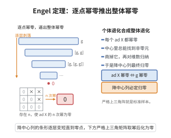

# Engel 定理

> **一句话大白话**：如果一个李代数里每个"伴随变换"都像反复乘几次就归零的"橡皮"，那么这个代数整个就是幂零的——"个个元素都退化"被论证成"整体也退化"的有力判据。
>
> **小例子**：严格上三角矩阵代数（对角线全为 0）满足每个 $\mathrm{ad}_X$ 幂零，因此它是幂零李代数，这也印证了 $\mathfrak{sl}_2$ 中的 $\mathrm{ad}_e$ 是幂零变换。

## 介绍

Engel 定理是李代数理论中的基本定理之一，它给出了李代数是幂零李代数的充要条件：一个有限维李代数是幂零的当且仅当每个 $\text{ad}_X$ 是幂零线性变换。该定理由德国数学家 Friedrich Engel 在 19 世纪末证明，是研究李代数结构理论的基础工具，也是 Lie 定理的对应物。

## 几何直观

图意在说明：只要每个伴随变换都幂零，整条降中心列就会逐层剥落，最终归零。

## 分析

**前置依赖**：李代数的定义、幂零李代数、伴随表示 $\text{ad}_X$、降中心列、线性变换的幂零性。

**定理内容**：设 $\mathfrak{g}$ 是有限维李代数。则 $\mathfrak{g}$ 是幂零李代数当且仅当对任意 $X \in \mathfrak{g}$，线性变换 $\text{ad}_X: \mathfrak{g} \to \mathfrak{g}$ 是幂零的（即存在正整数 $n$ 使得 $(\text{ad}_X)^n = 0$）。

**阐述**：
- 幂零李代数的定义：李代数 $\mathfrak{g}$ 的降中心列定义为 $\mathfrak{g}^0 = \mathfrak{g}$，$\mathfrak{g}^{k+1} = [\mathfrak{g}, \mathfrak{g}^k]$。若存在 $k$ 使得 $\mathfrak{g}^k = 0$，则称 $\mathfrak{g}$ 是幂零的。
- Engel 定理的条件 "$(\text{ad}_X)^n = 0$ 对每个 $X$ 成立" 称为"逐点幂零性"。
- 定理的结论是逐点幂零性等价于整体幂零性。

**数学内涵**：Engel 定理表明，李代数的幂零性可以通过检查每个单独元素的伴随作用来判定。这是一个简洁而深刻的结论，它使得幂零李代数的研究归结为对幂零线性变换的研究。

**证明策略**：证明的关键是通过归纳法。核心步骤是：若 $\mathfrak{g}$ 的每个元素都是 $\text{ad}$-幂零的，则存在非零的 $Z \in \mathfrak{g}$ 使得 $[X, Z] = 0$ 对所有 $X \in \mathfrak{g}$ 成立（即中心非平凡）。然后对 $\mathfrak{g}/\langle Z \rangle$ 使用归纳假设。

## 思考过程

Engel 定理的证明依赖于一个关键引理：若 $\mathfrak{g}$ 是 $\mathfrak{gl}(V)$ 的子李代数，且每个 $X \in \mathfrak{g}$ 是幂零线性变换，则存在非零向量 $v \in V$ 使得 $Xv = 0$ 对所有 $X \in \mathfrak{g}$ 成立（即存在公共零向量）。

这个引理本身也是通过归纳法证明的：取 $\mathfrak{g}$ 的极大真子代数 $\mathfrak{h}$，由归纳假设，存在非零 $v$ 使得 $\mathfrak{h}v = 0$。然后取 $Y \notin \mathfrak{h}$，考虑 $Y$ 作用在由 $v$ 生成的子空间上，利用 $Y$ 的幂零性得到 $v$ 的某个线性组合是 $\mathfrak{g}$ 的公共零向量。

有了这个引理，对 $\mathfrak{g}$ 本身应用，得到存在非零 $Z$ 属于 $\mathfrak{g}$ 的中心。然后对 $\mathfrak{g}/\langle Z \rangle$ 使用归纳假设，得到 $\mathfrak{g}$ 是幂零的。

## 证明过程

**定理**（Engel）：设 $\mathfrak{g}$ 是有限维李代数。则 $\mathfrak{g}$ 是幂零李代数当且仅当对任意 $X \in \mathfrak{g}$，$\text{ad}_X$ 是幂零线性变换。

**证明**：

### 引理（公共零向量引理）

设 $V$ 是有限维向量空间，$\mathfrak{g} \subseteq \mathfrak{gl}(V)$ 是子李代数。若每个 $X \in \mathfrak{g}$ 是幂零线性变换，则存在非零 $v \in V$ 使得 $Xv = 0$ 对所有 $X \in \mathfrak{g}$ 成立。

**引理证明**：对 $\dim \mathfrak{g}$ 进行归纳。

- 若 $\dim \mathfrak{g} = 0$ 或 $1$，结论平凡。
- 假设结论对维数小于 $\dim \mathfrak{g}$ 的李代数成立。取 $\mathfrak{h}$ 是 $\mathfrak{g}$ 的极大真子李代数。对 $\mathfrak{h}$ 在 $V$ 上的作用使用归纳假设，存在非零 $v \in V$ 使得 $\mathfrak{h}v = 0$。
- 令 $W = \{w \in V \mid \mathfrak{h}w = 0\}$。则 $W$ 是 $\mathfrak{h}$-不变的子空间，且对任意 $Y \in \mathfrak{g}$，$YW \subseteq W$（因为 $[Y, \mathfrak{h}] \subseteq \mathfrak{h}$）。
- 取 $Y \in \mathfrak{g} \setminus \mathfrak{h}$。由于 $Y$ 是幂零线性变换，$Y|_W$ 也是幂零的。存在非零 $w \in W$ 使得 $Yw = 0$。
- 此时 $\mathfrak{h}w = 0$ 且 $Yw = 0$。由于 $\mathfrak{g} = \mathfrak{h} \oplus \langle Y \rangle$（由 $\mathfrak{h}$ 的极大性），故 $Xw = 0$ 对所有 $X \in \mathfrak{g}$ 成立。引理得证。

### Engel 定理证明

**必要性**：若 $\mathfrak{g}$ 是幂零的，则降中心列 $\mathfrak{g}^0 = \mathfrak{g} \supset \mathfrak{g}^1 \supset \cdots \supset \mathfrak{g}^k = 0$。对任意 $X \in \mathfrak{g}$，$(\text{ad}_X)^n(Y) \in \mathfrak{g}^n$，故 $(\text{ad}_X)^k = 0$，即 $\text{ad}_X$ 幂零。

**充分性**：假设每个 $\text{ad}_X$ 幂零。考虑 $\text{ad}: \mathfrak{g} \to \mathfrak{gl}(\mathfrak{g})$，其像 $\text{ad}(\mathfrak{g})$ 是 $\mathfrak{gl}(\mathfrak{g})$ 的子李代数，且每个元素幂零。由公共零向量引理，存在非零 $Z \in \mathfrak{g}$ 使得 $\text{ad}_X(Z) = 0$ 对所有 $X \in \mathfrak{g}$ 成立，即 $Z \in \mathfrak{Z}(\mathfrak{g})$（中心）。

考虑商李代数 $\mathfrak{g}_1 = \mathfrak{g}/\langle Z \rangle$。对任意 $X \in \mathfrak{g}$，$\text{ad}_X$ 在 $\mathfrak{g}_1$ 上的诱导作用仍是幂零的。由归纳假设，$\mathfrak{g}_1$ 是幂零的。设 $\mathfrak{g}_1$ 的降中心列长度为 $k$，则 $\mathfrak{g}$ 的降中心列长度不超过 $k+1$，故 $\mathfrak{g}$ 是幂零的。$\square$

**推论**：若 $\mathfrak{g}$ 是有限维李代数，且每个 $X \in \mathfrak{g}$ 是 $\text{ad}$-幂零的，则 $\mathfrak{g}$ 是幂零李代数。

## 课堂问答

**老师**：Engel 定理凭什么把"每个元素幂零"与"整体幂零"划等号？

**学生**：结论是：有限维 $\mathfrak{g}$ 幂零 $\iff$ 每个 $\operatorname{ad}_X$ 幂零。充分性的核心是公共零向量引理——若子李代数 $\mathfrak{g}\subseteq\mathfrak{gl}(V)$ 中每个元素幂零，则存在非零 $v$ 使所有 $Xv=0$。把它用到 $\operatorname{ad}(\mathfrak{g})$ 上便得非零中心元 $Z$，再对商代数 $\mathfrak{g}/\langle Z\rangle$ 归纳即完成。

**老师（追问）**：公共零向量引理怎么证？

**学生**：对 $\dim\mathfrak{g}$ 归纳。取极大真子代数 $\mathfrak{h}$，由归纳得非零 $v$ 使 $\mathfrak{h}v=0$；令 $W=\{w:\mathfrak{h}w=0\}$，因 $[Y,\mathfrak{h}]\subseteq\mathfrak{h}$ 有 $YW\subseteq W$。取 $Y\notin\mathfrak{h}$，$Y|_W$ 幂零故有非零 $w\in W$ 使 $Yw=0$；又 $\mathfrak{g}=\mathfrak{h}\oplus\langle Y\rangle$，故 $w$ 对所有 $X\in\mathfrak{g}$ 零化。

**老师（拓展）**：它最容易和哪个定理混淆？

**学生**：容易和 Lie 定理混淆。Engel 对应"幂零 $\Rightarrow$ 可同时严格上三角化"（对角线全为 0），Lie 对应"可解 $\Rightarrow$ 可同时上三角化"（对角线未必为 0）。另一个误区是把"逐点幂零"当成"存在统一幂次 $n$ 使所有 $(\operatorname{ad}_X)^n=0$"——引理的真正作用正是把逐点性升级为整体幂零。
