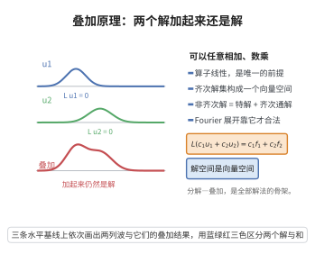

# 叠加原理

> **一句话大白话**：线性方程的解可以任意相加、任意数乘，加起来仍然是解。
>
> **小例子**：$y''+y=0$ 有解 $\cos x$ 与 $\sin x$，于是 $c_1\cos x+c_2\sin x$ 也是解，而且这已经是全部解。

## 介绍

叠加原理（superposition principle）是线性方程理论最基础、也是最有用的一条性质。它指出：若微分算子 $L$ 是线性的，则方程 $Lu=f$ 的解对"右端项"的加法与数乘保持同构关系：

$$Lu_i=f_i\ (i=1,\dots,k)\quad\Longrightarrow\quad L\Big(\sum_{i=1}^kc_iu_i\Big)=\sum_{i=1}^kc_if_i.$$

它带来两方面的结构信息：齐次方程 $Lu=0$ 的解集是一个向量空间（"解空间"），非齐次方程的通解等于"一个特解 + 齐次通解"。这既是常微分方程中构造通解的根据，也是 Fourier 方法、Green 函数法、特征函数展开等一切"分解—叠加"技巧的合法性来源。

## 几何直观

图意在说明：算子线性使得解可以任意相加与数乘，叠加后的波形仍然是同一方程的解。

## 分析

**前置依赖**：线性微分算子、导数与积分的线性性、线性代数（向量空间、线性映射、基与维数）、Fourier 变换、Green 函数。

**定理内容**：

1. **齐次叠加**：若 $Lu_i=0$ 于区域 $\Omega$（$i=1,\dots,k$），$c_i$ 为常数（或仅依赖于自变量的函数，当 $L$ 为"算子线性"时取常数），则 $L\big(\sum_ic_iu_i\big)=0$。
2. **非齐次叠加**：若 $Lu_i=f_i$，则 $L\big(\sum_ic_iu_i\big)=\sum_ic_if_i$。
3. **解的结构**：设 $u_p$ 是 $Lu=f$ 的一个特解，则 $Lu=f$ 的全部解为 $\{u_p+v:\ Lv=0\}$。
4. **解空间为向量空间**：齐次解集 $\ker L=\{u:Lu=0\}$ 是向量空间；对 $n$ 阶线性常微分方程，它为 $n$ 维。

## 思考过程

证明的关键只有一处：**算子线性**。注意到导数算子的线性性
$$\frac{d}{dx}(au+bv)=a\frac{du}{dx}+b\frac{dv}{dx},$$
以及常数倍、求和的交换，"$L$ 是线性的"被定义为
$$L(au+bv)=aLu+bLv\qquad(a,b\in\mathbb{R}\text{ 或 }\mathbb{C}).$$
一旦承认这一点，叠加就是线性映射的代数性质的直接翻译：线性映射保持线性组合。因此证明不需要任何分析估计，而是一个纯粹的代数事实；需要谨慎的只是"无穷级数形式的叠加"——那里出现了极限，必须附加收敛条件。

## 证明过程

**步骤 1：线性算子的代数性质。**

设 $L$ 是线性微分算子，即对任意属于其定义域的函数 $u,v$ 与常数 $a,b$，有 $L(au+bv)=aLu+bLv$。由定义立得对任意有限线性组合
$$L\Big(\sum_{i=1}^kc_iu_i\Big)=\sum_{i=1}^kc_iLu_i.$$
（对 $k$ 归纳：$k=1$ 显然；$k-1\to k$ 时把 $\sum_{i=1}^{k-1}c_iu_i$ 看作 $u$，$c_ku_k$ 看作 $v$。）

**步骤 2：齐次情形（结论 1）。**

若 $Lu_i=0$，代入上式得 $L\big(\sum_ic_iu_i\big)=\sum_ic_i\cdot0=0$。故齐次解集对加法与数乘封闭，即 $\ker L$ 是向量空间。

**步骤 3：非齐次情形（结论 2）。**

若 $Lu_i=f_i$，同理 $L\big(\sum_ic_iu_i\big)=\sum_ic_if_i$。特别地：

- $Lu_1=f,\ Lu_2=0\Rightarrow L(u_1+u_2)=f$；
- $Lu_1=f,\ Lu_2=f\Rightarrow L(u_1-u_2)=0$，即两个同右端解之差是齐次解。

**步骤 4：解的结构（结论 3）。**

设 $S_f=\{u:Lu=f\}$，$S_0=\ker L$。

- $u_p+S_0\subset S_f$：由步骤 3，$L(u_p+v)=L u_p+Lv=f$。
- $S_f\subset u_p+S_0$：若 $u\in S_f$，则 $L(u-u_p)=f-f=0$，即 $u-u_p\in S_0$，故 $u\in u_p+S_0$。

于是 $S_f=u_p+S_0$（$S_0$ 在 $S_f$ 上的仿射平移），这正是"通解 = 特解 + 齐次通解"。

**步骤 5：$n$ 阶线性常微分方程的解空间维数（结论 4）。**

设 $L=a_n(x)\frac{d^n}{dx^n}+\dots+a_1(x)\frac{d}{dx}+a_0(x)$，系数连续、$a_n\ne0$ 于区间 $I$。由 Picard–Lindelöf 定理，对任意初值 $(y_0,\dots,y_{n-1})$，存在唯一解 $y$ 满足 $y^{(j)}(x_0)=y_j$。于是映射
$$\Phi:S_0\to\mathbb{R}^n,\qquad \Phi(y)=\big(y(x_0),\dots,y^{(n-1)}(x_0)\big)$$
是线性同构（线性来自求值与求导的线性性；单射与满射由解的唯一存在性）。故 $\dim S_0=n$。这给出"$n$ 个线性无关特解构成基础解系"的严格依据，也解释了 Wronskian 判据的意义。

**步骤 6：无穷叠加（Fourier 与 Green 函数）。**

"叠加"在物理上常以无穷和或积分的形式出现，此时需附加收敛条件。

（i）**Fourier 级数**：若 $f=\sum_kf_k$ 在适当意义（如 $L^2$ 或一致收敛）下成立，且 $Lu_k=f_k$，在 $L$ 与求和可交换时 $u=\sum_ku_k$ 满足 $Lu=f$。对常系数算子，$L$ 与一致收敛的级数可逐项作用，故叠加合法。

（ii）**Green 函数（连续叠加）**：对 $Lu=f$，把 $f$ 视为点源 $f(y)\delta(x-y)$ 的连续叠加，点源响应为 $G(x,y)$，则由线性性与积分（叠加的连续版本）
$$u(x)=\int_\Omega G(x,y)f(y)\,dy.$$
只要积分收敛并允许在积分号下求导（例如 $G$ 有合适的光滑性或 $f$ 有紧支集），$Lu=f$ 即被验证，这就是 Green 函数法。叠加原理的连续形式在此取代了有限和。

## 课堂问答

**老师**：线性方程的解集为什么有向量空间结构？

**学生**：因为算子线性 $L(au+bv)=aLu+bLv$。于是齐次解集 $\ker L=\{u:Lu=0\}$ 对加法与数乘封闭，是向量空间；非齐次解集是它的仿射平移 $S_f=u_p+S_0$，即"通解 $=$ 一个特解 $+$ 齐次通解"。

**老师（追问）**：$n$ 阶线性常微分方程的解空间维数凭什么等于 $n$？

**学生**：初值映射 $\Phi(y)=\big(y(x_0),y'(x_0),\dots,y^{(n-1)}(x_0)\big):S_0\to\mathbb{R}^n$ 是线性的；由 Picard–Lindelöf 定理的初值问题存在唯一性，它既是单射又是满射，故是同构，$\dim S_0=n$。这正是"$n$ 个线性无关特解构成基础解系"与 Wronskian 判据的严格依据。

**老师（拓展）**：无穷叠加（Fourier、Green 函数）要注意什么？

**学生**：叠加的连续版本是积分。Green 函数法把 $f$ 视为点源 $f(y)\delta(x-y)$ 的连续叠加，点源响应为 $G(x,y)$，于是 $u(x)=\int_\Omega G(x,y)f(y)\,dy$。合法性要求 $L$ 与求和/积分可交换：一致收敛的级数（常系数算子）可逐项作用，积分表达式则需积分收敛并允许在积分号下求导。常见误区是把无穷级数当作有限和的显然推广——没有收敛或交换性条件，"解之和仍是解"可能失效；非线性算子则根本不能叠加。

## 相关条目

- [波动方程与dAlembert公式](./波动方程与dAlembert公式.md)：其通解 $F(x-ct)+G(x+ct)$ 与 Duhamel 叠加都依赖叠加原理。
- [Poisson方程与Green函数](./Poisson方程与Green函数.md)：Green 函数法把叠加原理推广为点源响应的积分。
- [二阶线性PDE分类](./二阶线性PDE分类.md)：分类理论针对的正是线性（可叠加）算子。
