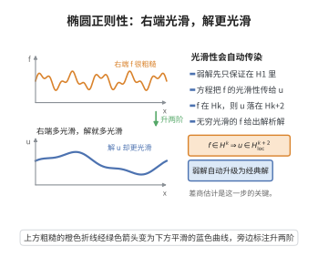

# 椭圆正则性定理

> **一句话大白话**：对椭圆型方程（如调和、势方程）来说，解不会"藏着尖角"——方程越光滑，解就越光滑，光滑性自动从等式右端"传染"到解本身，弱解也会自动升级成经典光滑解。
>
> **小例子**：若 $\Delta u=0$（调和），则 $u$ 是实解析的；一般地，若 $Lu=f$ 中 $f\in H^s$ 而 $L$ 为椭圆算子，则 $u\in H^{s+2}$，即解的自变量处处无限可微。

## 介绍

椭圆正则性定理（Elliptic regularity theorem）是椭圆型偏微分方程理论中的核心结果之一。它断言：若椭圆型方程 $Lu = f$ 的右端项 $f$ 足够光滑，则解 $u$ 也比预期更光滑。具体而言，$u$ 的正则性比 $f$ 高两阶（在 Sobolev 空间尺度上）。该定理是 PDE 理论中"正则性提升"的典型例子，也是理解 PDE 解光滑性的基本工具。

## 几何直观

图意在说明：方程把右端项的光滑性传递给解，f 在 Hk 时解自动落在 Hk+2 里。

## 分析

**前置依赖**：Sobolev空间定义、Sobolev 嵌入定理、椭圆型方程、弱解、差商、内插估计。

**定理内容**：设 $\Omega \subset \mathbb{R}^n$ 是有界光滑区域，$L$ 是一致椭圆算子
$$Lu = -\sum_{i,j=1}^n \partial_{x_j}(a_{ij}(x)\partial_{x_i}u) + \sum_{i=1}^n b_i(x)\partial_{x_i}u + c(x)u$$
其中系数光滑。

**内部正则性**：若 $u \in H^1(\Omega)$ 是 $Lu = f$ 的弱解，且 $f \in H^k(\Omega)$，则 $u \in H^{k+2}_{\text{loc}}(\Omega)$，且对任意 $\Omega' \subset\subset \Omega$，
$$\|u\|_{H^{k+2}(\Omega')} \le C(\|f\|_{H^k(\Omega)} + \|u\|_{L^2(\Omega)})$$

**边界正则性**：若此外 $u|_{\partial\Omega} = 0$（或 $u \in H_0^1(\Omega)$），且 $\partial\Omega$ 光滑，$f \in H^k(\Omega)$，则 $u \in H^{k+2}(\Omega)$，且
$$\|u\|_{H^{k+2}(\Omega)} \le C(\|f\|_{H^k(\Omega)} + \|u\|_{L^2(\Omega)})$$

**无穷正则性**：若 $f \in C^\infty(\overline{\Omega})$，且系数光滑，则 $u \in C^\infty(\overline{\Omega})$。

**数学内涵**：椭圆正则性定理揭示了椭圆型算子的"正则化效应"——解比右端项多两阶导数。这种正则性提升是椭圆型方程区别于其他类型方程的关键特征。例如，Laplace 方程 $\Delta u = 0$ 的解自动是 $C^\infty$ 的（调和函数的解析性）。

**证明策略**：使用差商方法（Nirenberg 技巧）或 Fourier 变换方法。核心是建立 $H^1$ 估计，然后通过迭代提升正则性。对内部正则性，利用截断函数局部化，然后通过差商估计导数。

## 思考过程

椭圆正则性定理的证明基于"自举"（bootstrap）思想。假设 $u \in H^1$ 是弱解，我们希望证明 $u \in H^2$。在局部化后，考虑差商 $\Delta_i^h u(x) = (u(x+he_i) - u(x))/h$。将弱形式中的测试函数取为 $v = \Delta_i^{-h}(\eta^2 \Delta_i^h u)$，经过复杂的估计得到 $\|\nabla(\Delta_i^h u)\|_{L^2}$ 有界，从而 $u \in H^2$。

一旦得到 $u \in H^2$，由于 $f \in H^1$ 且 $Lu = f$，我们可以对 $L(\partial_{x_i}u) = \partial_{x_i}f + \text{低阶项}$ 重复上述论证，得到 $u \in H^3$，依此类推。这就是自举过程。

## 证明过程

**定理**（内部椭圆正则性）：设 $u \in H^1(\Omega)$ 是 $Lu = f$ 的弱解，其中 $L$ 是一致椭圆算子，系数光滑。若 $f \in H^m(\Omega)$，则 $u \in H^{m+2}_{\text{loc}}(\Omega)$。

**证明**（$m=0$ 的情形，即 $f \in L^2$ 时 $u \in H^2_{\text{loc}}$）：

**步骤 1**：局部化。取 $\Omega' \subset\subset \Omega'' \subset\subset \Omega$，截断函数 $\zeta \in C_c^\infty(\Omega'')$，$\zeta \equiv 1$ 在 $\Omega'$ 上。考虑 $\tilde{u} = \zeta u$。

**步骤 2**：差商估计。对 $h$ 充分小，定义 $i$ 方向的差商
$$\Delta_i^h v(x) = \frac{v(x+he_i) - v(x)}{h}$$
将弱形式取测试函数 $v = \Delta_i^{-h}(\eta^2 \Delta_i^h \tilde{u})$，其中 $\eta$ 是另一个截断函数。

**步骤 3**：利用椭圆性，得到
$$\alpha \|\nabla(\Delta_i^h \tilde{u})\|_{L^2}^2 \le a(\tilde{u}, \Delta_i^{-h}(\eta^2 \Delta_i^h \tilde{u})) + \text{低阶项}$$
利用 $a(\tilde{u}, \cdot) = (f, \cdot)$，经估计得
$$\|\nabla(\Delta_i^h \tilde{u})\|_{L^2} \le C(\|f\|_{L^2} + \|\nabla u\|_{L^2} + \|u\|_{L^2})$$

**步骤 4**：由差商与弱导数的关系，$\|\nabla(\partial_{x_i}\tilde{u})\|_{L^2} \le C$，故 $\tilde{u} \in H^2(\Omega'')$，从而 $u \in H^2(\Omega')$。且
$$\|u\|_{H^2(\Omega')} \le C(\|f\|_{L^2(\Omega)} + \|u\|_{L^2(\Omega)})$$

**步骤 5**（自举）：若 $f \in H^1(\Omega)$，则对 $Lu = f$ 在分布意义下求导得 $L(\partial_{x_i}u) = \partial_{x_i}f + \text{低阶项}$。由 $u \in H^2_{\text{loc}}$，$\partial_{x_i}u \in H^1_{\text{loc}}$，重复上述论证得 $u \in H^3_{\text{loc}}$。归纳可得 $u \in H^{m+2}_{\text{loc}}$。$\square$

**定理**（边界正则性）：设 $u \in H_0^1(\Omega)$ 是 $Lu = f$ 的弱解，$\partial\Omega$ 光滑，$f \in H^m(\Omega)$，则 $u \in H^{m+2}(\Omega)$。

**证明思路**：在边界附近通过拉直变换将边界局部化为平直边界，然后利用反射法（或半空间上的差商估计）得到边界附近的正则性。结合内部正则性即得整体正则性。$\square$

**推论**（无穷正则性）：若 $f \in C^\infty(\overline{\Omega})$，且 $L$ 的系数光滑，则 $u \in C^\infty(\overline{\Omega})$。特别地，Laplace 方程 $\Delta u = 0$ 的解是 $C^\infty$ 的（调和函数的光滑性）。

## 课堂问答

**老师**：为什么说椭圆型方程的解会"自动变光滑"？

**学生**：因为椭圆主部可以对"反解"。若 $Lu=f$ 且 $L$ 一致椭圆、系数光滑，则 $f\in H^k$ 时解多得两阶：$u\in H^{k+2}_{\mathrm{loc}}(\Omega)$，并在任意 $\Omega'\subset\subset\Omega$ 上有 $\|u\|_{H^{k+2}(\Omega')}\le C(\|f\|_{H^k(\Omega)}+\|u\|_{L^2(\Omega)})$。

**老师（追问）**：从 $L^2$ 到 $H^2$ 这一步怎么跨过去？

**学生**：用差商法。定义 $\Delta_i^hv=\frac{v(x+he_i)-v(x)}{h}$，在弱形式里取测试函数 $v=\Delta_i^{-h}(\eta^2\Delta_i^h\tilde u)$（$\tilde u=\zeta u$ 为局部化、$\eta$ 为另一截断函数）；椭圆性给 $\alpha\|\nabla(\Delta_i^h\tilde u)\|^2\le a(\tilde u,\Delta_i^{-h}(\eta^2\Delta_i^h\tilde u))$，配合 $a(\tilde u,\cdot)=(f,\cdot)$ 与低阶项估计得 $\|\nabla(\Delta_i^h\tilde u)\|\le C(\|f\|+\|\nabla u\|+\|u\|)$，故 $u\in H^2_{\mathrm{loc}}$。

**老师（拓展）**：之后怎样一路上升到无穷光滑？

**学生**：自举。由 $u\in H^2_{\mathrm{loc}}$ 且 $L(\partial_{x_i}u)=\partial_{x_i}f+$低阶项，把同一套差商估计重复一次即得 $\partial_{x_i}u\in H^2_{\mathrm{loc}}$，从而 $u\in H^3_{\mathrm{loc}}$，归纳得 $H^{m+2}_{\mathrm{loc}}$；当 $f\in C^\infty$ 且系数光滑时 $u\in C^\infty$，特别地调和函数是实解析的。常见误区是混用内部与边界正则性：内部结果无需边界条件，而全局 $H^{m+2}$ 要 $u|_{\partial\Omega}=0$ 与光滑边界并用反射/拉直；得此结论的前提是算子的椭圆性，非椭圆方程无此提升。
