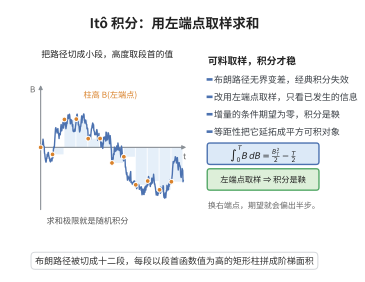

# Itô 积分

> **一句话大白话**：面对 Brown 运动那种上下乱跳的积分变量，普通定积分失效；Itô 积分把人随机地"看到当前"的信息切成小段再求和，给"对冲布朗噪声"一类表达式一个严格的随机积分定义。
>
> **小例子**：Itô 积分 $\int_0^t B_s\,dB_s=\frac{B_t^2}{2}-\frac{t}{2}$，多了 $-\tfrac t2$——这是与普通积分"微积可算"的关键差别（二阶项 $t$ 的出现 $\approx\sum(\Delta B)^2\to t$）。

## 介绍

Itô 积分（Itô integral）是随机分析的核心概念，由日本数学家伊藤清（Kiyosi Itô）在 1944 年创立。它定义了关于 Brown 运动的积分 $\int_0^t X_s \, dB_s$，其中被积函数 $X_s$ 是随机过程，$B_s$ 是 Brown 运动。Itô 积分是随机微分方程（SDE）理论的基础，也是现代数理金融（如 Black–Scholes 公式）的数学支柱。

## 几何直观

图意在说明：被积函数取段首值只依赖过去信息，增量条件期望为零，积分因此成为鞅。

## 分析

**前置依赖**：Brown 运动、鞅、二次变差、平方可积鞅空间、等距公式。

**定理内容**：Itô 积分的基本构造如下：

**简单过程的积分**：对形如 $X_t = \sum_{i=0}^{n-1} \xi_i 1_{(t_i, t_{i+1}]}(t)$ 的简单过程，其中 $\xi_i$ 是 $\mathcal{F}_{t_i}$-可测的平方可积随机变量，定义
$$\int_0^t X_s \, dB_s = \sum_{i=0}^{n-1} \xi_i (B_{t_{i+1} \wedge t} - B_{t_i \wedge t})$$

**Itô 等距**：对简单过程，
$$E\left[\left(\int_0^t X_s \, dB_s\right)^2\right] = E\left[\int_0^t X_s^2 \, ds\right]$$

**一般过程的积分**：任意满足 $E[\int_0^t X_s^2 \, ds] < \infty$ 的适应过程 $X$，可以用简单过程逼近，由 Itô 等距保证极限的存在性，定义为 Itô 积分。

**Itô 积分的性质**：
1. 线性性：$\int (aX + bY) \, dB = a\int X \, dB + b\int Y \, dB$。
2. 鞅性：$M_t = \int_0^t X_s \, dB_s$ 是鞅。
3. 二次变差：$\langle M, M \rangle_t = \int_0^t X_s^2 \, ds$。
4. 连续性：$M_t$ 有连续样本路径。

**数学内涵**：Itô 积分与 Riemann–Stieltjes 积分的本质区别在于，Brown 运动的样本路径几乎处处不可微且二次变差非零（$[B,B]_t = t$），导致 Itô 积分 $\int f(B_s) \, dB_s$ 不满足链式法则，而需要 Itô 公式。

**证明策略**：通过简单过程逼近一般过程，利用 Itô 等距在 $L^2$ 空间中的完备性，将积分定义为 $L^2$ 极限。

## 思考过程

Itô 积分的构造与 Lebesgue 积分类似：先从简单函数开始，然后通过逼近和完备化推广到更一般的函数类。但区别在于，Itô 积分的逼近是在 $L^2$ 意义下，核是 Brown 运动而不是 Lebesgue 测度。

Itô 等距 $E[(\int X \, dB)^2] = E[\int X^2 \, dt]$ 是构造的关键。它表明 $\int X \, dB$ 的 $L^2$ 范数等于 $X$ 的 $L^2(dt \times dP)$ 范数，因此积分算子 $\int \cdot \, dB$ 是等距嵌入，可以唯一延拓到整个 $L^2$ 空间。

## 证明过程

**定理**（Itô 积分的构造）：存在线性映射 $I: L^2_{\text{ad}}(\Omega \times [0,T]) \to L^2(\Omega)$，使得：
1. 对简单过程，$I(X) = \sum \xi_i (B_{t_{i+1}} - B_{t_i})$。
2. Itô 等距成立：$E[I(X)^2] = E[\int_0^T X_t^2 \, dt]$。
3. $I(X) = \int_0^T X_t \, dB_t$ 是鞅。

**证明**：

**步骤 1**：简单过程的积分。定义 $\mathcal{S}$ 为简单过程空间，对 $X \in \mathcal{S}$，定义
$$I(X) = \sum_{i=0}^{n-1} \xi_i (B_{t_{i+1}} - B_{t_i})$$

**步骤 2**：验证 Itô 等距。对 $X \in \mathcal{S}$，
$$E[I(X)^2] = E\left[\sum_{i,j} \xi_i \xi_j (B_{t_{i+1}} - B_{t_i})(B_{t_{j+1}} - B_{t_j})\right]$$
由鞅性和独立增量性，交叉项期望为零，故
$$E[I(X)^2] = \sum_i E[\xi_i^2 (B_{t_{i+1}} - B_{t_i})^2] = \sum_i E[\xi_i^2](t_{i+1} - t_i) = E\left[\int_0^T X_t^2 \, dt\right]$$

**步骤 3**：稠密性。$\mathcal{S}$ 在 $L^2_{\text{ad}}(\Omega \times [0,T])$ 中稠密。对任意可料平方可积过程 $X$，存在简单过程列 $X^{(n)}$ 使得 $E[\int_0^T |X_t^{(n)} - X_t|^2 \, dt] \to 0$。

**步骤 4**：延拓。由 Itô 等距，$\{I(X^{(n)})\}$ 是 $L^2(\Omega)$ 中的 Cauchy 列，定义 $I(X) = \lim_{n\to\infty} I(X^{(n)})$。该极限与逼近序列的选取无关，且延拓保持 Itô 等距。

**步骤 5**：鞅性。对 $s < t$ 和 $X \in \mathcal{S}$，$E[I_t(X) \mid \mathcal{F}_s] = I_s(X)$。由 $L^2$ 收敛保持条件期望，该性质对一般 $X$ 也成立。$\square$

**推论**（Itô 积分的二次变差）：$M_t = \int_0^t X_s \, dB_s$ 的二次变差为
$$[M, M]_t = \int_0^t X_s^2 \, ds$$
且 $M_t^2 - \int_0^t X_s^2 \, ds$ 是鞅。

## 课堂问答

**老师**：为什么 $\int_0^tB_s\,dB_s$ 不能直接当作 Riemann–Stieltjes 积分？

**学生**：因为 $B$ 的轨道几乎处处不可微，二次变差 $[B]_t=t\ne0$，不是有界变差函数，Riemann–Stieltjes 积分不存在。Itô 的做法是先在简单可料过程 $X=\sum_i\xi_i1_{(t_i,t_{i+1}]}$ 上定义 $\int X\,dB=\sum_i\xi_i(B_{t_{i+1}}-B_{t_i})$——被积函数取区间左端点（"不看未来"），再靠 Itô 等距 $E[(\int X\,dB)^2]=E\int X^2\,ds$ 把定义延拓到 $L^2$。

**老师（追问）**：左端点取值这个细节为什么不能改？

**学生**：改了就不是 Itô 积分了。取中点 $\tfrac12(B_{t_i}+B_{t_{i+1}})$ 会得到 Stratonovich 积分，它满足普通链式法则但一般不再是鞅。Itô 取左端点使 $\sum_i\xi_i\Delta B_i$ 保持鞅性：$E[\xi_i\Delta B_i\mid\mathcal F_{t_i}]=\xi_iE[\Delta B_i\mid\mathcal F_{t_i}]=0$，其中 $\Delta B_i$ 与 $\mathcal F_{t_i}$ 独立且零均值。常见误区：以为 $\int_0^tB\,dB=\tfrac12B_t^2$；正确的是 $\tfrac12B_t^2-\tfrac t2$。

**老师（拓展）**：延拓到一般的 $X$ 时，"极限与逼近序列无关"凭什么？

**学生**：由等距。若 $X^{(n)}\to X$ 与 $Y^{(n)}\to X$，则差趋于零，$\|I(X^{(n)})-I(Y^{(n)})\|_{L^2}^2=E\int|X^{(n)}-Y^{(n)}|^2\,dt\to0$，两个 $L^2$ 极限相等。这说明积分算子 $I$ 是 $L^2(\Omega\times[0,T])\to L^2(\Omega)$ 的等距嵌入，唯一延拓存在。
