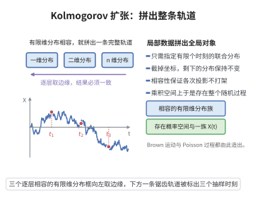

# Kolmogorov 扩张定理

> **一句话大白话**：给出每个有限时刻的"拼接分布"并彼此相容（截掉后面的坐标只剩前面时分布一致），就能把整个随机过程当成一个统一的随机对象定义出来——局部数据足够良心，全局就稳稳落地。
>
> **小例子**：定义做这事只需给所有有限子集的时间 $\{t_1,\dots,t_n\}$ 指定相容的联合分布 $P_{t_1\dots t_n}$，Kolmogorov 定理保证存在概率空间和随机变量族 $\{X_t\}$ 恰好兑现这些有限维分布。

## 介绍

Kolmogorov 扩张定理（Kolmogorov extension theorem），又称 Kolmogorov 存在性定理，是概率论中确保随机过程存在性的基本定理。由 Andrey Kolmogorov 在 1933 年建立。该定理断言：给定一族满足相容性条件的有限维分布，总存在一个随机过程以这些分布为其有限维分布。该定理为概率论奠定了严格的测度论基础，也是构造几乎所有随机过程（如 Brown 运动、Poisson 过程等）的理论保证。

## 几何直观

图意在说明：只要有限维分布彼此相容，就能在乘积空间上得到一个以它们为有限维分布的随机过程。

## 分析

**前置依赖**：测度论、概率空间、乘积空间、有限维分布、相容性条件（Kolmogorov 相容性）。

**定理内容**：设 $T$ 是任意指标集，对每个有限子集 $F = \{t_1,\dots,t_n\} \subset T$，给定 $\mathbb{R}^{n}$ 上的概率测度 $\mu_F$。若 $\{\mu_F\}$ 满足**相容性条件**：
1. 对任意排列 $\pi$，$\mu_{t_1,\dots,t_n}(A_1 \times \cdots \times A_n) = \mu_{t_{\pi(1)},\dots,t_{\pi(n)}}(A_{\pi(1)} \times \cdots \times A_{\pi(n)})$。
2. 对任意 $m < n$，$\mu_{t_1,\dots,t_n}(A_1 \times \cdots \times A_m \times \mathbb{R}^{n-m}) = \mu_{t_1,\dots,t_m}(A_1 \times \cdots \times A_m)$。

则存在概率空间 $(\Omega, \mathcal{F}, P)$ 和其上定义的随机过程 $\{X_t, t \in T\}$，使得对任意有限子集 $F$，$(X_t)_{t \in F}$ 的联合分布为 $\mu_F$。

**数学内涵**：Kolmogorov 扩张定理表明，随机过程的全部统计信息都包含在其有限维分布族中。只要有限维分布满足相容性，就一定存在一个随机过程实现它们。该定理是概率论从有限维向无限维推广的关键。

**证明策略**：取 $\Omega = \mathbb{R}^T$（所有实值函数的空间），$\mathcal{F}$ 为柱集生成的 $\sigma$-代数，然后利用 Carathéodory 扩张定理将定义在柱集上的集函数扩张为 $\mathcal{F}$ 上的概率测度。

## 思考过程

Kolmogorov 扩张定理的证明思路是典型的测度论扩张方法。首先，在乘积空间 $\Omega = \mathbb{R}^T$ 上定义柱集代数（即只依赖于有限个坐标的集合），然后利用给定的有限维分布在柱集代数上定义一个集函数。相容性条件保证了该集函数是良定义的有限可加测度。然后利用 Carathéodory 扩张定理（或更精确地，利用紧性论证）将其扩张为 $\sigma$-代数上的概率测度。

需要注意的是，定理的结论中的 $\Omega = \mathbb{R}^T$ 可能非常大（如 $T = \mathbb{R}$ 时，$\Omega$ 是所有 $\mathbb{R} \to \mathbb{R}$ 函数的空间），但扩张得到的概率测度支撑在可测函数的子集上。

## 证明过程

**定理**（Kolmogorov 扩张定理）：设 $\{\mu_F\}$ 是满足相容性条件的有限维分布族，则存在概率空间 $(\mathbb{R}^T, \mathcal{B}^T, P)$ 和坐标过程 $X_t(\omega) = \omega(t)$ 以 $\mu_F$ 为有限维分布。

**证明**：

**步骤 1**：构造样本空间。取 $\Omega = \mathbb{R}^T = \{\omega: T \to \mathbb{R}\}$，即所有实值函数的集合。定义 $\mathcal{F} = \mathcal{B}^T$ 为柱集 $\sigma$-代数，即由形如
$$C = \{\omega \in \Omega \mid (\omega(t_1), \dots, \omega(t_n)) \in B\},\quad B \in \mathcal{B}(\mathbb{R}^n)$$
的集合生成的 $\sigma$-代数。

**步骤 2**：定义柱集上的集函数。对柱集 $C = \{\omega \mid (\omega(t_1), \dots, \omega(t_n)) \in B\}$，定义
$$P(C) = \mu_{t_1,\dots,t_n}(B)$$
由相容性条件，$P$ 在柱集上是良定义的（不依赖于具体表示）。

**步骤 3**：验证 $P$ 是有限可加测度。$P$ 显然是非负的且 $P(\Omega) = 1$。有限可加性由有限维分布的可加性保证。

**步骤 4**：证明 $P$ 在柱集代数上是可数可加的。这需要利用 $\mathbb{R}^n$ 中紧集的正则性。对任意递减的柱集序列 $C_1 \supset C_2 \supset \cdots$ 满足 $\bigcap_n C_n = \emptyset$，需要证明 $P(C_n) \to 0$。利用 $\mathbb{R}^n$ 中紧集的有限交性质，通过构造紧集逼近可证。

**步骤 5**：由 Carathéodory 扩张定理，$P$ 可唯一扩张到 $\mathcal{F} = \sigma(\text{柱集})$ 上，成为概率测度。

**步骤 6**：定义坐标过程 $X_t(\omega) = \omega(t)$，则 $(X_{t_1},\dots,X_{t_n})$ 的联合分布为 $\mu_{t_1,\dots,t_n}$。$\square$

**注**：Kolmogorov 扩张定理中的 $\Omega = \mathbb{R}^T$ 可能包含不可测函数，但扩张得到的概率测度 $P$ 的支撑集不一定包含所有函数。在实际应用中，通常需要额外证明样本路径的某种正则性（如连续性），这需要 Kolmogorov–Chentsov 连续性定理。

## 课堂问答

**老师**：怎么从"每个有限时刻的分布"拼出"整条随机过程"？

**学生**：把有限维分布当"局部数据"，相容性当"拼接规则"。取 $\Omega=\mathbb R^T$、坐标过程 $X_t(\omega)=\omega(t)$，在柱集 $C=\{(\omega(t_1),\dots,\omega(t_n))\in B\}$ 上定义 $P(C)=\mu_{t_1\dots t_n}(B)$，相容性保证它良定义，再用 Carathéodory 扩张到柱 $\sigma$-代数。

**老师（追问）**：相容性的两条分别保证什么？

**学生**：排列相容保证 $P$ 不依赖坐标书写次序；边缘相容（截掉后几个坐标回到低维分布）保证它在柱集的交与补下自洽，从而有限可加。缺了边缘相容，同一集合的不同柱表示会给出不同值，$P$ 连良定义的集函数都算不上，更谈不上可数可加。

**老师（拓展）**：扩张定理造出的过程为什么常常"不够用"？

**学生**：因为 $\Omega=\mathbb R^T$ 太大，坐标过程轨道一般不可测、不连续。典型流程是：扩张定理先给出有限维分布唯一确定的 Gauss 过程，但它只知道有限维分布；要挑出连续版本还得靠 Kolmogorov–Chentsov 或证明胎紧再用 Prokhorov。常见误区：以为扩张定理直接给出 Brown 运动的连续路径——连续性是完全独立的一步。
