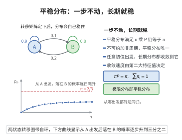

# Markov 链平稳分布

> **一句话大白话**：Markov 链有一条"不随时间走神"的稳态——只要初始按某个分布出发，之后每步都保持同样的分布；对良好（有限、不可约、非周期）的链，无论从哪开始，长期分布都会撞上这个唯一的平稳分布。
>
> **小例子**：转移矩阵 $\begin{pmatrix}0.9&0.1\\0.2&0.8\end{pmatrix}$ 的平稳分布 $\pi$ 满足 $\pi=\pi P$，解得 $\pi=(2/3,1/3)$，长期后链以 2/3 概率停在状态 1。

## 介绍

Markov 链的平稳分布（Stationary distribution）是概率分布 $\pi$，满足 $\pi P = \pi$，即从 $\pi$ 出发的 Markov 链在一步转移后分布不变。平稳分布刻画了 Markov 链的长期统计行为——当链达到平稳时，各状态的访问概率不再随时间变化。平稳分布的存在唯一性及其与极限分布的关系是 Markov 链理论的核心问题。

## 几何直观

图意在说明：满足 πP = π 的分布一步之后保持不变，且不可约非周期链的极限分布正是它。

## 分析

**前置依赖**：Markov 链定义、状态分类、常返性、周期性、非周期 Markov 链。

**定理内容**：设 $\{X_n\}$ 是离散时间 Markov 链，状态空间 $S$，转移矩阵 $P$。

**平稳分布的定义**：概率分布 $\pi = (\pi_i)_{i \in S}$ 满足 $\pi_j = \sum_{i \in S} \pi_i p_{ij}$ 对所有 $j$ 成立，即 $\pi = \pi P$。

**存在唯一性定理**：
- 若 Markov 链是不可约的（所有状态互通），则平稳分布要么不存在，要么唯一存在。
- 若 Markov 链是不可约常返的，则存在唯一的平稳分布 $\pi$，且 $\pi_i = 1/\mu_i$，其中 $\mu_i = E[T_i \mid X_0 = i]$ 是状态 $i$ 的平均返回时间。
- 若 Markov 链是不可约非周期常返的，则对任意初始分布，$\lim_{n\to\infty} p_{ij}^{(n)} = \pi_j$。

**细致平衡条件**：若存在 $\pi$ 使得 $\pi_i p_{ij} = \pi_j p_{ji}$ 对所有 $i,j$ 成立，则 $\pi$ 是平稳分布。这称为细致平衡条件，等价于 Markov 链是可逆的。

**数学内涵**：平稳分布的存在唯一性本质上由链的常返性决定。不可约常返链的平稳分布唯一，且由平均返回时间决定。对于有限不可约链，平稳分布总是存在唯一。

**证明策略**：通过构造平均访问频率来证明存在性。对常返链，定义 $\pi_i = \lim_{n\to\infty} \frac{1}{n}\sum_{k=1}^n 1_{\{X_k=i\}}$，然后证明 $\pi$ 满足平稳方程。

## 思考过程

平稳分布可以理解为 Markov 链在长时间运行后，各状态被访问的时间比例。对于不可约常返链，访问频率的极限就是平稳分布。

关键关系：
- 平稳分布 $\pi$ 满足 $\pi = \pi P$，即 $\pi$ 是转移矩阵 $P^T$ 的特征值为 1 的左特征向量。
- 对于不可约链，$\pi$ 唯一存在当且仅当链是正常返的（即平均返回时间有限）。
- 极限分布 $\lim_{n\to\infty} p_{ij}^{(n)}$ 存在且等于 $\pi_j$ 当且仅当链是非周期常返的。

## 证明过程

**定理**（平稳分布的存在唯一性）：设 $\{X_n\}$ 是不可约常返 Markov 链，则存在唯一的平稳分布 $\pi$，且 $\pi_i = 1/\mu_i$，其中 $\mu_i$ 是状态 $i$ 的平均返回时间。

**证明**：

**步骤 1**：构造平稳分布。固定状态 $r$，定义 $N_n(r) = \sum_{k=1}^n 1_{\{X_k = r\}}$。由常返性，以概率 1 有 $N_n(r) \to \infty$ 当 $n \to \infty$。定义
$$\pi_i = \lim_{n\to\infty} \frac{\sum_{k=1}^n 1_{\{X_k = i\}}}{\sum_{k=1}^n 1_{\{X_k = r\}}}$$
即 $i$ 的访问次数与 $r$ 的访问次数之比。由强大数定律，$\pi_i = E_i[\text{两次访问 } r \text{ 之间访问 } i \text{ 的次数}]$。

**步骤 2**：验证 $\pi$ 是概率分布。显然 $\pi_i \ge 0$，且 $\sum_i \pi_i = 1$。

**步骤 3**：验证 $\pi$ 满足平稳方程。由定义，
$$\pi_j = \sum_{i \in S} \pi_i p_{ij}$$
这可以通过考察访问次数的期望关系得到。

**步骤 4**：证明 $\pi_i = 1/\mu_i$。由定义，$\mu_i = E_i[T_i]$ 是返回时间。在两次访问 $i$ 之间，$\sum_k \pi_k = 1$ 且 $\pi_i$ 是访问 $i$ 的频率，故 $\pi_i = 1/\mu_i$。

**步骤 5**：唯一性。若 $\nu$ 是另一个平稳分布，则 $\nu = \nu P^n$ 对所有 $n$ 成立。由 $p_{ij}^{(n)} \to \pi_j$（在非周期情形下），得 $\nu_j = \sum_i \nu_i \lim_{n\to\infty} p_{ij}^{(n)} = \pi_j \sum_i \nu_i = \pi_j$。$\square$

**定理**（极限分布）：若 Markov 链是不可约非周期正常返的，则对任意 $i,j$，
$$\lim_{n\to\infty} p_{ij}^{(n)} = \pi_j$$
其中 $\pi$ 是唯一的平稳分布。

**证明**：利用耦合方法或 Perron–Frobenius 定理。核心思想是证明 $P^n$ 的每一行收敛到 $\pi$。$\square$

**推论**（有限不可约 Markov 链）：有限不可约 Markov 链的平稳分布存在唯一，且可以通过求解 $\pi P = \pi$ 和 $\sum \pi_i = 1$ 得到。

## 课堂问答

**老师**：$\pi P=\pi$ 到底在说什么？为什么它刻画"长期行为"？

**学生**：$\pi$ 是不动点：若某时刻分布是 $\pi$，下一步仍是 $\pi$，步步不变。它等价于 $\pi$ 是 $P^T$ 关于特征值 $1$ 的左特征向量。对有限不可约链，平稳分布存在唯一，且 $\pi_i=1/\mu_i$（$\mu_i$ 为状态 $i$ 的平均返回时间）；长期访问频率收敛到 $\pi$。

**老师（追问）**：存在性与唯一性各自靠什么？$p_{ij}^{(n)}\to\pi_j$ 是不是总成立？

**学生**：存在性靠常返性，用访问频率 $\pi_i=\lim_{n}\frac{\sum_{k\le n}1_{\{X_k=i\}}}{\sum_{k\le n}1_{\{X_k=r\}}}$ 构造，强大数定律保证极限；不可约时唯一。但极限分布要求更强：必须非周期，否则会振荡。例如二状态链 $P=\big(\begin{smallmatrix}0&1\\1&0\end{smallmatrix}\big)$ 的平稳分布是 $(1/2,1/2)$，可 $p_{11}^{(n)}$ 在 $0$ 与 $1$ 间跳动，并不收敛。常见误区：把"平稳分布存在"与"任意初始分布都收敛到它"混为一谈。

**老师（拓展）**：细致平衡 $\pi_ip_{ij}=\pi_jp_{ji}$ 与平稳是什么关系？

**学生**：细致平衡是更强的充分条件：两边对 $i$ 求和得 $\sum_i\pi_ip_{ij}=\pi_j\sum_ip_{ji}=\pi_j$，即 $\pi P=\pi$。它等价于链可逆（时间反演后同分布），为 Metropolis–Hastings 等构造给出直接求 $\pi$ 的办法。但可逆不是平稳的必要条件——存在不可逆却仍有平稳分布的链，例如三状态单向循环链。
