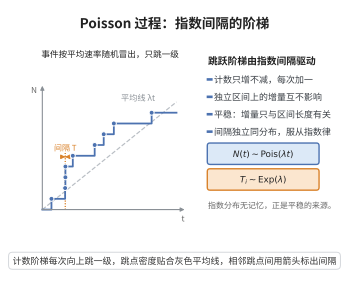

# Poisson 过程

> **一句话大白话**：一个"事件按固定平均速率、互不干扰地冒出来"的计数过程就叫做 Poisson 过程——电话打进客服、河水崩点，过去多久与未来多少次互不相干，间隔时间服从指数分布。
>
> **小例子**：$N(t)\sim \text{Pois}(\lambda t)$，单位区间内事件个数服从泊松；两次事件间隔 $T_i$ 独立同分布 $\mathrm{Exp}(\lambda)$，如平均每分钟 3 通电话则 $\lambda=3$，相邻两通间隔均值 $1/3$ 分钟。

## 介绍

Poisson 过程是随机过程理论中最基本和最重要的点过程之一，由法国数学家 Siméon Denis Poisson 在 1837 年发现。它描述了在时间或空间上随机独立发生的事件流，具有独立增量性和平稳增量性。Poisson 过程广泛应用于排队论、通信网络、粒子物理、保险精算和生物学等领域，是构建更复杂随机过程（如复合 Poisson 过程、Cox 过程）的基础。

## 几何直观

图意在说明：跳跃时刻的间隔独立且服从指数分布，计数因此在 t 时刻服从参数为 λt 的泊松分布。

## 分析

**前置依赖**：概率论基础、指数分布、Poisson 分布、独立增量过程、计数过程。

**定理内容**：计数过程 $\{N(t), t \ge 0\}$ 称为强度为 $\lambda > 0$ 的 Poisson 过程，若满足：
1. $N(0) = 0$。
2. 独立增量性：对任意不相交的时间区间，增量相互独立。
3. 平稳增量性：$N(t+s) - N(s)$ 的分布只依赖于 $t$。
4. $P(N(t+h) - N(t) = 1) = \lambda h + o(h)$。
5. $P(N(t+h) - N(t) \ge 2) = o(h)$。

**等价定义**：$N(t)$ 是强度为 $\lambda$ 的 Poisson 过程当且仅当：
- $N(t) \sim \text{Poisson}(\lambda t)$，即 $P(N(t) = k) = \frac{(\lambda t)^k}{k!} e^{-\lambda t}$。
- 它具有独立增量性。

**到达间隔时间**：设 $T_1, T_2, \dots$ 是相继到达间隔时间，则 $T_i$ 独立同分布，服从参数为 $\lambda$ 的指数分布：
$$P(T_i > t) = e^{-\lambda t},\quad t \ge 0$$

**等待时间**：第 $n$ 次到达的时间 $S_n = T_1 + \cdots + T_n$ 服从 Gamma 分布 $\text{Gamma}(n, \lambda)$，密度为
$$f_{S_n}(t) = \lambda \frac{(\lambda t)^{n-1}}{(n-1)!} e^{-\lambda t},\quad t \ge 0$$

**数学内涵**：Poisson 过程的核心性质是"无记忆性"——指数分布的缺乏记忆性使得 Poisson 过程具有 Markov 性。独立增量性和平稳增量性使得 Poisson 过程是一个 Lévy 过程。

**证明策略**：通过到达间隔时间指数分布的无记忆性，推导 Poisson 过程的计数分布。利用概率生成函数或微分方程方法证明 $N(t) \sim \text{Poisson}(\lambda t)$。

## 思考过程

Poisson 过程的定义有两种等价方式：一是通过计数过程的条件（独立增量、平稳增量、稀有事件假设），二是通过指数到达间隔时间。两种定义各有优势。

稀有事件条件 $P(N(h) = 1) = \lambda h + o(h)$ 和 $P(N(h) \ge 2) = o(h)$ 反映了在极短时间区间内，最多发生一次事件。这导致 $N(t)$ 服从 Poisson 分布，可以通过求解微分方程 $\frac{d}{dt}P(N(t)=k) = \lambda[P(N(t)=k-1)-P(N(t)=k)]$ 得到。

## 证明过程

**定理**（Poisson 过程的计数分布）：若 $\{N(t)\}$ 满足 Poisson 过程定义，则 $N(t) \sim \text{Poisson}(\lambda t)$。

**证明**：

**步骤 1**：建立微分方程。令 $p_n(t) = P(N(t) = n)$。由全概率公式和独立增量性，
$$p_0(t+h) = p_0(t)P(N(t+h)-N(t)=0) = p_0(t)(1 - \lambda h + o(h))$$
$$p_n(t+h) = p_n(t)(1-\lambda h) + p_{n-1}(t)\lambda h + o(h),\quad n \ge 1$$

**步骤 2**：取极限 $h \to 0$，
$$p_0'(t) = -\lambda p_0(t)$$
$$p_n'(t) = -\lambda p_n(t) + \lambda p_{n-1}(t),\quad n \ge 1$$

**步骤 3**：求解微分方程。初始条件 $p_0(0) = 1$，$p_n(0) = 0$（$n \ge 1$）。
$$p_0(t) = e^{-\lambda t}$$
对 $n=1$，$p_1'(t) = -\lambda p_1(t) + \lambda e^{-\lambda t}$，解得 $p_1(t) = \lambda t e^{-\lambda t}$。
归纳可得 $p_n(t) = \frac{(\lambda t)^n}{n!} e^{-\lambda t}$。$\square$

**定理**（到达间隔时间分布）：Poisson 过程的到达间隔时间 $T_1, T_2, \dots$ 独立同分布，服从 $\text{Exp}(\lambda)$。

**证明**：

**步骤 1**：$P(T_1 > t) = P(N(t) = 0) = e^{-\lambda t}$，故 $T_1 \sim \text{Exp}(\lambda)$。

**步骤 2**：由无记忆性和独立增量性，
$$P(T_2 > t \mid T_1 = s) = P(\text{在 } (s, s+t] \text{ 内无事件} \mid N(s) = 1) = P(N(t) = 0) = e^{-\lambda t}$$
故 $T_2$ 与 $T_1$ 独立同分布。归纳可得所有 $T_i$ 独立同分布 $\sim \text{Exp}(\lambda)$。$\square$

**推论**（叠加与分解）：
- **叠加**：两个独立 Poisson 过程（强度 $\lambda_1, \lambda_2$）的叠加是强度 $\lambda_1 + \lambda_2$ 的 Poisson 过程。
- **分解**：强度 $\lambda$ 的 Poisson 过程以概率 $p$ 独立标记每个事件，则标记事件和非标记事件分别构成强度 $\lambda p$ 和 $\lambda(1-p)$ 的独立 Poisson 过程。

## 课堂问答

**老师**：Poisson 过程为什么被"指数分布 + 独立增量"完全刻画？

**学生**：因为无记忆性。若 $T_1\sim\text{Exp}(\lambda)$，则 $P(T_1>t)=e^{-\lambda t}=P(N(t)=0)$；再由独立增量，$P(T_2>t\mid T_1=s)=P(N(s+t)-N(s)=0)=e^{-\lambda t}$，于是各 $T_i$ 独立同分布 $\text{Exp}(\lambda)$。反过来，由间隔分布就能重建计数分布 $N(t)\sim\text{Poisson}(\lambda t)$。

**老师（追问）**：$N(t)\sim\text{Poisson}(\lambda t)$ 怎么从微分方程得到？

**学生**：设 $p_n(t)=P(N(t)=n)$，用 $p_n(t+h)=p_n(t)(1-\lambda h)+p_{n-1}(t)\lambda h+o(h)$ 取极限得

$$p_n^{\prime}(t)=-\lambda p_n(t)+\lambda p_{n-1}(t),$$

配初值 $p_0(0)=1$、$p_n(0)=0$ 归纳解得 $p_n(t)=(\lambda t)^ne^{-\lambda t}/n!$。这用到了稀有事件条件 $P(N(h)=1)=\lambda h+o(h)$ 与 $P(N(h)\ge2)=o(h)$。

**老师（拓展）**：叠加与分解说明了什么？

**学生**：两个独立 Poisson 过程叠加仍是 Poisson 过程，强度相加；每个事件独立以概率 $p$ 标记后，两类事件分别是强度 $\lambda p$、$\lambda(1-p)$ 的独立 Poisson 过程。这体现 Poisson 过程的"可分性"，是排队网络分析的基石。常见误区：把 $\lambda t$ 只当作均值——对 $N(t)$ 而言均值与方差都等于 $\lambda t$，这是 Poisson 分布的特殊巧合，一般计数过程不具备。
