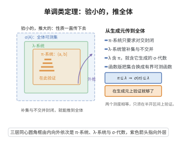

# 单调类定理

> **一句话大白话**：要证明"某个 σ-代数里的所有集合/函数都有性质 P"，不必逐个验证——只要在好验证的"小集合系"（代数或 $\pi$-系统）上验证 P，再检查 P 对递增并、递减交（或对逐点有界单调极限）封闭，P 就自动对全体成立。
>
> **小例子**：要证"对一切 Borel 集 $A$ 有 $\mu(A)=\nu(A)$"（两个概率测度相等），只需在半开区间 $(a,b]$ 这类集合上验证（它们构成 $\pi$-系统），再说明集合系 $\{A:\mu(A)=\nu(A)\}$ 对补集与不交并封闭即可——这就是 $\pi$-$\lambda$ 定理的典型用法。

## 介绍

测度论中大量的结论需要"对一切可测集"或"对一切有界可测函数"成立。逐点验证不可能；可行的策略是**先在一族结构简单的生成元上验证，再用封闭性把结论传播到整个 $\sigma$-代数/整个函数空间**。单调类定理（monotone class theorem）就是把这种传播机制抽象出来的三个标准定理：

1. **集合形式的单调类定理**：单调类若包含一个代数，就包含这个代数生成的 $\sigma$-代数；
2. **Dynkin 的 $\pi$-$\lambda$ 定理**：$\lambda$-系统若包含一个 $\pi$-系统，就包含后者生成的 $\sigma$-代数；
3. **函数形式的单调类定理**（functional monotone class theorem, HMMT）：向量空间若包含一个"生成整个 $\sigma$-代数的函数代数"并对逐点有界单调极限封闭，就包含一切有界可测函数。

三者的证明结构完全一致：**"最小的闭包类 = 生成的 $\sigma$-代数"**，只是"闭包类"的封闭性公理不同（单调类 / $\lambda$-系统 / 有界单调极限封闭的函数空间），因此真正的工作量集中在证明"最小的闭包类对有限交与补集封闭"这一步。

前两条在概率论与测度论中用于：证明测度相等（唯一性定理）、证明可测性、扩张定理；第三条是弱收敛理论（Portmanteau 定理）、条件期望、Markov 过程理论的通用工具。

## 几何直观

图意在说明：在半开区间这类生成元上验证性质，再用补集与不交并的封闭性一路外推到整个 σ-代数。

## 分析

**前置依赖**：$\sigma$-代数与生成的 $\sigma$-代数、代数（域）与 $\pi$-系统、$\lambda$-系统（Dynkin 系统）、单调类、可测函数与简单函数逼近、单调收敛定理与控制收敛定理、Weierstrass逼近定理。

**定理内容**：

**定理 A（单调类定理，集合形式）**：设 $\mathcal{A}\subseteq2^S$ 是 $S$ 上的**代数**（$S\in\mathcal{A}$，对有限并与补集封闭），$\mathcal{M}\subseteq2^S$ 是**单调类**（对递增并 $\bigcup_nA_n$ 与递减交 $\bigcap_nA_n$ 封闭）。若 $\mathcal{A}\subseteq\mathcal{M}$，则 $\sigma(\mathcal{A})\subseteq\mathcal{M}$。

**定理 B（Dynkin $\pi$-$\lambda$ 定理）**：设 $\mathcal{P}\subseteq2^S$ 是 $\pi$-系统（对有限交封闭），$\mathcal{D}\subseteq2^S$ 是 $\lambda$-系统（含 $S$，对补集封闭，对**可数不交并**封闭）。若 $\mathcal{P}\subseteq\mathcal{D}$，则 $\sigma(\mathcal{P})\subseteq\mathcal{D}$。

**定理 C（函数形式单调类定理）**：设 $\mathcal{A}$ 是 $S$ 上**有界实函数**的代数：$\mathcal{A}$ 是向量空间，含常数函数 $1$，且对逐点乘积封闭；又设 $\sigma(\mathcal{A})=\mathcal{F}$，其中 $\sigma(\mathcal{A})$ 是使 $\mathcal{A}$ 中一切函数可测的最小 $\sigma$-代数。设 $\mathcal{H}$ 是 $S$ 上有界实函数的向量空间，满足

- $\mathcal{A}\subseteq\mathcal{H}$；
- **有界单调极限封闭**：若 $f_n\in\mathcal{H}$，$|f_n|\le K$ 且 $f_n\uparrow f$ 逐点，则 $f\in\mathcal{H}$。

则 $\mathcal{H}$ 包含一切有界 $\mathcal{F}$-可测实函数。

**证明策略**：对 A、B 分别取"包含生成元的最小闭包类"，证明它其实是一个 $\sigma$-代数；关键是引入辅助类 $\mathcal{L}_B=\{A:A\cap B\in\mathcal{M}\ \text{等}\}$，验证它是同类型的闭包类，于是由最小性得到 $\mathcal{L}_B$ 就是整个闭包类，从而闭包类对有限交封闭。定理 C 的证明用"取最小的 $\mathcal{H}$"把 $\mathcal{H}$ 先做成对乘积封闭的代数，再用多项式与单调极限逼近，从元素 $f\in\mathcal{A}$ 造出一切 $\{f\ge t\}$ 的示性函数，最后归结为定理 B 加简单函数逼近。

## 思考过程

**共通骨架。** 设 $\mathcal{C}$ 是"包含给定生成元 $\mathcal{G}$ 的最小闭包类"（$\mathcal{C}=\bigcap\{\text{闭包类}\supseteq\mathcal{G}\}$，这个交仍是闭包类，故最小者存在）。若能证明 $\mathcal{C}$ 是 $\sigma$-代数，则 $\sigma(\mathcal{G})\subseteq\mathcal{C}$，而任何满足条件的闭包类都包含 $\mathcal{C}$，于是 $\sigma(\mathcal{G})\subseteq\mathcal{C}\subseteq$ 该闭包类，结论成立。所以**一切归结为证明 $\mathcal{C}$ 是 $\sigma$-代数**。

**补集与有限交从哪来？** 闭包类的公理里通常只有"并/交/不交并"这类单向封闭性，没有补集、交。技巧是"固定一个元素再让另一个跑动"：对 $B\in\mathcal{C}$ 定义

$$\mathcal{L}_B=\{A\in\mathcal{C}:A\cap B\in\mathcal{C},\ A\cup B\in\mathcal{C},\ A\setminus B\in\mathcal{C}\}\quad(\text{按需取舍}).$$

$\mathcal{L}_B$ 继承 $\mathcal{C}$ 的单调封闭性（因为 $A_n\cap B\uparrow A\cap B$ 等等），故 $\mathcal{L}_B$ 仍是闭包类。若 $B$ 属于生成元 $\mathcal{G}$，则 $\mathcal{G}\subseteq\mathcal{L}_B$（生成元自身对这些运算是封闭的），由最小性 $\mathcal{L}_B=\mathcal{C}$：这就证明了"$\mathcal{C}$ 中元素与生成元作交/并使然留在 $\mathcal{C}$ 中"。再把角色对调（把上面已得结论当作新的"生成元知识"）就能证明 $\mathcal{C}$ 自身对有限交封闭。最后配上补集（由 $S\in\mathcal{C}$ 与差集得到）与可数并，$\mathcal{C}$ 就是 $\sigma$-代数。

**定理 C 的独特困难：函数的代数只给出多项式封闭性，没有连续性。** $\mathcal{A}$ 对乘积封闭，意味着从 $g\in\mathcal{H}$ 出发只能免费得到多项式 $p(g)\in\mathcal{H}$。要得到示性函数 $1_{\{g\ge t\}}$，需要把"阶梯状"的函数用多项式从下方单调逼近——这一步由 Weierstrass 逼近定理加上"让误差以几何速率递减"的手腕完成：目标的连续阶梯函数与多项式之差可任意小，选择误差 $\eta_m$ 满足 $\eta_{m+1}\le\frac12\eta_m$，就能强迫逼近多项式序列单调，从而落进 $\mathcal{H}$ 的有界单调极限封闭性之中。

## 证明过程

### 一、定理 A（单调类定理）

设 $\mathcal{C}$ 是包含 $\mathcal{A}$ 的最小单调类（即所有包含 $\mathcal{A}$ 的单调类之交，它仍是单调类且含 $\mathcal{A}$）。只需证 $\mathcal{C}$ 是 $\sigma$-代数，因为那时 $\sigma(\mathcal{A})\subseteq\mathcal{C}\subseteq\mathcal{M}$。

**步骤 1：固定 $B\in\mathcal{A}$ 的辅助类。** 对 $B\in\mathcal{A}$ 令

$$\mathcal{L}_B=\{A\in\mathcal{C}:\ A\cup B\in\mathcal{C},\ A\cap B\in\mathcal{C},\ A\setminus B\in\mathcal{C}\}.$$

**$\mathcal{L}_B$ 是单调类**：若 $A_n\in\mathcal{L}_B$ 且 $A_n\uparrow A$，则 $A_n\cup B\uparrow A\cup B$、$A_n\cap B\uparrow A\cap B$、$A_n\setminus B\uparrow A\setminus B$，这些极限都在 $\mathcal{C}$ 中（$\mathcal{C}$ 是单调类），且 $A\in\mathcal{C}$，故 $A\in\mathcal{L}_B$；递减交同理。又 $\mathcal{A}\subseteq\mathcal{L}_B$：因为 $\mathcal{A}$ 是代数，对 $A,B\in\mathcal{A}$ 有 $A\cup B,A\cap B,A\setminus B\in\mathcal{A}\subseteq\mathcal{C}$，且 $A\in\mathcal{C}$。由 $\mathcal{C}$ 的最小性，$\mathcal{L}_B=\mathcal{C}$。

结论：**对一切 $A\in\mathcal{C}$ 与 $B\in\mathcal{A}$，$A\cup B,A\cap B,A\setminus B\in\mathcal{C}$。**

**步骤 2：对调角色。** 固定 $A\in\mathcal{C}$，令

$$\mathcal{L}_A=\{B\in\mathcal{C}:\ B\cup A\in\mathcal{C},\ B\cap A\in\mathcal{C},\ B\setminus A\in\mathcal{C}\}.$$

同样 $\mathcal{L}_A$ 是单调类，且由步骤 1，$\mathcal{A}\subseteq\mathcal{L}_A$（步骤 1 对一切 $B\in\mathcal{A}$、$A\in\mathcal{C}$ 成立）。由最小性 $\mathcal{L}_A=\mathcal{C}$。

结论：**$\mathcal{C}$ 对有限并、有限交、差集封闭。**

**步骤 3：$\mathcal{C}$ 是 $\sigma$-代数。** $\mathcal{A}$ 是代数故 $S\in\mathcal{A}\subseteq\mathcal{C}$；于是对 $A\in\mathcal{C}$，$A^c=S\setminus A\in\mathcal{C}$。再由 $\mathcal{C}$ 是单调类，递增并封闭，而任意可数并 $\bigcup_nA_n$ 可写成递增并 $\bigcup_n(A_1\cup\dots\cup A_n)$，由有限并封闭性可知它属于 $\mathcal{C}$，故 $\mathcal{C}$ 对可数并封闭。因此 $\mathcal{C}$ 是含 $\mathcal{A}$ 的 $\sigma$-代数，故 $\sigma(\mathcal{A})\subseteq\mathcal{C}\subseteq\mathcal{M}$。定理 A 得证。$\square$

### 二、定理 B（Dynkin $\pi$-$\lambda$ 定理）

设 $\mathcal{C}$ 是包含 $\mathcal{P}$ 的最小 $\lambda$-系统。先记录一条**基本事实**：若 $A,B\in\mathcal{C}$ 且 $A\subseteq B$，则 $B\setminus A\in\mathcal{C}$，因为

$$B\setminus A=(B^c\cup A)^c,$$

而 $B^c$ 与 $A$ 不交，其并属于 $\mathcal{C}$（$\lambda$-系统对可数不交并封闭），再取补集仍在 $\mathcal{C}$ 中。

**步骤 1：固定 $B\in\mathcal{P}$。** 令

$$\mathcal{L}_B=\{A\in\mathcal{C}:\ A\cap B\in\mathcal{C}\}.$$

**$\mathcal{L}_B$ 是 $\lambda$-系统**：

- $S\cap B=B\in\mathcal{C}$，故 $S\in\mathcal{L}_B$；
- 若 $A\in\mathcal{L}_B$，则 $A\cap B\subseteq B$，且 $A\cap B,\,B\in\mathcal{C}$，由基本事实 $A^c\cap B=B\setminus(A\cap B)\in\mathcal{C}$，故 $A^c\in\mathcal{L}_B$；
- 若 $A_n\in\mathcal{L}_B$ 两两不交，则 $A_n\cap B$ 也两两不交，其并属于 $\mathcal{C}$，而 $(\bigcup_nA_n)\cap B=\bigcup_n(A_n\cap B)$，故 $\bigcup_nA_n\in\mathcal{L}_B$。

又 $\mathcal{P}\subseteq\mathcal{L}_B$（因 $\mathcal{P}$ 是 $\pi$-系统，$A\cap B\in\mathcal{P}\subseteq\mathcal{C}$），由 $\mathcal{C}$ 的最小性 $\mathcal{L}_B=\mathcal{C}$。

结论：**对一切 $A\in\mathcal{C}$ 与 $B\in\mathcal{P}$，$A\cap B\in\mathcal{C}$。**

**步骤 2：对调角色。** 固定 $A\in\mathcal{C}$，令 $\mathcal{L}_A=\{B\in\mathcal{C}:A\cap B\in\mathcal{C}\}$。同上它是 $\lambda$-系统，且由步骤 1 有 $\mathcal{P}\subseteq\mathcal{L}_A$，故 $\mathcal{L}_A=\mathcal{C}$。

结论：**$\mathcal{C}$ 对有限交封闭。**

**步骤 3：$\mathcal{C}$ 是 $\sigma$-代数。** 由 $\mathcal{P}$ 是 $\pi$-系统，$\pi$-系统中的元素之并：对 $A,B\in\mathcal{C}$，由基本事实与有限交封闭性，

$$A\cup B=(A^c\cap B^c)^c,\qquad A\cap B\in\mathcal{C}\Rightarrow (A\cap B)^c\in\mathcal{C},\ \text{故}\ A\cup B\in\mathcal{C},$$

即 $\mathcal{C}$ 对有限并封闭。任意可数并 $\bigcup_nA_n$ 可改写为不交并 $\bigcup_n\big(A_n\setminus(A_1\cup\dots\cup A_{n-1})\big)$，由有限并与差集封闭性每一项属于 $\mathcal{C}$，故可数并属于 $\mathcal{C}$。结合补集封闭与 $S\in\mathcal{C}$，$\mathcal{C}$ 是 $\sigma$-代数。因此 $\sigma(\mathcal{P})\subseteq\mathcal{C}\subseteq\mathcal{D}$。定理 B 得证。$\square$

### 三、定理 C（函数形式单调类定理）

**步骤 1：不妨设 $\mathcal{H}$ 最小。** 设 $\mathcal{H}_0$ 为一切满足定理假设的类之交：即所有"含 $\mathcal{A}$、是有界函数向量空间、对有界单调极限封闭"的类的交。$\mathcal{H}_0$ 仍满足这些条件且 $\mathcal{A}\subseteq\mathcal{H}_0$。只需对 $\mathcal{H}_0$ 证明结论，因为任何满足假设的 $\mathcal{H}$ 都包含 $\mathcal{H}_0$。故以下记 $\mathcal{H}:=\mathcal{H}_0$。

**步骤 2：$\mathcal{H}$ 对乘积封闭。** 固定 $g\in\mathcal{A}$，令

$$\mathcal{H}_g=\{h\in\mathcal{H}:\ gh\in\mathcal{H}\}.$$

$\mathcal{H}_g$ 是向量空间：若 $h_1,h_2\in\mathcal{H}_g$，则 $g(h_1+h_2)=gh_1+gh_2\in\mathcal{H}$。$\mathcal{H}_g$ 对有界单调极限封闭：若 $h_n\in\mathcal{H}_g$、$|h_n|\le K$、$h_n\uparrow h$，则 $gh_n\to gh$ 单调且 $|gh_n|\le\|g\|_\infty K$，故 $gh\in\mathcal{H}$，即 $h\in\mathcal{H}_g$。又 $\mathcal{A}\subseteq\mathcal{H}_g$（$\mathcal{A}$ 对乘积封闭，且 $\mathcal{A}\subseteq\mathcal{H}$）。由 $\mathcal{H}$ 的最小性，$\mathcal{H}_g=\mathcal{H}$。

于是固定 $h\in\mathcal{H}$，令 $\mathcal{H}'_h=\{g\in\mathcal{H}:gh\in\mathcal{H}\}$。同上它是含 $\mathcal{A}$ 的、对有界单调极限封闭的向量空间，故 $\mathcal{H}'_h=\mathcal{H}$。因此**$\mathcal{H}$ 对逐点乘积封闭**，从而是含 $1$ 的有界函数代数。

**步骤 3：$\mathcal{H}$ 对连续函数复合封闭（一个引理）。**

**引理**：设 $g\in\mathcal{H}$，$|g|\le K$，$h$ 是 $\mathbb R$ 上局部一致有界的函数。若 $h$ 在 $[-K,K]$ 上是某个**一致有界且单调**（增或减）的**多项式序列** $p_m$ 的逐点极限，则 $h\circ g\in\mathcal{H}$。

**引理的证明**：每个 $p_m$ 是多项式，由步骤 2 与向量空间性质 $p_m\circ g\in\mathcal{H}$；$\|p_m\circ g\|_\infty=\sup_{[-K,K]}|p_m|\le M$ 一致有界；$p_m\circ g$ 单调收敛到 $h\circ g$。由有界单调极限封闭性，$h\circ g\in\mathcal{H}$。

**引理的两个应用**：对紧区间上的连续函数 $h$，存在一致有界的**单调递增**多项式序列收敛到 $h$。事实上取 $\eta_m\downarrow0$ 满足 $\eta_{m+1}<\frac12\eta_m$，并（由 Weierstrass 逼近定理）取多项式 $p_m$ 使 $\|p_m-(h-\eta_m)\|_\infty<\eta_m/4$，则 $|p_m-h|\le\frac54\eta_m$ 且 $p_m\le h-\frac34\eta_m<h-\frac34\eta_{m+1}\le p_{m+1}$，即 $p_m$ 递增、一致有界、逐点收敛到 $h$。类似地取 $h+\eta_m$ 得到单调递减的多项式序列。因此**$\mathcal{H}$ 对与紧区间上连续函数的复合封闭**。

特别地，对 $g_1,g_2\in\mathcal{H}$，$|g_1-g_2|\in\mathcal{H}$（复合连续函数 $t\mapsto|t|$），从而

$$\max(g_1,g_2)=\frac{g_1+g_2+|g_1-g_2|}{2}\in\mathcal{H},\qquad \min(g_1,g_2)\in\mathcal{H}.$$

**步骤 4：$\mathcal{H}$ 含一切示性函数 $1_{\{f\ge t\}}$（$f\in\mathcal{A}$，$t\in\mathbb R$）。**

设 $f\in\mathcal{A}$，$|f|\le K$，$t\in\mathbb R$，令 $\theta:=t$ 并把 $[-K,K]$ 平移缩放；不妨设 $-K\le t\le K$。阶梯函数 $\phi_m(x)=\max\big(0,\min(1,m(x-t))\big)$ 满足 $0\le\phi_m\le1$ 且 $\phi_m\uparrow1_{[t,\infty)}$（在 $x<t$ 处为 $0$，在 $x\ge t$ 处为 $1$；逐点递增）。

对每个固定的 $m$，$\phi_m$ 在 $[-K,K]$ 上连续，故由步骤 3 的引理**若**有单调多项式逼近即可得 $\phi_m\circ f\in\mathcal{H}$；为一次性处理，改用下述构造：取 $\eta_m\downarrow0$ 满足 $\eta_{m+1}<\frac12\eta_m$；对每个 $m$ 由 Weierstrass 定理取多项式 $q_m$ 使

$$\big\|q_m-(\phi_m-\eta_m)\big\|_{[-K,K]}<\frac{\eta_m}{4}.$$

则 $q_m\le\phi_m-\frac34\eta_m<\phi_m$，$|q_m|\le2$，且 $q_m\le q_{m+1}$（因为 $q_m\le\phi_m-\frac34\eta_m$ 而 $q_{m+1}\ge\phi_{m+1}-\frac54\eta_{m+1}\ge\phi_m-\frac58\eta_m$）。于是 $q_m\circ f\in\mathcal{H}$ 是**一致有界且递增**的序列，其逐点极限为 $1_{[t,\infty)}\circ f=1_{\{f\ge t\}}$。由有界单调极限封闭性，

$$1_{\{f\ge t\}}\in\mathcal{H}\qquad(f\in\mathcal{A},\ t\in\mathbb R).$$

**步骤 5：$\mathcal{K}=\{A:1_A\in\mathcal{H}\}$ 是含 $\sigma(\mathcal{A})$ 的 $\sigma$-代数。**

- $S\in\mathcal{K}$：$1_S=1\in\mathcal{A}\subseteq\mathcal{H}$。
- 补集：若 $A\in\mathcal{K}$，$1_{A^c}=1-1_A\in\mathcal{H}$（向量空间），故 $A^c\in\mathcal{K}$。
- 有限交：若 $A,B\in\mathcal{K}$，$1_{A\cap B}=1_A1_B\in\mathcal{H}$（步骤 2 的乘积封闭性），故 $A\cap B\in\mathcal{K}$。
- 可数并：若 $A_n\in\mathcal{K}$ 递增，则 $1_{A_n}\uparrow1_{\bigcup A_n}$ 且一致有界，故 $\bigcup_nA_n\in\mathcal{K}$；一般可数并由有限交/补集化为递增并（$\bigcup_nA_n=\bigcup_n(A_1\cup\dots\cup A_n)$），故可数并封闭。

因此 $\mathcal{K}$ 是 $\sigma$-代数。又由步骤 4，对 $f\in\mathcal{A}$ 与 $t\in\mathbb R$ 有 $f^{-1}([t,\infty))\in\mathcal{K}$，故 $\mathcal{A}$ 中一切函数关于 $\mathcal{K}$ 可测，即 $\sigma(\mathcal{A})\subseteq\mathcal{K}$。于是

$$1_A\in\mathcal{H}\qquad\text{对一切 }A\in\mathcal{F}=\sigma(\mathcal{A}).$$

**步骤 6：一切有界可测函数。** 由步骤 5 与向量空间性质，$\mathcal{H}$ 含一切 $\mathcal{F}$-可测的有限值简单函数 $\sum_ka_k1_{A_k}$。设 $f$ 有界 $\mathcal{F}$-可测且 $f\ge0$，则

$$f=\lim_{m\to\infty}\uparrow\ \sum_{k=1}^{m2^m}\frac{k-1}{2^m}\,1_{\{f\ge (k-1)/2^m\}}$$

是一个一致有界（不超过 $\|f\|_\infty$）的**递增**简单函数序列的逐点极限，每一项属于 $\mathcal{H}$，故 $f\in\mathcal{H}$。一般有界可测 $f$ 写成 $f=f^+-f^-$，两者都属于 $\mathcal{H}$，故 $f\in\mathcal{H}$。定理 C 得证。$\square$

**说明**：定理 A 与定理 B 是等价的两种表述（一个代数既是 $\pi$-系统、其单调类封闭性也蕴含 $\lambda$-系统封闭性），实际使用中：需要验证集合的测度相等时用 B（因为"不交并"和"补集"最易验证），需要处理递增逼近时用 A，需要验证函数空间的收敛性时用 C。

## 课堂问答

**老师**：为什么证明"对一切 Borel 集成立"可以只在少数生成元上验证？

**学生**：因为有"最小闭包类 = 生成 $\sigma$-代数"的骨架。设 $\mathcal C$ 是含生成元 $\mathcal G$ 的最小闭包类；只要能证明 $\mathcal C$ 本身是 $\sigma$-代数，则 $\sigma(\mathcal G)\subseteq\mathcal C\subseteq$ 任一满足条件的闭包类，结论便传播出去。集合形式（定理 A）、Dynkin $\pi$-$\lambda$（定理 B）、函数形式（定理 C）三个版本共用这一骨架，区别只在闭包公理不同。

**老师（追问）**：闭包类没有交集公理，怎么把它补成 $\sigma$-代数？

**学生**：用"固定一个元素、再让另一个跑动"。对 $B$ 令 $\mathcal L_B=\{A\in\mathcal C:A\cap B,\ A\cup B,\ A\setminus B\in\mathcal C\}$。$\mathcal L_B$ 继承 $\mathcal C$ 的单调封闭性，仍是闭包类；当 $B$ 属于生成元时 $\mathcal G\subseteq\mathcal L_B$，由最小性 $\mathcal L_B=\mathcal C$；再对调角色即得 $\mathcal C$ 对有限交/并封闭，配上补集就成了 $\sigma$-代数。

**老师（拓展）**：函数形式为何最难？Weierstrass 逼近在哪里登场？

**学生**：定理 C 中 $\mathcal A$ 只对乘积封闭，从 $g$ 出发只能免费得到多项式 $p(g)$；要造出示性函数 $1_{\{g\ge t\}}$，需要把阶梯函数用多项式单调逼近。取误差 $\eta_m\downarrow0$ 且 $\eta_{m+1}\le\tfrac12\eta_m$，配合 Weierstrass 定理取 $q_m$ 逼近 $\phi_m-\eta_m$，即得一致有界的递增多项式序列，落进 $\mathcal H$ 的有界单调极限封闭性。常见误区：以为需要连续性假设——恰恰相反，连续性是用多项式逼近"挣"出来的。

## 相关条目

- [Portmanteau定理](./Portmanteau定理.md)：其"有界一致连续函数收敛 $\Rightarrow$ 有界连续函数收敛"一步由定理 C 完成。
- [紧性准则](./紧性准则.md)：Prokhorov 定理中用函数形式单调类定理把可数决定类上的收敛推广到 $C_b(S)$。
- [Kolmogorov扩张定理](./Kolmogorov扩张定理.md)：有限维分布族的相容性与生成 $\sigma$-代数的论证依赖 $\pi$-$\lambda$ 定理。
