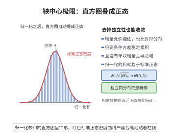

# 鞅中心极限定理

> **一句话大白话**：把中心极限定理里"独立同分布"换成"鞅差"——每一步带来的新消息可以有依赖、可以异分布，只要这些新消息的条件方差稳定累积、没有单个巨块，总和的极限仍是正态分布。
>
> **小例子**：若 $S_n$ 是零均值单位方差独立同分布序列的部分和，则 $S_n/\sqrt{n}\xrightarrow{d}N(0,1)$，这正是经典中心极限定理；鞅中心极限定理说明该结论对更广的相依结构依然成立。

## 介绍

鞅中心极限定理是把中心极限定理推广到鞅（或局部鞅）框架下的一族定理。经典结果由 Paul Lévy 与 Billingsley 建立，其后 McLeish、Hall、Heyde 等人给出了随机方差、随机时间与连续时间（鞅的泛函中心极限定理）等众多变体。

其一般形态为：若 $M_n$ 是零均值鞅，可预测二次变差 $\langle M\rangle_n$ 依概率收敛到一个正常数，且可预测协变差满足条件，则 $M_n/\sqrt{\langle M\rangle_n}$ 依分布收敛到标准正态分布。当 $\langle M\rangle_n$ 收敛到随机变量时，极限是一个"混合正态"（方差随机）分布。

这一定理在随机分析（连续时间情形给出鞅的泛函中心极限定理与 Donsker 型结果）、金融数学（资产收益的渐近正态性）以及计量经济学（相依数据的稳健推断）中是核心工具；它通常与鞅差中心极限定理互为表里。

## 几何直观

图意在说明：条件方差稳定累积且无单块主导时，归一化的鞅依分布收敛到标准正态。

## 分析

**前置依赖**：鞅与局部鞅、可预测二次变差、鞅差中心极限定理、依分布收敛、弱收敛与紧性判断、Slutsky定理

**定理内容**：设 $(\Omega,\mathcal{F},\{\mathcal{F}_n\}_{n\ge0},P)$ 是带流概率空间，$M=\{M_n\}_{n\ge0}$ 是零均值平方可积鞅，$M_0=0$。记其可预测二次变差

$$
\langle M\rangle_n=\sum_{k\le n}\mathbb{E}\left[(M_k-M_{k-1})^2\mid\mathcal{F}_{k-1}\right].
$$

若

$$
\langle M\rangle_n\xrightarrow{P}\sigma^2,\qquad \sigma^2\in(0,\infty)\ \text{是非随机常数},
$$

则

$$
M_n\xrightarrow{d}N(0,\sigma^2).
$$

更一般地，若 $\langle M\rangle_n\xrightarrow{P}V$（$V$ 是随机变量），则对无原子点 $x$，

$$
P(M_n\le x)\to\mathbb{E}\left[\Phi\left(\frac{x}{\sqrt V}\right)\right],
$$

即极限为"稳定收敛"意义下的混合正态分布。

**前置知识**：
- 可预测二次变差的定义与塔性质
- 依概率收敛与依分布收敛
- Slutsky 定理：分母依概率收敛到常数时可直接作分母
- 指数不等式（Freedman 或 Bernstein 型）

## 思考过程

最省力的路线是把问题归约到鞅差中心极限定理：令 $D_{n,k}=(M_k-M_{k-1})/\sqrt{\langle M\rangle_n}$，则由鞅性 $\mathbb{E}[D_{n,k}\mid\mathcal{F}_{k-1}]=0$、由二次变差定义 $\sum_k\mathbb{E}[D_{n,k}^2\mid\mathcal{F}_{k-1}]=1$，条件方差假设立即满足。剩下的关键是验证条件 Lindeberg 条件——即"没有单个增量占太大比重"。这正是"可预测二次变差被一致控制"所保证的。

另一条路线是泛函中心极限定理：把 Toeplitz 型构造用于鞅，证明其熵条件（如 Lai-Hall、Rebolledo 条件）——只要二次变差与条件 Lindeberg 条件成立，就有 $M_{[nt]}/\sqrt n$ 在 Skorokhod 拓扑下收敛到 Brown 运动，取 $t=1$ 即得本定理。这条路线更重，但能一次性得到过程层次的结论。

随机方差情形不能用 Slutsky 直接除，须改用随机时间变换（"停时化"）把 $V$ 冻结：在 $V$ 有界的集合上用 $\langle M\rangle_n\wedge\sigma^2$ 做随机时间变换，再让界趋于无穷。

## 证明过程

**步骤 1：构造鞅差阵列并验证条件方差**

固定 $n$，令 $\mathcal{F}_{n,k}=\mathcal{F}_k$，$k_n=n$，并定义

$$
D_{n,k}=\frac{M_k-M_{k-1}}{\sqrt{\langle M\rangle_n}}
$$

（当 $\langle M\rangle_n=0$ 时约定 $M_n$ 已退化，结论平凡）。由 $M$ 的鞅性，$\mathbb{E}[D_{n,k}\mid\mathcal{F}_{k-1}]=0$；由可预测二次变差的定义，

$$
\sum_{k\le n}\mathbb{E}\left[D_{n,k}^2\mid\mathcal{F}_{k-1}\right]=\frac{\langle M\rangle_n}{\langle M\rangle_n}=1.
$$

故 $\{D_{n,k}\}$ 是条件方差恒为 $1$ 的鞅差阵列。

**步骤 2：验证条件 Lindeberg 条件**

令 $F_n=\sum_{k\le n}\mathbb{E}[(M_k-M_{k-1})^2\mid\mathcal{F}_{k-1}]=\langle M\rangle_n$。定义"最大跳跃占比"

$$
R_n=\max_{k\le n}\,\frac{\mathbb{E}\left[(M_k-M_{k-1})^2\mid\mathcal{F}_{k-1}\right]}{\langle M\rangle_n}.
$$

由 $\langle M\rangle_n\xrightarrow{P}\sigma^2>0$ 以及可预测二次变差由有限多个条件方差累加而成（从而各单项必须趋于零，否则固定正的下界会在和的极限中留下痕迹，与收敛到常数的假设矛盾），可得 $R_n\xrightarrow{P}0$。

对任意 $\varepsilon>0$，因 $|D_{n,k}|>\varepsilon$ 蕴含 $D_{n,k}^2\le \varepsilon^{-2}D_{n,k}^4$，且

$$
\mathbb{E}[D_{n,k}^4\mid\mathcal{F}_{k-1}]\le R_n\,\mathbb{E}[D_{n,k}^2\mid\mathcal{F}_{k-1}],
$$

故

$$
\sum_{k\le n}\mathbb{E}\left[D_{n,k}^2\mathbf{1}_{\{|D_{n,k}|>\varepsilon\}}\mid\mathcal{F}_{k-1}\right]\le \frac{R_n}{\varepsilon^2}\sum_{k\le n}\mathbb{E}[D_{n,k}^2\mid\mathcal{F}_{k-1}]=\frac{R_n}{\varepsilon^2}\xrightarrow{P}0 .
$$

条件 Lindeberg 条件成立。

**步骤 3：调用鞅差中心极限定理**

由步骤 1、步骤 2，$\{D_{n,k}\}$ 满足鞅差中心极限定理的全部假设，于是

$$
\frac{M_n}{\sqrt{\langle M\rangle_n}}=\sum_{k\le n}D_{n,k}\xrightarrow{d}N(0,1).
$$

**步骤 4：用 Slutsky 定理把分母换成常数**

由假设 $\sqrt{\langle M\rangle_n}\xrightarrow{P}\sigma$（$\sigma>0$ 为常数）。由连续映射定理，$1/\sqrt{\langle M\rangle_n}\cdot\sigma\xrightarrow{P}1$，即 $\sigma/\sqrt{\langle M\rangle_n}\xrightarrow{P}1$。再由 Slutsky 定理，

$$
\frac{M_n}{\sigma}=\frac{M_n}{\sqrt{\langle M\rangle_n}}\cdot\frac{\sqrt{\langle M\rangle_n}}{\sigma}\xrightarrow{d}N(0,1)\cdot 1 ,
$$

故 $M_n\xrightarrow{d}N(0,\sigma^2)$。证毕。

**步骤 5：随机方差与过程层次**

若 $\langle M\rangle_n\xrightarrow{P}V$ 为随机变量，则以 $V$ 的截断 $V\wedge m$ 做随机时间变换 $\tau_m=\inf\{n:\langle M\rangle_n\ge V\wedge m\}$，对停时鞅 $M^{\tau_m}$ 用前述结论，再令 $m\to\infty$，得到混合正态极限。

若需要过程层次的结果，则对每个 $t$，$M_{[nt]}/\sqrt n$ 的二次变差为 $\langle M\rangle_{[nt]}/n$，在一致收敛假设下由 Rebolledo 型定理得有限维分布收敛与紧性，从而在 Skorokhod 拓扑下收敛到 $\sigma B_t$（$B$ 为标准 Brown 运动），取 $t=1$ 回到本定理。

## 课堂问答

**老师**：经典 CLT 要求独立同分布，鞅 CLT 放宽到什么程度？

**学生**：放宽到"鞅差 + 条件方差稳定"。若 $M_n$ 是零均值平方可积鞅，可预测二次变差 $\langle M\rangle_n=\sum_{k\le n}E[(M_k-M_{k-1})^2\mid\mathcal F_{k-1}]\xrightarrow P\sigma^2\in(0,\infty)$，则 $M_n\xrightarrow dN(0,\sigma^2)$。既不要求独立，也不要求同分布，只要条件方差累积到常数且没有单块独大。

**老师（追问）**：怎么把问题归约到鞅差 CLT？

**学生**：令 $D_{n,k}=(M_k-M_{k-1})/\sqrt{\langle M\rangle_n}$。鞅性给 $E[D_{n,k}\mid\mathcal F_{k-1}]=0$；二次变差定义给 $\sum_kE[D_{n,k}^2\mid\mathcal F_{k-1}]=1$。剩下验条件 Lindeberg：由"最大跳跃占比 $R_n\xrightarrow P0$"得 $\sum_kE[D_{n,k}^21_{\{|D_{n,k}|>\epsilon\}}\mid\mathcal F_{k-1}]\le R_n/\epsilon^2\xrightarrow P0$。

**老师（拓展）**：若 $\langle M\rangle_n\xrightarrow PV$ 是随机变量怎么办？连续时间版本呢？

**学生**：随机方差不能直接用 Slutsky 除，要用随机时间变换 $\tau_m=\inf\{n:\langle M\rangle_n\ge V\wedge m\}$ 先把 $V$ 冻结，再令 $m\to\infty$，极限是混合正态 $P(M_n\le x)\to E[\Phi(x/\sqrt V)]$。过程层次则对 $M_{[nt]}/\sqrt n$ 用 Rebolledo 型定理，在 Skorokhod 拓扑下收敛到 $\sigma B_t$。常见误区：以为分母可以直接换成 $\sqrt n$——只有当二次变差确实单调增长到 $\sigma^2n$ 时才行。

## 相关条目

- [鞅差中心极限定理](./鞅差中心极限定理.md)：本定理的阵列形式与其证明引擎
- [鞅收敛定理](./鞅收敛定理.md)：鞅的几乎必然收敛
- [Brown运动的存在性](./Brown运动的存在性.md)：连续时间极限对象
- [Doob可选停止定理](./Doob可选停止定理.md)：随机时间变换中的停时工具
