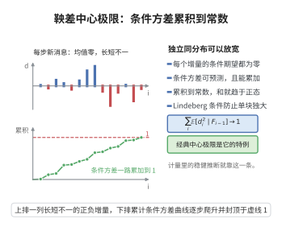

# 鞅差中心极限定理

> **一句话大白话**：独立同分布并不是中心极限定理的必要条件——只要每步的"新信息"（鞅差）大小可控、条件方差稳定累积，总和照样乖乖变成正态。
>
> **小例子**：对独立同分布零均值单位方差序列，$D_i=X_i-\mathbb{E}[X_i\mid\mathcal{F}_{i-1}]=X_i$，条件方差恒为 $1$，定理退化为经典的 Lindeberg-Lévy 中心极限定理。

## 介绍

鞅差中心极限定理（Martingale Difference Central Limit Theorem）是把经典中心极限定理从"独立同分布"推广到"鞅差阵列"的结论，其最基本的形式由 Paul Lévy 提出，后经 Billingsley、McLeish 等人发展为适合相依序列的通用工具。

它在统计与计量经济学中尤其重要：最小二乘估计、广义矩估计、生存分析中的得分函数等，往往既非独立也非同分布，但其增量在条件期望意义下是"公平"的——这正好是鞅差结构。因而鞅差中心极限定理成为证明这些估计量渐近正态性的标准引擎。

## 几何直观

图意在说明：增量虽相依异分布，只要条件方差可预测地累积成常数，总和就趋于正态。

## 分析

**前置依赖**：条件期望与鞅、鞅差阵列、依分布收敛、Lindeberg 条件、Slutsky定理、Borel-Cantelli 引理

**定理内容**：设 $\{D_{n,i}\}_{1\le i\le k_n}$ 是概率空间 $(\Omega,\mathcal{F},P)$ 上的鞅差阵列，即对递增的 $\sigma$-代数流 $\{\mathcal{F}_{n,i}\}$ 有 $\mathbb{E}[D_{n,i}\mid\mathcal{F}_{n,i-1}]=0$ 几乎必然。记

$$
X_{n,i}=\sum_{j\le i}D_{n,j},\qquad S_n=X_{n,k_n}=\sum_{i\le k_n}D_{n,i}.
$$

若下列条件成立：

1. 条件方差收敛：$\sum_{i\le k_n}\mathbb{E}[D_{n,i}^2\mid\mathcal{F}_{n,i-1}]\xrightarrow{P}\sigma^2\in(0,\infty)$；
2. 条件 Lindeberg 条件：对任意 $\varepsilon>0$，

$$
\sum_{i\le k_n}\mathbb{E}\left[D_{n,i}^2\mathbf{1}_{\{|D_{n,i}|>\varepsilon\}}\mid\mathcal{F}_{n,i-1}\right]\xrightarrow{P}0,
$$

则 $S_n\xrightarrow{d}N(0,\sigma^2)$。

**前置知识**：
- 鞅差：$\mathbb{E}[D_{n,i}\mid\mathcal{F}_{n,i-1}]=0$ 且 $D_{n,i}$ 关于 $\mathcal{F}_{n,i}$ 可测
- 鞅差的正交性：$i\ne j$ 时 $\mathbb{E}[D_{n,i}D_{n,j}]=0$
- Lévy 连续性定理：特征函数逐点收敛蕴含依分布收敛

## 思考过程

证明的核心是"用条件方差替代独立同分布中的方差"，并把独立性在特征函数乘积中的角色换成条件期望的迭代。对特征函数展开：

$$
\mathbb{E}\left[e^{itS_n}\right]=\mathbb{E}\left[\prod_{i\le k_n}\mathbb{E}\left[e^{itD_{n,i}}\mid\mathcal{F}_{n,i-1}\right]\right],
$$

这依赖塔性质，不需要独立性。对每个条件期望做二阶 Taylor 展开，主项贡献 $1-t^2\mathbb{E}[D_{n,i}^2\mid\mathcal{F}_{n,i-1}]/2$，并把高阶余项用条件 Lindeberg 条件压掉。最后把乘积取对数、用条件方差收敛把 $\sum$ 变成 $-\sigma^2t^2/2$，得到 $e^{-\sigma^2t^2/2}$。

难点在于余项的一致控制与"随机"方差的处理，通常用指数不等式与停时技巧（或把条件方差先"冻结"为常数）。

## 证明过程

**步骤 1：截断与化简**

先假设 $|D_{n,i}|\le\varepsilon_n$ 且 $\varepsilon_n\to0$（截断法：把 $D_{n,i}$ 换成 $D_{n,i}\mathbf{1}_{\{|D_{n,i}|\le\varepsilon_n\}}$ 并按条件均值中心化，再由条件 Lindeberg 条件证明截断替换造成的差别是 $o_P(1)$）。

**步骤 2：条件特征函数的二阶展开**

记 $\mathcal{F}_{n,i-1}$ 下条件期望为 $\mathbb{E}_{i-1}$。利用 $t^2$ 级数展开与 $\mathbb{E}_{i-1}[D_{n,i}]=0$：

$$
\mathbb{E}_{i-1}\left[e^{itD_{n,i}}\right]=1-\frac{t^2}{2}\mathbb{E}_{i-1}\left[D_{n,i}^2\right]+\theta_{n,i}\,t^2\,\mathbb{E}_{i-1}\left[D_{n,i}^2\right],
$$

其中 $|\theta_{n,i}|\le c\,\varepsilon_n|t|$（由 $|e^{ix}-1-ix+x^2/2|\le\min(|x|^3,cx^2)$）。

**步骤 3：乘积的对数与主项**

记 $\phi_n(t)=\mathbb{E}[e^{itS_n}]$。由塔性质，

$$
\phi_n(t)=\mathbb{E}\left[\prod_{i\le k_n}\left(1-\frac{t^2}{2}\mathbb{E}_{i-1}[D_{n,i}^2](1+O(\varepsilon_n))\right)\right].
$$

对乘积取对数并用 $\log(1-u)=-u+O(u^2)$（此处需 $u$ 一致小，由截断与 $k_n$ 增长控制保证）：

$$
\log\phi_n(t)=-\frac{t^2}{2}\sum_{i\le k_n}\mathbb{E}_{i-1}[D_{n,i}^2](1+O(\varepsilon_n))+O\!\left(t^4\sum_{i\le k_n}\mathbb{E}_{i-1}[D_{n,i}^2]^2\right)+o_P(1).
$$

后一项由条件 Lindeberg 条件（或由 $|D_{n,i}|\le\varepsilon_n$ 得 $\sum\mathbb{E}_{i-1}[D_{n,i}^2]^2\le\varepsilon_n^2\sigma^2$）趋于零。

**步骤 4：收敛到正态特征函数**

由条件方差收敛假设与步骤 3 的余项估计，对每个固定的 $t$，

$$
\log\phi_n(t)\xrightarrow{P}-\frac{\sigma^2t^2}{2}.
$$

因 $\phi_n(t)$ 有界，由控制收敛（把 $\phi_n(t)=e^{\log\phi_n(t)}$ 与有界收敛结合）得 $\phi_n(t)\to e^{-\sigma^2t^2/2}$，此即 $N(0,\sigma^2)$ 的特征函数。

**步骤 5：由特征函数收敛得依分布收敛**

由 Lévy 连续性定理，特征函数逐点收敛到连续函数 $e^{-\sigma^2t^2/2}$ 蕴含 $S_n\xrightarrow{d}N(0,\sigma^2)$。若原假设中 $\sigma^2$ 为随机极限（即条件方差收敛到随机变量 $V$），可用稳定收敛与随机化（混合正态）表述，或经 Slutsky 定理在具体应用中把方差估计量代入。

## 课堂问答

**老师**：鞅差阵列要满足什么条件才收敛到正态？

**学生**：两条。条件方差收敛：$\sum_{i\le k_n}E[D_{n,i}^2\mid\mathcal F_{n,i-1}]\xrightarrow P\sigma^2\in(0,\infty)$；条件 Lindeberg：对任意 $\epsilon>0$，$\sum_{i\le k_n}E[D_{n,i}^21_{\{|D_{n,i}|>\epsilon\}}\mid\mathcal F_{n,i-1}]\xrightarrow P0$。第一条替代独立同分布里的方差，第二条排除"单个增量过大"。

**老师（追问）**：没有独立性，特征函数的乘积怎么处理？

**学生**：靠塔性质。$\phi_n(t)=E\big[\prod_{i\le k_n}E[e^{itD_{n,i}}\mid\mathcal F_{n,i-1}]\big]$，不需要独立。对每个条件期望做二阶 Taylor：$E_{i-1}[e^{itD_{n,i}}]=1-\tfrac{t^2}{2}E_{i-1}[D_{n,i}^2]+\theta_{n,i}t^2E_{i-1}[D_{n,i}^2]$，主项贡献 $-\tfrac{t^2}{2}\sum_iE_{i-1}[D_{n,i}^2]$；取对数并由条件 Lindeberg 压掉余项，得 $\log\phi_n(t)\to-\tfrac{\sigma^2t^2}{2}$。

**老师（拓展）**：截断技巧为什么必要？

**学生**：为了控制 $u=t^2E_{i-1}[D_{n,i}^2]$ 足够小，以便用 $\log(1-u)=-u+O(u^2)$。做法是把 $D_{n,i}$ 换成 $D_{n,i}1_{\{|D_{n,i}|\le\epsilon_n\}}$ 再按条件均值中心化（$\epsilon_n\to0$），并用条件 Lindeberg 证明替换造成的差别是 $o_P(1)$。常见误区：忽略"随机方差"的处理——$\sigma^2$ 依概率收敛到常数不同于逐点收敛，需要控制收敛或指数不等式来保证期望与极限可交换。

## 相关条目

- [鞅收敛定理](./鞅收敛定理.md)：鞅几乎必然收敛的基本结论
- [Doob可选停止定理](./Doob可选停止定理.md)：鞅在停时处的期望守恒
- [中心极限定理](../第24级-概率论基础/中心极限定理.md)：独立同分布情形的经典结果
