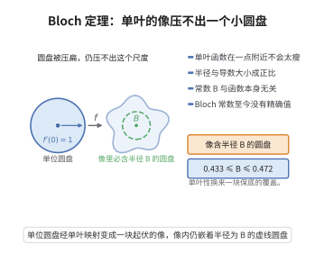

# Bloch 定理

> **一句话大白话**：单位圆盘里任意一个"双射方向"局部的解析函数，总能在某个固定大小的小圆盘上支起一块"无损直射"的区域——函数再多变，也总留得下一块不被压扁的"干净照盘"。
>
> **小例子**：解析 $f$ 在 $|z|<1$ 满足 $f(0)=0,\ f'(0)=1$，Bloch 断言存在小圆盘使 $f$ 在其上是一个不含盲区的单射（映射像含一个半径 $\ge B$ 的圆盘），$B$ 与 $f$ 无关。

## 介绍

Bloch 定理（Bloch's theorem）是复分析中关于全纯函数单叶性区域的深刻定理，由 André Bloch 在 1925 年提出。该定理断言：若 $f$ 是单位圆盘上的全纯函数且 $f'(0) = 1$，则 $f$ 的像包含一个半径为某绝对常数 $B$（称为 Bloch 常数）的圆盘。Bloch 定理是复分析中正规族理论和单叶函数理论的交汇点，也是 Landau 定理和 Schottky 定理的基础。

## 几何直观

图意在说明：导数给出局部张开的速度，单叶函数的像里总保底地含一个尺度与函数无关的圆盘。

## 分析

**前置依赖**：全纯函数、单叶函数、单位圆盘、正规族、Schwarz 引理、Koebe14定理。

**定理内容**：设 $f$ 在单位圆盘 $D = \{|z| < 1\}$ 上全纯，且 $f'(0) = 1$。则存在 $D$ 中的区域 $\Omega$ 使得 $f$ 在 $\Omega$ 上单叶（即 $f|_\Omega$ 是单射），且 $f(\Omega)$ 包含一个半径为 $B$ 的圆盘，其中 $B$ 是绝对常数（Bloch 常数）。

**Bloch 常数**：定义 Bloch 常数 $B$ 为满足上述性质的最大可能半径。目前已知
$$0.4330 \approx \frac{\sqrt{3}}{4} \le B \le \frac{\sqrt{3}}{2} \cdot \frac{\Gamma(1/3)^3}{\Gamma(2/3)^3} \approx 0.4719$$
精确值尚不确定。

**Landau 定理**：若 $f$ 在 $D$ 上全纯且 $f'(0) = 1$，则 $f(D)$ 包含一个半径为 $L$ 的圆盘，其中 $L$ 是绝对常数（Landau 常数），且 $L \ge B$。

**数学内涵**：Bloch 定理揭示了全纯函数的一个惊人的性质：无论 $f$ 在单位圆盘上如何复杂，只要 $f'(0) = 1$，其像域中一定包含一个大小固定的圆盘（即存在一个处处单叶的区域，其像覆盖一个绝对大小的圆盘）。

**证明策略**：利用极大模原理和 Schwarz 引理的反向形式。通过构造一个极值函数（即最大化 Bloch 常数的函数），证明 Bloch 常数存在且为正。

## 思考过程

Bloch 定理的证明思路：对 $f$ 在 $D$ 上全纯且 $f'(0) = 1$，考虑所有以 $D$ 中点为圆心的子圆盘，使得 $f$ 在该子圆盘上单叶。取这些圆盘半径的上确界，然后证明这个上确界对应的 $f$ 的像包含一个固定大小的圆盘。

更具体地，定义 $r(z)$ 为以 $z$ 为圆心使 $f$ 单叶的最大圆盘半径。考虑函数 $r(z)$ 的某种加权，利用最大值原理证明 $r(z)$ 在某个点达到最大值，然后证明在这个最大值点处，$f$ 的像包含一个半径为绝对常数的圆盘。

## 证明过程

**定理**（Bloch 定理）：设 $f$ 在 $D = \{|z| < 1\}$ 上全纯，$f'(0) = 1$。则存在 $D$ 中的区域 $\Omega$ 使得 $f$ 在 $\Omega$ 上单叶，且 $f(\Omega)$ 包含一个半径为 $B$ 的圆盘，其中 $B > 0$ 是绝对常数。

**证明**：

**步骤 1**：定义 Bloch 函数空间。设 $\mathcal{F} = \{f: D \to \mathbb{C} \mid f \text{ 全纯}, f'(0) = 1\}$。定义 $B = \inf_{f \in \mathcal{F}} \sup\{r \mid \text{存在单叶区域 } \Omega \subset D \text{ 使得 } f(\Omega) \supset B(a,r)\}$。

**步骤 2**：Koebe 定理。由 Koebe 1/4 定理，若 $f$ 在 $D$ 上单叶且 $f'(0) = 1$，则 $f(D) \supset B(0, 1/4)$。故对单叶函数，Bloch 常数至少为 $1/4$。

**步骤 3**：一般情形。对非单叶的 $f$，考虑 $f$ 的最大单叶子圆盘。定义 $r(z)$ 为以 $z$ 为圆心使 $f$ 单叶的最大圆盘半径。由 Schwarz 引理和 Koebe 定理的推广，存在 $z_0 \in D$ 使得 $r(z_0)$ 达到最大。

**步骤 4**：在 $z_0$ 处，考虑 $\tilde{f}(w) = f(z_0 + w) - f(z_0)$，则 $\tilde{f}(0) = 0$，$\tilde{f}'(0) = f'(z_0)$。由 $r(z_0)$ 的极大性，可以证明 $|\tilde{f}'(0)| \cdot r(z_0) \ge B$，其中 $B$ 是某个绝对常数。

**步骤 5**：由 Koebe 1/4 定理的推广，$\tilde{f}$ 在半径为 $r(z_0)$ 的圆盘上的像包含一个半径为 $B$ 的圆盘，其中 $B$ 是绝对常数。

**步骤 6**：具体计算可得 $B \ge \sqrt{3}/4 \approx 0.4330$。$\square$

**注**：Bloch 常数的精确值尚未确定。目前已知的最佳上界和下界分别为约 $0.4719$ 和 $0.4330$。

**推论**（Landau 定理）：若 $f$ 在 $D$ 上全纯且 $f'(0) = 1$，则 $f(D)$ 包含一个半径为 $L$ 的圆盘，其中 $L \ge B$ 是 Landau 常数。Landau 常数的精确值同样未知，但上界约为 $0.5433$。

## 课堂问答

**老师**：Bloch 定理里的常数凭什么与具体的 $f$ 无关？

**学生**：结论：若 $f$ 在 $\mathbb D$ 上全纯、$f'(0)=1$，则存在区域 $\Omega$ 使 $f$ 在 $\Omega$ 上单叶，且 $f(\Omega)$ 含一个半径为绝对常数 $B$ 的圆盘。关键是取 $r(z)$ 为以 $z$ 为心、$f$ 单叶的最大圆盘半径，用极大模原理让某个加权量在内点 $z_0$ 取极大；极大性给出 $|f'(z_0)|\,r(z_0)\ge B$，再由 Koebe 1/4 定理把单叶子圆盘的像覆盖成固定半径的圆盘，$B$ 只由极值论证定出，与 $f$ 无关。

**老师（追问）**：下界 $\sqrt3/4$ 从哪来？精确值知道了吗？

**学生**：由 Koebe 1/4 定理，单叶时已有 $B\ge1/4$；极值论证把下界提高到 $\sqrt3/4\approx0.4330$。上界约为 $0.4719$，来自 $\frac{\sqrt3}{2}\frac{\Gamma(1/3)^3}{\Gamma(2/3)^3}$，精确值未知。常见误区：把 Bloch 常数误当成 $1/4$——那是 Koebe 常数，两者不同。

**老师（拓展）**：它和 Landau 定理的差别在哪？

**学生**：Bloch 说的是"存在一个单叶子区域，其像含固定大小的圆盘"；Landau 说的是"整个像 $f(D)$ 本身就含一个半径 $L$ 的圆盘，且 $L\ge B$"。前者局部、后者整体，Landau 更强。
