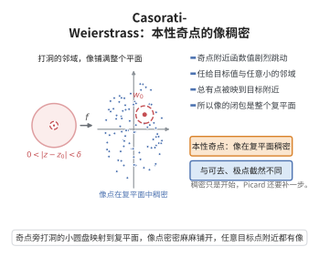

# Casorati–Weierstrass 定理

> **一句话大白话**：在本性奇点附近，函数值几乎"糊满"整个复平面——任给一个目标值，总有任意靠近奇点的点使函数值靠近它。
>
> **小例子**：$f(z)=e^{1/z}$ 以 $z=0$ 为本性奇点。对任意 $w\ne0$，取 $z_n=\dfrac{1}{\operatorname{Log}w+2\pi in}\to0$，则 $e^{1/z_n}=w$，故 $f(\{0<|z|<\delta\})=\mathbb{C}\setminus\{0\}$，在 $\mathbb{C}$ 中稠密。

## 介绍

孤立奇点分三类：可去奇点、极点、本性奇点。前两类函数在奇点附近的行为是"温和"的（有界，或趋于无穷）。Casorati–Weierstrass 定理刻画了本性奇点附近行为的剧烈程度：函数的像在整个复平面中稠密。它把"本性奇点不是可去的，也不是极点"这一纯代数的描述，转化为一个几何的稠密性陈述。

定理是 Picard 大定理的雏形（后者进一步说像最多遗漏一个点），也是正规族理论中许多判据（如 Montel 定理的"省略值"版本）的基础。

## 几何直观

图意在说明：本性奇点附近函数值剧烈跳动，任何目标值的任意小邻域里都能找到原像。

## 分析

**前置依赖**：孤立奇点的分类、Laurent 展开、Riemann 可去奇点定理（有界 ⇒ 可去）、零点孤立性与零点的有限阶。

**定理内容**：设 $f$ 在去心邻域 $0<|z-z_0|<\rho$ 上全纯，且 $z_0$ 是 $f$ 的**本性奇点**。则对任意 $w_0\in\mathbb{C}$ 与任意 $\epsilon>0$、$\delta\in(0,\rho)$，存在 $z$ 使
$$0<|z-z_0|<\delta,\qquad |f(z)-w_0|<\epsilon.$$
等价地：$f\big(\{0<|z-z_0|<\delta\}\big)$ 在 $\mathbb{C}$ 中稠密，即其闭包为 $\mathbb{C}$。

**证明策略**：反证。若某个值的某个小邻域被整个遗漏，即 $|f-w_0|\ge\epsilon$，则 $g=1/(f-w_0)$ 在去心邻域上有界，由 Riemann 可去奇点定理 $g$ 可全纯延拓到 $z_0$；再按 $g(z_0)\ne0$ 或 $g(z_0)=0$ 分别推出 $z_0$ 是 $f$ 的可去奇点或极点，与"本性"矛盾。

## 思考过程

反证法的关键是"遗漏一个值域邻域"这一假设如何被翻译成"有界"。取倒数正是标准技巧：$|f-w_0|\ge\epsilon$ 使得
$$\Big|\frac{1}{f-w_0}\Big|\le\frac1\epsilon,$$
有界性又把问题交回给 Riemann 可去奇点定理。

延拓之后要检查延拓值 $g(z_0)$ 的两种可能。若 $g(z_0)\ne0$，则 $g$ 在 $z_0$ 附近远离 $0$，于是 $f=w_0+1/g$ 本身在 $z_0$ 附近有界、可全纯延拓，$z_0$ 是**可去奇点**。若 $g(z_0)=0$，则 $g$ 以 $z_0$ 为有限阶零点（因为 $g$ 在去心邻域上不取零值），写作 $g(z)=(z-z_0)^mh(z)$，$h(z_0)\ne0$，于是 $f=w_0+(z-z_0)^{-m}/h(z)$ 在 $z_0$ 有**极点**。两种情形都与"本性奇点"矛盾。

## 证明过程

**步骤 1：反设。**

设结论不成立。则存在 $w_0\in\mathbb{C}$、$\epsilon>0$ 与 $\delta\in(0,\rho)$，使得对一切满足 $0<|z-z_0|<\delta$ 的 $z$，
$$|f(z)-w_0|\ge\epsilon. \tag{1}$$

**步骤 2：构造有界全纯函数并延拓。**

由 (1)，$f(z)\ne w_0$ 于去心圆盘 $0<|z-z_0|<\delta$，故
$$g(z)=\frac{1}{f(z)-w_0}$$
在该去心圆盘上全纯，且由 (1)
$$|g(z)|\le\frac1\epsilon\qquad(0<|z-z_0|<\delta).$$
即 $g$ 在 $z_0$ 的去心邻域内有界。由 Riemann 可去奇点定理，$g$ 在 $z_0$ 处有可去奇点：存在全纯函数 $\tilde g$ 于 $|z-z_0|<\delta$，使 $\tilde g=g$ 于去心圆盘。记 $c=\tilde g(z_0)$。

**步骤 3：情形 $c\ne0$：$z_0$ 是可去奇点。**

由 $\tilde g$ 连续与 $c\ne0$，可取 $0<\delta'<\delta$ 使 $|\tilde g(z)-c|<|c|/2$，从而 $|\tilde g(z)|>|c|/2>0$ 于 $|z-z_0|<\delta'$。于是
$$f(z)=w_0+\frac{1}{\tilde g(z)}\qquad(0<|z-z_0|<\delta')$$
右端在 $|z-z_0|<\delta'$ 上全纯且有界（$|1/\tilde g|\le2/|c|$），故 $f$ 在 $z_0$ 附近有界。由 Riemann 可去奇点定理，$z_0$ 是 $f$ 的可去奇点——与 $z_0$ 是本性奇点矛盾。

**步骤 4：情形 $c=0$：$z_0$ 是极点。**

此时 $\tilde g$ 在 $z_0$ 取零值，但 $\tilde g$ 在去心圆盘上等于 $g=1/(f-w_0)\ne0$，故 $z_0$ 是 $\tilde g$ 的**孤立零点**。由零点的孤立性与有限阶性，存在整数 $m\ge1$ 与在 $|z-z_0|<\delta''$ 上全纯的函数 $h$ 使
$$\tilde g(z)=(z-z_0)^mh(z),\qquad h(z_0)\ne0.$$
（$m$ 是零点阶数：把 $\tilde g$ 在 $z_0$ 展成幂级数，$m$ 是首个非零系数所在次数。）于是对 $0<|z-z_0|<\delta''$，
$$f(z)=w_0+\frac{1}{\tilde g(z)}=w_0+\frac{(z-z_0)^{-m}}{h(z)}.$$
因 $h(z_0)\ne0$，$(z-z_0)^{-m}/h(z)$ 在 $z_0$ 有极点（阶 $m$），故 $f$ 在 $z_0$ 有极点：$\lim_{z\to z_0}|f(z)|=+\infty$——与 $z_0$ 是本性奇点矛盾。

**步骤 5：结论与等价的稠密性表述。**

两种情形都导出矛盾，故反设不成立：对任意 $w_0\in\mathbb{C}$、$\epsilon>0$、$\delta\in(0,\rho)$，总存在 $z$ 满足 $0<|z-z_0|<\delta$ 且 $|f(z)-w_0|<\epsilon$。这正是"$f$ 在去心邻域的像在 $\mathbb{C}$ 中稠密"。

**步骤 6：本质性说明（例与推论）。**

（i）**$e^{1/z}$ 的稠密性**：对任意 $w\ne0$，$w$ 的对数分支为 $\operatorname{Log}w+2\pi in$（$n\in\mathbb{Z}$），取
$$z_n=\frac{1}{\operatorname{Log}w+2\pi in}\longrightarrow0,$$
则 $e^{1/z_n}=w$，故像在每去心邻域中已含 $\mathbb{C}\setminus\{0\}$，当然稠密。而 $0$ 不在像中，说明稠密性一般不能升级为"取遍"，这正是 Picard 大定理（最多遗漏一个值）所要补足的精确结论。

（ii）**与极点/可去奇点的对比**：对极点，$|f(z)|\to\infty$，像远离原点处的一切值；对可去奇点，$f$ 在奇点附近有界，像含于某个有界集。稠密性只在本性奇点处出现，因此它可以作为本性奇点的判别法。

（iii）**与 Montel 定理的联系**：Montel 的"省略值"判据（一族全纯函数若一致地省略两个值则为正规族）与 Casorati–Weierstrass 定理在精神上一致：本性奇点的存在等价于局部像不省略任何值。

## 课堂问答

**老师**：本性奇点附近函数的像，为什么会在整个复平面中稠密？

**学生**：结论：$z_0$ 为 $f$ 的本性奇点时，对任意 $w_0\in\mathbb C$ 与 $\epsilon,\delta>0$，总存在 $0<|z-z_0|<\delta$ 使 $|f(z)-w_0|<\epsilon$。反证：若某个去心邻域内恒有 $|f-w_0|\ge\epsilon$，则 $g=1/(f-w_0)$ 在其上有界且 $\le1/\epsilon$，由 Riemann 可去奇点定理全纯延拓到 $z_0$。

**老师（追问）**：延拓值 $g(z_0)$ 的两种情形分别导出什么矛盾？

**学生**：若 $g(z_0)\ne0$，则 $f=w_0+1/g$ 在 $z_0$ 附近有界，$z_0$ 是 $f$ 的可去奇点；若 $g(z_0)=0$，则 $z_0$ 是 $g$ 的有限阶零点，$g(z)=(z-z_0)^mh(z)$、$h(z_0)\ne0$，于是 $f=w_0+(z-z_0)^{-m}/h(z)$ 在 $z_0$ 有极点。两种情况都与"本性奇点"矛盾。

**老师（拓展）**：既然像稠密，为什么不能直接说"取遍"？

**学生**：稠密不等于取遍。$e^{1/z}$ 在 $0$ 附近取遍 $\mathbb C\setminus\{0\}$，恰恰遗漏 $0$ 这一个值。把它升级为"最多遗漏一个值"的正是 Picard 大定理；本定理只是它的雏形。

## 相关条目

- [Picard大定理](./Picard大定理.md)：把稠密性加强为"最多遗漏一个点"，其证明常以本定理为起点。
- [Picard小定理](./Picard小定理.md)：由大定理中"避开奇点"得到整函数的结论。
- [Montel定理](./Montel定理.md)：正规族理论中的省略值判据与本定理的稠密性思想相通。
