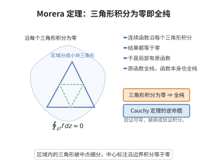

# Morera 定理

> **一句话大白话**：要判断一个连续函数是不是全纯的，不必去找它的导数，只要检查它沿一切三角形的围道积分为零就够了——这是 Cauchy 定理的"逆命题"，也是最好用的全纯性判据。
>
> **小例子**：$g(z)=\frac{1}{2\pi i}\oint_{|\zeta|=2}\frac{d\zeta}{\zeta-z}$ 在 $|z|<1$ 上是全纯的。按定义直接求导会很麻烦，但用 Morera 定理只需注意：沿任意三角形 $T\subseteq\{|z|<1\}$ 有 $\oint_{\partial T}g\,dz=\oint_{|\zeta|=2}\big(\oint_{\partial T}\frac{dz}{\zeta-z}\big)d\zeta=0$（内层积分为零），于是 $g$ 全纯。

## 介绍

Cauchy 定理说：区域上全纯的函数沿任一闭曲线积分为零。Morera 定理的说法正好相反：**若连续函数沿一切三角形（其内部含于区域）的积分为零，则它是全纯的**。由于"全纯 $\Leftrightarrow$ 有原函数（局部）$\Leftrightarrow$ 与路径无关 $\Leftrightarrow$ 沿三角形积分为零"，Morera 定理实际上是在说"积分的路径无关性"足以反过来刻画全纯性。

这条定理的用途极其广泛，因为它把"验证可导性"这一较难的局部任务换成了"验证积分"这一较易的整体任务，而且积分可以在极限号下处理：

- 证明 Weierstrass 一致收敛定理（内闭一致收敛的全纯函数列极限全纯）；
- 证明含参变量积分的全纯性（如 Cauchy 积分 $\frac{1}{2\pi i}\oint\frac{\varphi(\zeta)}{\zeta-z}d\zeta$ 关于 $z$ 全纯）；
- 证明 Schwarz 反射原理中拼接函数的全纯性；
- 证明 Hartogs 型"分别全纯 $\Rightarrow$ 全纯"的 Osgood 论证中的关键一步。

由于它只需沿三角形验证，验证时通常只需处理"三角形完全落在一个小球内"这一最简单的情形，技术难度大幅降低。

## 几何直观

图意在说明：连续函数只要沿每个三角形的边界积分为零，就局部有原函数，从而是全纯函数。

## 分析

**前置依赖**：全纯函数与 Cauchy–Riemann 方程、连续性与积分估计（ML 不等式）、复变函数的原函数与微积分基本定理（对连续函数沿线段的积分）、柯西积分定理、区域的连通性与直线段的凸性（圆盘内线段仍在圆盘内）。

**定理内容（Morera）**：设 $\Omega\subseteq\mathbb C$ 是开集，$f:\Omega\to\mathbb C$ 连续。若对每个闭三角形 $T\subseteq\Omega$（即 $T$ 及其内部都含于 $\Omega$）都有

$$\oint_{\partial T}f(z)\,dz=0 ,$$

则 $f$ 在 $\Omega$ 上全纯。

**定理内容（弱化形式，用矩形替代三角形）**：若只对一切边平行于坐标轴的闭矩形验证 $\oint_{\partial R}f\,dz=0$，结论仍然成立。

**定理内容（闭曲线形式）**：若 $\Omega$ 单连通、$f$ 连续，且 $f$ 沿 $\Omega$ 内每条闭的逐段 $C^1$ 曲线积分为零，则 $f$ 全纯。

**证明策略**：不要在 $\Omega$ 上整体构造原函数（那需要路径无关性，涉及连通性），而是在**每个小圆盘内**构造。对 $a\in\Omega$ 取圆盘 $D=B(a,r)\subseteq\Omega$，定义 $F(z)=\int_{[a,z]}f\,d\zeta$（沿直线段积分）。对三角形 $\langle a,z,z+h\rangle$ 用假设，得到 $F(z+h)-F(z)=\int_{[z,z+h]}f\,d\zeta$，于是差商就是 $f$ 沿线段的一个平均，由 $f$ 的连续性趋于 $f(z)$：$F'=f$。于是 $F$ 全纯，$f=F'$ 也全纯。

## 思考过程

**为什么"沿三角形积分为零"等价于"局部有原函数"？** 在圆盘（凸集）内，任意两点之间的折线可以用三角形分解来比较。准确地说，对圆盘内的三角形 $\langle a,z,z+h\rangle$，假设给出

$$\int_{[a,z]}f+\int_{[z,z+h]}f+\int_{[z+h,a]}f=0 ,$$

移项即 $\int_{[a,z]}+\int_{[z,z+h]}=\int_{[a,z+h]}$：这说明 $F(z+h)-F(z)=\int_{[z,z+h]}f$。注意这里只用到了**一个**三角形的条件，无需整体的路径无关性——这正是把证明局部化、避开单连通假定的诀窍。若要在整个 $\Omega$ 上定义原函数，就必须沿着一条固定的折线路径把三角形条件"拼接"起来，那一路上要用到 $\Omega$ 的连通性，且论证更繁；局部构造则完全绕开了这些麻烦。

**为什么 $F'=f$ 可以直接看出？** 因为

$$\frac{F(z+h)-F(z)}{h}=\frac1h\int_0^1 f(z+th)\,h\,dt=\int_0^1f(z+th)\,dt ,$$

这是 $f$ 在小线段上取值的"平均"。当 $h\to0$ 时 $f(z+th)\to f(z)$ 对 $t\in[0,1]$ 一致，故平均值趋于 $f(z)$。于是 $F'(z)=f(z)$，即 $f$ 是某个全纯函数的导数，而全纯函数的导数全纯（由 Cauchy 积分公式或幂级数展开直接得到）。

**为什么矩形形式也够？** 这是 Goursat 式的对称论证：把矩形四等分，若沿边界的积分不为零，则至少一个子矩形上的积分不小于原来的四分之一；无限细分得到一个收敛点列，在极限点处用 $f$ 的连续性可以证明当矩形足够小时积分与"$f$ 常数时的积分"之差任意小，从而必须为零。由此对一切矩形的积分为零，而任意三角形可以嵌入一个矩形内部并用三角形的"内点分割"化为若干矩形与三角形的组合（标准的分割论证），从而回到三角形形式。

## 证明过程

**步骤 1：局部原函数的构造。**

取任意 $a\in\Omega$。因 $\Omega$ 开，存在 $r>0$ 使圆盘 $D:=B(a,r)\subseteq\Omega$。$D$ 是凸集，对任意 $z\ne a\in D$，线段 $[a,z]\subseteq D\subseteq\Omega$，故可定义

$$F(z):=\int_{[a,z]}f(\zeta)\,d\zeta ,\qquad F(a):=0 ,$$

其中 $\int_{[a,z]}$ 表示沿直线段 $[a,z]$ 的积分；因 $f$ 连续（从而有界）且线段长度有限，积分存在。

**步骤 2：由三角形条件得到"沿线段可加性"。**

设 $z\in D$ 与 $h\ne0$ 足够小，使 $z+h\in D$。因 $D$ 凸，闭三角形 $T=\langle a,z,z+h\rangle$（顶点为 $a,z,z+h$ 的三角形及其内部）满足 $T\subseteq D\subseteq\Omega$。由定理假设

$$\oint_{\partial T}f\,d\zeta=0 .$$

把边界按正向拆成三段（必要时重排符号）：

$$\int_{[a,z]}f+\int_{[z,z+h]}f-\int_{[a,z+h]}f=0 .$$

于是

$$F(z+h)-F(z)=\int_{[a,z+h]}f-\int_{[a,z]}f=\int_{[z,z+h]}f .$$

**步骤 3：$f$ 是 $F$ 的导数。**

把沿线段的积分参数化为 $\zeta=z+th$（$t\in[0,1]$，$d\zeta=h\,dt$）：

$$F(z+h)-F(z)=\int_0^1 f(z+th)\,h\,dt .$$

于是

$$\frac{F(z+h)-F(z)}{h}=\int_0^1 f(z+th)\,dt .$$

因 $f$ 在 $z$ 处连续，给定 $\epsilon>0$ 存在 $\delta>0$ 使 $|\zeta-z|<\delta\Rightarrow|f(\zeta)-f(z)|<\epsilon$。当 $|h|<\delta$ 时对一切 $t\in[0,1]$ 有 $|z+th-z|=t|h|<\delta$，故

$$\left|\frac{F(z+h)-F(z)}{h}-f(z)\right|=\left|\int_0^1\big(f(z+th)-f(z)\big)dt\right|\le\int_0^1\epsilon\,dt=\epsilon .$$

因此 $F'(z)=f(z)$ 对一切 $z\in D$ 成立。

**步骤 4：$f$ 在 $D$ 上全纯。**

$F$ 在 $D$ 上复可导（步骤 3），故 $F$ 在 $D$ 上全纯。由 Cauchy 积分公式（或全纯函数的幂级数展开），全纯函数的导数仍全纯：对 $z\in D$ 取 $\overline{B(z,\rho)}\subseteq D$，则

$$F'(z)=\frac{1}{2\pi i}\oint_{|\zeta-z|=\rho}\frac{F(\zeta)}{(\zeta-z)^2}\,d\zeta ,$$

右端是含参数 $z$ 的连续积分核表达式，关于 $z$ 全纯（可直接用 Cauchy–Riemann 或再用一次本定理）。故 $f=F'$ 在 $D$ 上全纯。

**步骤 5：处处全纯。**

对每个 $a\in\Omega$ 都取到这样的圆盘 $D$ 并使 $f$ 在 $D$ 上全纯；因 $f$ 在 $a$ 的某个邻域内可导，$f$ 在 $\Omega$ 上处处全纯。Morera 定理得证。$\square$

**步骤 6：矩形形式的说明。**

设只对边平行于坐标轴的矩形验证积分为零。

**(i) 四等分论证**：设矩形 $R$ 沿边界积分为 $I$。用中位线把 $R$ 分成四个全等子矩形 $R_1,\dots,R_4$，则沿边界积分满足

$$I=\sum_{k=1}^{4}\oint_{\partial R_k}f\,dz ,$$

因为内部的公共边被反向经过两次而抵消。于是存在 $k$ 使 $\big|\oint_{\partial R_k}f\big|\ge|I|/4$。迭代得到矩形序列 $R\supseteq R_1\supseteq R_2\supseteq\cdots$，边长趋于 $0$，直径 $d_m\to0$，且

$$\Big|\oint_{\partial R_m}f\,dz\Big|\ge\frac{|I|}{4^m}.$$

**(ii) 极限点处的估计**：由闭矩形套定理取 $\zeta_0\in\bigcap_mR_m$。给定 $\epsilon>0$，由 $f$ 在 $\zeta_0$ 处连续取 $m$ 使 $|f(\zeta)-f(\zeta_0)|<\epsilon$ 对一切 $\zeta\in R_m$ 成立。因常数函数沿闭曲线积分为零且 $\oint_{\partial R_m}d\zeta=0$（矩形），

$$\Big|\oint_{\partial R_m}f\,dz\Big|=\Big|\oint_{\partial R_m}\big(f-f(\zeta_0)\big)dz\Big|\le\epsilon\cdot L(\partial R_m) ,$$

其中 $L(\partial R_m)$ 是周长，随 $m\to\infty$ 趋于零。结合 (i) 的不等式得 $|I|\le4^m\epsilon L(\partial R_m)$ 对充分大的 $m$ 成立，右端趋于 $0$，故 $I=0$。

**(iii) 化为三角形形式**：对任意闭三角形 $T\subseteq\Omega$，由 $f$ 的连续性（$f$ 在紧集上一致连续）与"把三角形挖成有限个足够小的矩形与三角形的并"（先在 $T$ 内取一点，把 $T$ 分成三个小三角形并重复此过程，得到直径任意小的三角形拼块），总可以把 $\oint_{\partial T}f$ 表示为有限个沿小矩形（积分为零）与小三角形（直径 $<\delta$）的积分之和；取 $\delta$ 使小三角形上的积分被 $\epsilon$ 控制，令 $\epsilon\to0$ 得 $\oint_{\partial T}f=0$。于是定理的三角形形式成立，再由步骤 1–5 得 $f$ 全纯。$\square$

**推论 1（含参积分的全纯性）**：设 $\gamma$ 是可求长曲线，$\varphi$ 在 $\gamma$ 上连续，则

$$g(z):=\int_\gamma\frac{\varphi(\zeta)}{\zeta-z}\,d\zeta$$

在 $\mathbb C\setminus\gamma$ 上全纯。证明：$g$ 连续；对任意三角形 $T\subseteq\mathbb C\setminus\gamma$，由 Fubini 定理交换积分次序，$\oint_{\partial T}\frac{dz}{\zeta-z}=0$（$\frac{1}{\zeta-z}$ 关于 $z$ 在 $T$ 的邻域内全纯，或直接计算），故 $\oint_{\partial T}g\,dz=0$，由 Morera 定理得证。这是 Cauchy 积分公式与 Cauchy 型积分的合法性来源。

**推论 2（Weierstrass 一致收敛定理的钥匙）**：若 $f_n$ 全纯、$f_n\to f$ 内闭一致，则对任意三角形 $T\subseteq\Omega$，由 $\oint_{\partial T}f_n=0$（Cauchy 定理）与一致收敛可在积分号下取极限，得 $\oint_{\partial T}f=0$；由 Morera 定理，$f$ 全纯。

## 课堂问答

**老师**：不想求导，怎么判定一个连续函数是全纯的？

**学生**：结论（Cauchy 定理的逆命题）：若连续函数 $f$ 沿一切内部含于区域的闭三角形积分为零，即 $\oint_{\partial T}f\,dz=0$，则 $f$ 全纯。它把"验证可导"这一较难的局部任务换成"验证积分"这一较易处理的整体任务。

**老师（追问）**：为什么证明要在小圆盘里局部构造原函数？

**学生**：对 $a\in\Omega$ 取圆盘 $D=B(a,r)\subseteq\Omega$，定义 $F(z)=\int_{[a,z]}f\,d\zeta$。对三角形 $\langle a,z,z+h\rangle$ 用假设得 $F(z+h)-F(z)=\int_{[z,z+h]}f$，于是
$$\frac{F(z+h)-F(z)}{h}=\int_0^1 f(z+th)\,dt\xrightarrow{h\to0}f(z),$$
即 $F'=f$、$F$ 全纯，故 $f=F'$ 全纯。局部构造绕开了整体路径无关与单连通假设。

**老师（拓展）**：它最常被用来做什么？

**学生**：证明 Weierstrass 一致收敛定理（$\oint f_n=0$ 取极限得 $\oint f=0$）、含参变量积分的全纯性，以及 Schwarz 反射原理中拼接函数的全纯性。

## 相关条目

- [Weierstrass一致收敛定理](./Weierstrass一致收敛定理.md)：其"极限函数全纯"一步的证明正是本定理的直接应用。
- [Riemann可去奇点定理](./Riemann可去奇点定理.md)：与本定理同为"把局部信息升级为全纯性"的基本判据。
- [Schwarz反射原理](./Schwarz反射原理.md)：拼接函数在对称轴上的全纯性由 Morera 定理验证。
