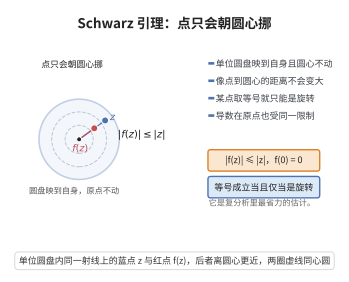

# Schwarz 引理

> **一句话大白话**：把单位圆盘映入自身、且固定圆心的全纯函数，绝不会把点拉得离圆心更远；若某点被"拉满"，函数就只能是旋转。
>
> **小例子**：$f(z)=z^2$ 满足 $|f(z)|\le|z|$（$|z|<1$）；而 $f(z)=2z$ 不满足，因为它把 $\frac12$ 映到 $1$，跑出了圆盘。

## 介绍

Schwarz 引理是关于单位圆盘上全纯函数的"保距性"的最基本估计：它把圆盘的自同构（Möbius 变换）对圆盘的刚性刻画推广为一个普适的定量不等式。其结论看似简单，却是复分析中极高效的推理工具：

- 它给出全纯函数在固定点处的"增长上限"，是 Bloch 定理、Koebe 1/4 定理、Picard 理论的关键一步；
- 它是正规族理论中"局部一致有界 ⇒ 等度连续"的基础；
- 经 Möbius 变换共轭后得到 Schwarz–Pick 不等式，即全纯映射是圆盘的"距离不增映射"（双曲度量的压缩）。

## 几何直观

图意在说明：把圆盘映入自身并固定圆心，像点到圆心的距离不会增大，某点取等号时只能是旋转。

## 分析

**前置依赖**：全纯函数、最大模原理、Riemann 可去奇点定理、单位圆盘自同构（Möbius 变换 $z\mapsto e^{i\theta}\frac{z-a}{1-\bar az}$）、零点的孤立性。

**定理内容**：设 $f:\mathbb{D}\to\mathbb{D}$（$\mathbb{D}=\{|z|<1\}$）全纯，且 $f(0)=0$。则

1. 对一切 $z\in\mathbb{D}$，$|f(z)|\le|z|$；
2. $|f'(0)|\le1$；
3. 等号成立的情形：若存在某 $z_0\ne0$ 使 $|f(z_0)|=|z_0|$，或 $|f'(0)|=1$，则存在 $\theta\in\mathbb{R}$ 使 $f(z)=e^{i\theta}z$ 对一切 $z$ 成立。

**证明策略**：把"在 $0$ 处的零"除掉，令 $g(z)=f(z)/z$，$g$ 在 $\mathbb{D}$ 上全纯（$0$ 处可去）。对 $g$ 用最大模原理：在 $|z|=r$ 上 $|g|\le1/r$，令 $r\to1^-$ 即得 $|g|\le1$，从而得到 1、2；等号情形再由最大模原理的等号刻画得到。

## 思考过程

为什么要除以 $z$？因为 $f$ 在 $0$ 处的"伸缩率"由 $f(z)/z$ 在 $0$ 的值刻画，而圆盘的有界性给出 $|f(z)|<1$，于是 $g$ 在半径 $r$ 的圆上有界 $1/r$。$1/r$ 这个界随 $r\to1$ 收紧到 $1$，正是引理的核心估计。

最大模原理只在紧子集上直接可用，所以要"先固定 $r$，再让 $r\to1$"：这是处理非紧区域上最大模标准的"截断—取极限"两步法。等号情形则利用最大模原理的等号结论：内部取到最大值 ⇒ 函数为常数。这里 $|g(z_0)|=1$ 意味着 $|g|$ 在内点取到最大值 $1$。

## 证明过程

**步骤 1：构造辅助函数 $g$。**

由 $f(0)=0$ 与 $f$ 全纯，$f$ 在 $0$ 附近有 Taylor 展开 $f(z)=a_1z+a_2z^2+\cdots$，故
$$g(z)=\frac{f(z)}{z}\qquad(z\in\mathbb{D}\setminus\{0\})$$
在去心圆盘上全纯，且在 $0$ 附近有界（$g(z)\to a_1=f'(0)$）。由 Riemann 可去奇点定理，$g$ 可全纯延拓到 $\mathbb{D}$，且 $g(0)=f'(0)$。

**步骤 2：最大模原理给出 $|g|\le1$。**

固定 $0<r<1$。对 $|z|=r$，由 $f(z)\in\mathbb{D}$ 得 $|f(z)|<1$，故
$$|g(z)|=\frac{|f(z)|}{r}<\frac1r.$$
$g$ 在闭圆盘 $\{|z|\le r\}$ 上全纯（$g$ 已在 $\mathbb{D}$ 上全纯），由最大模原理
$$|g(z)|\le\sup_{|w|=r}|g(w)|\le\frac1r\qquad(|z|\le r).$$
现在固定 $z\in\mathbb{D}$ 并令 $r\to1^-$（只要 $r>|z|$，上式对 $z$ 成立），得
$$|g(z)|\le1\qquad(z\in\mathbb{D}). \tag{1}$$

**步骤 3：得到结论 1 与 2。**

由 (1)，对 $z\ne0$
$$|f(z)|=|z|\cdot|g(z)|\le|z|,$$
而 $z=0$ 时两边为 $0$，故结论 1 成立。又 $|f'(0)|=|g(0)|\le1$，结论 2 成立。

**步骤 4：等号情形。**

（a）设存在 $z_0\ne0$（$|z_0|<1$）使 $|f(z_0)|=|z_0|$。则 $|g(z_0)|=1$，而由 (1) $|g|\le1$ 在 $\mathbb{D}$ 上成立，故 $|g|$ 在**内点** $z_0$ 取到最大值 $1$。由最大模原理的等号刻画，常数 $c$ 使 $g\equiv c$，且 $|c|=|g(z_0)|=1$，即 $c=e^{i\theta}$。于是
$$f(z)=e^{i\theta}z\qquad(z\in\mathbb{D}).$$

（b）设 $|f'(0)|=1$。则 $|g(0)|=|f'(0)|=1$，即 $|g|$ 在内点 $0$ 取到最大值 $1$，同理 $g\equiv e^{i\theta}$，故 $f(z)=e^{i\theta}z$。

反过来，$f(z)=e^{i\theta}z$ 显然满足 $|f(z)|=|z|$、$|f'(0)|=1$，且是 $\mathbb{D}$ 的自同构，故等号刻画是精确的。

**步骤 5：推广（Schwarz–Pick 不等式）。**

设 $f:\mathbb{D}\to\mathbb{D}$ 全纯（不要求 $f(0)=0$），$w=f(a)$。用圆盘自同构
$$\varphi_a(z)=\frac{z-a}{1-\bar az},\qquad \psi_w(z)=\frac{z-w}{1-\bar wz}$$
（都是 $\mathbb{D}$ 的双全纯自同构，$\varphi_a(a)=0$）共轭：
$$F=\psi_w\circ f\circ\varphi_a^{-1},$$
则 $F:\mathbb{D}\to\mathbb{D}$ 全纯且 $F(0)=\psi_w(f(a))=0$。由结论 1，
$$|F(\zeta)|\le|\zeta|,\qquad\text{即}\qquad \Big|\frac{f(z)-f(a)}{1-\overline{f(a)}f(z)}\Big|\le\Big|\frac{z-a}{1-\bar az}\Big|,$$
其中 $z=\varphi_a^{-1}(\zeta)$。同时由结论 2，$|F'(0)|\le1$ 化为
$$\frac{|f'(a)|}{1-|f(a)|^2}\le\frac{1}{1-|a|^2}.$$
这两式就是 Schwarz–Pick 不等式，其几何意义是：全纯映射不增大圆盘上的双曲度量（Poincaré 度量）$ds=\frac{2|dz|}{1-|z|^2}$，且等号成立当且仅当 $f$ 是圆盘自同构。

**步骤 6：应用要点。**

（i）**正规族与等度连续**：若一族全纯函数 $\mathcal{F}$ 一致有界于 $\mathbb{D}$，则对 $|z|\le r$，用 Schwarz–Pick 或 Schwarz 引理可得 $|f'(z)|\le\frac{M}{1-r}$ 的一致界，从而等度连续（Montel 定理的引理部分）。

（ii）**Koebe 1/4 定理**：对单叶函数使用 Schwarz 引理的反向形式（Bloch 常数的估计）是其证明的一环。

（iii）**不动点与迭代**：若 $f:\mathbb{D}\to\mathbb{D}$、$f(0)=0$，则 $|f^n(z)|\le|z|$，且当 $|f'(0)|<1$ 时迭代收敛到 $0$——这给出圆盘上全纯映射的动力学入门结论。

## 课堂问答

**老师**：圆盘自映射固定原点时，有什么刚性？

**学生**：结论：$f:\mathbb D\to\mathbb D$ 全纯且 $f(0)=0$，则 $|f(z)|\le|z|$、$|f'(0)|\le1$；并且只要存在 $z_0\ne0$ 使 $|f(z_0)|=|z_0|$，或 $|f'(0)|=1$，就必有 $f(z)=e^{i\theta}z$ 对一切 $z$ 成立。

**老师（追问）**：除以 $z$ 这一手为什么有效？

**学生**：令 $g(z)=f(z)/z$。因 $f(0)=0$，$g$ 在 $0$ 处有界可去，全纯且 $g(0)=f'(0)$。在 $|z|=r$ 上 $|g|<1/r$，由最大模原理 $|g(z)|\le1/r$，令 $r\to1^-$ 得 $|g|\le1$，即 $|f(z)|\le|z|$。等号时 $|g|$ 在内点取到最大值 $1$，最大模原理的等号刻画给出 $g\equiv e^{i\theta}$。

**老师（拓展）**：不固定原点怎么办？

**学生**：用圆盘自同构 $\varphi_a(z)=\frac{z-a}{1-\bar az}$ 共轭，得 Schwarz–Pick 不等式
$$\Big|\frac{f(z)-f(a)}{1-\overline{f(a)}f(z)}\Big|\le\Big|\frac{z-a}{1-\bar az}\Big|,$$
其几何意义是全纯映射不增大圆盘上的双曲度量，等号成立当且仅当 $f$ 是圆盘自同构。

## 相关条目

- [Bloch定理](./Bloch定理.md)：其证明用 Schwarz 引理的反向估计控制单叶子圆盘的半径。
- [Picard小定理](./Picard小定理.md)：椭圆模函数的存在性论证依赖 Schwarz 引理与正规族。
- [Montel定理](./Montel定理.md)：局部一致有界 ⇒ 等度连续这一关键步骤以 Schwarz 引理为工具。
