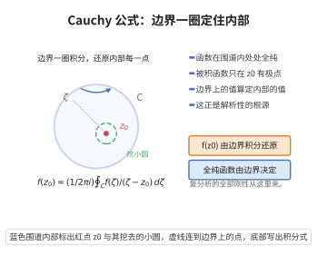

# 全纯函数与 Cauchy 积分公式

> **一句话大白话**：全纯函数（处处复可导）比实可导函数"刚性"得多——它的实部与虚部必须满足 Cauchy–Riemann 方程，因此在闭曲线上的积分自动为零，而圈内任一点的值都能由边界上的一圈积分精确还原出来。
>
> **小例子**：$f(z)=z^2$ 在全平面全纯，沿单位圆周 $\oint_{|z|=1}z^2\,dz=0$；而 $f(z)=1/z$ 在 $z=0$ 处有奇点，$\oint_{|z|=1}\dfrac{dz}{z}=2\pi i$——正说明 Cauchy 积分公式的关键在"绕住奇点"。

## 介绍

全纯函数（holomorphic function，又称解析函数）是复分析的研究对象：$f:\Omega\to\mathbb C$（$\Omega\subseteq\mathbb C$ 开）在 $z_0$ 处复可导，指极限 $\lim_{h\to0}\frac{f(z_0+h)-f(z_0)}{h}$ 存在；处处复可导则称 $f$ 在 $\Omega$ 上全纯。

全纯性是一个远比实可导性强的条件。把 $f=u+iv$ 分解为实部与虚部后，复可导立即迫使 $u,v$ 满足 Cauchy–Riemann 方程

$$u_x=v_y,\qquad u_y=-v_x.$$

这一对方程带来的第一个深刻后果是 **Cauchy 积分定理**：全纯函数沿单连通区域中任一闭曲线的积分为零。由此又得到 **Cauchy 积分公式**：区域内部任一点的值等于边界上的一圈积分。它表明全纯函数的信息被边界"锁死"，进而推出全纯函数无穷可微、可展成幂级数、满足 Cauchy 估计与 Liouville 定理。本词条是辐角原理、Hurwitz 定理、最大模原理等一切复分析结论的共同地基。

## 几何直观

图意在说明：全纯函数在围道内任一点的值，由它在边界上的一圈积分完全决定，解析性由此而来。

## 分析

**前置依赖**：Cauchy-Riemann方程、格林定理、实部-虚部分解

**定义与定理内容**：

- **全纯与 C-R 方程**：设 $f=u+iv$ 在 $\Omega$ 上全纯。则 $u,v$ 可微且满足 $u_x=v_y,\ u_y=-v_x$；反之，若 $u,v\in C^1(\Omega)$ 且满足 C-R 方程，则 $f=u+iv$ 全纯，且 $f'=u_x+iv_x$。
- **Cauchy 积分定理**：设 $f$ 在单连通区域 $\Omega$ 上全纯，$\gamma$ 是 $\Omega$ 内逐段 $C^1$ 的闭曲线，则
  $$\oint_\gamma f(z)\,dz=0.$$
- **Cauchy 积分公式**：设 $\gamma$ 是正向行进的简单闭曲线，$f$ 在 $\gamma$ 内部全纯、在 $\gamma$ 及其内部连续，则对 $\gamma$ 内部任一点 $z_0$，
  $$f(z_0)=\frac{1}{2\pi i}\oint_\gamma\frac{f(z)}{z-z_0}\,dz.$$
- **高阶导数与估计**：$f$ 在 $\Omega$ 上无穷可微，且
  $$f^{(n)}(z_0)=\frac{n!}{2\pi i}\oint_\gamma\frac{f(z)}{(z-z_0)^{n+1}}\,dz,\qquad |f^{(n)}(z_0)|\le\frac{n!\,M}{R^n},$$
  其中 $M=\max_{|z-z_0|=R}|f(z)|$（Cauchy 估计）。

**关键要点**：

- C-R 方程是全纯性的"实坐标判据"，把复分析问题化为实分析问题；
- Cauchy 积分定理的证明是把复线积分用格林定理化为面积分，再用 C-R 方程使其为零；
- Cauchy 积分公式是把"绕奇点的积分"化为"奇点处的取值"，其技巧是挖去小圆盘；
- 由 Cauchy 公式可导出全纯函数可展为幂级数，从而"复可导一次即可导无穷次"。

## 思考过程

**为什么复可导会逼出 C-R 方程？** 复可导意味着差商沿任何方向趋于同一极限。分别取 $h$ 沿实轴与虚轴方向，比较两个极限的实部与虚部，就得到 $u_x=v_y$ 与 $u_y=-v_x$。换句话说，C-R 方程正是"导数与方向无关"的实部虚部翻译。

**为什么积分定理等价于面积分为零？** 把 $f\,dz$ 用 $u,v$ 展开：

$$f\,dz=(u+iv)(dx+i\,dy)=(u\,dx-v\,dy)+i(v\,dx+u\,dy).$$

对实部与虚部分别用格林定理化为面积分，被积函数恰好是 $-v_x-u_y$ 与 $u_x-v_y$，由 C-R 方程两者都为零，于是 $\oint_\gamma f\,dz=0$。这解释了"全纯"与"闭曲线积分为零"的等价来源。

**为什么积分公式要"挖洞"？** $\frac{f(z)}{z-z_0}$ 在 $z_0$ 处不解析，不能直接对它用积分定理。但它在挖去以 $z_0$ 为心的小圆盘后的多连通区域上解析，于是沿外边界与沿小圆周的积分相等；让小圆周半径趋于零，$\frac{f(z)}{z-z_0}\cdot(z-z_0)\to f(z_0)$ 就把积分算成 $2\pi i f(z_0)$。

## 证明过程

**步骤 1：全纯蕴含 C-R 方程。** 设 $f$ 在 $z_0$ 复可导，记 $f'(z_0)=\alpha+i\beta$。取 $h=t\in\mathbb R$（$t\to0$）：

$$\frac{f(z_0+t)-f(z_0)}{t}\to u_x(z_0)+iv_x(z_0),$$

故 $u_x=\alpha,\ v_x=\beta$。取 $h=it$（$t\to0$）：

$$\frac{f(z_0+it)-f(z_0)}{it}\to\frac{1}{i}\big(u_y(z_0)+iv_y(z_0)\big)=v_y(z_0)-iu_y(z_0),$$

故 $v_y=\alpha,\ -u_y=\beta$。比较得 $u_x=v_y,\ u_y=-v_x$，且 $f'=u_x+iv_x$。

**步骤 2：C-R 加 $C^1$ 蕴含全纯。** 设 $u,v\in C^1$ 且满足 C-R 方程，记 $h=h_1+ih_2$，各偏导数在 $z_0$ 处取值。由 $u,v$ 实可微，

$$\Delta u=u_xh_1+u_yh_2+o(|h|),\qquad \Delta v=v_xh_1+v_yh_2+o(|h|).$$

于是

$$f(z_0+h)-f(z_0)=\big(u_x+iv_x\big)h_1+\big(u_y+iv_y\big)h_2+o(|h|).$$

由 C-R 方程 $u_y=-v_x,\ v_y=u_x$，有 $u_y+iv_y=-v_x+iu_x=i(u_x+iv_x)$，故

$$f(z_0+h)-f(z_0)=\big(u_x+iv_x\big)h_1+i\big(u_x+iv_x\big)h_2+o(|h|)=\big(u_x+iv_x\big)h+o(|h|).$$

两边除以 $h$ 并令 $h\to0$，得 $\lim_{h\to0}\frac{f(z_0+h)-f(z_0)}{h}=u_x(z_0)+iv_x(z_0)$，故 $f$ 全纯且 $f'=u_x+iv_x$。

**步骤 3：Cauchy 积分定理。** 设 $f=u+iv$ 在单连通 $\Omega$ 上全纯，$\gamma$ 是 $\Omega$ 内正向简单闭曲线，围成区域 $D\subseteq\Omega$。由步骤 1，$u,v$ 满足 C-R 方程。展开

$$\oint_\gamma f\,dz=\oint_\gamma(u\,dx-v\,dy)+i\oint_\gamma(v\,dx+u\,dy).$$

对两个实线积分用格林定理 $\oint_\gamma(P\,dx+Q\,dy)=\iint_D(Q_x-P_y)\,dA$（要求 $u,v\in C^1$）：

$$\operatorname{Re}\oint_\gamma f\,dz=\iint_D\big((-v)_x-u_y\big)dA=\iint_D(-v_x-u_y)\,dA=\iint_D(v_x-v_x)\,dA=0,$$

$$\operatorname{Im}\oint_\gamma f\,dz=\iint_D\big(u_x-v_y\big)dA=\iint_D(v_y-v_y)\,dA=0.$$

故 $\oint_\gamma f\,dz=0$。一般闭曲线可由简单闭曲线拼接，一般全纯函数可在紧集上用 $C^1$ 函数逼近，故结论对一般 $\gamma$ 与一般全纯 $f$ 成立。

**步骤 4：Cauchy 积分公式。** 固定 $\gamma$ 内部一点 $z_0$。对充分小的 $\varepsilon>0$，取小圆周 $\gamma_\varepsilon=\{z:|z-z_0|=\varepsilon\}$（正向）。在挖去圆盘 $B(z_0,\varepsilon)$ 的区域内，函数 $g(z)=\frac{f(z)}{z-z_0}$ 全纯，由多连通情形的 Cauchy 积分定理（步骤 3 的推论）：

$$\oint_\gamma\frac{f(z)}{z-z_0}\,dz=\oint_{\gamma_\varepsilon}\frac{f(z)}{z-z_0}\,dz.$$

在小圆周上 $z=z_0+\varepsilon e^{i\theta}$，$dz=i\varepsilon e^{i\theta}d\theta$，故

$$\oint_{\gamma_\varepsilon}\frac{f(z)}{z-z_0}\,dz=i\int_0^{2\pi}f(z_0+\varepsilon e^{i\theta})\,d\theta.$$

由 $f$ 在 $z_0$ 连续，对任意 $\delta>0$ 取 $\varepsilon$ 充分小使 $|f(z_0+\varepsilon e^{i\theta})-f(z_0)|<\delta$，则

$$\left|\oint_{\gamma_\varepsilon}\frac{f(z)}{z-z_0}\,dz-2\pi i f(z_0)\right|=\left|i\int_0^{2\pi}\big(f(z_0+\varepsilon e^{i\theta})-f(z_0)\big)d\theta\right|\le2\pi\delta.$$

令 $\varepsilon\to0$ 即 $\delta\to0$，得 $\oint_\gamma\frac{f(z)}{z-z_0}\,dz=2\pi i f(z_0)$，即 Cauchy 积分公式。

**步骤 5：高阶导数、Cauchy 估计与幂级数。** 对 Cauchy 积分公式关于 $z_0$ 反复求导（被积函数在 $z\in\gamma$ 上解析，积分号下求导合法），得

$$f^{(n)}(z_0)=\frac{n!}{2\pi i}\oint_\gamma\frac{f(z)}{(z-z_0)^{n+1}}\,dz.$$

取 $\gamma$ 为圆周 $|z-z_0|=R$、$|f|\le M$，由 ML 不等式

$$|f^{(n)}(z_0)|\le\frac{n!}{2\pi}\cdot\frac{M}{R^{n+1}}\cdot2\pi R=\frac{n!\,M}{R^n},$$

即 Cauchy 估计。再把 $\frac{1}{z-z_0}$ 在圆盘内按几何级数展开并逐项积分，即得 $f$ 的 Taylor 展开 $f(z)=\sum_{n\ge0}\frac{f^{(n)}(z_0)}{n!}(z-z_0)^n$：全纯函数局部是幂级数之和。作为推论，若 $f$ 在全平面全纯且有界，则对任意 $R$ 有 $|f'(z_0)|\le M/R\to0$，故 $f'\equiv0$，$f$ 为常数（Liouville 定理）。$\square$

## 课堂问答

**老师**：全纯函数的"刚性"到底源自哪里？

**学生**：结论：复可导迫使实部与虚部满足 Cauchy–Riemann 方程 $u_x=v_y,\ u_y=-v_x$，由此得到 Cauchy 积分定理 $\oint_\gamma f\,dz=0$，闭曲线上的信息便"锁死"了区域内部的取值。

**老师（追问）**：为什么积分公式要"挖一个小洞"来证？

**学生**：因为被积函数 $\frac{f(z)}{z-z_0}$ 在 $z_0$ 处不解析，不能直接用积分定理；但它在挖去小圆盘的区域上解析，于是沿外边界与小圆周 $\gamma_\varepsilon$ 的积分相等。令 $\varepsilon\to0$，用小圆周上 $f(z)=f(z_0)+o(1)$，即得
$$f(z_0)=\frac{1}{2\pi i}\oint_\gamma\frac{f(z)}{z-z_0}\,dz.$$

**老师（拓展）**：从它能顺势推出哪些结论？

**学生**：高阶导数公式 $f^{(n)}(z_0)=\frac{n!}{2\pi i}\oint_\gamma\frac{f(z)}{(z-z_0)^{n+1}}dz$、Cauchy 估计 $|f^{(n)}(z_0)|\le\frac{n!M}{R^n}$、幂级数展开，以及 Liouville 定理。要点是"复可导一次即可导无穷次"。

## 相关条目

- [Cauchy-Riemann方程](../第18级-复分析/Cauchy-Riemann方程.md)：全纯性的实坐标刻画，本词条证明的起点。
- [柯西积分公式](../第18级-复分析/柯西积分公式.md)：本词条核心结论的独立条目版本。
- [全纯函数零点的孤立性与恒等定理](./全纯函数零点的孤立性与恒等定理.md)：由本词条的幂级数展开推出。
- [Hurwitz定理](./Hurwitz定理.md)：以本词条（辐角原理的基础）为前置依赖。
