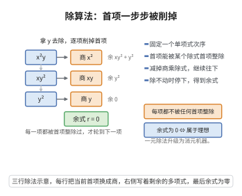

# 除算法

> **一句话大白话**：给定一个单项式次序，多元多项式也能像整数一样做"带余除法"——用一组多项式去除某个多项式，得到若干商与一个余式，而余式里没有任何一项还能被除式的首项整除。
>
> **小例子**：在 $k[x,y]$ 中取字典序、除式 $f=y$，去除 $x^2y+xy^2+y^2$：首项 $x^2y$ 被 $y$ 整除，得商 $x^2$、余 $xy^2+y^2$；再把 $xy^2$ 整除得商 $xy$、余 $y^2$；再把 $y^2$ 整除得商 $y$、余 $0$。于是 $x^2y+xy^2+y^2=(x^2+xy+y)\cdot y$。

## 介绍

除算法（division algorithm，多元多项式除法）是把一元多项式的欧几里得除法推广到多元多项式环 $K[x_1,\dots,x_n]$ 的算法。它回答的问题是：给定多项式 $f$ 和一组"除式" $F=(f_1,\dots,f_s)$，能否把 $f$ 写成

$$f=q_1f_1+\cdots+q_sf_s+r,$$

其中余式 $r$ 满足一个"不能再被约化"的条件：$r$ 的每个单项式都不被任何 $\operatorname{LT}(f_i)$ 整除。

多元除法与一元除法的根本差别在于**余式不唯一**：它依赖除式的排列顺序，也依赖所选单项式序。但当 $F$ 是 Gröbner 基时，余式唯一且与顺序无关，这就使"理想成员判定"（$f\in\langle F\rangle$ 当且仅当余式为 $0$）成为可算法化的判断。因此除算法是 Gröbner 基与 Buchberger 算法的第一步，也是计算代数几何、符号计算系统的地基。

## 几何直观



图意在说明：每步都用首项能整除的除式消去一项，有限步后余式的项不再被任何首项整除。

## 分析

**前置依赖**：良序原理、Hilbert基定理、欧几里得算法

**预备概念**：单项式序 $>$ 是 $K[x_1,\dots,x_n]$ 上全体单项式的一个全序，满足：(i) 与乘法相容，即 $\alpha>\beta\Rightarrow\alpha\gamma>\beta\gamma$；(ii) 是良序，即每个非空单项式集合有最小元。对多项式 $f$，记 $\operatorname{LT}(f)$ 为其首项（关于 $>$ 最大的单项式），$\operatorname{LC}(f)$ 为首系数。

**定理内容（除算法）**：固定单项式序 $>$，设 $F=(f_1,\dots,f_s)$ 是非零多项式的有序组，$f\in K[x_1,\dots,x_n]$。则存在 $q_1,\dots,q_s,r\in K[x_1,\dots,x_n]$ 使得

$$f=q_1f_1+\cdots+q_sf_s+r,$$

且 $r$ 满足：或者 $r=0$，或者 $r$ 是若干单项式的 $K$-线性组合，而其中每个单项式都不被任何 $\operatorname{LT}(f_1),\dots,\operatorname{LT}(f_s)$ 整除。特别地，若 $r\ne0$，则 $\operatorname{LT}(r)$ 不被任何 $\operatorname{LT}(f_i)$ 整除。

**关键要点**：

- 余式 $r$ 一般依赖 $F$ 的排列顺序与单项式序的选择，故多元除法**不唯一**；
- 终止性来自单项式序的良序性：每走一步，当前被处理多项式的首单项式严格下降；
- 若 $F$ 是 Gröbner 基，则余式唯一、与顺序无关，且 $f\in\langle F\rangle\iff r=0$；
- 一元情形（$n=1$）时单项式序唯一，余式唯一，算法退化为欧几里得除法。

## 思考过程

算法的策略是**贪心地约化首项**：始终盯着当前剩余多项式 $p$ 的首项 $\operatorname{LT}(p)$，检查它能否被某个 $\operatorname{LT}(f_i)$ 整除。

- 若能，设 $i$ 是使 $\operatorname{LT}(f_i)\mid\operatorname{LT}(p)$ 的一个下标，令

  $$p\leftarrow p-\frac{\operatorname{LT}(p)}{\operatorname{LT}(f_i)}f_i,\qquad q_i\leftarrow q_i+\frac{\operatorname{LT}(p)}{\operatorname{LT}(f_i)}.$$

  这一步把 $q_i f_i$ 的一部分"扣"到商里，同时把 $p$ 的首项消去（首项与 $\frac{\operatorname{LT}(p)}{\operatorname{LT}(f_i)}f_i$ 的首项相抵消），于是新 $p$ 的首单项式严格小于原来那个。

- 若不能，说明这个首项无法再被约化，把它移入余式：$r\leftarrow r+\operatorname{LT}(p)$、$p\leftarrow p-\operatorname{LT}(p)$。新 $p$ 的首单项式也严格小于原来那个。

两种情形下 $\operatorname{LM}(p)$ 都严格下降。由于单项式序是良序，首单项式不能无限严格下降，算法必在有限步后停止（此时 $p=0$）。这与一元欧几里得算法中"余式次数严格下降"的机制完全一致。

## 证明过程

**算法（多元除法）**：

```
输入：单项式序 >，有序除式组 F=(f_1,...,f_s)，被除式 f
输出：商 q_1,...,q_s 与余式 r
q_1:=...:=q_s:=0;  r:=0;  p:=f
while p ≠ 0:
    若存在 i 使 LT(f_i) | LT(p)：
        取最小的这样的 i
        t := LT(p)/LT(f_i)
        q_i := q_i + t;  p := p - t*f_i
    否则：
        r := r + LT(p);  p := p - LT(p)
返回 q_1,...,q_s, r
```

**步骤 1：不变式。** 断言每一步都有

$$f=q_1f_1+\cdots+q_sf_s+p+r.$$

初始时 $q_i=0$、$p=f$、$r=0$，等式成立。在 $\operatorname{LT}(f_i)\mid\operatorname{LT}(p)$ 的分支，$q_i$ 增加 $t$、$p$ 减少 $t f_i$，等式右端净变化 $t f_i-t f_i=0$；在否则分支，$r$ 增加 $\operatorname{LT}(p)$、$p$ 减少 $\operatorname{LT}(p)$，净变化亦为零。故不变式恒成立。

**步骤 2：终止性。** 记 $\operatorname{LM}(p)$ 为 $p$ 的首单项式（$\operatorname{LM}(0)$ 视为 $\bot$）。

- 在 "$i$ 分支"，新 $p'=p-t f_i$，其中 $t=\operatorname{LT}(p)/\operatorname{LT}(f_i)$ 使 $\operatorname{LT}(t f_i)=\operatorname{LT}(p)$。故 $p'$ 中该项与 $p$ 的首项相消，$\operatorname{LM}(p')<\operatorname{LM}(p)$（关于单项式序 $>$）。
- 在否则分支，$p'=p-\operatorname{LT}(p)$，其各项单项式都严格小于 $\operatorname{LM}(p)$，故 $\operatorname{LM}(p')<\operatorname{LM}(p)$。

于是每步首单项式在良序下严格下降。由良序原理，不存在无穷严格下降的单项式序列，故循环至多执行有限步，终止时 $p=0$。

**步骤 3：余式的性质。** 终止时 $p=0$，由步骤 1 的不变式得

$$f=q_1f_1+\cdots+q_sf_s+r.$$

而 $r$ 只累积了那些"首项不被任何 $\operatorname{LT}(f_i)$ 整除"的项 $\operatorname{LT}(p)$ 的加法。本文断言 $r$ 的每个单项式都不被任何 $\operatorname{LT}(f_i)$ 整除。若不然，设 $r$ 中某个单项式 $m$ 满足 $\operatorname{LT}(f_i)\mid m$ 对某 $i$ 成立，且 $m$ 是 $r$ 中关于 $>$ 的**最大**这类单项式。考虑 $m$ 被加入 $r$ 的那一刻，那时它是 $\operatorname{LM}(p)$，因而不被任何 $\operatorname{LT}(f_i)$ 整除；但 $r$ 后来又加入了若干单项式（都 $<m$，因为在加入 $m$ 之后 $p$ 的首单项式继续严格下降），这些新项的系数不会把 $m$ 的系数改为零（它们单项式不同），故 $m$ 在最终 $r$ 中系数非零，且 $m$ 不被整除，矛盾。故 $r$ 满足定理所述条件。

**步骤 4：Gröbner 基情形余式唯一。** 设 $F=G$ 是理想 $I=\langle G\rangle$ 的 Gröbner 基，即 $\langle\operatorname{LT}(g_1),\dots,\operatorname{LT}(g_t)\rangle=\langle\operatorname{LT}(I)\rangle$。

- **成员判定**：设 $f=q_1g_1+\cdots+q_tg_t+r$ 为除算法输出。若 $r\ne0$，则 $\operatorname{LT}(r)\in\operatorname{LT}(I)$（因 $r\in I$），故存在 $i$ 使 $\operatorname{LT}(g_i)\mid\operatorname{LT}(r)$，与步骤 3 矛盾；故 $r=0$。反之若 $r=0$ 则 $f\in I$。于是

  $$f\in I\iff \text{用 }G\text{ 除 }f\text{ 的余式为 }0.$$
- **唯一性**：设 $f=\sum q_ig_i+r=\sum q_i'g_i+r'$，$r,r'$ 都满足"单项式不被任何 $\operatorname{LT}(g_i)$ 整除"，则 $r-r'\in I$ 且 $r-r'$ 的每个单项式都不被任何 $\operatorname{LT}(g_i)$ 整除（两个此类多项式的差仍有此性质）。若 $r-r'\ne0$，则 $\operatorname{LT}(r-r')\in\operatorname{LT}(I)$，故被某 $\operatorname{LT}(g_i)$ 整除，矛盾。于是 $r=r'$，余式唯一，与除式顺序无关。$\square$

**推论（Gröbner 基的存在性）**：任意理想 $I$ 都有（有限）Gröbner 基。证明思路：由 Hilbert 基定理，$\operatorname{LT}(I)$ 由有限个单项式生成，取这些单项式对应的 $I$ 中元素即得 Gröbner 基；再由 Buchberger 算法（以本除算法为约化子程序）实际算出它。

## 课堂问答

**老师**：多元除算法与一元欧氏除法最大的差别是什么？

**学生**：一元时余式唯一；多元时余式 $r$ 一般依赖除式的排列顺序与所选单项式序，因而并不唯一——只要 $r$ 的每个单项式都不被任何 $\operatorname{LT}(f_i)$ 整除就算终止。但当 $F$ 是 Gröbner 基时余式唯一且与顺序无关，于是 $f\in\langle F\rangle\iff r=0$ 成为可算法化的判定。

**老师（追问）**：算法为什么必然终止？

**学生**：每步都让当前多项式 $p$ 的首单项式 $\operatorname{LM}(p)$ 严格下降。可约化分支取 $t=\operatorname{LT}(p)/\operatorname{LT}(f_i)$ 以 $p\leftarrow p-tf_i$ 消掉首项；否则分支把 $\operatorname{LT}(p)$ 移入余式后 $p\leftarrow p-\operatorname{LT}(p)$，剩下单项式都更小。由单项式序的良序性不存在无穷严格降链，故有限步后 $p=0$。

**老师（拓展）**：它在计算代数几何中的地位如何？

**学生**：它是 Buchberger 算法的约化子程序，是理想成员判定、消去理想、维数计算的共同地基；一元情形退化为欧几里得除法，而 $\gcd$ 的角色由 Gröbner 基扮演。

## 相关条目

- [Grobner基与Buchberger算法](./Grobner基与Buchberger算法.md)：本算法是其约化子程序与成员判定的基础。
- [Hilbert基定理](../第37级-交换代数/Hilbert基定理.md)：保证单项式理想与 Gröbner 基有限生成，从而算法能停下。
- [欧几里得算法](../第27级-初等数论/欧几里得算法.md)：一元情形下本算法的原型。
