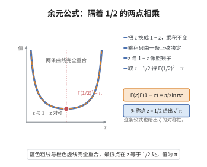

# 余元公式

> **一句话大白话**：Gamma 函数在 $z$ 与 $1-z$ 两点上的值"互补相乘"，其结果只由一条三角函数决定——隔着 $\tfrac12$ 对称的两点，乘积恰是 $\pi/\sin(\pi z)$。
>
> **小例子**：取 $z=\tfrac12$，得 $\Gamma(\tfrac12)^2=\pi/\sin\tfrac{\pi}{2}=\pi$，于是 $\Gamma(\tfrac12)=\sqrt{\pi}$；取 $z=\tfrac13$，则 $\Gamma(\tfrac13)\Gamma(\tfrac23)=\dfrac{2\pi}{\sqrt3}$。

## 介绍

余元公式（Euler's reflection formula，也称 Euler 反射公式）是 Euler 于 1749 年前后得到的 Gamma 函数恒等式，它是 Euler 积分理论中最优美的对称关系之一。公式断言：对任意非整数复数 $z$，

$$
\Gamma(z)\Gamma(1-z)=\frac{\pi}{\sin(\pi z)}.
$$

它的地位在于：把 Gamma 函数——一个通过积分与乘积定义、看似只与实数分析相关的函数——与周期性的三角函数直接联系起来。由它可以立刻算出许多特殊值，例如 $\Gamma(\tfrac12)=\sqrt\pi$、$\Gamma(\tfrac13)\Gamma(\tfrac23)=\tfrac{2\pi}{\sqrt3}$，也解释了 $\sin$ 的零点与 $\Gamma$ 的极点之间的对应。在解析数论中，它常常以"用于改写函数方程"的角色出现：Riemann Zeta 函数的函数方程 $\zeta(s)=\zeta(1-s)$ 的推导，正是靠 Gamma 函数的倍角公式与余元公式把 $\Gamma(s)$ 与 $\Gamma(1-s)$ 相互换算。

## 几何直观

图意在说明：Γ(z)Γ(1−z) 与 π 除以 sin πz 逐点相等，乘积只由正弦决定，在 1/2 处取 π。

## 分析

**前置依赖**：Gamma 函数的定义与解析延拓、Beta 函数及其与 Gamma 函数的关系 $B(p,q)=\dfrac{\Gamma(p)\Gamma(q)}{\Gamma(p+q)}$、Mellin 变换、几何级数逐项积分、部分分式展开 $\dfrac{\pi}{\sin(\pi z)}=\displaystyle\sum_{n\in\mathbb Z}\dfrac{(-1)^n}{z+n}$。

**定理内容**：对任意 $z\in\mathbb C\setminus\mathbb Z$，

$$
\Gamma(z)\Gamma(1-z)=\frac{\pi}{\sin \pi z}.
$$

等价地，对 $0<\mathrm{Re}\,z<1$，有 $\displaystyle\int_0^\infty \frac{u^{z-1}}{1+u}\,du=\frac{\pi}{\sin\pi z}$。

**依赖的概念**：Gamma 函数、Beta 函数、解析延拓、留数、部分分式。

## 思考过程

证明的关键是"把乘积降维成一次积分"。直接对两个 Gamma 积分相乘会得到 $\mathbb{R}_+^2$ 上的二重积分，并不好算；但若先借用 Beta 函数关系 $\Gamma(z)\Gamma(1-z)=B(z,1-z)$，问题就化为一维积分 $\int_0^1 t^{z-1}(1-t)^{-z}\,dt$。再作替换 $t=\frac{u}{1+u}$ 把它搬到半直线 $[0,\infty)$ 上，化为经典的 $\int_0^\infty \frac{u^{z-1}}{1+u}\,du$。

这个积分的处理只需要一个技巧：把它拆成 $[0,1]$ 与 $[1,\infty)$ 两段，对后一段作倒数替换 $u\mapsto 1/u$，两段合并后分母统一为 $1+u$，于是可以按几何级数 $\frac{1}{1+u}=\sum(-1)^n u^n$ 逐项积分，得到两个交错级数。最后一步是识别：所得级数恰好是 $\pi/\sin(\pi z)$ 的部分分式展开。整个证明不需要复围道积分，只用初等的换元与级数运算。

## 证明过程

**步骤 1：化归到 Beta 函数。**

设 $0<\mathrm{Re}\,z<1$。由 Beta 函数与 Gamma 函数的关系 $B(p,q)=\dfrac{\Gamma(p)\Gamma(q)}{\Gamma(p+q)}$，取 $p=z,\ q=1-z$，则 $p+q=1$，$\Gamma(1)=1$，于是

$$
\Gamma(z)\Gamma(1-z)=B(z,1-z)=\int_0^1 t^{z-1}(1-t)^{-z}\,dt.
$$

积分在 $0<\mathrm{Re}\,z<1$ 时收敛，右侧通过解析延拓给出一般的 $z\notin\mathbb Z$。

**步骤 2：变量替换 $t=\dfrac{u}{1+u}$。**

令 $t=\frac{u}{1+u}$（$u\in[0,\infty)$），则 $1-t=\frac{1}{1+u}$，$dt=\frac{du}{(1+u)^2}$。代入得

$$
t^{z-1}(1-t)^{-z}\,dt=\frac{u^{z-1}}{(1+u)^{z-1}}\cdot(1+u)^{z}\cdot\frac{du}{(1+u)^2}=\frac{u^{z-1}}{1+u}\,du.
$$

因此

$$
\Gamma(z)\Gamma(1-z)=\int_0^\infty \frac{u^{z-1}}{1+u}\,du.
$$

**步骤 3：拆段并作倒数替换。**

将积分拆成两段 $I=\int_0^1+\int_1^\infty$。对第二段作 $u=1/v$，则 $du=-dv/v^2$，且

$$
\int_1^\infty \frac{u^{z-1}}{1+u}\,du=\int_0^1 \frac{v^{1-z}}{1+1/v}\cdot\frac{dv}{v^2}=\int_0^1 \frac{v^{-z}}{1+v}\,dv.
$$

于是

$$
I=\int_0^1 \frac{u^{z-1}+u^{-z}}{1+u}\,du.
$$

**步骤 4：逐项积分。**

在 $0\le u<1$ 上 $\dfrac{1}{1+u}=\displaystyle\sum_{n=0}^\infty (-1)^n u^n$，且由一致收敛性可逐项积分：

$$
I=\sum_{n=0}^\infty (-1)^n\left(\int_0^1 u^{z-1+n}\,du+\int_0^1 u^{-z+n}\,du\right)=\sum_{n=0}^\infty (-1)^n\left(\frac{1}{z+n}+\frac{1}{n+1-z}\right).
$$

**步骤 5：对照 $\pi/\sin(\pi z)$ 的部分分式展开。**

由 $\sin$ 的经典部分分式展开 $\dfrac{\pi}{\sin\pi z}=\displaystyle\sum_{n\in\mathbb Z}\dfrac{(-1)^n}{z+n}$，把 $n\le -1$ 与 $n\ge 0$ 合并可得

$$
\frac{\pi}{\sin\pi z}=\frac1z+\sum_{n=1}^\infty (-1)^n\left(\frac{1}{z+n}+\frac{1}{z-n}\right).
$$

而在步骤 4 的级数中，第二项重指标 $m=n+1\ge1$ 后为 $\sum_{m\ge1}(-1)^{m-1}\frac{1}{m-z}=-\sum_{m\ge1}(-1)^m\frac{1}{m-z}$，注意 $\frac{1}{z-m}=-\frac{1}{m-z}$，故两项相加恰为 $\sum_{m\ge1}(-1)^m\big(\frac{1}{z+m}+\frac{1}{z-m}\big)$。于是

$$
\Gamma(z)\Gamma(1-z)=I=\frac{\pi}{\sin\pi z}.
$$

**步骤 6：延拓到全部非整数。**

上式两边在 $0<\mathrm{Re}\,z<1$ 内成立。左边 $\Gamma(z)\Gamma(1-z)$ 与右边 $\pi/\sin(\pi z)$ 都是 $\mathbb C\setminus\mathbb Z$ 上的亚纯函数，两者在非空开集上一致，故由唯一性定理在整个 $\mathbb C\setminus\mathbb Z$ 上相等。$\square$

**注**：当 $z$ 取整数时两侧均为无穷（$\Gamma$ 有极点而 $\sin$ 为零），故必须排除 $z\in\mathbb Z$。

## 课堂问答

**老师**：写出余元公式，并说明为什么它能把 Gamma 函数与三角函数联系起来。

**学生**：$\Gamma(z)\Gamma(1-z)=\frac{\pi}{\sin\pi z}$，对非整数 $z$ 成立。证明先借 Beta 关系 $\Gamma(z)\Gamma(1-z)=B(z,1-z)=\int_0^1 t^{z-1}(1-t)^{-z}\,dt$，把两个 Gamma 积分的乘积降为一次一维积分。

**老师（追问）**：接下来怎么做？

**学生**：作替换 $t=\frac{u}{1+u}$，积分化为 $\int_0^\infty\frac{u^{z-1}}{1+u}\,du$；拆成 $[0,1]$ 与 $[1,\infty)$，后段用 $u=1/v$ 倒数替换后合并为 $\int_0^1\frac{u^{z-1}+u^{-z}}{1+u}\,du$，再用几何级数 $\frac{1}{1+u}=\sum_{n\ge0}(-1)^nu^n$ 逐项积分，所得级数恰好是 $\frac{\pi}{\sin\pi z}=\sum_{n\in\mathbb{Z}}\frac{(-1)^n}{z+n}$ 的部分分式展开。最后用解析唯一性延拓到全体非整数。

**老师（拓展）**：举几个特殊值，并说它在解析数论中的用途。

**学生**：取 $z=\frac12$ 得 $\Gamma(\frac12)^2=\pi$ 即 $\Gamma(\frac12)=\sqrt\pi$；取 $z=\frac13$ 得 $\Gamma(\frac13)\Gamma(\frac23)=\frac{2\pi}{\sqrt3}$。它与倍角公式配合，可把 $\Gamma(s)$ 与 $\Gamma(1-s)$ 互相换算，正是推导 Zeta 函数方程的关键一步。

## 相关条目

- [Zeta函数函数方程](./Zeta函数函数方程.md)：用余元公式与倍角公式把 $\Gamma(s)$ 换算为 $\Gamma(1-s)$，从而导出函数方程。
- [类数公式](./类数公式.md)：类数公式的推导中反复使用 Gamma 函数的特殊值与反射关系。
