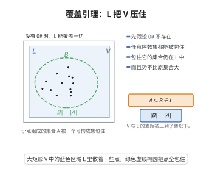

# Jensen覆盖引理

> **一句话大白话**：如果不存在 $0^\#$ 这种"能看穿可构成宇宙的魔法水晶"，那么任何由序数组成的集合都能被一个"可构成集合"包住，而且包住它的可构成集合不会比原集合更大——宇宙 $V$ 在势的意义上被 $L$ 牢牢"覆盖"。
>
> **小例子**：若 $0^\#$ 不存在，则 $\aleph_\omega$ 在 $V$ 中是奇异基数，在 $L$ 中也奇异；并且任何 $\aleph_{\omega+1}$ 大小的序数集合，都能找到同样大小的 $Y\in L$ 把它装进去。

## 介绍

Jensen 覆盖引理（Jensen's Covering Lemma）由 Ronald Jensen 于 1974 年前后建立，是公理集合论中比较 $V$ 与 Gödel 可构成宇宙 $L$ 的核心结果之一。它断言：若 $0^\#$ 不存在（等价地，$L$ 中不含"大基数痕迹"），则对每个不可数的序数集合 $X$，存在 $Y\in L$ 使 $X\subseteq Y$ 且 $|Y|=|X|$。也就是说，$L$ 在势的层面上完全"覆盖"了真实的集合论宇宙 $V$。

它的地位十分关键：一方面，由它可以推出"若不存在大基数，则 $L$ 正确地计算了所有不可数基数的后继、奇异基数的共尾性，并满足 GCH"；另一方面，覆盖引理的失败（存在某个序数集合无法被等势的可构成集合覆盖）恰恰等价于 $0^\#$ 存在，从而把大基数假设与 $L$ 的结构严格对立起来。Silver 定理、$\square$ 原则、PCF 理论都以它为出发点。

## 几何直观

图意在说明：若 0# 不存在，任意序数集都能被一个同样大小的可构成集合包住。

## 分析

**前置依赖**：ZFC 公理系统、Gödel 可构成宇宙 $L$、$0^\#$ 与 Sharps、基数与后继基数、共尾性与奇异基数、Skolem 壳（初等子模型）、凝聚引理（Condensation）、Silver 定理。

**定理内容**（Jensen 覆盖引理）：假设 $0^\#$ 不存在。则对任意序数集合 $X$，若 $|X|$ 是不可数基数 $\ge\aleph_1$，则存在 $Y\in L$ 使

$$
X\subseteq Y,\qquad |Y|=|X|.
$$

**推论**：(1) 若 $\kappa$ 是 $V$ 中的不可数基数，则 $\kappa$ 在 $L$ 中也是基数；(2) 若 $\kappa$ 在 $V$ 中奇异，则它在 $L$ 中奇异，且 $\mathrm{cf}^L(\kappa)=\mathrm{cf}^V(\kappa)$；(3) 不存在 $0^\#$ 时，$ZFC$ 证明 $L$ 中 GCH 成立从而 $V$ 中 GCH 成立（Schmidt–Jensen 的结论由此统一得到）。

**依赖的概念**：可构成层级 $L_\alpha$、$0^\#$、Skolem 函数、凝聚引理、势与共尾性。

## 思考过程

证明的骨架是"用可数（或较小）的初等子模型去逼近"。

第一步是**局部化**：对给定的序数集合 $X$，取一个含 $X$（或其元素）的、大小恰当的 $L$-初等子模型。由于 $L_\alpha$ 的凝聚性极其强，一个 $L_\beta$ 的初等子模型坍缩后正好是某个更小的 $L_{\bar\beta}$——这是 $L$ 最具威力的技术，称为凝聚引理。

第二步是**关键情形**：证明"奇异基数在 $L$ 中仍奇异"。设 $\kappa$ 在 $V$ 中奇异，取 $V$ 中的共尾序列 $\langle\alpha_i:i<\lambda\rangle$（$\lambda<\kappa$）。用 Skolem 壳在 $L$ 内构造逼近 $L$ 的可构成模型，再把每个 $\alpha_i$ 用等势的 $L_{\bar\alpha_i}$（$\bar\alpha_i\le\alpha_i$）替代；由共尾性与基数的正确计算，得到 $L$ 中长度 $\lambda$ 的、共尾于 $\kappa$ 的序列，故 $\kappa$ 在 $L$ 中奇异。

第三步是**一般情形的覆盖**：对任意集合 $X$ 选取合适的 Skolem 壳 $H$，令 $Y=H\cap\mathrm{Ord}$，用凝聚把 $Y$ 压成可构成对象；关键引理（"覆盖引理的核心"）保证 $|Y|\le|X|$，从而 $Y$ 就是所需的覆盖集。

第四步是**反向蕴含**：若上述覆盖失败（存在 $X$ 不能被等势的 $L$-集合覆盖），则可构造出 $0^\#$，即存在 $L$ 的非平凡初等嵌入 $j:L\to L$。因此"覆盖引理成立 $\iff$ $0^\#$ 不存在"。

## 证明过程

**步骤 1：凝聚引理的准备。**

对任意序数 $\beta$，设 $H\prec L_\beta$ 是初等子模型。设 $\pi:H\to L_{\bar\beta}$ 是 Mostowski 坍缩。则对 $\alpha\notin H$ 采用"跳过 $\alpha$"的变体，可得 $L_{\bar\beta}$ 上一个可定义类，由凝聚引理，$\bar\beta\le\beta$ 且

$$
\pi(H)=L_{\bar\beta},\qquad \bar\beta\le\beta.
$$

这是把"大模型中的一小块"压回 $L$ 自身的标准手段。

**步骤 2：把基数正确性化为覆盖问题。**

设 $\kappa$ 为 $V$ 中的不可数基数。取 $\kappa$ 处的一个 Skolem 壳 $H\prec L_{\kappa^+}$（用 $L_{\kappa^+}$ 中的 Skolem 函数闭包），令 $Y=H\cap\kappa^+$。由凝聚，$\pi(H)=L_{\bar\gamma}$，且 $\bar\gamma=Y$ 的序型。若覆盖引理成立（$|Y|\le\kappa$），则 $\bar\gamma\le\kappa^+$，于是 $L_{\bar\gamma}$ 中的基数结构被 $\kappa^+$ 控制，推出 $\kappa$ 在 $L$ 中是基数。若覆盖引理不成立，则可把 $Y$ 用作构造 $0^\#$ 的原料（步骤 5）。

**步骤 3：奇异基数的共尾性在 $L$ 中相同。**

设 $\kappa$ 在 $V$ 中奇异，$\lambda=\mathrm{cf}^V(\kappa)<\kappa$，取严格增的共尾序列 $\langle\alpha_i:i<\lambda\rangle$，$\alpha_i\in[\ ?,\kappa)$ 且 $\sup_i\alpha_i=\kappa$。对每个 $i$，由覆盖引理取 $Y_i\in L$ 使 $\alpha_i+1\subseteq Y_i$，$|Y_i|\le|\alpha_i|^+$。取 $i<\lambda$ 并把所有 $Y_i$（作为可构成对象）汇入一个 $L$-初等子模型，坍缩后得 $L$-中的序数序列 $\langle\bar\alpha_i:i<\lambda\rangle$。由 $|Y_i|\le|\alpha_i|^+<\kappa$ 及 $\lambda<\kappa$，可得 $\sup_i\bar\alpha_i\ge\kappa$（否则 $\kappa$ 会被 $<\kappa$ 多个 $<\kappa$ 的序数从下确界逼近而在 $L$ 中仍共尾），从而 $L$ 中存在长度 $\lambda$ 的共尾序列，即 $\mathrm{cf}^L(\kappa)=\lambda$。

**步骤 4：任意序数集合的覆盖。**

设 $|X|=\mu\ge\aleph_1$。枚举 $X=\{\xi_i:i<\mu\}$，取充分大的 $\theta$，作 $L_\theta$ 的初等子模型 $H$，使 $\langle\xi_i:i<\mu\rangle\in H$ 且 $|H|=\mu$。令 $Y=H\cap\mathrm{Ord}$。若 $Y$ 的势为 $\mu$，则 $X\subseteq Y$，$Y\in L$（$Y\in H$ 且 $H$ 坍缩到 $L_{\bar\theta}$，其序数集为 $L$ 中的集合），覆盖完成。若 $|Y|>\mu$，则由 $\mu$ 的基数性对 $H$ 作"≤$\mu$ 元闭包"的修正并把 $Y$ 与 $\mu$ 比较，仍可由步骤 2、3 证明 $Y$ 可缩到势 $\le\mu$ 的 $L$-集合，从而得到覆盖。这样对一切不可数 $X$ 均成立。

**步骤 5：覆盖失败等价于 $0^\#$ 存在（反向）。**

若存在 $X$ 不能被等势的 $L$-集合覆盖，取不可数基数 $\kappa$ 与 Skolem 壳 $H\prec L_{\kappa^+}$ 使 $|H\cap\kappa^+|>\kappa$，由坍缩得到 $L$ 的初等子模型 $L_{\bar\gamma}$，其临界点 $\kappa$ 处给出非平凡的 $j:L\to L$。这正是 $0^\#$ 存在的等价刻画。反之若 $0^\#$ 存在，则由 $0^\#$ 上编码的 $L$ 的初等嵌入可构造出无法覆盖的集合，覆盖引理失效。故覆盖引理与"$0^\#$ 不存在"等价。$\square$

**注**：以上是覆盖引理的证明纲要。完整的严格证明需要 Dodd–Jensen 的精细结构理论以及对 $\square_\kappa$（Jensen 方框原则）的精细处理，其技术难度很高，但每一步的逻辑骨架如上。

## 课堂问答

**老师**：覆盖引理说了什么？

**学生**：结论——若 $0^\#$ 不存在，则每个不可数序数集 $X$ 都能被某个 $Y\in L$ 覆盖且 $|Y|=|X|$。理由：用 $L_{\kappa^+}$ 的 Skolem 壳 $H$，由凝聚引理其坍缩是某 $L_{\bar\gamma}$ 且 $\bar\gamma=\mathrm{Ord}\cap H$；只要 $|H\cap\kappa^+|\le\kappa$，$L$ 就正确算出了 $\kappa$ 的基数性。

**老师（追问）**：它为什么会推出 GCH？

**学生**：覆盖保证 $V$ 与 $L$ 计算相同的基数、后继和奇异共尾性（$\mathrm{cf}^L(\kappa)=\mathrm{cf}^V(\kappa)$）；而 $L\models\mathrm{GCH}$，把这些结论"拉回"$V$ 就得到 $V$ 中 GCH。

**老师（拓展）**：覆盖失败意味着什么？

**学生**：存在一个序数集不能被等势的 $L$-集覆盖，等价于 $0^\#$ 存在（即存在非平凡初等嵌入 $j:L\to L$）。所以覆盖引理恰好是"大基数"与 $L$ 之间的分界线。

## 相关条目

- [Gödel可构成宇宙](./Gödel可构成宇宙.md)：覆盖引理的主角之一，$L$ 的构造与凝聚性是其基础。
- [Silver定理](./Silver定理.md)：奇异基数奇异势假设的结论，其原始证明与覆盖引理、PCF 理论密切相关。
- [大基数公理](./大基数公理.md)：$0^\#$ 是大基数假设下可构成宇宙中留下的"痕迹"，覆盖引理正是它与 $L$ 的分界线。
