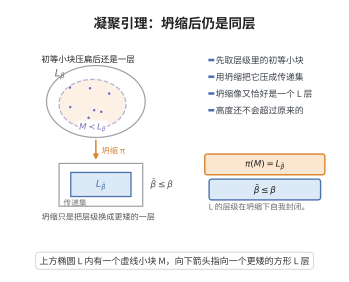

# 凝聚引理

> **一句话大白话**：把可构成层级 $L_\beta$ 的任意一个"初等小块"压成传递集合之后，得到的仍然是一个可构成层级 $L_{\bar\beta}$，而且它不会比原来更高——$L$ 的层级结构在初等子模型的坍缩下完全"自我封闭"。
>
> **小例子**：取 $L_{\omega_1}$ 的一个可数初等子模型 $H$，则 $H$ 的 Mostowski 坍缩恰是某个 $L_{\bar\beta}$，其中 $\bar\beta\le\omega_1$ 且 $\bar\beta=H\cap\mathrm{Ord}$；特别地 $\bar\beta<\omega_1$，所以 $H$ 同构于一个可数层级 $L_{\bar\beta}$。

## 介绍

凝聚引理（Condensation Lemma）是 Kurt Gödel 在 1938–1939 年构造可构成宇宙 $L$ 时提炼出的核心技术引理，也是内模型理论最基本的"自省"工具。它断言：若 $H$ 是可构成层级 $L_\beta$ 的一个初等子模型（即 $H\prec L_\beta$），则 $H$ 在 $\in$-关系下是良基的，因而可以被 Mostowski 坍缩 $\pi$ 压成一个传递集合；而压缩的结果必然仍是某个可构成层级 $L_{\bar\beta}$（$\bar\beta$ 是某个序数），并且 $\bar\beta\le\beta$。

它的价值在于把"$L_\beta$ 中一小块满足与 $L_\beta$ 相同一阶命题的模型"重新识别为 $L$ 自己的一个层级。由于 $L_\alpha$ 的势为 $|\alpha|$，凝聚引理立刻给出"$L$ 的每个可数初等子模型都落在 $L_{\omega_1}$ 之内"这类精细的势估计，从而支撑了三条重要结论：$L\models\mathrm{GCH}$、$\square$ 原理（Jensen 方框原则）的一致性证明，以及 Jensen 覆盖引理中"用 Skolem 壳逼近 $L$"的整个技术路线。可以说，凡是要把"外部世界里的一小块模型"拉回到 $L$ 内部的论证，几乎都要用到凝聚引理。

## 几何直观

图意在说明：层级中的初等小块经 Mostowski 坍缩后，得到的还是同一座层级里更矮的一层。

## 分析

**前置依赖**：Gödel可构成宇宙、Löwenheim-Skolem定理、序数的比较定理、可数集的性质、选择公理AC。

**定理内容**（凝聚引理）：设 $\beta$ 为序数，$H\prec L_\beta$ 是 $L_\beta$ 的初等子模型，$\pi:H\to M$ 是 $H$ 的 Mostowski 坍缩（$\in$-关系下的传递坍缩）。则存在序数 $\bar\beta$ 使

$$
M=L_{\bar\beta},\qquad \bar\beta=\mathrm{Ord}\cap H=\mathrm{Ord}\cap M\le\beta .
$$

特别地，$\pi(H\cap\mathrm{Ord})=\bar\beta$，即坍缩把 $H$ 内的序数保序地映到 $\bar\beta$ 以下的序数。

**推论**：若 $H\prec L_\beta$ 还可数，则 $\bar\beta<\omega_1$；若 $|H|=\kappa$ 是无穷基数，则 $|L_{\bar\beta}|=|\bar\beta|=\kappa$。

**依赖的概念**：可构成层级 $L_\alpha$、可定义子集算子 $\mathrm{Def}$、初等子模型与初等嵌入、Skolem 壳、Mostowski 坍缩、传递类、序数与序型。

## 思考过程

证明的主线是"先坍缩、再识别"。

第一步是**坍缩的存在性**。$L_\beta$ 是传递的、$\in$ 在其上良基，而初等子模型 $H$ 继承了这一良基性（$\in$ 在任何子模型中依然是良基关系，这正是正则公理的后果）。于是由 Mostowski 坍缩定理，存在唯一的传递集合 $M$ 与同构 $\pi:(H,\in)\to(M,\in)$。

第二步是**序数的自动对应**。$H\prec L_\beta$ 蕴含"$x$ 是序数"这一性质在 $H$ 与 $L_\beta$ 之间绝对，故 $H\cap\mathrm{Ord}$ 恰是 $H$ 的全部元素中落在序数类里的那些；而 Mostowski 坍缩保序地把良序结构送到传递集合的序数上，因此 $\pi(H\cap\mathrm{Ord})=\mathrm{Ord}\cap M$ 是一个序数 $\bar\beta$。

第三步是**把 $M$ 认成层级**——这是引理的真正内容。需要说明 $M$ 恰好是"从空集出发、逐级取 $\mathrm{Def}$ 到 $\bar\beta$ 层"的结果。关键观察有两条：其一，"$y=L_\alpha$"这一关系是 $\Sigma_1$ 的、从而对 $H\prec L_\beta$ 绝对；其二，$\mathrm{Def}$ 算子本身是可定义的，故对 $X\in H$，只要 $X=L_\alpha\in H$，则 $L_\beta$ 中的对象 $\mathrm{Def}(L_\alpha)=L_{\alpha+1}$ 可由 $L_\alpha$ 通过一个一阶公式在 $L_\beta$ 中定义出来，于是它属于 $H$。两者合起来说明：$M$ 在"取下一层"这一运算下封闭，且每个 $L_\alpha$（$\alpha<\bar\beta$）都在 $M$ 中。

第四步是**上界 $\bar\beta\le\beta$**。因为 $H\subseteq L_\beta$ 从而 $\mathrm{Ord}\cap H\subseteq\beta$，而 $\bar\beta$ 与 $\mathrm{Ord}\cap H$ 保序同构，由序数的比较定理得 $\bar\beta\le\beta$。

## 证明过程

**步骤 1：$H$ 上的 $\in$-关系良基。**

$L_\beta$ 是传递集合，$\in$ 在 $L_\beta$ 上无无穷下降链（由正则公理）。$H\subseteq L_\beta$ 继承这一点，故 $(H,\in)$ 是良基的外延结构（外延性由 $L_\beta$ 的外延性与 $H$ 的传递性共同保证）。由 Mostowski 坍缩定理，存在唯一传递集合 $M$ 与同构

$$
\pi:(H,\in)\longrightarrow(M,\in),
$$

$\pi$ 保序且保持 $\in$-关系。

**步骤 2：序数在坍缩下不变。**

由 $\Delta_0$ 绝对性，"$x$ 是序数"（即 $x$ 传递且被 $\in$ 良序）在传递模型 $H$、$M$ 与 $L_\beta$ 中一致。于是 $\pi$ 把 $\mathrm{Ord}\cap H$ 保序映到 $\mathrm{Ord}\cap M$；又由 $H\prec L_\beta$ 知 $\mathrm{Ord}\cap H$ 是线性序，故

$$
\bar\beta:=\mathrm{Ord}\cap M=\pi(\mathrm{Ord}\cap H)
$$

是序数。

**步骤 3：$L_\alpha$ 层级在 $H$ 中是绝对的。**

用超穷归纳证明：对每个 $\alpha\le\beta$，

$$
\alpha\in H\ \Longrightarrow\ L_\alpha\in H\ \text{且}\ (L_\alpha)^H=L_\alpha,\qquad \pi(L_\alpha)=L_{\pi(\alpha)} .
$$

基例 $\alpha=0$：空集 $\varnothing$ 由公式 $\forall y\,(y\notin x)$ 定义，故属于 $H$，且被 $\pi$ 送到 $\varnothing=L_0$。后继步：$L_{\alpha+1}=\mathrm{Def}(L_\alpha)$，而"$y=\mathrm{Def}(L_\alpha)$"由 $\Sigma_1$ 公式"存在公式 $\varphi$ 与有限参数 $\bar p\in L_\alpha$ 使 $y=\{z\in L_\alpha:\varphi(z,\bar p)^{L_\alpha}\}$"刻画；该公式对 $H\prec L_\beta$ 绝对，故 $L_{\alpha+1}\in H$ 且 $\pi(L_{\alpha+1})=\mathrm{Def}(\pi(L_\alpha))=L_{\pi(\alpha)+1}$。极限步：$L_\lambda=\bigcup_{\alpha<\lambda}L_\alpha$，由并集的绝对性与 $\pi$ 保持 $\in$，得 $\pi(L_\lambda)=\bigcup_{\alpha<\lambda}\pi(L_\alpha)=L_{\sup_{\alpha<\lambda}\pi(\alpha)}$。

**步骤 4：$M=L_{\bar\beta}$。**

一方面，由步骤 2、3，对每个 $\alpha<\bar\beta$ 有 $\alpha\in M$ 且 $L_\alpha=\pi(L_\alpha)\in M$，而 $M$ 传递，故 $L_{\bar\beta}=\bigcup_{\alpha<\bar\beta}L_\alpha\subseteq M$。另一方面，设 $x\in M$。由 $M$ 传递，$x\subseteq M$ 且 $\mathrm{trcl}(x)$ 的序数 $<\bar\beta$；取 $L_\beta$ 中相应的层级可见 $x\in L_{\bar\beta}$，故 $M\subseteq L_{\bar\beta}$。两边合并得

$$
M=L_{\bar\beta}.
$$

**步骤 5：上界与势。**

由 $H\subseteq L_\beta$ 得 $\mathrm{Ord}\cap H\subseteq\beta$，而 $\pi$ 保序，故 $\bar\beta=\pi(\mathrm{Ord}\cap H)$ 与 $\mathrm{Ord}\cap H$ 同序型；由序数的比较定理得 $\bar\beta\le\beta$。又当 $\bar\beta$ 无穷时 $|L_{\bar\beta}|=|\bar\beta|$，故若 $|H|=\kappa$ 为无穷基数，则 $|\bar\beta|=\kappa$，即 $|L_{\bar\beta}|=\kappa$。$\square$

**注**：步骤 3 是引理的技术核心，它依赖 $L$ 层级定义"足够简单"（$\Sigma_1$）这一事实；对一般模型类此绝对性不成立，这正是 $L$ 的特殊之处，也是凝聚引理只对可构成层级成立的原因。

## 课堂问答

**老师**：凝聚引理为什么被称为 $L$ 的自省工具？

**学生**：结论——若 $H\prec L_\beta$ 是其初等子模型，则其 Mostowski 坍缩满足 $M=L_{\bar\beta}$ 且 $\bar\beta=\mathrm{Ord}\cap H\le\beta$。理由：$\in$ 在 $L_\beta$ 良基故子模型可坍缩；"$y=L_\alpha$"是 $\Sigma_1$、"$y=\mathrm{Def}(x)$"绝对，故 $M$ 对取层运算封闭，只能是某个 $L_{\bar\beta}$。

**老师（追问）**：核心的技术难点在哪一步？

**学生**：在把 $M$ 认成层级这一步。$L_{\alpha+1}=\mathrm{Def}(L_\alpha)$ 由 $\Sigma_1$ 公式刻画，对 $H\prec L_\beta$ 绝对，于是 $L_{\alpha+1}\in H$ 且 $\pi(L_{\alpha+1})=L_{\pi(\alpha)+1}$，说明 $M$ 在"取下一层"下封闭且吸收各级 $L_\alpha$。

**老师（拓展）**：可数子模型给什么结论？

**学生**：若 $H\prec L_\beta$ 还可数，则 $\bar\beta<\omega_1$，即坍缩落在 $L_{\omega_1}$ 之内。这正是证明 $L\models\mathrm{GCH}$ 的关键一步。

## 相关条目

- [Gödel可构成宇宙](./Gödel可构成宇宙.md)：凝聚引理的主角，$L_\alpha$ 层级的构造与绝对性是本引理的直接基础。
- [Jensen覆盖引理](./Jensen覆盖引理.md)：其中的"Skolem 壳逼近"与基数正确性计算全部建立在凝聚引理之上。
- [Löwenheim-Skolem定理](../第123级-模型论/Löwenheim-Skolem定理.md)：保证所需的初等子模型存在并能控制其势。
- [序数的比较定理](../第122级-公理集合论/序数的比较定理.md)：用于得到 $\bar\beta\le\beta$ 这一上界。
