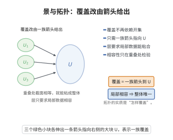

# Grothendieck拓扑与景

> **一句话大白话**：把"什么叫覆盖"彻底提炼成一个抽象概念（取景而非取寻常拓扑打开集），从而让"层"的意义焕然一新——用覆盖去粘合局部性质，就是适层在任意范畴里的灵魂。
>
> **小例子**：取 $C=\mathbf{Sch}$（概形范畴）配上 Zariski、etale 或平坦覆盖，就得到不同的"景"；在其上有大小怪异的层与上同调（如 etale 上同调，用来证明 Weil 猜想）。

## 介绍

Grothendieck拓扑（Grothendieck Topology）和景（Site）是代数几何中由 Alexandre Grothendieck 引入的革命性概念，它为在一般范畴上定义"层"理论提供了基础。传统拓扑空间上的开集结构被推广为范畴上的覆盖系（covering system），使得可以在任意范畴上谈论"局部性质"和"粘合条件"。景是配备了Grothendieck拓扑的范畴，它使得层论可以脱离拓扑空间而独立存在。这一概念是平展上同调、晶体上同调以及更一般的拓扑斯理论（Topos Theory）的基础，是现代代数几何的基石之一。

## 几何直观

图意在说明：把“覆盖”抽象成一族映射到 U 的箭头，层的粘合条件就只依赖重叠处的相容性。

## 分析

**前置依赖**：范畴与函子、纤维积、层与预层、筛子、层化函子与伴随。

**定义**：范畴 $\mathcal{C}$ 上的一个 **Grothendieck拓扑** 是指对每个对象 $U \in \mathcal{C}$，指定一族覆盖族 $\{U_i \to U\}_{i \in I}$，满足：
1. **同构覆盖**：$\{U \xrightarrow{\mathrm{id}} U\}$ 是覆盖。
2. **拉回稳定性**：若 $\{U_i \to U\}$ 是覆盖，则对任意 $V \to U$，$\{U_i \times_U V \to V\}$ 是覆盖。
3. **传递性**（局部覆盖）：若 $\{U_i \to U\}$ 是覆盖，且对每个 $i$，$\{V_{ij} \to U_i\}$ 是覆盖，则 $\{V_{ij} \to U\}$ 是覆盖。

**景**：配备了Grothendieck拓扑的范畴 $(\mathcal{C}, J)$ 称为一个**景**。

**层**：景上的一个层是反变函子 $F: \mathcal{C}^{\mathrm{op}} \to \mathbf{Set}$，满足对每个覆盖 $\{U_i \to U\}$，图表

$$
F(U) \to \prod_i F(U_i) \rightrightarrows \prod_{i,j} F(U_i \times_U U_j)
$$

是等化子（equalizer）。

**依赖的概念**：范畴、纤维积、层、拓扑斯。

**核心定理**：
- 景上的层范畴 $\mathrm{Sh}(\mathcal{C}, J)$ 是一个拓扑斯（Grothendieck Topos）。
- Giraud 定理：Grothendieck 拓扑斯恰好是那些满足 Giraud 公理的范畴。
- 每个拓扑空间 $X$ 诱导一个景（开集范畴上的标准拓扑），且 $X$ 上的层与 $\mathrm{Sh}(X)$ 一致。

## 思考过程

Grothendieck拓扑的核心思想是**抽象覆盖**。在拓扑空间中，开覆盖的概念依赖于点集拓扑，但Grothendieck发现，层论中真正需要的是覆盖的"组合性质"——即上述三条公理。

与传统拓扑对比：
- 传统拓扑：开集 $\subseteq$ 幂集 $(X)$，覆盖由并集定义。
- Grothendieck拓扑：覆盖由态射族定义，使用纤维积代替交集。

这个推广使得我们可以在许多非拓扑的范畴上定义层，例如：
- 在代数簇的平展覆盖上定义平展层。
- 在Zariski拓扑以外的Grothendieck拓扑（如平展拓扑、fppf拓扑、fpqc拓扑）上研究上同调。

## 证明过程

**定理**（景上的层范畴是拓扑斯）：设 $(\mathcal{C}, J)$ 是景，则 $\mathrm{Sh}(\mathcal{C}, J)$ 是 Grothendieck 拓扑斯。即 $\mathrm{Sh}(\mathcal{C}, J)$ 是完备的、余完备的、有幂对象和子对象分类子的范畴。

**证明概要**：

**步骤 1：$\mathrm{Sh}(\mathcal{C}, J)$ 是完备的。**

极限在函子范畴 $[\mathcal{C}^{\mathrm{op}}, \mathbf{Set}]$ 中逐点计算。由于层条件对极限封闭，故 $\mathrm{Sh}(\mathcal{C}, J)$ 在 $[\mathcal{C}^{\mathrm{op}}, \mathbf{Set}]$ 中是完备的。

**步骤 2：$\mathrm{Sh}(\mathcal{C}, J)$ 是余完备的。**

余极限在预层范畴中逐点构造，然后通过"层化"（sheafification）函子 $a: [\mathcal{C}^{\mathrm{op}}, \mathbf{Set}] \to \mathrm{Sh}(\mathcal{C}, J)$ 投射到层范畴。层化函子是左伴随于包含函子，故 $\mathrm{Sh}(\mathcal{C}, J)$ 是余完备的。

**步骤 3：子对象分类子。**

存在子对象分类子 $\Omega$，定义为 $\Omega(U) = \{$覆盖 $U$ 的筛子 $\}$。具体地，$\Omega(U)$ 是 $U$ 的所有 $J$-闭筛子的集合。自然变换 $\mathrm{true}: 1 \to \Omega$ 由 $\mathrm{true}_U(*) = \{\text{最大筛子}\}$ 给出。

**步骤 4：幂对象。**

对任意层 $F$，幂对象 $P(F)$ 定义为 $P(F)(U) = \mathrm{Sub}_{\mathrm{Sh}(\mathcal{C}, J)}(F \times h_U)$，即 $F \times h_U$ 的子层。

**推论**（Giraud定理）：一个范畴 $\mathcal{E}$ 是 Grothendieck 拓扑斯当且仅当 $\mathcal{E}$ 满足以下条件：
1. $\mathcal{E}$ 有有限极限。
2. $\mathcal{E}$ 有任意余极限，且余极限在 $\mathcal{E}$ 中是泛的（universal）和有效的。
3. $\mathcal{E}$ 有积分的族（disjoint coproducts）。
4. $\mathcal{E}$ 中的等价关系是有效的（effective）。
5. $\mathcal{E}$ 有生成元集。

**证明**：Giraud定理的证明是复杂的，涉及拓扑斯结构层化函子的构造。其核心是证明任何满足上述条件的范畴等价于某个景上的层范畴。$\square$

**例**（平展景）：设 $X$ 是概形，定义平展景 $X_{\mathrm{\acute{e}t}}$，其对象是 $X$ 上的平展概形 $U \to X$，覆盖是平展覆盖族。平展层理论是构造平展上同调的基础，也是 Weil 猜想的证明中的关键工具。

## 课堂问答

**老师**：为什么层条件一定要写成对覆盖的等化子 $\prod_i F(U_i)\rightrightarrows\prod_{i,j}F(U_i\times_U U_j)$，而不能"逐点相等"？

**学生**：结论：因为一般范畴里没有"点"，粘合只能靠纤维积给出的两个投影。理由：一条投影来自 $U_i\times_U U_j\to U_i$，另一条来自 $\to U_j$，等化子恰好刻画"局部数据在重叠处一致"。常见误区：以为这是拓扑空间的并集条件照搬，其实用的是纤维积代替交集。

**老师（追问）**：证明"景上的层范畴是拓扑斯"时，哪一步最不易？

**学生**：子对象分类子与余完备性。$\Omega(U)$ 取"$U$ 的 $J$-闭筛子"全体，$\mathrm{true}$ 取最大筛；余极限要先在预层范畴逐点造，再由层化函子 $a\dashv i$ 投射到层范畴。

**老师（拓展）**：Giraud 定理如何反过来刻画拓扑斯？

**学生**：$\mathcal E$ 是 Grothendieck 拓扑斯当且仅当有有限极限、泛而有效的余极限、不交余积、有效等价关系与生成元集。注意"泛余极限"不可省；这一组条件等价于 $\mathcal E\simeq\mathrm{Sh}(\mathcal C,J)$。
