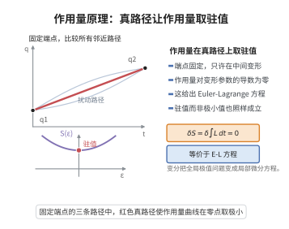

# Lagrangian力学与作用量原理

> **一句话大白话**：自然界选择"最省力"的那条路径——真实运动是所有可能路径中让作用量（能量沿时间的累积）取驻值的特殊一条，而这条驻值路径恰好由 Euler–Lagrange 方程刻画。
>
> **小例子**：自由落体：取 $L=\frac12 m\dot y^2-mgy$，Euler–Lagrange 方程给出 $m\ddot y=-mg$，即 $y(t)=y_0+v_0t-\frac12 gt^2$，与牛顿力学一致。

## 介绍

Lagrangian 力学（Lagrangian mechanics）是 Joseph-Louis Lagrange 在 1788 年的《分析力学》中建立的对经典力学的重写，它用标量函数——Lagrange 函数 $L(q,\dot q,t)=T-V$——替代矢量力，把运动规律浓缩成一组 Euler–Lagrange 方程。其核心是**作用量原理**（Hamilton 原理）：系统的真实运动使作用量泛函

$$
S[q]=\int_{t_1}^{t_2}L\big(q(t),\dot q(t),t\big)\,\mathrm dt
$$

在固定端点的所有容许路径中取驻值（一阶变分为零）。

这一表述是理论物理的统一语言：它不依赖坐标选择，便于处理约束系统；通过 Legendre 变换它等价于 Hamiltonian 力学；通过 Noether 定理，它把对称性直接翻译成守恒律；在量子化时它又成为 Feynman 路径积分的被积相位。因此作用量原理是从经典力学通向场论、相对论、量子力学的枢纽。

## 几何直观

图意在说明：固定端点比较所有邻近路径，只有使作用量一阶变分为零的那条才是真实运动。

## 分析

**前置依赖**：变分法与泛函极值、Euler–Lagrange 方程、分部积分与基本引理、Legendre 变换、守恒量（动量、能量）与 Noether 定理。

**定理内容**（Hamilton 原理）：设 $L:\mathbb R^n\times\mathbb R^n\times\mathbb R\to\mathbb R$ 是 $C^2$ 的 Lagrange 函数。对固定端点 $q(t_1)=q_1,\ q(t_2)=q_2$ 的 $C^2$ 曲线 $q:[t_1,t_2]\to\mathbb R^n$，作用量 $S[q]=\int_{t_1}^{t_2}L(q,\dot q,t)\,\mathrm dt$ 的一阶变分为零（$\delta S=0$）当且仅当 $q$ 满足 Euler–Lagrange 方程

$$
\frac{\mathrm d}{\mathrm dt}\frac{\partial L}{\partial \dot q_i}-\frac{\partial L}{\partial q_i}=0,\qquad i=1,\dots,n.
$$

**依赖的概念**：作用量泛函、变分、驻值路径、广义坐标与广义动量、Euler–Lagrange 算子。

## 思考过程

证明的主线是"把泛函极值问题转化为微分方程"。想法极其朴素：若 $q$ 是使 $S$ 取驻值的路径，那么沿任何保持端点的方向作扰动 $q+\epsilon h$（$h(t_1)=h(t_2)=0$），$S(\epsilon)$ 作为 $\epsilon$ 的函数在 $\epsilon=0$ 处导数为零。

求导时得到的表达式里含 $\dot h$，直接令其为零无法得到偏微分形式的方程。关键一步是**分部积分**：把 $\dot h$ 上的导数"移"到 $\partial L/\partial\dot q_i$ 上，端点项因 $h$ 在端点为零而消失。这样导数表达式变为 $\int(\cdots)h_i\,\mathrm dt$，其中括号内就是 Euler–Lagrange 表达式的负号形式。最后用**变分法的基本引理**：若一个连续函数与一切紧支撑光滑函数的内积都为零，则该函数恒为零。于是括号内必须处处为零，Euler–Lagrange 方程得证。反方向只需把上述推导倒推。

## 证明过程

**步骤 1：写出变分。**

设 $q$ 使 $S$ 取驻值。取任意的 $h\in C^2([t_1,t_2],\mathbb R^n)$ 满足 $h(t_1)=h(t_2)=0$，令 $q_\epsilon=q+\epsilon h$。定义

$$
\varphi(\epsilon)=S[q_\epsilon]=\int_{t_1}^{t_2}L(q+\epsilon h,\dot q+\epsilon\dot h,t)\,\mathrm dt.
$$

由 $q$ 是驻值点，$\varphi'(0)=0$。

**步骤 2：对参数求导并将导数移入积分号。**

由 $L$ 是 $C^2$ 的、$[t_1,t_2]$ 紧，可在积分号下求导：

$$
\varphi'(0)=\int_{t_1}^{t_2}\sum_{i=1}^n\left(\frac{\partial L}{\partial q_i}h_i+\frac{\partial L}{\partial \dot q_i}\dot h_i\right)\mathrm dt.
$$

**步骤 3：对含 $\dot h_i$ 的项分部积分。**

$$
\int_{t_1}^{t_2}\frac{\partial L}{\partial \dot q_i}\dot h_i\,\mathrm dt=\left[\frac{\partial L}{\partial \dot q_i}h_i\right]_{t_1}^{t_2}-\int_{t_1}^{t_2}\frac{\mathrm d}{\mathrm dt}\frac{\partial L}{\partial \dot q_i}\,h_i\,\mathrm dt.
$$

端点项因 $h_i(t_1)=h_i(t_2)=0$ 而消失。代入步骤 2：

$$
0=\varphi'(0)=\int_{t_1}^{t_2}\sum_{i=1}^n\left(\frac{\partial L}{\partial q_i}-\frac{\mathrm d}{\mathrm dt}\frac{\partial L}{\partial \dot q_i}\right)h_i\,\mathrm dt.
$$

**步骤 4：变分法的基本引理。**

记 $E_i(t)=\dfrac{\partial L}{\partial q_i}-\dfrac{\mathrm d}{\mathrm dt}\dfrac{\partial L}{\partial \dot q_i}$，则 $E_i$ 连续，且对一切满足端点条件的 $h$ 有 $\int\sum_i E_i h_i\,\mathrm dt=0$。若某个 $E_j(t_0)\ne0$，取 $h$ 只在 $t_0$ 附近非零且方向指向 $E_j(t_0)$，可使其积分为正，矛盾（基本引理）。故

$$
\frac{\mathrm d}{\mathrm dt}\frac{\partial L}{\partial \dot q_i}-\frac{\partial L}{\partial q_i}=0,\qquad i=1,\dots,n.
$$

**步骤 5：反方向。**

反过来，若 $q$ 满足 Euler–Lagrange 方程，则对任意 $h$ 重复步骤 2–3 的运算，积分中括号项恒为零，故 $\varphi'(0)=0$，即 $q$ 是驻值路径。因此两者等价。$\square$

**步骤 6：Legendre 变换与 Hamilton 形式。**

令广义动量 $p_i=\dfrac{\partial L}{\partial \dot q_i}$，若 Hessian $\big(\partial^2 L/\partial\dot q_i\partial\dot q_j\big)$ 可逆，则可局部解出 $\dot q=\dot q(q,p,t)$。定义 Hamiltonian

$$
H(q,p,t)=\sum_i p_i\dot q_i-L(q,\dot q,t).
$$

对 $H$ 微分并用 Euler–Lagrange 方程，可得正则方程 $\dot q_i=\dfrac{\partial H}{\partial p_i},\ \dot p_i=-\dfrac{\partial H}{\partial q_i}$，与 Poisson 括号形式 $\dot f=\{f,H\}$ 一致。

**注**：作用量原理中的"驻值"不必是最小值（如在某些区间上路径对应的是鞍点或极大），故更准确的名称是"驻值原理"。

## 课堂问答

**老师**：为什么"作用量取驻值"能等价于 Euler–Lagrange 方程，而不必是最小值？

**学生**：结论：$\delta S=0$ 只要求一阶变分为零。理由：令 $q_\epsilon=q+\epsilon h$（端点为零），得 $\varphi'(0)=\int\sum_i(\frac{\partial L}{\partial q_i}h_i+\frac{\partial L}{\partial\dot q_i}\dot h_i)\,dt=0$，再分部积分把 $\dot h_i$ 移走。常见误区：称"最小作用量"，实为驻值，可能是鞍点或极大。

**老师（追问）**：端点项为什么消失，最后一步靠什么定理？

**学生**：端点项 $[\frac{\partial L}{\partial\dot q_i}h_i]$ 因 $h_i(t_1)=h_i(t_2)=0$ 消失；剩下 $\int\sum_i(\frac{\partial L}{\partial q_i}-\frac{d}{dt}\frac{\partial L}{\partial\dot q_i})h_i=0$，由变分法基本引理得括号恒为零。

**老师（拓展）**：怎样过渡到 Hamilton 形式？

**学生**：令 $p_i=\frac{\partial L}{\partial\dot q_i}$，经 Legendre 变换 $H=\sum_i p_i\dot q_i-L$，即得正则方程 $\dot q_i=\frac{\partial H}{\partial p_i}$、$\dot p_i=-\frac{\partial H}{\partial q_i}$，与 Poisson 括号形式一致。

## 相关条目

- [Hamiltonian力学与辛几何](./Hamiltonian力学与辛几何.md)：Lagrange 形式经 Legendre 变换后的等价表述，辛几何为其自然舞台。
- [Noether定理](./Noether定理.md)：作用量在连续对称变换下的不变性直接给出守恒律。
- [Feynman路径积分](./Feynman路径积分.md)：把作用量指数化并对所有路径求和，是作用量原理的量子推广。
