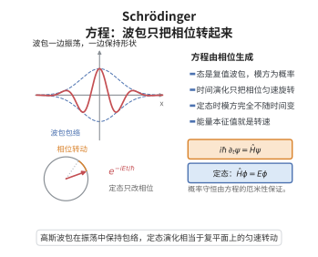

# Schrödinger 方程

> **一句话大白话**：量子态随时间的演化被一句话锁定——"能量算符就是时间导数"：$i\hbar\,\partial_t\psi=\hat H\psi$；波函数相位转得越快，能量就越高，比例系数是 $\hbar$。
>
> **小例子**：自由粒子取 $\hat H=-\frac{\hbar^2}{2m}\partial_x^2$，把平面波 $\psi=e^{i(kx-\omega t)}$ 代入，立刻得到 $\hbar\omega=\frac{\hbar^2k^2}{2m}$，正是经典关系 $E=\frac{p^2}{2m}$ 配上 de Broglie 关系 $E=\hbar\omega$、$p=\hbar k$。

## 介绍

Schrödinger 方程是 Erwin Schrödinger 于 1926 年提出的量子力学基本运动方程，是波动形式的量子力学表述的核心。它断言：给定系统的 Hamiltonian 算符 $\hat H$，态矢 $|\psi(t)\rangle$ 满足 $i\hbar\frac{\mathrm d}{\mathrm dt}|\psi(t)\rangle=\hat H|\psi(t)\rangle$；在位置表象下写成偏微分方程

$$
i\hbar\frac{\partial\psi}{\partial t}=\hat H\psi=-\frac{\hbar^2}{2m}\nabla^2\psi+V(x)\psi .
$$

作为一个基本公理，它不能由更深的原理"证明"，却可以从两个方向自然导出：把经典 Hamilton 函数按 $\{A,B\}\to\frac{1}{i\hbar}[\hat A,\hat B]$、$p\to-i\hbar\nabla$ 作正则量子化；或直接把 de Broglie 的相位假设用于平面波。它的地位相当于经典力学的 $F=ma$：给定初值 $\psi(\,\cdot\,,0)$，方程唯一决定此后所有时刻的态。定态方程 $\hat H\phi=E\phi$ 则是它的分离变量结论，从而把量子问题化为本征值问题（这正是无界自伴算子谱定理的用武之地）。此外，它与 Feynman 路径积分两种表述完全等价。

## 几何直观

图意在说明：方程决定波包的相位演化，模方代表概率，定态时只有相位在匀速旋转。

## 分析

**前置依赖**：Lagrangian力学与作用量原理、Hamiltonian力学与辛几何、Poisson括号与Jacobi恒等式、无界自伴算子的谱定理、Fourier变换与逆变换公式。

**定理内容**：设单粒子系统的经典 Hamilton 函数为 $H(q,p)=\frac{p^2}{2m}+V(q)$。作正则量子化

$$
\hat p=-i\hbar\nabla,\qquad \{\,\cdot\,,\,\cdot\,\}\longrightarrow \frac{1}{i\hbar}[\,\cdot\,,\,\cdot\,],
$$

则位置表象下的态函数 $\psi(x,t)$ 满足 Schrödinger 方程 $i\hbar\partial_t\psi=\hat H\psi$，其中 $\hat H=\frac{\hat p^2}{2m}+V(\hat x)$。

**主要性质**：（1）**概率守恒**：$\partial_t\rho+\nabla\cdot j=0$，$\rho=|\psi|^2$；（2）**定态**：$\psi=e^{-iEt/\hbar}\phi$ 时 $\hat H\phi=E\phi$；（3）**经典对应**（Ehrenfest 定理）：$\langle\hat x\rangle$ 与 $\langle\hat p\rangle$ 满足牛顿方程。

**依赖的概念**：态函数与相位、算符与自伴性、正则对易关系、Hilbert 空间、本征值问题、概率流密度。

## 思考过程

导出方程的最短路径是"相位–能量"关系。de Broglie 假设一个自由粒子携带相位 $e^{i(k\cdot x-\omega t)}$，其中 $\omega=E/\hbar$ 与 $k=p/\hbar$ 是两条经验关系。对平面波直接求导有

$$
\partial_t\psi=-i\omega\psi,\qquad \nabla\psi=ik\psi,
$$

于是 $E\leftrightarrow i\hbar\partial_t$、$p\leftrightarrow -i\hbar\nabla$ 这两个"算符替换"就落在眼前。把 $E=H(q,p)$ 中的 $p$ 换成 $\hat p$，即得 $i\hbar\partial_t\psi=\hat H\psi$。线性性也由此明白：$p$ 在 $H$ 中是二次的，替换后成为二阶微分算子。

有了方程后，概率解释要求 $\int|\psi|^2\,\mathrm dx$ 不随时间改变，这迫使 $|\psi|^2$ 与某个流密度满足连续性方程；这一步是纯计算，只需把方程与其复共轭相加。最后，任何线性方程都可以分离变量，令 $\psi=e^{-iEt/\hbar}\phi$ 便得定态方程；自伴性保证 $E$ 为实数，谱定理保证有一组完备的本征态可以叠加出一般解。

## 证明过程

**定理 1**（由 de Broglie 关系导出方程）：若态函数是平面波，则 Schrödinger 方程等价于经典关系 $E=\frac{p^2}{2m}+V$。

**证明**：取 $\psi(x,t)=Ae^{i(k\cdot x-\omega t)}$。逐项求导得

$$
i\hbar\partial_t\psi=\hbar\omega\,\psi=E\psi,\qquad -i\hbar\nabla\psi=\hbar k\,\psi=p\psi .
$$

把第二式平方作用于 $\psi$ 得 $\hat p^2\psi=p^2\psi$，故 $\hat H\psi=\big(\frac{\hat p^2}{2m}+V\big)\psi=\big(\frac{p^2}{2m}+V\big)\psi=E\psi$，于是 $i\hbar\partial_t\psi=\hat H\psi$。一般波包是平面波的线性组合，而 $\hat H$ 与 $i\hbar\partial_t$ 都是线性算子，故方程对一切叠加态成立。

**定理 2**（概率守恒）：设 $\psi$ 满足 Schrödinger 方程且 $V$ 实值。令 $\rho=|\psi|^2$，$j=\frac{\hbar}{2mi}(\bar\psi\nabla\psi-\psi\nabla\bar\psi)$。则

$$
\frac{\partial\rho}{\partial t}+\nabla\cdot j=0 .
$$

**证明**：由方程得 $\partial_t\psi=\frac{1}{i\hbar}\big(-\frac{\hbar^2}{2m}\nabla^2\psi+V\psi\big)$。取复共轭（$V$ 实）得 $\partial_t\bar\psi=\frac{1}{i\hbar}\big(\frac{\hbar^2}{2m}\nabla^2\bar\psi-V\bar\psi\big)$。于是

$$
\partial_t\rho=\partial_t\bar\psi\,\psi+\bar\psi\,\partial_t\psi
=\frac{\hbar}{2mi}\big(\psi\,\nabla^2\bar\psi-\bar\psi\,\nabla^2\psi\big).
$$

另一方面由乘积法则

$$
\nabla\cdot j=\frac{\hbar}{2mi}\big(\bar\psi\,\nabla^2\psi-\psi\,\nabla^2\bar\psi\big),
$$

因为 $\nabla\bar\psi\cdot\nabla\psi$ 与 $\nabla\psi\cdot\nabla\bar\psi$ 两项相消。两式相加即得 $\partial_t\rho+\nabla\cdot j=0$。积分并用散度定理，若 $\psi$ 在无穷远处衰减足够快则边界项为零，故 $\frac{\mathrm d}{\mathrm dt}\int|\psi|^2\,\mathrm dx=0$，即总概率守恒。

**定理 3**（定态与分离变量）：设 $\psi(x,t)=\phi(x)T(t)$ 是解，则 $T(t)=e^{-iEt/\hbar}$ 且 $\hat H\phi=E\phi$。

**证明**：代入方程得 $i\hbar\phi T'=T\hat H\phi$。在 $\phi T\ne0$ 处两边除以 $\phi T$：

$$
i\hbar\frac{T'(t)}{T(t)}=\frac{\hat H\phi(x)}{\phi(x)} .
$$

左端只依赖 $t$、右端只依赖 $x$，故二者同等于常数 $E$。由右式得定态方程 $\hat H\phi=E\phi$；由左式得 $T'=-iET/\hbar$，即 $T(t)=e^{-iEt/\hbar}$。因 $\hat H$ 自伴，$E$ 为实数；由无界自伴算子的谱定理，$\hat H$ 有实谱分解与完备本征态，故一般解可按定态叠加。

**定理 4**（Ehrenfest 定理）：对不显含时的算符 $A$ 有 $\frac{\mathrm d}{\mathrm dt}\langle A\rangle=\frac{1}{i\hbar}\langle[A,\hat H]\rangle$。特别地

$$
\frac{\mathrm d}{\mathrm dt}\langle\hat x\rangle=\frac{1}{m}\langle\hat p\rangle,\qquad \frac{\mathrm d}{\mathrm dt}\langle\hat p\rangle=-\langle\nabla V\rangle .
$$

**证明**：由 $\langle A\rangle=\int\bar\psi A\psi\,\mathrm dx$ 求导并代入方程及其共轭：

$$
\frac{\mathrm d}{\mathrm dt}\langle A\rangle=\int\big(\partial_t\bar\psi\,A\psi+\bar\psi A\,\partial_t\psi\big)\mathrm dx
=\frac{1}{i\hbar}\int\big(\bar\psi A\hat H\psi-\overline{A\hat H\psi}\,\psi\big)\mathrm dx=\frac{1}{i\hbar}\langle[A,\hat H]\rangle,
$$

最后一步用了 $\hat H$ 与 $A$ 的自伴性。由 $[\hat x,\hat H]=\big[\hat x,\frac{\hat p^2}{2m}\big]=\frac{i\hbar}{m}\hat p$ 与 $[\hat p,\hat H]=[\hat p,V]=-i\hbar\nabla V$，代入即得两式。对自由粒子（$\nabla V=0$）与谐振子它给出严格的经典运动方程，这正是量子–经典对应的精确表述。

**推论**：Schrödinger 方程是 Hilbert 空间中由自伴生成元 $\hat H$ 生成的单参数酉群 $U(t)=e^{-i\hat Ht/\hbar}$ 的无穷小形式，故解为 $\psi(t)=U(t)\psi(0)$ 且 $\|\psi(t)\|=\|\psi(0)\|$（幺正演化）。这与 Feynman 路径积分给出的传播子完全一致。$\square$

## 课堂问答

**老师**：这个方程不能被"证明"，那它凭什么是基本运动方程？

**学生**：结论：它同时被两条路径支持——正则量子化 $p\to-i\hbar\nabla$ 与 de Broglie 平面波相位。理由：对 $\psi=Ae^{i(kx-\omega t)}$ 有 $i\hbar\partial_t\psi=\hbar\omega\psi=E\psi$、$-i\hbar\nabla\psi=\hbar k\psi=p\psi$，把 $E=H(q,p)$ 中的 $p$ 换 $\hat p$ 即得。常见误区：把它当作可由经典力学推出的定理。

**老师（追问）**：概率守恒是怎么来的？

**学生**：由方程与其复共轭相加，令 $\rho=|\psi|^2$、$j=\frac{\hbar}{2mi}(\bar\psi\nabla\psi-\psi\nabla\bar\psi)$，得 $\partial_t\rho+\nabla\cdot j=0$，其中 $\nabla\bar\psi\cdot\nabla\psi$ 与 $\nabla\psi\cdot\nabla\bar\psi$ 两项相消。

**老师（拓展）**：定态与经典对应各说明什么？

**学生**：分离变量 $\psi=e^{-iEt/\hbar}\phi$ 给定态方程 $\hat H\phi=E\phi$，自伴性保证 $E$ 为实、谱定理给完备本征态；Ehrenfest 定理 $\frac{d}{dt}\langle A\rangle=\frac{1}{i\hbar}\langle[A,\hat H]\rangle$ 让 $\langle\hat x\rangle,\langle\hat p\rangle$ 精确满足牛顿方程。

## 相关条目

- [Feynman路径积分](./Feynman路径积分.md)：把作用量指数化并对路径求和，给出的传播子等价于 Schrödinger 方程的解。
- [无界自伴算子的谱定理](./无界自伴算子的谱定理.md)：保证 $\hat H$ 的谱分解与定态完备性，使分离变量法合法。
- [Hamiltonian力学与辛几何](./Hamiltonian力学与辛几何.md)：经典侧的 $H(q,p)$ 是正则量子化的出发点。
- [Poisson括号与Jacobi恒等式](./Poisson括号与Jacobi恒等式.md)：提供 $\{\,\cdot\,,\,\cdot\,\}\to\frac{1}{i\hbar}[\,\cdot\,,\,\cdot\,]$ 这一量子化对应。
