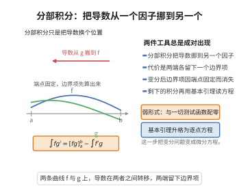

# 分部积分与基本引理

> **一句话大白话**：变分法里最关键的一道"手续"——先用分部积分把落在"变化率"上的导数搬到系数上（端点项因固定端点而消失），再用基本引理把"对一切测试函数积分为零"升级为"被积函数处处为零"，于是积分形式的驻值条件就变成逐点的微分方程。
>
> **小例子**：若 $\int_a^b h(t)\eta'(t)\,\mathrm dt=0$ 对一切紧支光滑的 $\eta$ 成立，则 $h$ 必是常数；这正是"由弱形式得到 Euler–Lagrange 方程"时缺的最后一块拼图。

## 介绍

分部积分（integration by parts）与变分法基本引理（fundamental lemma of the calculus of variations）是变分法、有限元方法与偏微分方程弱解理论中最常用的两件工具，而且几乎总是成对出现。分部积分把导数在乘积的两个因子之间"转移"，它只是微积分基本定理的改写：对 $(fg)'=f'g+fg'$ 两边积分得 $\int_a^b f g'\,\mathrm dt=[fg]_a^b-\int_a^b f'g\,\mathrm dt$。变分法的基本引理则说明：一个连续（更一般地，局部可积）函数若与一切紧支光滑函数的内积都为零，则它必恒为零。

分开看，前者是微积分的事实、后者是逼近与测度的事实；但在变分问题中只有组合起来才见效：作用量的一阶变分经分部积分后化为"某个函数乘测试函数的积分"，再据基本引理读出 Euler–Lagrange 方程。与之配套的还有 du Bois-Reymond 引理——测试函数上带导数的那种情形，它把待定函数确定到相差一个常数。这三条合起来，正是从"作用量取驻值"走到"运动方程"的完整逻辑链条。

## 几何直观

图意在说明：分部积分把导数在乘积因子间转移，代价是端点上的边界项，端点固定时该项消失。

## 分析

**前置依赖**：分部积分法、微积分基本定理、积分中值定理、变分法基本引理。

**定理内容**：（1）**分部积分**：设 $f,g\in C^1[a,b]$，则

$$
\int_a^b f(t)g'(t)\,\mathrm dt=\big[f(t)g(t)\big]_a^b-\int_a^b f'(t)g(t)\,\mathrm dt .
$$

（2）**基本引理**：设 $h\in C^0[a,b]$，若对一切 $\eta\in C_c^\infty(a,b)$ 有 $\int_a^b h\eta\,\mathrm dt=0$，则 $h\equiv0$。

（3）**du Bois-Reymond 引理**：设 $h\in C^0[a,b]$，若对一切 $\eta\in C_c^\infty(a,b)$ 有 $\int_a^b h\eta'\,\mathrm dt=0$，则 $h$ 为常数。

**组合应用**：设 Lagrange 函数 $L(q,\dot q,t)$ 为 $C^2$。若 $q$ 是作用量 $S[q]=\int_{t_1}^{t_2}L\,\mathrm dt$ 在固定端点类中的驻值路径，则对一切满足 $h(t_1)=h(t_2)=0$ 的 $h$ 有

$$
\int_{t_1}^{t_2}\sum_i\Big(\frac{\partial L}{\partial q_i}-\frac{\mathrm d}{\mathrm dt}\frac{\partial L}{\partial\dot q_i}\Big)h_i\,\mathrm dt=0 .
$$

由基本引理即得 Euler–Lagrange 方程。

**依赖的概念**：紧支集光滑函数（凸包函数）、连续性与一致连续性、积分的单调性与中值性、磨光（卷积逼近）、弱形式与强形式。

## 思考过程

分部积分的证明只是一次 Newton–Leibniz 公式的应用，没有难点。基本引理也不难：它靠"用连续性把某点的一个正取值放大到整个小区间，再拿一个在该区间为正的凸包函数作测试"来反证——一个与正函数积出的正数不可能等于零。

真正需要动脑筋的是 du Bois-Reymond 引理：测试函数上带着导数，直接取 $\eta$ 为凸包函数得不到 $h$ 的逐点信息。标准办法是**先把 $h$ 的一次积分构造出来**：令 $c$ 为 $h$ 在 $[a,b]$ 上的平均值，定义 $H(t)=\int_a^t\big(h(s)-c\big)\mathrm ds$。这样 $H(a)=0$，而由 $c$ 的取法 $H(b)=0$，并且 $H'=h-c$。于是 $H$ 本身就是一个"端点为 0"的测试函数形状，代入假设便得到 $\int(h-c)H'=\int(h-c)^2=0$。$H$ 未必光滑，但只要先对 $h-c$ 作磨光、保持端点为 0，论证就严格；最后用积分的正性读出 $h\equiv c$。这个"用未知函数的一次积分当测试函数"的技巧，是变分法中最经典的一招。

## 证明过程

**步骤 1：分部积分公式。**

设 $f,g\in C^1[a,b]$，则 $(fg)'=f'g+fg'$ 连续。由微积分基本定理

$$
\int_a^b\big(f g\big)'(t)\,\mathrm dt=f(b)g(b)-f(a)g(a)=\big[fg\big]_a^b .
$$

把 $(fg)'=f'g+fg'$ 代入并移项即得分析中所列的分部积分公式。

**步骤 2：基本引理。**

设 $h\in C^0[a,b]$ 且对一切 $\eta\in C_c^\infty(a,b)$ 有 $\int_a^b h\eta\,\mathrm dt=0$。反证：若存在 $t_0\in(a,b)$ 使 $h(t_0)>0$，由连续性可取 $\delta>0$ 使 $[t_0-\delta,t_0+\delta]\subset(a,b)$ 且其上 $h\ge c:=h(t_0)/2>0$。取凸包函数

$$
\varphi(t)=\begin{cases}e^{-1/(\delta^2-(t-t_0)^2)},& |t-t_0|<\delta,\\ 0,& |t-t_0|\ge\delta,\end{cases}
$$

则 $\varphi\in C_c^\infty(a,b)$、$\varphi\ge0$ 且在 $|t-t_0|<\delta$ 上严格为正。由积分的单调性

$$
\int_a^b h\varphi\,\mathrm dt\ge c\int_{t_0-\delta}^{t_0+\delta}\varphi\,\mathrm dt>0,
$$

与假设矛盾。对 $-h$ 同理排除 $h<0$ 的可能，故 $h\equiv0$。

**步骤 3：du Bois-Reymond 引理。**

设 $h\in C^0[a,b]$ 且 $\int_a^b h\eta'\,\mathrm dt=0$ 对一切 $\eta\in C_c^\infty(a,b)$ 成立。令 $c=\frac{1}{b-a}\int_a^b h(s)\,\mathrm ds$，则 $\int_a^b (h-c)\,\mathrm ds=0$。定义

$$
H(t)=\int_a^t\big(h(s)-c\big)\,\mathrm ds,\qquad t\in[a,b],
$$

则 $H(a)=0$、$H(b)=\int_a^b(h-c)=0$，且 $H$ 绝对连续、$H'=h-c$ 几乎处处。取磨光核 $\rho_\epsilon$ 与 $H_\epsilon=H*\rho_\epsilon$ 并作端点修正（把 $(h-c)$ 先截断在 $(a+\epsilon,b-\epsilon)$ 内再积分），可得一族 $\eta_\epsilon\in C_c^\infty(a,b)$ 使 $\eta_\epsilon'\to h-c$ 于 $L^1$。把 $\eta=\eta_\epsilon$ 代入假设并令 $\epsilon\to0$：

$$
0=\int_a^b h\,\eta_\epsilon'\,\mathrm dt\longrightarrow\int_a^b h\,(h-c)\,\mathrm dt=\int_a^b (h-c)^2\,\mathrm dt .
$$

末一步用了 $\int_a^b c\,(h-c)\,\mathrm dt=c\int(h-c)=0$。于是 $\int_a^b(h-c)^2=0$，被积函数连续非负，故 $h\equiv c$ 为常数。

**步骤 4：组合成 Euler–Lagrange 方程。** 设 $q$ 是 $S[q]=\int_{t_1}^{t_2}L(q,\dot q,t)\,\mathrm dt$ 的驻值路径，取 $h\in C^2$、$h(t_1)=h(t_2)=0$，令 $q_\epsilon=q+\epsilon h$。由 $L\in C^2$ 可在积分号下求导，$\frac{\mathrm d}{\mathrm d\epsilon}\big|_0 S=0$ 给出

$$
\int_{t_1}^{t_2}\sum_i\Big(\frac{\partial L}{\partial q_i}h_i+\frac{\partial L}{\partial\dot q_i}\dot h_i\Big)\mathrm dt=0 .
$$

对第二项用分部积分（步骤 1），端点项因 $h_i(t_1)=h_i(t_2)=0$ 而消失：

$$
\int_{t_1}^{t_2}\frac{\partial L}{\partial\dot q_i}\dot h_i\,\mathrm dt=-\int_{t_1}^{t_2}\frac{\mathrm d}{\mathrm dt}\frac{\partial L}{\partial\dot q_i}h_i\,\mathrm dt .
$$

合并后

$$
\int_{t_1}^{t_2}\sum_i\Big(\frac{\partial L}{\partial q_i}-\frac{\mathrm d}{\mathrm dt}\frac{\partial L}{\partial\dot q_i}\Big)h_i\,\mathrm dt=0 .
$$

记 $E_i=\frac{\partial L}{\partial q_i}-\frac{\mathrm d}{\mathrm dt}\frac{\partial L}{\partial\dot q_i}$，它连续。对任一固定指标 $i$，取 $h_j\equiv0$（$j\ne i$）而 $h_i$ 为任意满足端点条件的测试函数，得 $\int E_i h_i\,\mathrm dt=0$，由步骤 2 的基本引理得 $E_i\equiv0$，即

$$
\frac{\mathrm d}{\mathrm dt}\frac{\partial L}{\partial\dot q_i}-\frac{\partial L}{\partial q_i}=0,\qquad i=1,\dots,n .
$$

**步骤 5：高维版本。** 把区间 $[a,b]$ 换成区域 $\Omega\subset\mathbb R^n$、分部积分换成格林公式/散度定理，上述论证逐字成立：把 $\int_\Omega E\,\eta=0$ 对一切 $\eta\in C_c^\infty(\Omega)$ 化为 $E\equiv0$；du Bois-Reymond 引理也相应推广为"散度形式的弱等式蕴含其强形式"。这正是有限元弱解理论与变分原理的共同起点。$\square$

## 课堂问答

**老师**：为什么"对一切测试函数积分为零"能升级成"被积函数处处为零"？

**学生**：结论：靠连续性加正凸包函数反证。理由：若 $h(t_0)>0$，取邻域上 $h\ge c>0$，测试函数 $\varphi=e^{-1/(\delta^2-(t-t_0)^2)}\ge0$ 且内部严格正，则 $\int h\varphi\ge c\int\varphi>0$，矛盾；对 $-h$ 同理。常见误区：以为需要比可积性更强的收敛假设，其实 $L^1_{\mathrm{loc}}$ 就够（用磨光）。

**老师（追问）**：du Bois-Reymond 引理（测试函数带导数）怎么处理？

**学生**：先构造 $h$ 的一次积分 $H(t)=\int_a^t(h(s)-c)\,ds$，$c$ 取均值使 $H(a)=H(b)=0$，代入假设得 $\int_a^b(h-c)^2\,ds=0$，故 $h\equiv c$ 为常数。这里用了 $\int_a^b(h-c)H'\,ds=\int_a^b(h-c)^2\,ds$。

**老师（拓展）**：这套工具怎样产出 Euler–Lagrange 方程？

**学生**：作用量变分经分部积分把 $\dot h$ 的导数移到系数上，端点项因 $h$ 固定端点消失，得 $\int\sum_i E_ih_i=0$，由基本引理 $E_i=\frac{\partial L}{\partial q_i}-\frac{d}{dt}\frac{\partial L}{\partial\dot q_i}\equiv0$；高维换成散度定理，就是有限元弱解的起点。

## 相关条目

- [变分法基本引理](./变分法基本引理.md)：本引理的第二部分，单独讨论了弱形式到逐点形式的升级。
- [Lagrangian力学与作用量原理](./Lagrangian力学与作用量原理.md)：把分部积分与基本引理组合起来，从驻值条件得到 Euler–Lagrange 方程。
- [变分原理与Euler-Lagrange方程](./变分原理与Euler-Lagrange方程.md)：本套工具的一般化叙述与场论推广。
- [分部积分法](../第11级-单变量微积分/分部积分法.md)：分部积分公式与其基本例题。
- [微积分基本定理](../第11级-单变量微积分/微积分基本定理.md)：分部积分公式的根据。
