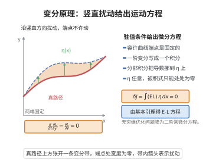

# 变分原理与 Euler-Lagrange 方程

> **一句话大白话**：一个泛函若在所有"允许的扰动"下取驻值，就等价于它的被积函数满足一组微分方程——Euler–Lagrange 方程；变分原理就是"整体取极值 $\Rightarrow$ 局部微分方程"的翻译机。
>
> **小例子**：$J[y]=\int_a^b L(x,y,y')\,\mathrm dx$ 取驻值给出 $\frac{\mathrm d}{\mathrm dx}\frac{\partial L}{\partial y'}-\frac{\partial L}{\partial y}=0$；取 $L=\sqrt{1+y'^2}$ 得 $y''=0$，即平面上光滑曲线中最短者必为直线。

## 介绍

变分原理（variational principle）与 Euler–Lagrange 方程是变分法的核心。它的一般形式是：给定泛函

$$
J[y]=\int_a^b L\big(x,y(x),y'(x)\big)\,\mathrm dx,
$$

若曲线 $y$ 在所有具有相同端点、且足够光滑的比较曲线中使 $J$ 取驻值（即一阶变分为零），则 $y$ 必满足 Euler–Lagrange 方程。这一步把"全局的极值问题"翻译成"局部的二阶微分方程"，从而把一个无穷维的优化问题化为有限阶 ODE/PDE 的求解问题。

Euler 与 Lagrange 于 18 世纪中叶建立这一框架，此后它一直是理论物理的统一语言：力学的最小作用量原理、光学的 Fermat 原理、广义相对论的 Einstein–Hilbert 作用量、规范场论的 Yang–Mills 作用量，全都是"某个泛函取驻值给出运动方程"的实例。它与 Lagrange 力学、Hamilton 力学、Noether 定理层层相连，也是有限元方法的离散化起点。

## 几何直观

图意在说明：端点固定的竖直扰动经分部积分后留下待定因子，任意性迫使它处处为零，即得方程。

## 分析

**前置依赖**：Lagrangian力学与作用量原理、变分法基本引理、第一变分公式、分部积分法。

**定理内容**（Euler–Lagrange 方程）：设 $L(x,y,y')$ 关于其三个变量为 $C^2$。则 $y\in C^2[a,b]$ 在固定端点 $y(a)=y_a,\ y(b)=y_b$ 的类中使泛函 $J[y]=\int_a^b L\,\mathrm dx$ 取驻值，当且仅当

$$
\frac{\mathrm d}{\mathrm dx}\frac{\partial L}{\partial y'}-\frac{\partial L}{\partial y}=0 .
$$

**多函数形式**：对 $J[y_1,\dots,y_n]=\int_a^b L\big(x,y_1,\dots,y_n,y_1',\dots,y_n'\big)\mathrm dx$，方程组为

$$
\frac{\mathrm d}{\mathrm dx}\frac{\partial L}{\partial y_i'}-\frac{\partial L}{\partial y_i}=0,\qquad i=1,\dots,n .
$$

**含高阶导形式**：对 $L(x,y,y',y'')$，方程为 $\frac{\mathrm d^2}{\mathrm dx^2}\frac{\partial L}{\partial y''}-\frac{\mathrm d}{\mathrm dx}\frac{\partial L}{\partial y'}+\frac{\partial L}{\partial y}=0$。

**场论形式**：对场 $\phi(x)$ 与 Lagrange 密度 $\mathcal L(\phi,\partial_\mu\phi)$，方程为 $\partial_\mu\frac{\partial\mathcal L}{\partial(\partial_\mu\phi)}-\frac{\partial\mathcal L}{\partial\phi}=0$。

**依赖的概念**：变分与第一变分、容许曲线与固定端点、弱形式与强形式、泛函的驻值、Legendre 条件、Noether 对称–守恒对应。

## 思考过程

证明的结构与"函数取极值则导数为零"完全平行，只是把"方向导数"换成"沿扰动方向的第一变分"。取一条扰动方向 $h$（端点为零），令 $y_\epsilon=y+\epsilon h$，则 $J(\epsilon)=J[y_\epsilon]$ 是关于 $\epsilon$ 的普通函数，驻值条件就是 $J'(0)=0$ 对一切这样的 $h$ 成立。

把 $J'(0)$ 写开后会出现 $h$ 与 $h'$ 两项：形如 $\int\big(\frac{\partial L}{\partial y}h+\frac{\partial L}{\partial y'}h'\big)\mathrm dx=0$。含 $h'$ 的那一项不能直接读出 $h$ 的系数，必须用分部积分把导数从 $h'$ 搬到系数上，端点项因 $h(a)=h(b)=0$ 而消失。于是等式变成 $\int E\,h\,\mathrm dx=0$，其中 $E=\frac{\partial L}{\partial y}-\frac{\mathrm d}{\mathrm dx}\frac{\partial L}{\partial y'}$ 连续。最后用变分法基本引理（"与一切测试函数积分为零的连续函数恒为零"）得 $E\equiv0$，这正是 Euler–Lagrange 方程。反方向把推导倒推即可。多函数与高阶导情形只是把同一个论证逐分量、逐阶重复；场论情形则把一维的分部积分换成多重分部积分（散度定理）。

## 证明过程

**步骤 1：写出第一变分。**

设 $y$ 使 $J$ 取驻值，$h\in C^2[a,b]$ 满足 $h(a)=h(b)=0$，令 $y_\epsilon=y+\epsilon h$，定义

$$
\varphi(\epsilon)=J[y_\epsilon]=\int_a^b L\big(x,y+\epsilon h,y'+\epsilon h'\big)\mathrm dx .
$$

由 $L\in C^2$ 与 $[a,b]$ 紧，可在积分号下求导，$\varphi'(0)=0$ 给出

$$
\varphi'(0)=\int_a^b\Big(\frac{\partial L}{\partial y}h+\frac{\partial L}{\partial y'}h'\Big)\mathrm dx=0 .
$$

这正是作用量的一阶变分 $\delta J=0$（第一变分公式）。

**步骤 2：分部积分。**

对含 $h'$ 的项用分部积分（见 [分部积分法](../第11级-单变量微积分/分部积分法.md)）：

$$
\int_a^b\frac{\partial L}{\partial y'}h'\,\mathrm dx=\Big[\frac{\partial L}{\partial y'}h\Big]_a^b-\int_a^b\frac{\mathrm d}{\mathrm dx}\frac{\partial L}{\partial y'}\,h\,\mathrm dx .
$$

端点项因 $h(a)=h(b)=0$ 消失。代入步骤 1：

$$
\int_a^b\Big(\frac{\partial L}{\partial y}-\frac{\mathrm d}{\mathrm dx}\frac{\partial L}{\partial y'}\Big)h\,\mathrm dx=0 .
$$

**步骤 3：基本引理与 Euler–Lagrange 方程。**

记 $E(x)=\frac{\partial L}{\partial y}-\frac{\mathrm d}{\mathrm dx}\frac{\partial L}{\partial y'}$，它连续。因 $\{h\}$ 可任意取遍 $C_c^\infty(a,b)$ 的成员（把 $h$ 换成凸包函数即可），由变分法基本引理得 $E\equiv0$，即

$$
\frac{\mathrm d}{\mathrm dx}\frac{\partial L}{\partial y'}-\frac{\partial L}{\partial y}=0 .
$$

**步骤 4：反方向。** 设 $y$ 满足该方程。对任意满足端点条件的 $h$，把步骤 1、2 的运算反向重做，积分中 $h$ 的系数恒为零，故 $\varphi'(0)=0$，即 $y$ 为驻值路径。于是"驻值 $\iff$ 满足 Euler–Lagrange 方程"。

**步骤 5：多函数情形。** 对 $J[y_1,\dots,y_n]$，取扰动 $h=(h_1,\dots,h_n)$。逐项重复步骤 1–3，并把 $(h_i)$ 中除 $h_i$ 外的分量取零，得每个分量独立的等式 $\int E_i h_i\,\mathrm dx=0$，故 $E_i\equiv0$，即 $n$ 个 EL 方程。对应的几何例子是测地线：$L=\frac12 g_{ij}\dot x^i\dot x^j$ 的 EL 方程即测地线方程 $\ddot x^k+\Gamma^k_{ij}\dot x^i\dot x^j=0$。

**步骤 6：场论情形。** 设作用量 $S[\phi]=\int_\Omega\mathcal L(\phi,\partial_\mu\phi)\,\mathrm d^nx$，取紧支扰动 $\eta$，其第一变分为 $\delta S=\int_\Omega\big(\frac{\partial\mathcal L}{\partial\phi}\eta+\frac{\partial\mathcal L}{\partial(\partial_\mu\phi)}\partial_\mu\eta\big)\mathrm d^nx=0$。对第二项作多重分部积分（散度定理），利用 $\eta|_{\partial\Omega}=0$ 去掉边界项：

$$
\delta S=\int_\Omega\Big(\frac{\partial\mathcal L}{\partial\phi}-\partial_\mu\frac{\partial\mathcal L}{\partial(\partial_\mu\phi)}\Big)\eta\,\mathrm d^nx=0 .
$$

由基本引理（高维版本）对一切 $\eta$ 成立即得

$$
\partial_\mu\frac{\partial\mathcal L}{\partial(\partial_\mu\phi)}-\frac{\partial\mathcal L}{\partial\phi}=0 .
$$

Yang–Mills 方程、Maxwell 方程、Einstein 方程都是它的特例。

**步骤 7：二阶条件与对称性。** $\delta J=0$ 只是极值的必要条件；判定极小还须 Legendre 条件 $\frac{\partial^2 L}{\partial y'^2}\ge0$（第二变分非负）。此外，若 $\mathcal L$ 在某个连续对称变换下不变，则由 Noether 定理存在对应的守恒流 $\partial_\mu j^\mu=0$——这正是变分原理与守恒律的桥梁。$\square$

## 课堂问答

**老师**：为什么泛函取驻值能化成微分方程，而多函数、高阶导、场论情形是同一套论证？

**学生**：结论：核心是"分部积分加基本引理"。理由：$\delta J=\int(\frac{\partial L}{\partial y}h+\frac{\partial L}{\partial y'}h')\,dx=0$，把 $h'$ 的导数搬到系数上，端点项消失得 $\int E h\,dx=0$，由基本引理 $E\equiv0$。常见误区：以为要先转成 Hamilton 形式才能处理场论。

**老师（追问）**：多函数情形为什么要逐个令 $h_i=0$？

**学生**：这样才能把 $\int\sum_i E_ih_i\,dx=0$ 拆成每个 $\int E_ih_i\,dx=0$，对每个 $i$ 单独用基本引理得 $E_i\equiv0$。几何例子是测地线方程 $\ddot x^k+\Gamma^k_{ij}\dot x^i\dot x^j=0$。

**老师（拓展）**：$\delta J=0$ 就足以判定极小吗？

**学生**：不够，它只是必要条件；判定极小还须 Legendre 条件 $\frac{\partial^2L}{\partial y'^2}\ge0$（第二变分非负）。而对称性经 Noether 定理转成守恒流 $\partial_\mu j^\mu=0$。场论版本经多重分部积分给出 $\partial_\mu\frac{\partial\mathcal L}{\partial(\partial_\mu\phi)}-\frac{\partial\mathcal L}{\partial\phi}=0$。

## 相关条目

- [Lagrangian力学与作用量原理](./Lagrangian力学与作用量原理.md)：本方程在经典力学中的具体化身，并给出 Legendre 变换到 Hamilton 形式。
- [分部积分与基本引理](./分部积分与基本引理.md)：本证明所使用的两件技术工具。
- [变分法基本引理](./变分法基本引理.md)：把弱形式升级为强形式的最后一步。
- [第一变分公式](../第59级-几何分析/第一变分公式.md)：$\delta J$ 的一般计算，用于测地线与极小曲面等几何变分问题。
- [Yang-Mills方程](./Yang-Mills方程.md)：以本方程为出发点，对规范势取变分得到 $d_A*F_A=0$。
