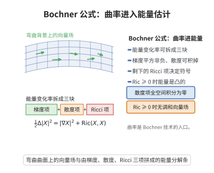

# Bochner公式

> **一句话大白话**：它是一架"守恒天平"——左边是某个函数梯度长度平方的拉普拉斯，右边被拆成三块：一块恒非负的 Hessian 平方、一块梯度与自身拉普拉斯的内积、再加一块曲率。正曲率那一块被迫为正，于是平方项只能为零，调和对象被"挤没了"。
>
> **小例子**：在 $\mathbb R^n$ 上 $\mathrm{Ric}=0$，公式退化为 $\frac12\Delta|\nabla f|^2=|\mathrm{Hess}\,f|^2+\langle\nabla f,\nabla\Delta f\rangle$；而若 $f$ 调和（$\Delta f=0$），则 $|\nabla f|^2$ 是次调和的，由极大值原理可知紧流形上调和函数必为常数。

## 介绍

Bochner 公式（Bochner formula，亦称 Bochner–Weitzenböck 公式）由 Salomon Bochner 在 1940 年代研究调和形式与曲率时引入，是黎曼几何中联系分析量与曲率的最基本恒等式。对光滑函数 $f$ 它在几何学家常用的符号约定下写作

$$
\frac12\Delta|\nabla f|^2=|\mathrm{Hess}\,f|^2+\langle\nabla f,\nabla\Delta f\rangle+\mathrm{Ric}(\nabla f,\nabla f).
$$

其中 $\Delta=\mathrm{tr}_g\nabla^2$ 是 Laplace–Beltrami 算子，$\mathrm{Hess}\,f=\nabla^2 f$，$\mathrm{Ric}$ 是 Ricci 曲率。

该公式是曲率进入分析证明的"总闸门"：把它与极大值原理、分部积分结合，能得到 Bochner 消失定理（$\mathrm{Ric}>0$ 的紧流形没有非平凡调和 1-形式，$b_1=0$）、Laplacian 比较定理、特征值估计（Lichnerowicz 定理）、以及 Ricci 流单调量（$\mathcal W$ 熵）的计算。它的推广——对 $p$-形式与旋量的 Weitzenböck 公式——则是 Hodge 理论、Kodaira 消没定理、Dirac 算子指标的证明核心。

## 几何直观

图意在说明：向量场能量的拉普拉斯可拆成梯度平方、散度与 Ricci 三项，曲率决定其符号。

## 分析

**前置依赖**：黎曼联络与协变导数、Hessian（第二协变导数）、Laplace-Beltrami算子与热方程、Riemann曲率张量的对称性、Ricci 曲率、Ricci 恒等式（协变导数交换子）、极大值原理。

**定理内容**：设 $(M^n,g)$ 是黎曼流形，$f\in C^\infty(M)$，约定 $\Delta=\mathrm{tr}_g\nabla^2=\sum_i\nabla_i\nabla_i$（在标准正交标架下）。则

$$
\frac12\Delta|\nabla f|^2=|\mathrm{Hess}\,f|^2+\langle\nabla f,\nabla\Delta f\rangle+\mathrm{Ric}(\nabla f,\nabla f).
$$

推广（对 1-形式的 Weitzenböck 形式）：对恰当 1-形式 $\alpha=\mathrm df$（更一般地对任意 1-形式），

$$
\frac12\Delta|\alpha|^2=|\nabla\alpha|^2+\langle\alpha,\nabla^*\nabla\alpha\rangle+\mathrm{Ric}(\alpha,\alpha),
$$

其中 $\nabla^*\nabla$ 是联络 Laplacian。

**依赖的概念**：Hessian、曲率张量、Ricci 张量、协变导数的交换子。

## 思考过程

证明是一次"框架内的微积分"。选一个在该点 $\nabla_i e_j=0$ 的标准正交标架 $\{e_i\}$，把 $|\nabla f|^2=\sum_j(\nabla_j f)^2$ 代入二阶导数和，展开会得到两类项：

- 一类是 $(\nabla_i\nabla_j f)^2$，逐项求和正好是 Hessian 的范数平方 $|\mathrm{Hess}\,f|^2$，它恒非负；
- 另一类是 $\nabla_j f\cdot\nabla_i\nabla_i\nabla_j f$，需要把"三阶导数"中 $i,j$ 的次序调换成 $\nabla_j\nabla_i\nabla_i f$（即 $\nabla\Delta f$ 的分量），调换时出现的偏差正是**曲率**——这就是 Ricci 恒等式登场之处。

调换后第一块给出 $\langle\nabla f,\nabla\Delta f\rangle$，剩下由曲率产生的项对 $i$ 求和恰好收缩成 $\mathrm{Ric}(\nabla f,\nabla f)$。整条思路就是"展开—交换导数—识别曲率—收缩成 Ricci"。

## 证明过程

**步骤 1：取标准正交标架并约定曲率符号。**

在点 $p$ 取标准正交标架 $\{e_1,\dots,e_n\}$ 使 $\nabla_i e_j=0$（$p$ 处的测地标架），其中 $\nabla_i=\nabla_{e_i}$。约定 Riemann 曲率 $R(X,Y)Z=\nabla_X\nabla_YZ-\nabla_Y\nabla_XZ-\nabla_{[X,Y]}Z$，分量 $R_{ijkl}=\langle R(e_i,e_j)e_k,e_l\rangle$，Ricci 分量 $\mathrm{Ric}_{jl}=\sum_i R_{ijil}$（即 $\mathrm{Ric}(e_j,e_l)=\sum_i R_{ijil}$）。

**步骤 2：展开 $\frac12\Delta|\nabla f|^2$。**

$$
\frac12\Delta|\nabla f|^2=\frac12\sum_i\nabla_i\nabla_i\sum_j(\nabla_j f)^2=\sum_{i,j}\nabla_i\big(\nabla_j f\,\nabla_i\nabla_j f\big).
$$

由 Leibniz 法则及 $\nabla_i\nabla_j f=\nabla_j\nabla_i f$（无挠，作用于函数对称），得

$$
\frac12\Delta|\nabla f|^2=\sum_{i,j}(\nabla_i\nabla_j f)^2+\sum_{i,j}\nabla_j f\,\nabla_i\nabla_i\nabla_j f.
$$

**步骤 3：识别 $|\mathrm{Hess}\,f|^2$。**

第一项 $\sum_{i,j}(\nabla_i\nabla_j f)^2=\sum_{i,j}\nabla_i\nabla_j f\,\nabla_i\nabla_j f=|\nabla^2 f|^2=|\mathrm{Hess}\,f|^2\ge0$。

**步骤 4：交换三阶导数的次序，引入曲率。**

由 $\nabla_i\nabla_i\nabla_j f=\nabla_i\nabla_j\nabla_i f$（同样由无挠性，$\nabla_i f$ 的 Hessian 对称）与 Ricci 恒等式

$$
(\nabla_i\nabla_j-\nabla_j\nabla_i)\nabla_k f=R_{ijkl}\,\nabla_l f,
$$

取 $k=i$ 得

$$
\nabla_i\nabla_i\nabla_j f=\nabla_j\nabla_i\nabla_i f+R_{ijil}\,\nabla_l f.
$$

代入第二项：

$$
\sum_{i,j}\nabla_j f\,\nabla_i\nabla_i\nabla_j f=\sum_{i,j}\nabla_j f\,\nabla_j\nabla_i\nabla_i f+\sum_{i,j}\nabla_j f\,R_{ijil}\nabla_l f.
$$

**步骤 5：识别 $\langle\nabla f,\nabla\Delta f\rangle$ 与 $\mathrm{Ric}$ 项。**

第一块：$\sum_{i,j}\nabla_j f\,\nabla_j(\nabla_i\nabla_i f)=\sum_j\nabla_j f\,\nabla_j(\Delta f)=\langle\nabla f,\nabla\Delta f\rangle$。

第二块：$\sum_{i,j,l}\nabla_j f\,R_{ijil}\nabla_l f=\sum_{j,l}\mathrm{Ric}_{jl}\nabla_j f\nabla_l f=\mathrm{Ric}(\nabla f,\nabla f)$。

**步骤 6：合并。**

$$
\frac12\Delta|\nabla f|^2=|\mathrm{Hess}\,f|^2+\langle\nabla f,\nabla\Delta f\rangle+\mathrm{Ric}(\nabla f,\nabla f).
$$

至此函数版本得证。

**步骤 7：1-形式的 Weitzenböck 形式。**

对 1-形式 $\alpha$，同样的标架计算给出 $\frac12\Delta|\alpha|^2=|\nabla\alpha|^2+\langle\alpha,\nabla^*\nabla\alpha\rangle+\mathrm{Ric}(\alpha,\alpha)$，其中 $|\nabla\alpha|^2=\sum_{i,j}(\nabla_i\alpha_j)^2$、$\nabla^*\nabla=-\sum_i\nabla_i\nabla_i$ 为联络 Laplacian。取 $\alpha=\mathrm df$：由 Hessian 对称 $\nabla\alpha=\nabla^2 f$，故 $|\nabla\alpha|^2=|\mathrm{Hess}\,f|^2$；又 $\nabla^*\nabla(\mathrm df)=\mathrm d(\Delta f)$，故 $\langle\alpha,\nabla^*\nabla\alpha\rangle=\langle\nabla f,\nabla\Delta f\rangle$，与函数版本一致。$\square$

**推论（Bochner 消失定理）**：设 $M$ 紧致连通、$\mathrm{Ric}>0$。若 $\Delta f=0$，由上式与 $\mathrm{Ric}>0$、$|\mathrm{Hess}f|^2\ge0$ 在 $M$ 上积分得

$$
0=\frac12\int_M\Delta|\nabla f|^2=\int_M\big(|\mathrm{Hess}\,f|^2+\mathrm{Ric}(\nabla f,\nabla f)\big)\ge0,
$$

故 $\nabla f\equiv0$，$f$ 为常数。对调和 1-形式 $\alpha$（$\Delta\alpha=0$）同理得 $\alpha=0$，从而 $b_1(M)=0$。

**注**：符号约定（$\Delta$ 是否带负号、Ricci 的正负号）会影响各块的符号，但"平方项 $+$ 曲率项"的结构不变；本仓库统一采用上述约定。

## 课堂问答

**老师**：请写出 Bochner 公式（函数版）并指出其中恒非负的一项。

**学生**：结论先说：对光滑函数 $f$，
$$\frac12\Delta|\nabla f|^2=|\mathrm{Hess}\,f|^2+\langle\nabla f,\nabla\Delta f\rangle+\mathrm{Ric}(\nabla f,\nabla f),$$
其中 $|\mathrm{Hess}\,f|^2\ge0$ 恒非负。理由是在满足 $\nabla_i e_j=0$ 的测地标架里展开 $\sum_{i,j}(\nabla_i\nabla_j f)^2$ 恰得 Hessian 的范数平方；交换三阶协变导数次序时用 Ricci 恒等式 $(\nabla_i\nabla_j-\nabla_j\nabla_i)\nabla_k f=R_{ijkl}\nabla_l f$，把 $R_{ijil}$ 收缩成 $\mathrm{Ric}(\nabla f,\nabla f)$。常见误区是忘记标架条件，把二阶导当成普通偏导来算。

**老师（追问）**：若 $M$ 紧致、$\mathrm{Ric}>0$ 而 $f$ 调和，请由此推出 $f$ 只能是常数。

**学生**：$\Delta f=0$ 时中间项 $\langle\nabla f,\nabla\Delta f\rangle=0$，在 $M$ 上对 $\frac12\Delta|\nabla f|^2$ 积分：
$$0=\int_M\frac12\Delta|\nabla f|^2=\int_M\big(|\mathrm{Hess}\,f|^2+\mathrm{Ric}(\nabla f,\nabla f)\big).$$
两项都非负、第二项在 $\nabla f\ne0$ 时严格正，故只能 $\nabla f\equiv0$，$f$ 为常数。对调和 $1$-形式同理得 $\alpha=0$，于是 $b_1(M)=0$。

**老师（拓展）**：这套机制如何推广到 $p$-形式与旋量？

**学生**：把 Hessian 换成 $\nabla\alpha$、把 $\mathrm{Ric}$ 换成曲率端同态 $\mathcal R_p$，即得 Weitzenböck 公式 $\Delta_H\alpha=\nabla^*\nabla\alpha+\mathcal R_p(\alpha)$；旋量版是 Lichnerowicz 公式 $D^2=\nabla^*\nabla+\frac14\mathrm{Scal}$。结构永远是"平方项加曲率项"，只要曲率项正定，积分法就把调和对象挤没，这正是 Hodge 消没与指标定理的分析核心。

## 相关条目

- [Bonnet-Myers定理](./Bonnet-Myers定理.md)：第二变分与 Bochner 型计算共同给出正 Ricci 曲率下的直径与拓扑限制。
- [Laplacian比较定理](./Laplacian比较定理.md)：对距离函数应用 Bochner 公式得到 Riccati 不等式，是体积比较的起点。
- [Hodge分解定理](./Hodge分解定理.md)：调和形式的 Weitzenböck/Bochner 公式是 Hodge 理论与消没定理的分析核心。
