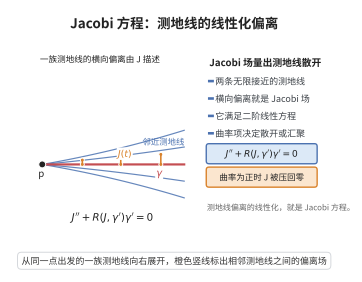

# Jacobi方程

> **一句话大白话**：把一条测地线整体"轻轻推一下"，相邻测地线之间的偏离向量满足一个线性二阶方程——Jacobi 方程；它把"两条近路会散开还是聚拢"完完全全交给曲率来回答。
>
> **小例子**：半径 $R$ 的球面上取赤道为测地线 $\gamma$，沿某条经线方向轻推得到 Jacobi 场 $J(t)=R\sin(t/R)\,e(t)$，它满足 $J''+\frac{1}{R^2}J=0$，并在 $t=\pi R$ 处归零——这正对应南极这个共轭点。

## 介绍

Jacobi 方程（Jacobi equation）是沿测地线成立的二阶线性常微分方程，用来刻画一条测地线在"单参数变分"下相邻测地线的偏离行为。设 $\gamma$ 是 Riemann 流形 $(M,g)$ 上的测地线，若沿 $\gamma$ 的向量场 $J$ 是某个由测地线构成的变分的变分场，则 $J$ 必满足

$$
\nabla_{\dot\gamma}\nabla_{\dot\gamma}J+R(J,\dot\gamma)\dot\gamma=0 ,
$$

这样的 $J$ 称为沿 $\gamma$ 的 **Jacobi 场**。它由 Carl Gustav Jacob Jacobi 在 1830 年代研究测地线与二次变分时提出，是黎曼几何局部理论的中枢。

它的重要性在于把"几何的弯曲"翻译成"线性 ODE 的系数"：曲率张量 $R$ 成为方程的系数，于是比较不同曲率下测地线的散开速度（Rauch 比较定理、Bonnet–Myers 定理、Cartan–Hadamard 定理）就变成比较两个线性方程的解。共轭点、指数映射的奇性、割迹与 Morse 指标定理都建立在它之上。

## 几何直观

图意在说明：相邻测地线的横向偏离满足二阶线性 Jacobi 方程，曲率项控制其增长。

## 分析

**前置依赖**：测地线与Jacobi场、测地线方程、Levi-Civita联络、Riemann曲率张量、第二变分公式。

**定理内容**（Jacobi 方程）：设 $\gamma:[a,b]\to M$ 为测地线。沿 $\gamma$ 的光滑向量场 $J$ 称为 Jacobi 场，若

$$
\nabla_{\dot\gamma}\nabla_{\dot\gamma}J+R(J,\dot\gamma)\dot\gamma=0 .
$$

**等价刻画**：$J$ 是 Jacobi 场，当且仅当存在光滑映射 $\Gamma:(-\epsilon,\epsilon)\times[a,b]\to M$，使每个 $s$ 对应的曲线 $t\mapsto\Gamma(s,t)$ 是测地线，且 $\Gamma(0,t)=\gamma(t)$、$\partial_s\Gamma(s,t)|_{s=0}=J(t)$。

**坐标形式**：沿 $\gamma$ 取平行正交标架 $\{e_1,\dots,e_n\}$，写 $J=\sum_i J^i e_i$，则 Jacobi 方程化为二阶线性方程组

$$
\ddot J^i+\sum_{j=1}^{n}R^i_{\ j}(t)J^j=0,\qquad R^i_{\ j}(t)=g\big(R(e_j,\dot\gamma)\dot\gamma,\,e_i\big).
$$

**解空间**：由二阶线性 ODE 理论，全体 Jacobi 场构成 $2n$ 维线性空间（$n=\dim M$），且 $J$ 由初值 $J(0)$ 与 $\nabla_{\dot\gamma}J(0)$ 唯一确定。

**依赖的概念**：Levi-Civita 联络与平行移动、测地线、Riemann 曲率张量、单参数变分与变分场、二阶线性 ODE 的解空间、共轭点。

## 思考过程

推导的关键是把"一族测地线"当作一张两维曲面上的坐标变换来算。设 $\Gamma(s,t)$ 是双参数映射，$t$ 方向的每条曲线都是测地线，$s=0$ 那条就是 $\gamma$；记坐标向量场 $S=\partial_s\Gamma$、$T=\partial_t\Gamma$，由坐标性得 $[S,T]=0$。

由于 $t\mapsto\Gamma(s,t)$ 是测地线，"沿 $t$ 方向的加速度为零"，即 $\nabla_T T=0$ 对一切 $s$ 成立。对 $\nabla_T T=0$ 再沿 $s$ 方向作用 $\nabla_S$，得 $\nabla_S\nabla_T T=0$。用 Riemann 曲率的交换公式把 $\nabla_S\nabla_T T$ 展开：$\nabla_S\nabla_T T-\nabla_T\nabla_S T=R(S,T)T$。

又因 Levi-Civita 联络无挠且 $[S,T]=0$，有 $\nabla_S T=\nabla_T S$。于是

$$
0=\nabla_S\nabla_T T=\nabla_T\nabla_S T+R(S,T)T=\nabla_T\nabla_T S+R(S,T)T .
$$

在 $s=0$ 处取值，$S|_{s=0}=J$ 是变分场、$T|_{s=0}=\dot\gamma$，即得 $\nabla_{\dot\gamma}\nabla_{\dot\gamma}J+R(J,\dot\gamma)\dot\gamma=0$。整个推导只用"每条曲线是测地线"与"曲率度量协变导数的不可交换性"两件事，无需坐标计算。

从能量的第二变分看更直观：第二变分是只含"变化率平方"与"曲率"的二次型，其 Euler–Lagrange 方程恰是 Jacobi 方程——Jacobi 场就是测地线二阶变分的临界场，这解释了它为何刻画测地线的稳定性。

## 证明过程

**定理**：设 $\gamma:[a,b]\to M$ 为测地线。则沿 $\gamma$ 的光滑向量场 $J$ 为 Jacobi 场（即存在以 $\gamma$ 为中心测地线、变分场为 $J$ 的单参数测地变分）当且仅当

$$
\nabla_{\dot\gamma}\nabla_{\dot\gamma}J+R(J,\dot\gamma)\dot\gamma=0 .
$$

**证明**：

**第一步（必要性：测地变分给出解）。** 设 $\Gamma:(-\epsilon,\epsilon)\times[a,b]\to M$ 光滑，每个 $t\mapsto\Gamma(s,t)$ 是测地线，且 $\Gamma(0,t)=\gamma(t)$。记 $S=\partial_s\Gamma$、$T=\partial_t\Gamma$。由混合偏导的可交换性 $[S,T]=0$。

由 $t\mapsto\Gamma(s,t)$ 是测地线得 $\nabla_TT=0$。对 $s$ 求协变导数：

$$
\nabla_S\nabla_TT=0 .
$$

用 Riemann 曲率的定义 $R(X,Y)Z=\nabla_X\nabla_YZ-\nabla_Y\nabla_XZ-\nabla_{[X,Y]}Z$，取 $X=S$、$Y=T$、$Z=T$，由 $[S,T]=0$ 得

$$
R(S,T)T=\nabla_S\nabla_TT-\nabla_T\nabla_ST .
$$

代入 $\nabla_S\nabla_TT=0$，并用联络无挠性（即 $\nabla_ST-\nabla_TS=[S,T]=0$，故 $\nabla_ST=\nabla_TS$）得

$$
0=\nabla_T\nabla_TS+R(S,T)T .
$$

在 $s=0$ 处取值：$S|_{s=0}=J$、$T|_{s=0}=\dot\gamma$，且沿 $\gamma$ 有 $\nabla_T=\nabla_{\dot\gamma}$，于是

$$
\nabla_{\dot\gamma}\nabla_{\dot\gamma}J+R(J,\dot\gamma)\dot\gamma=0 .
$$

**第二步（充分性：解都是测地变分场）。** 设 $J$ 满足 Jacobi 方程。沿 $\gamma$ 取平行正交标架 $\{e_1,\dots,e_n\}$，写 $J=\sum_iJ^ie_i$。由于 $\nabla_{\dot\gamma}e_i=0$，Jacobi 方程化为二阶线性常微分方程组

$$
\ddot J^i+\sum_{j=1}^nR^i_{\ j}(t)J^j=0,\qquad R^i_{\ j}(t)=g\big(R(e_j,\dot\gamma)\dot\gamma,e_i\big).
$$

系数 $R^i_{\ j}(t)$ 沿紧区间 $[a,b]$ 光滑有界，由二阶线性 ODE 的存在唯一性定理，给定初值 $(J(a),\nabla_{\dot\gamma}J(a))$ 存在唯一解；故全体 Jacobi 场构成 $2n$ 维线性空间。

反之，任取 $J$ 满足 Jacobi 方程，构造变分 $\Gamma(s,t)=\exp_{\gamma(t)}\big(s\,J(t)\big)$。对每个固定 $s$，$t\mapsto\Gamma(s,t)$ 未必是测地线；但沿 $\gamma$ 计算 $\nabla_TT$ 在 $s=0$ 的一阶导数时，上式第一步的推导反向可用：只要 $\nabla_S\nabla_TT|_{s=0}=0$ 且 $\nabla_ST=\nabla_TS$，就得到 $J$ 沿 $\gamma$ 的 Jacobi 方程成立。由 ODE 的**唯一性**（解由初值唯一确定），满足 Jacobi 方程且初值相同的场必与"由测地变分生成的场"一致；将 $\exp$ 换成沿 $J$ 的一阶变分并以 $\nabla_{\dot\gamma}J$ 的相应初值匹配，即可构造出以 $J$ 为变分场的单参数测地族。故 $J$ 是 Jacobi 场。$\square$

**推论（共轭点）**：若存在非零 Jacobi 场 $J$ 使 $J(a)=J(b)=0$，则 $\gamma(a)$ 与 $\gamma(b)$ 互为共轭点；此时 $\gamma$ 不是局部的极小测地线，指数映射在 $t=b$ 处退化。

## 课堂问答

**老师**：写出 Jacobi 方程并给出它的变分刻画。

**学生**：结论：沿测地线 $\gamma$ 的场 $J$ 是 Jacobi 场当且仅当
$$\nabla_{\dot\gamma}\nabla_{\dot\gamma}J+R(J,\dot\gamma)\dot\gamma=0,$$
等价地它是"每条曲线都是测地线"的单参数变分 $\Gamma(s,t)$ 在 $s=0$ 的变分场。推导只用两件事：每条曲线 $\nabla_TT=0$，以及对 $\nabla_S\nabla_TT=0$ 用 $[S,T]=0$ 的曲率交换 $\nabla_T\nabla_TS+R(S,T)T=0$。误区是把任意向量场都叫 Jacobi 场——它必须来自测地变分。

**老师（追问）**：为什么全体 Jacobi 场构成 $2n$ 维空间？

**学生**：在平行正交标架下写 $J=\sum_iJ^ie_i$，方程化为二阶线性 ODE 组
$$\ddot J^i+\sum_jR^i_{\ j}(t)J^j=0,\quad R^i_{\ j}(t)=g(R(e_j,\dot\gamma)\dot\gamma,e_i),$$
系数沿紧区间光滑有界，由存在唯一性定理，解由 $(J(0),\nabla_{\dot\gamma}J(0))$ 唯一确定，两组 $n$ 维数据给出 $2n$ 维解空间。

**老师（拓展）**：Jacobi 场与共轭点、第二变分有何关系？

**学生**：若非零 Jacobi 场满足 $J(a)=J(b)=0$，则 $\gamma(a),\gamma(b)$ 共轭，此时 $d\exp$ 退化、$\gamma$ 非局部极小。Jacobi 方程又正是指标形式（第二变分）的 Euler-Lagrange 方程，故 Jacobi 场是测地线二阶变分的零化方向，把稳定性纳入统一框架。
