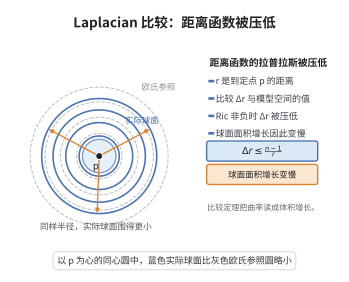

# Laplacian比较定理

> **一句话大白话**：到某点的距离函数的拉普拉斯（可理解为"测地球面的平均曲率"）被空间曲率卡住了上限：曲率越大，等距球面越"往里凹"，距离函数的拉普拉斯就越小；曲率下界给出一个由模型空间决定的通用上界。
>
> **小例子**：若 $\mathrm{Ric}\ge0$，则在 cut locus 之外 $\Delta\rho\le\dfrac{n-1}{\rho}$，这正是欧氏空间 $\mathbb R^n$ 中 $\Delta\rho=\frac{n-1}{r}$ 的推广；球面上曲率 $k>0$ 时 $\Delta\rho\le(n-1)\sqrt k\cot(\sqrt k\rho)$，且右端在大 $\rho$ 时变负，预示球面绕回。

## 介绍

Laplacian 比较定理（Laplacian Comparison Theorem，亦称距离函数的 Bochner 比较定理）是黎曼几何比较理论的中心工具之一。设 $(M^n,g)$ 完备，$\rho(x)=d(p,x)$ 为到定点 $p$ 的距离函数，则 $\rho$ 在 cut locus 之外光滑，且其 Laplace–Beltrami 算子被曲率下界控制。

它把"曲率如何影响体积与平均值"这一直观量化出来：距离函数的拉普拉斯等于测地球面的平均曲率，而平均曲率在测地线沿径向随曲率演化。若 $\mathrm{Ric}\ge(n-1)k$，则 $\Delta\rho$ 至多等于常曲率 $k$ 的模型空间（球面 $k>0$、欧氏 $k=0$、双曲 $k<0$）中相应距离函数的拉普拉斯。此定理是 Bishop–Gromov 体积比较、Cheeger–Gromoll 分裂定理、Bonnet–Myers 定理、以及强极大值原理与特征值估计的共同基础。

## 几何直观

图意在说明：Ricci 曲率非负时距离函数的拉普拉斯不超过平直值，球面面积增长变慢。

## 分析

**前置依赖**：Ricci 曲率、测地线与指数映射、Jacobi 场与第二变分公式、距离函数与 cut locus、Hessian 与 Laplace–Beltrami 算子、Bochner 公式、Riccati 方程的比较原理。

**定理内容**：设 $(M^n,g)$ 完备，$\mathrm{Ric}\ge(n-1)k$（$k\in\mathbb R$）。记 $\rho(x)=d(p,x)$。在 $\rho>0$ 且光滑处（即 cut locus 之外）有

$$
\Delta\rho\le(n-1)\,\frac{\mathrm{sn}_k'(\rho)}{\mathrm{sn}_k(\rho)},
$$

其中 $\mathrm{sn}_k$ 是初值问题 $y''+ky=0,\ y(0)=0,\ y'(0)=1$ 的解。显式地，

$$
\mathrm{sn}_k(r)=
\begin{cases}
\dfrac{\sin(\sqrt k\,r)}{\sqrt k}, & k>0,\\[4pt]
r, & k=0,\\[4pt]
\dfrac{\sinh(\sqrt{|k|}\,r)}{\sqrt{|k|}}, & k<0,
\end{cases}
$$

故 $\dfrac{\mathrm{sn}_k'}{\mathrm{sn}_k}(r)$ 分别等于 $\sqrt k\cot(\sqrt k r)$、$1/r$、$\sqrt{|k|}\coth(\sqrt{|k|}r)$。结论也可写成"分布意义"下在整个 $M$ 上成立。

**依赖的概念**：距离函数、Hessian 的迹（$\Delta\rho$）、第二基本形式、Riccati 比较。

## 思考过程

证明的出发点是**Bochner 公式对距离函数**的退化形式。因 $|\nabla\rho|=1$ 是常数，作用 Bochner 公式

$$
\Delta\frac{|\nabla\rho|^2}{2}=\langle\nabla\rho,\nabla\Delta\rho\rangle+|\mathrm{Hess}\,\rho|^2+\mathrm{Ric}(\nabla\rho,\nabla\rho)
$$

得

$$
\partial_r(\Delta\rho)+|\mathrm{Hess}\,\rho|^2+\mathrm{Ric}(\partial_r,\partial_r)=0,\qquad \partial_r=\frac{\partial}{\partial r}.
$$

第二项用 Cauchy–Schwarz 下界：$\mathrm{Hess}\,\rho$ 限制在 $\nabla\rho^\perp$ 上是对称的（相当于等距球面的第二基本形式），故 $|\mathrm{Hess}\,\rho|^2\ge\frac{(\mathrm{tr}\,\mathrm{Hess}\,\rho)^2}{n-1}=\frac{(\Delta\rho)^2}{n-1}$。代入并用 $\mathrm{Ric}\ge(n-1)k$ 即得**Riccati 不等式**

$$
\partial_r\Big(\frac{\Delta\rho}{n-1}\Big)+\Big(\frac{\Delta\rho}{n-1}\Big)^2+k\le0.
$$

令 $m=\Delta\rho/(n-1)$，$m'+m^2+k\le0$。而模型量 $m_k=\mathrm{sn}_k'/\mathrm{sn}_k$ 恰好满足等号 $m_k'+m_k^2+k=0$。Riccati 比较原理断言：满足"$\le$"的解不会超过模型解，即 $m\le m_k$，于是 $\Delta\rho\le(n-1)m_k(\rho)$。

## 证明过程

**步骤 1：距离函数的正则性与 Hessian。**

固定 $p$，$\rho$ 在 $M\setminus(\{p\}\cup\mathrm{Cut}(p))$ 上光滑且 $|\nabla\rho|=1$。等距球面 $S_r=\rho^{-1}(r)$ 的 Weingarten 映射就是 $\mathrm{Hess}\,\rho$ 在 $T S_r$ 上的限制：对 $X,Y\perp\nabla\rho$，

$$
\mathrm{Hess}\,\rho(X,Y)=\langle\nabla_X\nabla\rho,Y\rangle=\mathrm{II}(X,Y),
$$

其中 $\mathrm{II}$ 是 $S_r$ 相对于 $\nabla\rho$ 的第二基本形式。因此

$$
\Delta\rho=\mathrm{tr}\,\mathrm{Hess}\,\rho=\mathrm{tr}_{TS_r}\,\mathrm{II}=H(r),
$$

即 $S_r$ 的平均曲率（乘以 $n-1$）。

**步骤 2：Bochner 公式与 Riccati 不等式。**

由 $|\nabla\rho|^2\equiv1$ 及 Bochner 公式，

$$
0=\Delta\tfrac{|\nabla\rho|^2}{2}=\langle\nabla\rho,\nabla(\Delta\rho)\rangle+|\mathrm{Hess}\,\rho|^2+\mathrm{Ric}(\nabla\rho,\nabla\rho).
$$

即 $\partial_r(\Delta\rho)=-|\mathrm{Hess}\,\rho|^2-\mathrm{Ric}(\partial_r,\partial_r)$。把 $\mathrm{Hess}\,\rho$ 分解为 $TS_r$ 方向的对角部分与迹零部分，后者贡献非负的 Frobenius 范数，故

$$
|\mathrm{Hess}\,\rho|^2\ge\frac{(\mathrm{tr}_{TS_r}\mathrm{Hess}\,\rho)^2}{n-1}=\frac{(\Delta\rho)^2}{n-1}.
$$

代入并使用 $\mathrm{Ric}(\partial_r,\partial_r)\ge(n-1)k$：

$$
\partial_r(\Delta\rho)+\frac{(\Delta\rho)^2}{n-1}+(n-1)k\le0.
$$

**步骤 3：化为标量 Riccati 不等式。**

令 $m(r)=\dfrac{\Delta\rho}{n-1}$，两边除以 $n-1$ 得

$$
m'(r)+m(r)^2+k\le0.\tag{R}
$$

**步骤 4：模型解与比较原理。**

定义 $m_k(r)=\dfrac{\mathrm{sn}_k'(r)}{\mathrm{sn}_k(r)}$。由 $\mathrm{sn}_k''+k\,\mathrm{sn}_k=0$，直接计算得 $m_k'+m_k^2+k=0$。由标准 Riccati 比较原理：若 $m$ 满足 $(R)$ 且在某点 $r_0$ 有 $m(r_0)\le m_k(r_0)$，则在 $m_k$ 存在且有限的区间上 $m(r)\le m_k(r)$。原因是若首次出现 $m=m_k$，则在该点由 $(R)$ 与模型的等式得 $m'-m_k'\le -(m^2-m_k^2)=0$，故 $m-m_k$ 不再变正。

**步骤 5：初值条件与结论。**

当 $r\to0^+$ 时，$\Delta\rho\sim\frac{n-1}{r}$（在法坐标下由 $\sqrt{\det g}$ 展开或直接计算得），故 $m(r)\to+\infty$ 而 $m_k(r)\to+\infty$；比较上述渐近可得 $m\le m_k$ 在 $\rho$ 的首次奇异值之前成立。为把比较用到整个 $(0,\mathrm{inj}(p))$，注意 $m_k$ 在 $r_0$（$k>0$ 时 $r_0=\pi/\sqrt k$）之前有限且 $\le m_k$，而在 $m_k$ 爆破之前 $m$ 不可能超过它（否则会先相交）。因此对一切 $\rho\in(0,\min\{\mathrm{inj}(p),r_0\})$，

$$
\Delta\rho\le(n-1)m_k(\rho).
$$

**步骤 6：越过 cut locus 的处理。**

在 cut locus 上 $\rho$ 不光滑。由 Calabi 的"用支撑函数"技巧或对 $\rho_\epsilon=\sqrt{\rho^2+\epsilon^2}$ 取极限，可知不等式在弱（分布）意义下仍然成立；特别地，对凸函数 $\phi$ 与所有非负紧支撑试验函数，$\int \rho\,\Delta\phi\le\int\phi\,(n-1)m_k$ 成立。于是定理在整个流形上作为分布不等式有效。$\square$

**推论**：由 $\Delta\rho\le(n-1)m_k(\rho)$ 与 $\Delta\rho=\partial_r\log(\text{体积元})$ 的变分公式，可得 Bishop–Gromov 体积比较；当 $k>0$ 时结合 $\Delta\rho$ 在李卡蒂解爆破点强制半径有界，即得 Bonnet–Myers 定理。

## 课堂问答

**老师**：陈述距离函数的 Laplacian 比较，并指出它的来源方程。

**学生**：结论：$\mathrm{Ric}\ge(n-1)k$ 的完备流形上，$\rho(x)=d(p,x)$ 在 cut locus 外满足
$$\Delta\rho\le(n-1)\frac{\mathrm{sn}_k'(\rho)}{\mathrm{sn}_k(\rho)},$$
模型量取 $\sqrt k\cot(\sqrt k\rho)$、$1/\rho$、$\sqrt{|k|}\coth(\sqrt{|k|}\rho)$。来源是 Bochner 公式在 $|\nabla\rho|=1$ 下的退化式 $\partial_r(\Delta\rho)+|\mathrm{Hess}\,\rho|^2+\mathrm{Ric}(\partial_r,\partial_r)=0$，再用 $|\mathrm{Hess}\,\rho|^2\ge\frac{(\Delta\rho)^2}{n-1}$ 得 Riccati 不等式。误区是漏掉 Hessian 的迹零部分——Cauchy-Schwarz 那步必须做。

**老师（追问）**：Riccati 不等式为何能与模型解比较？

**学生**：令 $m=\Delta\rho/(n-1)$ 得 $m'+m^2+k\le0$，而模型 $m_k=\mathrm{sn}_k'/\mathrm{sn}_k$ 满足等号 $m_k'+m_k^2+k=0$；由首次接触点论证，满足"小于等于"的解不超过模型解，即 $m\le m_k$。$r\to0$ 时两边都趋于 $+\infty$ 提供对接，故不等式在首次奇异前成立。

**老师（拓展）**：怎样推出体积比较与 Bonnet-Myers？

**学生**：因 $\Delta\rho$ 等于体积元的对数导数，对 $m\le m_k$ 积分得 Bishop-Gromov 体积比单调；$k>0$ 时模型解在 $\pi/\sqrt k$ 爆破，迫使半径有界，即 Bonnet-Myers 直径估计。同一不等式也是 Cheeger-Gromoll 分裂中 $\Delta b^\pm\le0$ 的来源。

## 相关条目

- [Bonnet-Myers定理](./Bonnet-Myers定理.md)：由 Laplacian 比较直接推出正 Ricci 曲率下流形紧致、直径有界。
- [Rauch比较定理](./Rauch比较定理.md)：从 Jacobi 场侧比较测地线散布，是 Laplacian 比较的"线性化"版本。
- [测地线与Jacobi场](./测地线与Jacobi场.md)：距离函数的 Hessian、Riccati 方程与 Jacobi 场的对应关系。
