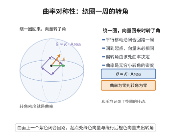

# Riemann曲率张量的对称性

> **一句话大白话**：用来"测量弯曲"的曲率张量其实有很多重复信息——它有对称与反对称的几条"镜像规则"，把这些规则一用，真正独立的"自由度"数量大大缩减，好记也好算。
>
> **小例子**：对 $R_{ijkl}$ 有 $R_{ijkl}=-R_{jikl}=-R_{ijlk}=R_{klij}$ 及第一比安基恒等式 $R_{ijkl}+R_{iklj}+R_{iljk}=0$；正因这些对称，$n$ 维的整数独立分量从 $n^4$ 降到约 $n^2(n^2-1)/12$，如2维只有1个自由度即曲率本身。

## 介绍

Riemann曲率张量（Riemann Curvature Tensor）是黎曼几何中刻画流形弯曲程度的核心对象。Riemann曲率张量 $(4,0)$-张量场 $R(X,Y,Z,W) = g(R(X,Y)Z, W)$ 具有一系列重要的对称性质，这些对称性不仅反映了曲率张量的代数结构，也是理解 Ricci 恒等式、Bianchi 恒等式以及各种几何不等式的基础。Riemann曲率张量的对称性由四个基本性质组成：斜对称性、交换对称性、代数 Bianchi 恒等式和微分 Bianchi 恒等式。

## 几何直观

图意在说明：向量沿闭合回路平行移动一周后一般会偏转，转角密度正是曲率张量。

## 分析

**前置依赖**：Riemann 度量、Levi-Civita 联络（无挠与度量相容）、曲率张量的定义、协变导数、极化恒等式。

**定理的精确表述**：设 $(M, g)$ 是 Riemann 流形，$R$ 是 Riemann 曲率张量，$X, Y, Z, W \in T_pM$。则：
1. **斜对称性**：$R(X, Y, Z, W) = -R(Y, X, Z, W) = -R(X, Y, W, Z)$。
2. **交换对称性**：$R(X, Y, Z, W) = R(Z, W, X, Y)$。
3. **代数 Bianchi 恒等式**（第一 Bianchi 恒等式）：$R(X, Y, Z, W) + R(Y, Z, X, W) + R(Z, X, Y, W) = 0$。
4. **微分 Bianchi 恒等式**（第二 Bianchi 恒等式）：$\nabla R(X, Y, Z, W, V) + \nabla R(Y, Z, X, W, V) + \nabla R(Z, X, Y, W, V) = 0$。

**依赖的概念**：Riemann 流形、联络、曲率张量、Covariant 导数。

**证明策略**：利用 Levi-Civita 联络的无挠性和与度量的相容性，通过直接计算曲率张量的定义 $R(X, Y)Z = \nabla_X \nabla_Y Z - \nabla_Y \nabla_X Z - \nabla_{[X,Y]}Z$。

## 思考过程

曲率张量的对称性不是偶然的，它们来源于 Levi-Civita 联络的两个基本性质：无挠性（$\nabla_X Y - \nabla_Y X = [X,Y]$）和与度量的相容性（$\nabla g = 0$）。这些对称性在 Ricci 流、比较定理和许多几何分析问题中至关重要。

关键观察：
- 斜对称性在前两个参数上由 $R(X,Y) = -R(Y,X)$ 直接得到。
- 后两个参数的斜对称性来源于 $R(X,Y,Z,W) = -R(X,Y,W,Z)$，这等价于 $R(X,Y,Z,Z) = 0$。
- 交换对称性 $R(X,Y,Z,W) = R(Z,W,X,Y)$ 是前两个对称性的推论。
- 代数 Bianchi 恒等式是无挠性的直接结果。

## 证明过程

**定理**（Riemann曲率张量的对称性）：设 $(M, g)$ 是 Riemann 流形，则曲率张量 $R$ 满足上述四个对称性。

**证明**：

**步骤 1：第一斜对称性 $R(X,Y,Z,W) = -R(Y,X,Z,W)$。**

由定义 $R(X,Y) = \nabla_X \nabla_Y - \nabla_Y \nabla_X - \nabla_{[X,Y]}$，交换 $X$ 和 $Y$ 得 $R(Y,X) = \nabla_Y \nabla_X - \nabla_X \nabla_Y - \nabla_{[Y,X]} = -R(X,Y)$。因此 $R(X,Y,Z,W) = g(R(X,Y)Z,W) = -g(R(Y,X)Z,W) = -R(Y,X,Z,W)$。

**步骤 2：第二斜对称性 $R(X,Y,Z,W) = -R(X,Y,W,Z)$。**

由于 $g$ 与 $\nabla$ 相容，$\nabla g = 0$。对任意向量场 $U$，有 $g(\nabla_U Z, Z) = \frac{1}{2} U(g(Z, Z))$。计算 $R(X,Y)Z$ 与 $Z$ 的内积，利用 $[X,Y]$ 的运算性质，可得 $g(R(X,Y)Z, Z) = 0$。由极化恒等式，$g(R(X,Y)Z, W) = -g(R(X,Y)W, Z)$。

**步骤 3：交换对称性 $R(X,Y,Z,W) = R(Z,W,X,Y)$。**

由前两个对称性，曲率张量可视为 $\Lambda^2 T_pM$ 上的对称双线性形式。具体地，定义 $\tilde{R}(X \wedge Y, Z \wedge W) = R(X,Y,Z,W)$，则 $\tilde{R}$ 是对称的。这可以通过代数 Bianchi 恒等式和前面的斜对称性推导。

**步骤 4：代数 Bianchi 恒等式。**

利用 Levi-Civita 联络的无挠性 $\nabla_X Y - \nabla_Y X = [X,Y]$，计算

$$
R(X,Y)Z + R(Y,Z)X + R(Z,X)Y = \nabla_X \nabla_Y Z - \nabla_Y \nabla_X Z - \nabla_{[X,Y]}Z + \nabla_Y \nabla_Z X - \nabla_Z \nabla_Y X - \nabla_{[Y,Z]}X + \nabla_Z \nabla_X Y - \nabla_X \nabla_Z Y - \nabla_{[Z,X]}Y.
$$

利用无挠性将 $\nabla_Y Z - \nabla_Z Y = [Y,Z]$ 等关系代入，展开后所有项相消，得 $R(X,Y)Z + R(Y,Z)X + R(Z,X)Y = 0$。与 $W$ 取内积即得代数 Bianchi 恒等式。

**步骤 5：微分 Bianchi 恒等式。**

对曲率张量求协变导数，利用 $\nabla$ 的无挠性和 $R(X,Y)Z$ 的定义，通过直接（但冗长的）计算可得

$$
(\nabla_X R)(Y,Z)W + (\nabla_Y R)(Z,X)W + (\nabla_Z R)(X,Y)W = 0,
$$

即微分 Bianchi 恒等式。$\square$

**推论**（Ricci 恒等式）：对任意向量场 $X$ 和 1-形式 $\omega$，有

$$
(\nabla^2_{X,Y} - \nabla^2_{Y,X})\omega = -R(X,Y)^*\omega,
$$

其中 $R(X,Y)^*$ 是曲率张量在余切丛上的诱导作用。

## 课堂问答

**老师**：列出 $R_{ijkl}$ 的主要对称性，并指出各由什么性质产生。

**学生**：四条：斜对称 $R_{ijkl}=-R_{jikl}=-R_{ijlk}$、交换对称 $R_{ijkl}=R_{klij}$、代数（第一）Bianchi $R_{ijkl}+R_{iklj}+R_{iljk}=0$、微分（第二）Bianchi $\nabla R$ 三项轮换和为零。前三条来自 Levi-Civita 联络的无挠性与度量相容（$\nabla g=0$），微分 Bianchi 来自协变导数与曲率定义的直接计算。误区是把 $R_{ijkl}=R_{ijlk}$ 记反——后两个指标是反对称而非对称。

**老师（追问）**：这些对称性如何缩减独立分量数？

**学生**：斜对称使 $R$ 成为 $\Lambda^2T_pM$ 上的对称双线性型，第一 Bianchi 再加迹零约束，独立分量数为 $n^2(n^2-1)/12$：$n=2$ 只剩 $1$（即高斯曲率），$n=3$ 为 $6$，$n=4$ 为 $20$。

**老师（拓展）**：第二 Bianchi 恒等式为何独立于代数对称？

**学生**：它约束 $R$ 沿流形的一阶变化（含协变导数），是微分恒等式而非常数点上的代数关系，不能由同点对称性代数推出。缩并后给出 $\nabla^iG_{ij}=0$（Einstein 张量散度为零），是广义相对论能量守恒与 Ricci 流分析的根源。
