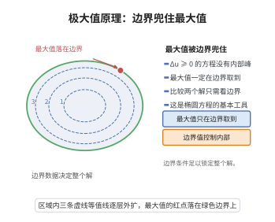

# 极大值原理

> **一句话大白话**：次调和函数（每点都不低于周围平均）在有界区域里"涨"不到里面去，它的最大必然发生在边界上；想在里面冒尖，就只能靠边界数据抬高上限。
>
> **小例子**：在单位圆盘上解 $\Delta u=0$（调和），无论内部多复杂，$u$ 的最大值和最小值都出现在圆周上；即便改成 $\Delta u=2>0$（如 $u=x^2+y^2$），最大值也仍在边界。

## 介绍

极大值原理（Maximum Principle）是椭圆型偏微分方程理论最基本的定性工具。弱形式断言：设 $\Omega$ 是 $\mathbb R^n$ 中的有界区域，$u\in C^2(\Omega)\cap C^0(\bar\Omega)$ 满足 $\Delta u\ge0$（次调和），则

$$
\sup_{\Omega}u=\sup_{\partial\Omega}u,\qquad \inf_{\Omega}u=\inf_{\partial\Omega}u\ (\text{对 } \Delta u\le0).
$$

它最早由 Gauss 在 1839 年用平均值性质证明调和函数的相应结论，其后被 Hopf、Nirenberg 等人推广到一般二阶椭圆算子。极大值原理的价值在于：它把偏微分方程解的"定量估计"化为"边界数据的比较"，从而提供解的唯一性、稳定性、比较原理与先验估计。Perron 方法、Dirichlet 问题解的存在性、Cauchy 问题的能量方法、调和映射与 Ricci 流中的梯度估计都依赖它；黎曼几何中的 Laplacian 比较、Harnack 不等式与特征值估计同样以它为基石。

## 几何直观

图意在说明：次调和函数的最大值必定落在边界，边界数据足以控制整个解。

## 分析

高斯散度定理、Laplace 算子、二级偏导的极值条件、次调和与超调和函数、区域的连通性、椭圆型方程最大值原理。

**定理内容**（弱极大值原理）：设 $\Omega\subset\mathbb R^n$ 有界开，$u\in C^2(\Omega)\cap C^0(\bar\Omega)$。

1. 若 $\Delta u\ge0$ 于 $\Omega$，则 $\displaystyle\max_{\bar\Omega}u=\max_{\partial\Omega}u$；
2. 若 $\Delta u\le0$ 于 $\Omega$，则 $\displaystyle\min_{\bar\Omega}u=\min_{\partial\Omega}u$；
3. 若 $\Delta u=0$ 于 $\Omega$，则 $\max$ 与 $\min$ 都在边界取得。

**一般椭圆算子版本**：设 $L=a^{ij}(x)\partial_i\partial_j+b^i(x)\partial_i$，$a^{ij}$ 对称正定且一致椭圆。若 $Lu\ge0$ 于 $\Omega$，则同样有 $\max_{\bar\Omega}u=\max_{\partial\Omega}u$（$b^i$ 项只影响强形式的证明细节，不影响弱形式）。

**依赖的概念**：内部极值的二阶必要条件、一致椭圆性、次调和、比较原理。

## 思考过程

证明的巧思在于"用严格的扰动打破退化情形"。若直接假设 $u$ 在内部点取最大，则由二阶必要条件该点 Hessian 半负定、迹 $\le0$，与 $\Delta u\ge0$ 并不一定矛盾——因为可能恰好 $\Delta u=0$ 且 Hessian 退化。

解决办法是引入小扰动 $u_\epsilon(x)=u(x)+\epsilon|x|^2$。由于 $\Delta|x|^2=2n>0$，总有 $\Delta u_\epsilon\ge2n\epsilon>0$，严格。若 $u_\epsilon$ 在内部取最大，则必须 $0\ge\Delta u_\epsilon(x_0)>0$，矛盾；因此最大值落在边界，取 $\epsilon\to0^+$ 即得 $u$ 的结论。整个证明是"严格化 + 极限"两句话。强形式（内部取最大则必为常数）则由平均值性质或 Hopf 引理完成。

## 证明过程

**步骤 1：内部极值的二阶必要条件。**

设 $v\in C^2$ 在内部点 $x_0$ 取局部最大值。则一阶导数全零，Hessian $\big(\partial_i\partial_j v(x_0)\big)$ 半负定，故其迹

$$
\Delta v(x_0)=\sum_{i=1}^n\partial_i\partial_i v(x_0)\le0.
$$

**步骤 2：扰动的严格化。**

设 $\Delta u\ge0$，$\Omega$ 有界。对 $\epsilon>0$ 定义

$$
u_\epsilon(x)=u(x)+\epsilon|x|^2,\qquad \Delta u_\epsilon(x)=\Delta u(x)+2n\epsilon\ge2n\epsilon>0.
$$

**步骤 3：证明 $u_\epsilon$ 的最大值在边界取得。**

反设 $u_\epsilon$ 在内部点 $x_0\in\Omega$ 取最大值 $\max_{\bar\Omega}u_\epsilon$。由步骤 1，$\Delta u_\epsilon(x_0)\le0$；但由步骤 2，$\Delta u_\epsilon(x_0)>0$。矛盾。故最大值在边界取得：

$$
\max_{\bar\Omega}u_\epsilon=\max_{\partial\Omega}u_\epsilon.
$$

**步骤 4：令 $\epsilon\to0^+$。**

对任意 $x\in\bar\Omega$，

$$
u(x)\le u_\epsilon(x)\le\max_{\bar\Omega}u_\epsilon=\max_{\partial\Omega}u_\epsilon\le\max_{\partial\Omega}u+\epsilon\sup_{\bar\Omega}|x|^2.
$$

令 $\epsilon\to0^+$ 得 $u(x)\le\max_{\partial\Omega}u$，对 $x$ 取上确界：

$$
\max_{\bar\Omega}u=\max_{\partial\Omega}u.
$$

**步骤 5：极小值与调和情形。**

对 $-u$ 应用步骤 1–4（注意 $\Delta(-u)\ge0\iff\Delta u\le0$）得 $\min_{\bar\Omega}u=\min_{\partial\Omega}u$。当 $\Delta u=0$ 时两条同时成立，故 $\max$ 与 $\min$ 都在边界取得。

**步骤 6：一般椭圆算子。**

对 $L=a^{ij}\partial_i\partial_j+b^i\partial_i$ 一致椭圆（$a^{ij}\xi_i\xi_j\ge\lambda|\xi|^2$，$\lambda>0$）。作同型扰动 $u_\epsilon=u+\epsilon(e^{\gamma x_1})$，其中取 $\gamma$ 充分大使 $L(e^{\gamma x_1})>0$（因 $a^{11}\gamma^2 e^{\gamma x_1}+b^1\gamma e^{\gamma x_1}>0$ 当 $\gamma$ 大）。若 $Lu\ge0$，则 $Lu_\epsilon>0$；在内部极大点 $x_0$，$b^i\partial_i u_\epsilon=0$（梯度为零）、$a^{ij}\partial_i\partial_j u_\epsilon\le0$（Hessian 半负定且 $a^{ij}$ 正定），故 $Lu_\epsilon(x_0)\le0$，矛盾。于是 $u_\epsilon$ 的最大值在边界取得，令 $\epsilon\to0$ 即得结论。$\square$

**推论**：（1）**唯一性**：Dirichlet 问题 $\Delta u=f$ 于 $\Omega$、$u|_{\partial\Omega}=g$ 至多有一个解（两解之差调和且边界为零，由极大值原理为零）。（2）**比较原理**：若 $\Delta u\ge\Delta v$、$u|_{\partial\Omega}\le v|_{\partial\Omega}$，则 $u\le v$。（3）**强极大值原理**：把结论升级为"内部取最大则必为常数"。

## 课堂问答

**老师**：陈述弱极大值原理，并说明扰动技巧为何必要。

**学生**：结论：$\Omega$ 有界、$u\in C^2\cap C^0(\bar\Omega)$、$\Delta u\ge0$，则 $\max_{\bar\Omega}u=\max_{\partial\Omega}u$。必要性在于：若 $u$ 内部取极大，二阶必要条件只给 $\Delta u(x_0)\le0$，与 $\Delta u\ge0$ 可能相容（如 $\Delta u=0$），无法直接矛盾；故用 $u_\epsilon=u+\epsilon|x|^2$ 严格化（$\Delta u_\epsilon\ge2n\epsilon>0$），极大值必落边界，再令 $\epsilon\to0^+$。误区是以为 $\Delta u\ge0$ 时内部也能取极大。

**老师（追问）**：一般椭圆算子怎么扰动？

**学生**：取 $L=a^{ij}\partial_i\partial_j+b^i\partial_i$ 一致椭圆，用 $u_\epsilon=u+\epsilon e^{\gamma x_1}$，选 $\gamma$ 大使 $L(e^{\gamma x_1})=a^{11}\gamma^2e^{\gamma x_1}+b^1\gamma e^{\gamma x_1}>0$。在内部极大点梯度为零、Hessian 半负定而 $a^{ij}$ 正定，故 $Lu_\epsilon\le0$，与 $Lu_\epsilon>0$ 矛盾。

**老师（拓展）**：由此得到哪些标准推论？

**学生**：唯一性（Dirichlet 问题两解之差调和、边界为零故恒零）、比较原理（$\Delta u\ge\Delta v$、边界 $u\le v$ 则 $u\le v$）、以及强极大值原理。它是 Laplacian 比较、Harnack 估计、Perron 方法与 Ricci 流梯度估计的基石。

## 相关条目

- [强极大值原理](./强极大值原理.md)：把"极值在边界"加强为"内部取极值必为常数"，由平均值性质或 Hopf 引理证明。
- [Bonnet-Myers定理](./Bonnet-Myers定理.md)：全局曲率比较型结论常以极大值原理作为定性推理的最后一环。
