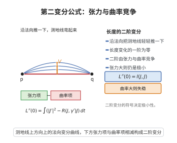

# 第二变分公式

> **一句话大白话**：测地线的能量（或长度）在它附近的二阶变化是一个只含"变化率平方"与"曲率"的二次型——第一项想让它变长，第二项由曲率决定，正曲率让它变得不稳定。

> **小例子**：单位球面 $S^n$ 上取大圆（长度 $2\pi$ 的测地线）与沿它的正常变分场 $V$，因 $K=1>0$ 有 $\langle R(V,\gamma')\gamma',V\rangle=|V|^2$，于是 $L''(0)=\int(|V'|^2-|V|^2)dt$ 对某些 $V$ 可为负：大圆是闭测地线但并非长度极小。双曲空间 $K<0$ 的情形则恒为正，测地线稳定。

## 介绍

第二变分公式（second variation formula，又称指标形式/index form）刻画测地线作为能量泛函与长度泛函临界点的稳定性，是经典黎曼几何与变分法的核心工具，其形如今天所述的形式主要由 Jacobi、Darboux 与 Morse 在 19 世纪末至 20 世纪初的工作逐步完成，Morse 在 1930 年代用系统的方式建立了 Morse 指标定理。

设 $\gamma:[0,a]\to M$ 是以弧长为参数的测地线，能源泛函

$$E(s)=\frac12\int_0^a\bigl|\partial_t\gamma_s(t)\bigr|^2\,dt$$

沿一簇曲线 $\gamma_s$ 取值。第一变分为零给出测地线方程；第二变分则给出更精细的信息：它是沿测地线的正常变分场 $V$ 上的一个二次型

$$I(V,V)=\int_0^a\Bigl(|V'|^2-\bigl\langle R(V,\gamma')\gamma',V\bigr\rangle\Bigr)dt,$$

其中 $V'=\nabla_{\gamma'}V$，$R$ 为黎曼曲率张量。这个二次型称为指标形式。

其重要性在于：$I$ 的正定性等价于该测地线局部极小；$I$ 的负惯性指数（Morse 指标）恰等于 $\gamma$ 内部共轭点的个数（计重数，Morse 指标定理）；Jacobi 场正是 $I$ 的"零化方向"（$I(V,W)=0$ 对所有 $W$）。由此可推出 Rauch 比较定理、Bonnet–Myers 定理（正 Ricci 曲率下测地线在有限长度内出现共轭点，流形紧）与 Cartan–Hadamard 定理（非正曲率下无非平凡共轭点，指数映射是微分同胚）。因此第二变分公式是"曲率符号决定测地线几何"这一图景的定量核心。

## 几何直观

图意在说明：长度的二阶变分是张力项与曲率项之差，符号决定测地线是否仍是极小。

## 分析

**前置依赖**：测地线与 Jacobi 场、Levi-Civita 联络与协变导数、能量泛函与长度泛函、第一变分公式、Riemann 曲率张量、沿曲线的协变导数交换子（Ricci 恒等式）、分部积分法。

**定理内容**：设 $\gamma:[0,a]\to M$ 为单位速度测地线。设 $\gamma_s$（$|s|<\epsilon$）是 $\gamma$ 的一个光滑变分，变分场 $V(t)=\partial_s\gamma_s(t)|_{s=0}$，并设它是正常变分：$V(0)=V(a)=0$。则能源泛函在 $s=0$ 处的一阶变分为零，二阶变分由指标形式给出：

$$E''(0)=\int_0^a\Bigl(|V'|^2-\bigl\langle R(V,\gamma')\gamma',V\bigr\rangle\Bigr)dt,\qquad V'=\nabla_{\gamma'}V.$$

对单位速度测地线，长度泛函 $L(s)=\int_0^a|\partial_t\gamma_s|dt$ 满足 $L''(0)=E''(0)$。

**推论（常曲率情形）**：若 $M$ 有常截面曲率 $K$ 且 $V\perp\gamma'$，则 $\langle R(V,\gamma')\gamma',V\rangle=K|V|^2$，于是

$$E''(0)=\int_0^a\bigl(|V'|^2-K|V|^2\bigr)dt.$$

$K>0$ 时曲面（球面）上长测地线不稳定，$K\le0$ 时稳定。

**依赖的概念**：变分场、能量与长度、沿曲线的协变导数、曲率张量的对称性。

## 思考过程

整个推导是"对第一变分再求一次导数"。先写出能量的一阶变分：把 $\partial_s$ 与 $\partial_t$ 的协变导数交换（联络无挠，且 $[\partial_s,\partial_t]=0$），一阶变分可写成 $\langle V,T\rangle$ 的边界项减去 $\int\langle V,\nabla_tT\rangle$。对正常变分边界项为零，且在测地线上 $\nabla_tT=0$，这说明测地线确是一阶临界点。

再对 $s$ 求导。此时用到的关键观察是：$\nabla_tT$ 在 $s=0$ 处已经为零，因此积分号下"对 $V$ 求导"的那一项消失，只剩下把两阶导数搬到 $T$ 上的项 $\langle V,\nabla_s\nabla_tT\rangle$。接着用沿着二维"曲面" $\gamma_s(t)$ 的协变导数交换子 $\nabla_s\nabla_tT-\nabla_t\nabla_sT=R(\partial_s,\partial_t)T$ 把 $\nabla_s\nabla_tT$ 换成 $\nabla_t\nabla_tV+R(V,T)T$——曲率就是在这一步进入的。最后对 $\int\langle V,\nabla_t\nabla_tV\rangle$ 分部积分，用 $V$ 在两端为零消去边界项，得到的正是 $|V'|^2$ 与曲率项之差的积分。

## 证明过程

**步骤 1：准备记号与一阶变分。** 记 $\partial_t\gamma_s=T$，$V=\partial_s\gamma_s$。对

$$E(s)=\frac12\int_0^a\langle T,T\rangle\,dt$$

关于 $s$ 求导，并用联络无挠（$\nabla_s\partial_t=\nabla_t\partial_s$）交换 $\partial_s$ 与 $\partial_t$：

$$E'(s)=\int_0^a\langle\nabla_sT,T\rangle\,dt=\int_0^a\langle\nabla_tV,T\rangle\,dt.$$

对第二式分部积分：

$$E'(s)=\langle V,T\rangle\Big|_0^a-\int_0^a\langle V,\nabla_tT\rangle\,dt=-\int_0^a\langle V,\nabla_tT\rangle\,dt,$$

末步用 $V(0)=V(a)=0$。特别地，当 $s=0$、$\gamma$ 为测地线（$\nabla_tT=0$）时 $E'(0)=0$。

**步骤 2：再求一次导数。** 对 $E'(s)=-\int_0^a\langle V,\nabla_tT\rangle dt$ 关于 $s$ 求导并在 $s=0$ 取值：

$$E''(0)=-\int_0^a\Bigl(\bigl\langle\nabla_sV,\nabla_tT\bigr\rangle+\bigl\langle V,\nabla_s\nabla_tT\bigr\rangle\Bigr)\Big|_{s=0}dt.$$

在 $s=0$ 处 $\nabla_tT=\nabla_{t}\gamma'=0$，第一项消失，故

$$E''(0)=-\int_0^a\bigl\langle V,\nabla_s\nabla_tT\bigr\rangle\Big|_{s=0}dt.$$

**步骤 3：用曲率交换协变导数。** 对沿二维族 $\gamma_s(t)$ 的向量场 $T$，协变导数的交换子给出

$$\nabla_s\nabla_tT-\nabla_t\nabla_sT=R(\partial_s,\partial_t)T=R(V,T)T.$$

又由无挠性 $\nabla_sT=\nabla_tV$，故

$$\nabla_s\nabla_tT=\nabla_t\nabla_sT+R(V,T)T=\nabla_t\nabla_tV+R(V,T)T.$$

在 $s=0$ 处 $T=\gamma'$，记 $V''=\nabla_t\nabla_tV$，则 $\nabla_s\nabla_tT=V''+R(V,\gamma')\gamma'$。代入步骤 2：

$$E''(0)=-\int_0^a\bigl\langle V,\ V''+R(V,\gamma')\gamma'\bigr\rangle\,dt=-\int_0^a\langle V,V''\rangle\,dt-\int_0^a\bigl\langle V,R(V,\gamma')\gamma'\bigr\rangle\,dt.$$

**步骤 4：分部积分并利用曲率对称性。** 对第一项分部积分，并用 $V(0)=V(a)=0$：

$$\int_0^a\langle V,V''\rangle\,dt=\langle V,V'\rangle\Big|_0^a-\int_0^a\langle V',V'\rangle\,dt=-\int_0^a|V'|^2\,dt.$$

把它代回，并利用曲率张量的反对称性 $\langle R(V,\gamma')\gamma',V\rangle=\langle V,R(V,\gamma')\gamma'\rangle$，得

$$E''(0)=\int_0^a|V'|^2\,dt-\int_0^a\bigl\langle R(V,\gamma')\gamma',V\bigr\rangle\,dt=\int_0^a\Bigl(|V'|^2-\bigl\langle R(V,\gamma')\gamma',V\bigr\rangle\Bigr)dt.$$

**步骤 5：与长度泛函一致。** 对单位速度测地线 $|\partial_t\gamma|=1$，直接计算可知 $L(s)=E(s)+O((s))^2$ 型的二阶项相同，故 $L''(0)=E''(0)$。取 $M$ 为常曲率 $K$、$V\perp\gamma'$，则

$$\bigl\langle R(V,\gamma')\gamma',V\bigr\rangle=K\bigl(|V|^2|\gamma'|^2-\langle V,\gamma'\rangle^2\bigr)=K|V|^2,$$

于是 $E''(0)=\int_0^a(|V'|^2-K|V|^2)dt$。证毕。

## 课堂问答

**老师**：写出指标形式并说明其各项含义。

**学生**：结论：对单位速度测地线 $\gamma$ 与正常变分场 $V$（$V(0)=V(a)=0$），
$$E''(0)=I(V,V)=\int_0^a\big(|V'|^2-\langle R(V,\gamma')\gamma',V\rangle\big)dt.$$
第一项 $|V'|^2\ge0$ 想使测地线变长、起稳定作用；第二项由曲率决定，正曲率使其为负、破坏极小性。误区是以为指标形式只有 $|V'|^2$——曲率项才是曲率符号决定稳定性的关键。

**老师（追问）**：曲率项是怎么进入推导的？

**学生**：关键是对 $E'(s)=-\int\langle V,\nabla_tT\rangle dt$ 再求导，用沿二维族的交换子 $\nabla_s\nabla_tT-\nabla_t\nabla_sT=R(\partial_s,\partial_t)T$，把 $\nabla_s\nabla_tT$ 换成 $\nabla_t\nabla_tV+R(V,T)T$，曲率在此出现；再对 $\int\langle V,\nabla_t\nabla_tV\rangle$ 分部积分、用 $V$ 两端为零消去边界项，即得 $|V'|^2$ 与曲率项之差。

**老师（拓展）**：指标形式怎样统一众定理？

**学生**：$I$ 正定等价于测地线局部极小；$I$ 的负惯性指数（Morse 指标）恰等于内部共轭点个数（Morse 指标定理）；Jacobi 场是 $I$ 的零化方向。常曲率 $K$ 且 $V\perp\gamma'$ 时退化为 $\int(|V'|^2-K|V|^2)dt$：$K>0$ 长测地线不稳定、$K\le0$ 稳定，由此导出 Rauch、Bonnet-Myers 与 Cartan-Hadamard。

## 相关条目

- [测地线与Jacobi场](./测地线与Jacobi场.md)：Jacobi 场是第二变分（指标形式）的零化方向，$V''+R(V,\gamma')\gamma'=0$ 即 Jacobi 方程。
- [Rauch比较定理](./Rauch比较定理.md)：用第二变分比较不同曲率下测地线的共轭点位置。
- [Bonnet-Myers定理](./Bonnet-Myers定理.md)：由指标形式的曲率项推出正 Ricci 曲率下必有共轭点，从而流形紧。
- [Cartan-Hadamard定理](./Cartan-Hadamard定理.md)：非正曲率下指标形式正定，无共轭点，指数映射为微分同胚。
- [Hopf-Rinow定理](./Hopf-Rinow定理.md)：把测地线的极小性与流形的度量化联系起来，第二变分给出"极小"的二阶判据。
