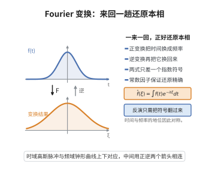

# Fourier变换与逆变换公式

> **一句话大白话**：把函数拆成不同频率的波，每个频率配一个系数；逆变换公式说，用这些系数把波重新叠回去，能原封不动地还原原来的函数。

> **小例子**：高斯函数 $f(x)=e^{-\pi x^2}$ 是它自己的傅里叶变换，$\hat f(\xi)=e^{-\pi\xi^2}$，于是逆变换 $\int\hat f(\xi)e^{2\pi i x\xi}\,\mathrm d\xi=e^{-\pi x^2}=f(x)$ 直接可见。

## 一、定理介绍

> **前置依赖**：$L^1$ 空间与 Lebesgue 积分、Fubini 定理、Schwartz 速降函数空间、Gauss 积分、控制收敛定理、卷积与磨光。

傅里叶变换由 Joseph Fourier 在 1822 年的《热的解析理论》中为解决热传导方程而引入，其思想是：任何足够好的函数都可以分解为不同频率的正弦、余弦波的叠加。正变换

$$
\hat f(\xi)=\int_{\mathbb R^n}f(x)e^{-2\pi i\,x\cdot\xi}\,\mathrm dx
$$

给出频率含量，逆变换公式

$$
f(x)=\int_{\mathbb R^n}\hat f(\xi)e^{2\pi i\,x\cdot\xi}\,\mathrm d\xi
$$

则声称这些频率含量足以唯一地重构 $f$。这个"可逆性"是整个调和分析的基础：它保证频率描述与空间描述是同一对象的两种等价语言。历史上 Fourier 的断言曾因缺乏严格的收敛性理论而受质疑，直到 Dirichlet、Riemann 与 Lebesgue 积分理论的建立，逆变换定理才被严格证明。现代证明的要点在于把高斯函数当作"近似恒等核"，用 Fubini 定理交换积分次序，从而把逆变换的积分识别为 $f$ 与一个收敛到 $\delta$ 的核的卷积。该定理在偏微分方程（把微分化为乘法）、信号处理、概率论（特征函数）与数论（Poisson 求和）中都是出发点。

## 几何直观

图意在说明：正变换把时间换成频率，逆变换只把指数符号翻过来，一来一回就能精确还原原来的函数。

## 二、原理思路

核心策略是"先用性质最好的函数证明，再谈推广"。

1. **用高斯函数做近似恒等核。** 高斯函数在傅里叶变换下自对偶，其缩放族 $\epsilon^{-n}\gamma(x/\epsilon)$ 当 $\epsilon\to0$ 时是近似恒等核。在逆变换积分中插入收敛因子 $\gamma(\epsilon\xi)$，可保证积分绝对收敛。
2. **用 Fubini 交换积分次序。** 把 $\hat f$ 的定义代入后交换次序，内层积分恰是 $\gamma$ 的傅里叶变换，等于 $\epsilon^{-n}\gamma((x-y)/\epsilon)$，于是整体成为 $f$ 与该核的卷积。
3. **取极限。** 令 $\epsilon\to0$，卷积收敛到 $f$（在连续点逐点收敛，在 $L^p$ 中收敛），而收敛因子逐点趋于 $1$，由控制收敛定理得到逆变换公式。

## 三、定理的严格表述

采用约定

$$
\hat f(\xi)=\int_{\mathbb R^n}f(x)e^{-2\pi i\,x\cdot\xi}\,\mathrm dx,\qquad \check g(x)=\int_{\mathbb R^n}g(\xi)e^{2\pi i\,x\cdot\xi}\,\mathrm d\xi .
$$

**（傅里叶逆变换定理）** 设 $f\in L^1(\mathbb R^n)$ 且 $\hat f\in L^1(\mathbb R^n)$。则 $\check{\hat f}$ 是连续函数，且

$$
\check{\hat f}(x)=\int_{\mathbb R^n}\hat f(\xi)e^{2\pi i\,x\cdot\xi}\,\mathrm d\xi=f(x)\quad\text{几乎处处}；
$$

若 $f$ 在点 $x$ 连续，则上述等号在该点成立。

特别地，对 $f\in\mathcal S(\mathbb R^n)$ 有逐点恒等式 $\check{\hat f}=f$，等价地

$$
\int_{\mathbb R^n}\hat f(\xi)e^{2\pi i\,x\cdot\xi}\,\mathrm d\xi=f(x),\qquad \widehat{\hat f}(x)=f(-x),\qquad \mathcal F^4=\mathrm{id}.
$$

## 四、证明过程

**步骤 1（高斯函数的自对偶性）。** 令 $\gamma(x)=e^{-\pi|x|^2}$。由一维 Gauss 积分 $\int_{\mathbb R}e^{-\pi t^2}\mathrm dt=1$，计算

$$
\hat\gamma(\xi)=\int_{\mathbb R^n}e^{-\pi|x|^2}e^{-2\pi ix\cdot\xi}\,\mathrm dx
=\prod_{j=1}^n\int_{\mathbb R}e^{-\pi x_j^2-2\pi i x_j\xi_j}\,\mathrm dx_j .
$$

配方 $-\pi x_j^2-2\pi ix_j\xi_j=-\pi(x_j+i\xi_j)^2-\pi\xi_j^2$，并利用被积函数在复平移下围道积分不变，每个因子等于 $e^{-\pi\xi_j^2}$，故 $\hat\gamma=\gamma$。

**步骤 2（缩放与近似恒等性）。** 对 $\epsilon>0$ 定义 $\gamma_\epsilon(x)=\epsilon^{-n}\gamma(x/\epsilon)$。由变量替换

$$
\hat{\gamma_\epsilon}(\xi)=\gamma(\epsilon\xi),\qquad \int_{\mathbb R^n}\gamma_\epsilon(x)\,\mathrm dx=1 .
$$

当 $\epsilon\to0$ 时 $\gamma_\epsilon$ 是近似恒等核：对连续的 $f$ 有 $(f*\gamma_\epsilon)(x)\to f(x)$；对 $f\in L^p$ 有 $f*\gamma_\epsilon\to f$ 于 $L^p$。

**步骤 3（插入收敛因子）。** 取 $f\in\mathcal S(\mathbb R^n)$（于是 $\hat f\in\mathcal S\subset L^1$）。对 $\epsilon>0$ 计算

$$
I_\epsilon(x):=\int_{\mathbb R^n}\hat f(\xi)\gamma(\epsilon\xi)e^{2\pi i\,x\cdot\xi}\,\mathrm d\xi .
$$

把 $\hat f(\xi)=\int_{\mathbb R^n}f(y)e^{-2\pi i\,y\cdot\xi}\,\mathrm dy$ 代入。由于 $|\hat f(\xi)\gamma(\epsilon\xi)|\le|\hat f(\xi)|\in L^1$，被积函数关于 $(\xi,y)$ 绝对可积，可用 Fubini 定理交换次序：

$$
I_\epsilon(x)=\int_{\mathbb R^n}f(y)\left(\int_{\mathbb R^n}\gamma(\epsilon\xi)e^{2\pi i\,(x-y)\cdot\xi}\,\mathrm d\xi\right)\mathrm dy .
$$

**步骤 4（内层积分化为核）。** 由步骤 1 与缩放 $\widehat{g(\epsilon\,\cdot)}(\eta)=\epsilon^{-n}\hat g(\eta/\epsilon)$，得

$$
\int_{\mathbb R^n}\gamma(\epsilon\xi)e^{2\pi i\,z\cdot\xi}\,\mathrm d\xi=\epsilon^{-n}\hat\gamma(-z/\epsilon)=\epsilon^{-n}\gamma(z/\epsilon)=\gamma_\epsilon(z).
$$

代入步骤 3 得

$$
I_\epsilon(x)=\int_{\mathbb R^n}f(y)\,\gamma_\epsilon(x-y)\,\mathrm dy=(f*\gamma_\epsilon)(x).
$$

**步骤 5（取极限）。** 由步骤 2，$I_\epsilon(x)\to f(x)$（在 $f$ 的连续点，对几乎处处的 $x$）。另一方面由控制收敛定理（$|\hat f\gamma(\epsilon\cdot)|\le|\hat f|\in L^1$ 且 $\gamma(\epsilon\xi)\to1$ 逐点）

$$
I_\epsilon(x)\xrightarrow[\epsilon\to0]{}\int_{\mathbb R^n}\hat f(\xi)e^{2\pi i\,x\cdot\xi}\,\mathrm d\xi=\check{\hat f}(x).
$$

两式比较即得 $\check{\hat f}=f$（连续点逐点，一般情形几乎处处）。

**步骤 6（推广与 $\mathcal F^4=\mathrm{id}$）。** 对一般的 $f\in L^1$ 且 $\hat f\in L^1$，用 $\mathcal S$ 中函数逼近并利用控制收敛定理即得结论。再由 $\check g(x)=\hat g(-x)$ 得 $\widehat{\hat f}(x)=\check{\hat f}(-x)=f(-x)$，即 $\mathcal F^2f=f(-\cdot)$；于是 $\mathcal F^4=(\mathcal F^2)^2=\mathrm{id}$。

$\square$

## 五、应用与意义

- **偏微分方程**：$\widehat{\partial_j f}=2\pi i\xi_j\hat f$ 把常系数线性方程化为代数方程，是热方程、波动方程、Schrödinger 方程求解的标准手段。
- **信号与图像处理**：正变换做频谱分析，逆变换做信号重构，是采样定理与滤波器设计的理论根据。
- **概率论**：特征函数即分布的傅里叶变换，逆变换给出密度与分布的唯一性。
- **数论与几何**：与 Poisson 求和公式配合，把格点的分布问题转化为对偶格点的求和。

## 课堂问答

**老师**：逆变换公式为什么必须借高斯函数来证？

**学生**：结论：高斯 $\gamma(x)=e^{-\pi|x|^2}$ 自对偶（$\hat\gamma=\gamma$），其缩放族 $\gamma_\epsilon$ 是近似恒等核。在逆变换积分里插入收敛因子 $\gamma(\epsilon\xi)$ 保证绝对可积，用 Fubini 交换次序后内层积分化为 $\gamma_\epsilon(x-y)$，整体成为 $f*\gamma_\epsilon$。

**老师（追问）**：最后 $\epsilon\to0$ 那步靠什么？

**学生**：一方面 $f\in\mathcal S$ 时 $f*\gamma_\epsilon\to f$（连续点逐点）；另一方面由控制收敛定理 $I_\epsilon(x)\to\int\hat f(\xi)e^{2\pi ix\cdot\xi}d\xi$。两者比较即得 $\check{\hat f}=f$，一般 $f\in L^1\cap L^2$ 情形的几乎处处等号由稠密逼近延拓。

**老师（拓展）**：由它怎么得到 $\mathcal F^4=\mathrm{id}$？

**学生**：先由 $\check g(x)=\hat g(-x)$ 得 $\widehat{\hat f}(x)=\check{\hat f}(-x)=f(-x)$，即 $\mathcal F^2f=f(-\cdot)$；再作用一次得 $\mathcal F^4=\mathrm{id}$。这个四阶周期是傅里叶变换在 $L^2$ 上谱性质的根源。

## 相关条目

- [Plancherel定理](./Plancherel定理.md)：把逆变换公式延拓到 $L^2$，得到傅里叶变换的酉性。
- [Fourier变换的L2理论](./Fourier变换的L2理论.md)：系统讨论 $L^2$ 上傅里叶变换与逆变换的构造。
- [Poisson求和公式](../第53级-代数数论/Poisson求和公式.md)：对函数与其傅里叶变换的采样求和建立恒等式，直接用正变换与逆变换的对称性。
- [Fubini定理](../第12级-多变量微积分/Fubini定理.md)：证明中交换积分次序的依据。
