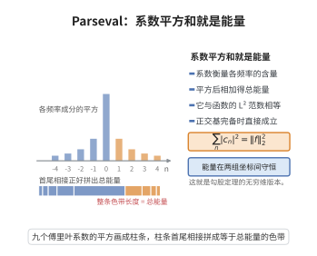

# Parseval恒等式

> **一句话大白话**：用函数本身算"能量"和用它的频率系数算"能量"，结果一样；这不过是勾股定理在无穷维空间里的版本。

> **小例子**：对 $f(x)=x$ 在 $[-\pi,\pi]$ 上，Fourier 系数为 $c_0=0$、$c_n=\frac{(-1)^{n+1}i}{n}$（$n\ne0$）。于是 Parseval 恒等式给出 $\sum_{n\ne0}\frac{1}{n^2}=\frac{1}{2\pi}\int_{-\pi}^{\pi}x^2\mathrm dx=\frac{\pi^2}{3}$，这正是 Basel 问题的值。

## 一、定理介绍

> **前置依赖**：Fourier级数与三角正交系、内积空间与正交基、Fourier变换与逆变换公式、$L^2$ 空间与完备性、Bessel不等式。

Parseval 恒等式由法国数学家 Marc-Antoine Parseval 于 1799 年（当时年仅 20 岁）在研究微分方程时提出，最初是三角级数的一个形式恒等式。它的内容是：周期函数的 Fourier 系数平方和等于函数平方的平均值。这个看似简单的等式实际上是一条"能量守恒律"：它说明从空间域与频率域两个角度度量函数能量结果相同，因此 Fourier 展开是保长的正交变换。19 世纪 Dirichlet、Riemann 与 Lebesgue 的理论说明了该等式的成立条件（$f\in L^2$ 即可）；20 世纪 Plancherel 把它推广到整个 $\mathbb R^n$，成为傅里叶变换的酉性。Parseval 恒等式在现代分析中有枢纽地位：几何上它是无穷维勾股定理，泛函分析上是完备正交系的刻画，物理上是能量守恒，数论上则是计算 $\sum n^{-2s}$ 等特殊值的工具。

## 几何直观

图意在说明：每个系数衡量该频率的含量，系数平方相加恰好等于函数的 L² 能量，这是无穷维的勾股定理。

## 二、原理思路

1. **周期情形先在正交系上做投影。** 三角系 $\{e^{inx}\}_{n\in\mathbb Z}$ 在 $L^2(-\pi,\pi)$ 中正交，$N$ 阶部分和 $S_N$ 是 $f$ 到 $\mathrm{span}\{e^{inx}:|n|\le N\}$ 上的正交投影，正交性立即给出 $\frac{1}{2\pi}\int|S_N|^2=\sum_{|n|\le N}|c_n|^2$。
2. **用完备性补上"消失的能量"。** Bessel 不等式只给出 $\le$；要取等号必须知道三角系完备（即 $S_N\to f$ 于 $L^2$），这正是 Fourier 级数的 $L^2$ 收敛性定理。
3. **非周期情形化为 Plancherel 或内积恒等式。** 一般 $L^2(\mathbb R^n)$ 情形用乘法公式 $\int f\hat g=\int\hat f g$ 与极化恒等式，或直接引用 Plancherel 定理。

## 三、定理的严格表述

**（周期 Parseval 恒等式）** 设 $f\in L^2[-\pi,\pi]$，其 Fourier 系数为

$$
c_n=\frac{1}{2\pi}\int_{-\pi}^{\pi}f(x)e^{-inx}\,\mathrm dx,\qquad n\in\mathbb Z .
$$

则 $\sum_{n\in\mathbb Z}|c_n|^2<\infty$ 且

$$
\frac{1}{2\pi}\int_{-\pi}^{\pi}|f(x)|^2\,\mathrm dx=\sum_{n\in\mathbb Z}|c_n|^2 .
$$

更一般的内积形式为

$$
\frac{1}{2\pi}\int_{-\pi}^{\pi}f(x)\overline{g(x)}\,\mathrm dx=\sum_{n\in\mathbb Z}c_n(f)\overline{c_n(g)} .
$$

**（连续 Parseval 恒等式）** 设 $f,g\in L^2(\mathbb R^n)$，采用约定 $\hat f(\xi)=\int_{\mathbb R^n}f(x)e^{-2\pi i\,x\cdot\xi}\,\mathrm dx$，则

$$
\int_{\mathbb R^n}f(x)\overline{g(x)}\,\mathrm dx=\int_{\mathbb R^n}\hat f(\xi)\overline{\hat g(\xi)}\,\mathrm d\xi .
$$

特别地 $\|f\|_{L^2}=\|\hat f\|_{L^2}$。

## 四、证明过程

**步骤 1（部分和的正交性）。** 令 $S_N(x)=\sum_{|n|\le N}c_ne^{inx}$。直接计算

$$
\frac{1}{2\pi}\int_{-\pi}^{\pi}|S_N(x)|^2\mathrm dx=\sum_{|m|,|n|\le N}c_n\overline{c_m}\cdot\frac{1}{2\pi}\int_{-\pi}^{\pi}e^{i(n-m)x}\mathrm dx=\sum_{|n|\le N}|c_n|^2,
$$

因为 $\frac{1}{2\pi}\int_{-\pi}^{\pi}e^{i(n-m)x}\mathrm dx=\delta_{mn}$。

**步骤 2（Bessel 不等式）。** 由 $S_N$ 是 $f$ 到有限维子空间的正交投影，有 $f-S_N\perp S_N$，故由勾股定理

$$
\frac{1}{2\pi}\int|f|^2=\frac{1}{2\pi}\int|S_N|^2+\frac{1}{2\pi}\int|f-S_N|^2\ge\sum_{|n|\le N}|c_n|^2 .
$$

令 $N\to\infty$ 得 $\sum_{n\in\mathbb Z}|c_n|^2\le\frac{1}{2\pi}\int|f|^2$。

**步骤 3（完备性给出等号）。** 三角多项式在连续函数空间中依 $L^2$ 范数稠密（Weierstrass 三角逼近），而连续函数在 $L^2$ 中稠密，故 $\bigcup_N\mathrm{span}\{e^{inx}:|n|\le N\}$ 在 $L^2$ 中稠密。于是 $S_N\to f$ 于 $L^2$，且

$$
\frac{1}{2\pi}\int|f-S_N|^2=\frac{1}{2\pi}\int|f|^2-\sum_{|n|\le N}|c_n|^2\xrightarrow[N\to\infty]{}0,
$$

即得等号。

**步骤 4（内积形式）。** 对 $f\pm g$、$f\pm ig$ 应用范数形式并用极化恒等式

$$
\langle f,g\rangle=\frac{1}{4}\big(\|f+g\|^2-\|f-g\|^2+i\|f+ig\|^2-i\|f-ig\|^2\big)
$$

即得内积形式。

**步骤 5（非周期情形）。** 对 $f,g\in\mathcal S(\mathbb R^n)$ 用乘法公式

$$
\int_{\mathbb R^n}\hat f\,g\,\mathrm dx=\int_{\mathbb R^n}f\,\hat g\,\mathrm dx,
$$

其证明是把 $\hat f$ 的定义代入并用 Fubini 定理交换积分次序。取 $g=\overline{\hat f}$，利用 $\widehat{\overline{\hat f}}=\overline{f}$（由共轭与逆变换公式），得

$$
\int\hat f\,\overline{\hat f}=\int f\,\overline{\overline{\hat f}}=\int|f|^2,
$$

即 $\|\hat f\|_{L^2}=\|f\|_{L^2}$。对一般的 $f,g\in L^2$，再由 Plancherel 定理的连续延拓与极化恒等式即得内积形式。

$\square$

## 五、应用与意义

- **能量守恒与信号处理**：Parseval 恒等式即"时域能量 $=$ 频域能量"，是滤波器、采样与压缩理论的基本约束。
- **级数求和**：选取合适的 $f$ 可算出 $\sum n^{-2}=\pi^2/6$、$\sum n^{-4}=\pi^4/90$ 等 $\zeta$ 特殊值。
- **PDE 与量子力学**：$L^2$ 能量估计、谱分解与位置表象/动量表象的等价性都建立在 Parseval 恒等式之上。
- **不确定性原理**：由 $\|\hat f\|_{L^2}=\|f\|_{L^2}$ 出发可得位置与频率不能同时集中的定量结论。

## 课堂问答

**老师**：为什么说 Parseval 恒等式是"无穷维勾股定理"？

**学生**：结论：$N$ 阶部分和 $S_N$ 是 $f$ 到 $\mathrm{span}\{e^{inx}:|n|\le N\}$ 的正交投影，正交性给出 $\frac1{2\pi}\int|S_N|^2=\sum_{|n|\le N}|c_n|^2$ 且 $f-S_N\perp S_N$，能量按勾股分解。完备性（三角多项式稠密）让 $S_N\to f$，余项能量归零，等号成立。

**老师（追问）**：少了完备性会怎样？

**学生**：只能得到 Bessel 不等式 $\sum|c_n|^2\le\frac1{2\pi}\int|f|^2$，可能有"消失的能量"——存在与所有 $e^{inx}$ 正交的非零函数。完备正交系才把 $\le$ 升级为等号。

**老师（拓展）**：用它怎么顺手算出 $\sum n^{-2}$？

**学生**：取 $f(x)=x$ 得 $c_n=\frac{(-1)^{n+1}i}{n}$（$n\ne0$），Parseval 给 $\sum_{n\ne0}\frac1{n^2}=\frac1{2\pi}\int_{-\pi}^\pi x^2dx=\frac{\pi^2}{3}$，即 Basel 值 $\zeta(2)=\pi^2/6$。这是范数形式加极化恒等式算内积的典型用法。

## 相关条目

- [Plancherel定理](./Plancherel定理.md)：Parseval 恒等式在 $\mathbb R^n$ 上的连续版本。
- [Fourier变换与逆变换公式](./Fourier变换与逆变换公式.md)：非周期情形的证明依赖逆变换与乘法公式。
- [Fourier变换的L2理论](./Fourier变换的L2理论.md)：$L^2$ 上 Fourier 变换的完备处理，包含 Parseval 恒等式。
- [Poisson求和公式](../第53级-代数数论/Poisson求和公式.md)：与 Parseval 型恒等式同源的频率域恒等式。
