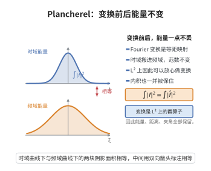

# Plancherel 定理

> **一句话大白话**：傅里叶变换在平方可积函数上"不改变长度"——它把 $L^2$ 空间里的每个函数旋到一个新函数，二者能量（平方积分）一样大，而且变换可逆；于是 $L^2$ 上的傅里叶变换是一个完美的"旋转"。
>
> **小例子**：高斯函数 $f(x)=e^{-\pi x^2}$ 是傅里叶变换的不动点（$\hat f=f$），故 $\|\hat f\|_2=\|f\|_2$；对 $f(x)=\mathbf 1_{[-1,1]}(x)$ 则 $\hat f(\xi)=\frac{\sin 2\pi\xi}{\pi\xi}$，也有 $\int\hat f^2=\int f^2=2$。

## 一、定理介绍

> **前置依赖**：$L^p$ 空间与稠密性、Fourier 变换与逆变换公式、Schwartz 空间及其在 $L^2$ 中稠密、Fubini 定理、等距算子的唯一连续延拓

Plancherel 定理由 Michel Plancherel 于 1910 年证明，又称傅里叶变换的 $L^2$ 等距性定理。它解决了傅里叶变换的一个根本困难：可积函数 $f\in L^1$ 的傅里叶变换有定义，但 $L^2$ 函数（如 $f(x)=\mathbf 1_{[-1,1]}$ 尚可，而 $x^{-1/2}$ 型函数）未必可积，傅里叶积分未必绝对收敛。Plancherel 定理说明：对 $L^1\cap L^2$ 中的函数，$\hat f$ 也属于 $L^2$，而且范数相等；于是傅里叶变换可以唯一地连续延拓为 $L^2(\mathbb R^n)$ 上的酉算子。

这个延拓是调和分析的基石。它把 Parseval 等式从周期情形推广到整个 $\mathbb R^n$，使得"能量守恒"成为傅里叶分析的第一原理：微分算子在对偶空间中变成乘法算子、卷积变成乘积、Heisenberg 不确定性原理成为"函数与其变换不能同时集中"的定量表述。

在本仓库中，Plancherel 定理也是奇异积分理论、Littlewood–Paley 分解与 Bochner–Riesz 平均中一切 $L^2$ 估计的出发点。

## 几何直观

图意在说明：Fourier 变换把函数搬到频域时不改变 L² 范数，能量、距离与夹角全部原样保留。

## 二、原理思路

核心想法只有一句话：**先在性质最好的 Schwartz 空间上把恒等式证出来，再用稠密性把算子延拓出去。**

具体地，采用"无 $2\pi$"的傅里叶约定 $\hat f(\xi)=\int_{\mathbb R^n}f(x)e^{-2\pi i x\cdot\xi}\,\mathrm dx$，此时逆变换与正变换形式对称：$\hat{\hat f}(x)=f(-x)$。证明分两步：

**第一步（恒等式）**：对 $f,g\in\mathcal S(\mathbb R^n)$ 用 Fubini 定理证明乘法公式 $\int\hat f\,g=\int f\,\hat g$；在其中取 $g=\overline{\hat f}$，并利用 $\widehat{\overline{\hat f}}=\overline f$，即得 $\|\hat f\|_2=\|f\|_2$。这一步是纯粹的计算。

**第二步（延拓）**：$\mathcal S$ 在 $L^2$ 中稠密，而 $L^2$ 完备。一个在稠密子空间上保持范数的线性算子唯一地延拓为整个空间上的等距线性算子；再由逆变换公式给出其逆，等距即为酉。第二步是标准的泛函分析套路。

## 三、定理的严格表述

**（Plancherel 定理）** 采用约定

$$
\hat f(\xi)=\int_{\mathbb R^n}f(x)e^{-2\pi i\,x\cdot\xi}\,\mathrm dx,\qquad f\in L^1(\mathbb R^n),
$$

则：

1. 对 $f\in L^1\cap L^2(\mathbb R^n)$，有 $\hat f\in L^2(\mathbb R^n)$ 且

$$
\|\hat f\|_{L^2}=\|f\|_{L^2}.
$$

2. 更一般地，对 $f,g\in L^2(\mathbb R^n)$ 有内积恒等式

$$
\langle\hat f,\hat g\rangle_{L^2}=\langle f,g\rangle_{L^2}.
$$

3. 傅里叶变换 $\mathcal F:L^2\to L^2$，$\mathcal F f=\hat f$，是 $\mathbb R$-线性（实际上 $\mathbb C$-线性）的酉算子；其逆为 $\mathcal F^{-1}g(x)=\hat g(-x)=\int g(\xi)e^{2\pi ix\cdot\xi}\,\mathrm d\xi$（在 $L^2$ 意义下），且 $\mathcal F^4=\mathrm{id}$。

## 四、证明过程

**步骤 1：在 Schwartz 空间上建立乘法公式。**

设 $f,g\in\mathcal S(\mathbb R^n)$。计算

$$
\int_{\mathbb R^n}\hat f(\xi)\,g(\xi)\,\mathrm d\xi=\int_{\mathbb R^n}\left(\int_{\mathbb R^n}f(x)e^{-2\pi ix\cdot\xi}\,\mathrm dx\right)g(\xi)\,\mathrm d\xi.
$$

被积函数绝对可积（$f,g$ 速降），由 Fubini 定理可交换积分次序：

$$
\int\hat f\,g=\int_{\mathbb R^n}f(x)\left(\int_{\mathbb R^n}g(\xi)e^{-2\pi ix\cdot\xi}\,\mathrm d\xi\right)\mathrm dx=\int_{\mathbb R^n}f(x)\,\hat g(x)\,\mathrm dx.
$$

这就是乘法公式 $\displaystyle\int\hat f\,g=\int f\,\hat g$。

**步骤 2：逆变换公式（Schwartz 情形）。**

对 $f\in\mathcal S$，由 Fourier 逆变换定理 $\hat{\hat f}(x)=f(-x)$。等价地，对任意 $f\in\mathcal S$，

$$
f(x)=\int_{\mathbb R^n}\hat f(\xi)e^{2\pi ix\cdot\xi}\,\mathrm d\xi.
$$

（这可对高斯函数验证后再由稠密性/与 $f$ 卷积的标准手法得到；许多教材将其作为傅里叶反演定理单独证明。）

**步骤 3：取 $g=\overline{\hat f}$。**

由 $g\in\mathcal S$（因 $f\in\mathcal S$ 得 $\hat f\in\mathcal S$，共轭仍速降），计算其傅里叶变换：

$$
\hat g(\xi)=\int\overline{\hat f(x)}e^{-2\pi ix\cdot\xi}\,\mathrm dx=\overline{\int\hat f(x)e^{2\pi ix\cdot\xi}\,\mathrm dx}=\overline{\hat{\hat f}(-\xi)}=\overline{f(\xi)},
$$

最后一步用了步骤 2 的逆变换公式（$\hat{\hat f}(-\xi)=f(\xi)$）。故 $\hat g=\overline f$。

**步骤 4：代入乘法公式得等距性。**

由步骤 1 与步骤 3，

$$
\int_{\mathbb R^n}\hat f\,\overline{\hat f}\,\mathrm d\xi=\int_{\mathbb R^n}f\,\overline{\hat g}\,\mathrm d\xi=\int_{\mathbb R^n}f\,\overline{\overline f}\,\mathrm d\xi=\int_{\mathbb R^n}|f|^2\,\mathrm dx,
$$

即

$$
\|\hat f\|_{L^2}=\|f\|_{L^2},\qquad f\in\mathcal S(\mathbb R^n).
$$

**步骤 5：对 $L^1\cap L^2$ 验证。**

若 $f\in L^1\cap L^2$，取 $f_k\in\mathcal S$ 使 $f_k\to f$ 于 $L^1\cap L^2$。由 $\hat f_k\to\hat f$ 一致收敛（因 $\|f_k-f\|_1\to0$）且 $\|\hat f_k\|_2=\|f_k\|_2$ 一致有界，再由 Fatou 引理得 $\hat f\in L^2$ 且 $\|\hat f\|_2\le\|f\|_2$；结合稠密性取极限得等号。于是 1 成立。

**步骤 6：延拓为酉算子。**

$\mathcal S$ 在 $L^2$ 中稠密。对 $f\in L^2$ 取 $f_k\in\mathcal S$，$f_k\to f$。由步骤 4，$(\hat f_k)$ 是 $L^2$ 中 Cauchy 列，定义 $\mathcal F f:=\lim\hat f_k$。该定义与逼近序列无关（由等距性），且 $\|\mathcal F f\|_2=\|f\|_2$，故 $\mathcal F$ 是等距线性算子。

**步骤 7：证明 $\mathcal F$ 是满射（酉）。**

由逆变换公式与 $\mathcal F^4=\mathrm{id}$（在 $\mathcal S$ 上验证：$\mathcal F^2 f=\check f$、$\mathcal F^4=\mathrm{id}$），对任意 $g\in L^2$ 取 $\mathcal F^{-1}g=\mathcal F^3 g\in L^2$ 即得 $\mathcal F(\mathcal F^{-1}g)=g$。故 $\mathcal F$ 可逆、等距，是酉算子。对 $f,g\in L^2$，由极化恒等式得 $\langle\mathcal F f,\mathcal F g\rangle=\langle f,g\rangle$，即 2 成立。$\square$

## 五、应用与意义

**理论意义**：Plancherel 定理把傅里叶变换从"对可积函数做积分"提升为 $L^2$ 空间的自同构，使 $L^2$ 成为傅里叶分析的天然舞台。它是 Parseval 等式在 $\mathbb R^n$ 上的连续版本，也是量子力学"动量表象与位置表象等价"的数学表述；物理上即"能量守恒"。

**应用领域**：
1. **偏微分方程**：$L^2$ 能量估计与仿微分算子（拟微分算子）的 $L^2$ 有界性直接依赖 Plancherel。
2. **奇异积分与 Littlewood–Paley 理论**：用 Plancherel 把算子范数化为对傅里叶乘子的估计，是 Calderón–Zygmund 理论的入口。
3. **信号处理与采样**：能量守恒与 Shannon 采样定理是同一原理的应用形式。
4. **不确定性原理**：由 $\|\hat f\|_2=\|f\|_2$ 与 Heisenberg 不等式可得位置-频率不能同时集中的定量结论。

**推广**：Plancherel 定理可推广到局部紧交换群上的抽象傅里叶分析（Pontryagin 对偶）以及半单李群上的非交换调和分析，是朗兰兹纲领"局部-整体"思想的雏形。

## 课堂问答

**老师**：$L^2$ 函数未必可积，$\hat f$ 的积分无意义，Plancherel 怎么绕过这个矛盾？

**学生**：结论：稠密延拓。先在 $\mathcal S$ 上由乘法公式 $\int\hat fg=\int f\hat g$ 取 $g=\overline{\hat f}$ 证得 $\|\hat f\|_2=\|f\|_2$；再因 $\mathcal S$ 在 $L^2$ 稠密、$L^2$ 完备，等距线性算子唯一延拓为 $L^2\to L^2$ 的酉算子。

**老师（追问）**：怎么确保延拓后是满射而非只到 $L^2$ 的一半？

**学生**：用逆变换：在 $\mathcal S$ 上 $\mathcal F^2f=\check f$、$\mathcal F^4=\mathrm{id}$，故 $\mathcal F^{-1}=\mathcal F^3$ 也在 $L^2$ 上有定义。对任意 $g\in L^2$ 取 $\mathcal F^{-1}g=\mathcal F^3g$ 即为原像，故满射，结合等距得酉。

**老师（拓展）**：内积恒等式 $\langle\hat f,\hat g\rangle=\langle f,g\rangle$ 怎么来？

**学生**：由范数等距加极化恒等式 $\langle f,g\rangle=\frac14\sum_{k=0}^3 i^k\|f+i^kg\|_2^2$ 直接给出。物理上这就是"时域能量等于频域能量"。

## 相关条目

- [Fourier变换的L2理论](./Fourier变换的L2理论.md)：以 Plancherel 定理为核心，系统讨论 $L^2$ 上傅里叶变换的构造与性质。
- [奇异积分算子理论](./奇异积分算子理论.md)：借助 Plancherel 定理把奇异积分算子的 $L^2$ 有界性化为乘子估计。
