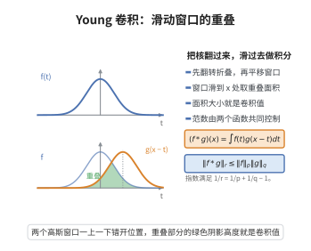

# Young 卷积不等式

> **一句话大白话**：两个函数卷积之后，它的"平均大小"会被两个因子的可积性同时卡住——只要把三个指数满足 $\frac1p+\frac1q=1+\frac1r$，卷积的 $L^r$ 范数就不超过两个因子各自 $L^p$、$L^q$ 范数的乘积。
>
> **小例子**：取 $p=q=1$，得 $\|f*g\|_1\le\|f\|_1\|g\|_1$；取 $p=q=2$，则 $r=\infty$，得 $\|f*g\|_\infty\le\|f\|_2\|g\|_2$（由 Cauchy–Schwarz）；取 $p=1,q=2$，得 $\|f*g\|_2\le\|f\|_1\|g\|_2$。

## 一、定理介绍

> **前置依赖**：$L^p$ 空间与 Hölder 不等式、Minkowski不等式、卷积的定义与基本性质、Riesz–Thorin 插值定理、调和分析的实插值方法

Young 卷积不等式由 William Henry Young 在 1912 年提出，是卷积运算最基本的范数估计。它断言：若 $1\le p,q,r\le\infty$ 满足

$$
\frac1p+\frac1q=1+\frac1r,
$$

则对一切 $f\in L^p(\mathbb R^n)$、$g\in L^q(\mathbb R^n)$ 有 $f*g\in L^r(\mathbb R^n)$ 且

$$
\|f*g\|_{L^r}\le\|f\|_{L^p}\,\|g\|_{L^q}.
$$

它的重要性在于揭示"卷积是一种平滑/混合运算"：当 $r\ge\max(p,q)$ 时，卷积后函数的可积性不比两个因子差，通常是"更好"。这在估计解算子、证明 Sobolev 型不等式、构造磨光核（mollifier）以及讨论 Calderón–Zygmund 奇异积分时反复使用。

从对偶的观点看，Young 不等式是 Hölder 不等式在"群卷积"上的推广；它的极致情形 $p=q=1$ 说明 $L^1$ 在卷积下是 Banach 代数，这正是傅里叶变换把它变成乘法代数的根源。

## 几何直观

图意在说明：卷积就是把核翻转平移后与函数相乘积分，窗口滑到哪里，重叠面积就给出那里的卷积值。

## 二、原理思路

证明的主线是"**用两个极端情形插值出中间情形**"。

**极端情形一**：$p=1$（此时 $r=q$）。由 Minkowski 积分不等式，

$$
\|f*g\|_q=\Big\|\int f(y)g(\cdot-y)\,\mathrm dy\Big\|_q\le\int|f(y)|\,\|g(\cdot-y)\|_q\,\mathrm dy=\|f\|_1\|g\|_q.
$$

即"$L^1$ 与 $L^q$ 卷积仍 $L^q$"。

**极端情形二**：对偶极端 $q=\infty$（此时 $r=p$），同理有 $\|f*g\|_p\le\|f\|_p\|g\|_\infty$。更本质的第二极端是 $q=p'$（$r=\infty$）：由 Hölder 得点态估计 $\|f*g\|_\infty\le\|f\|_p\|g\|_{p'}$。

中间的 $(p,q,r)$ 都落在这两个端点的"插值线段"上：固定 $p$，算子 $g\mapsto f*g$ 在端点指标之间插值，$L^r$ 范数按对数凸方式被 $L^1$、$L^{p'}$ 两个端点范数控制。对数凸性正是 Riesz–Thorin 定理的内容，插值后指数关系恰好化为 $1/r=1/p+1/q-1$。这就是整个证明的逻辑。

## 三、定理的严格表述

**（Young 卷积不等式）** 设 $1\le p,q,r\le\infty$ 满足

$$
\frac1p+\frac1q=1+\frac1r.
$$

则对任意 $f\in L^p(\mathbb R^n)$、$g\in L^q(\mathbb R^n)$，卷积

$$
(f*g)(x)=\int_{\mathbb R^n}f(y)g(x-y)\,\mathrm dy
$$

对几乎处处的 $x$ 有定义，$f*g\in L^r(\mathbb R^n)$，且

$$
\|f*g\|_{L^r}\le\|f\|_{L^p}\,\|g\|_{L^q}.
$$

**等价的指数关系**：$1/r=1/p+1/q-1$，或 $1/p+1/q+1/r'=2$（$r'$ 为 $r$ 的共轭指数）。

**特殊情形**：$r=\infty\iff q=p'$ 时即 Hölder 不等式；$p=q=1\Rightarrow r=1$；$p=1\Rightarrow r=q$。

## 四、证明过程

**步骤 1：两个端点不等式。**

**(a) $p=1$，$r=q$。** 设 $f\in L^1,g\in L^q$。对几乎处处 $x$，$\int|f(y)||g(x-y)|\,\mathrm dy\le\|f\|_1^{1/q'}\big((|f|*|g|^q)(x)\big)^{1/q}<\infty$，故 $f*g$ 有意义。由 Minkowski 积分不等式（$q\ge1$）：

$$
\|f*g\|_q=\Big\|\int f(y)g(\cdot-y)\,\mathrm dy\Big\|_q\le\int|f(y)|\,\|g(\cdot-y)\|_q\,\mathrm dy=\|f\|_1\|g\|_q.
$$

**(b) $q=p'$，$r=\infty$。** 由 Hölder 不等式，对每个 $x$，

$$
|(f*g)(x)|\le\|f\|_p\|g\|_{p'},\qquad\text{故}\quad \|f*g\|_\infty\le\|f\|_p\|g\|_{p'}.
$$

**(c) $q=\infty$，$r=p$。** 同理 $\|f*g\|_p\le\|f\|_p\|g\|_\infty$（由 Minkowski 与 $|g|\le\|g\|_\infty$）。这三个端点已覆盖所有边界情形。

**步骤 2：固定 $f$ 定义线性算子。**

取定 $f\in L^p$（$1<p<\infty$），定义 $T_f:g\mapsto f*g$。由步骤 1(a)（配合 $L^p$ 与 $L^1$ 的对称性），

$$
T_f:L^1\to L^p,\qquad \|T_f g\|_p\le\|f\|_p\|g\|_1;
$$

由步骤 1(b)，

$$
T_f:L^{p'}\to L^\infty,\qquad \|T_f g\|_\infty\le\|f\|_p\|g\|_{p'}.
$$

**步骤 3：Riesz–Thorin 插值。**

Riesz–Thorin 定理断言：若线性算子 $T$ 有界地作用 $L^{p_0}\to L^{q_0}$ 与 $L^{p_1}\to L^{q_1}$（范数分别为 $M_0,M_1$），则对 $0\le\theta\le1$，$T$ 有界地作用

$$
L^{p_\theta}\to L^{q_\theta},\qquad \frac1{p_\theta}=\frac{1-\theta}{p_0}+\frac\theta{p_1},\quad \frac1{q_\theta}=\frac{1-\theta}{q_0}+\frac\theta{q_1},
$$

且 $\|T\|_{p_\theta\to q_\theta}\le M_0^{1-\theta}M_1^{\theta}$。

把 $p_0=1,\ q_0=p$（端点 a）与 $p_1=p',\ q_1=\infty$（端点 b）代入。给定 $1<q<p'$，取 $\theta\in[0,1]$ 使

$$
\frac1q=\frac{1-\theta}{1}+\frac\theta{p'},
$$

则对应的

$$
\frac1r=\frac{1-\theta}{p}+\frac\theta{\infty}=\frac{1-\theta}{p}.
$$

由 $\frac1q=1-\theta+\frac\theta{p'}$ 解得 $1-\theta=\frac1q-\frac\theta{p'}$，再消去 $\theta$ 可验证

$$
\frac1r=\frac1p+\frac1q-1,
$$

即 $r$ 恰为题设值。于是

$$
\|f*g\|_r=\|T_f g\|_r\le\|f\|_p^{1-\theta}\|f\|_p^{\theta}\,\|g\|_q=\|f\|_p\|g\|_q.
$$

**步骤 4：其余指标。**

若 $q\ge p'$（即 $r\ge p$ 的大指标区），由对称性交换 $f,g$ 或用端点 (c) 与 (b) 的另一种插值组合即可；边界情形 $p=1$、$q=1$、$p=\infty$、$q=\infty$ 由步骤 1 直接给出。综上，对一切满足 $\frac1p+\frac1q=1+\frac1r$ 的指标，不等式成立。$\square$

**注**：不等式中的常数 $1$ 是最优的（取逼近 $\delta$ 函数的 $f$、$g$ 可逼近等号）。

## 五、应用与意义

**理论意义**：Young 不等式说明 $L^1$ 配卷积是 Banach 代数（$p=q=r=1$），并在傅里叶变换下变为乘法：$\widehat{f*g}=\hat f\hat g$。由此 $L^1$ 的 Gelfand 理论成为抽象调和分析的原型。

**应用领域**：
1. **Sobolev 嵌入与拟微分算子**：用卷积核的可积性估计解的正则性，Young 不等式是 Sobolev 型不等式的初等来源。
2. **磨光（mollification）**：取 $\rho_\epsilon$ 为逼近单位，$\|f*\rho_\epsilon-f\|_p\to0$ 的证明完全依赖 Young 不等式。
3. **奇异积分与极大函数**：$L^1$-$L^{1,\infty}$ 型的弱型 Young 不等式是 Calderón–Zygmund 分解的配套工具。
4. **概率论**：独立随机变量和的密度是卷积，Young 不等式给出密度可积性的传播。

**推广**：弱型 Young 不等式（用 Lorentz 空间 $L^{p,\infty}$ 代替 $L^p$）、以及双线性插值（特别是 $r\le1$ 的"端点多线性"情形，与 Brascamp–Lieb 不等式相关）为现代调和分析所用。

## 课堂问答

**老师**：Young 不等式的指数关系 $\frac1p+\frac1q=1+\frac1r$ 为什么长这样？

**学生**：结论：它是两端点插值的必然结果。端点一 $p=1\Rightarrow r=q$（Minkowski）；端点二 $q=p'\Rightarrow r=\infty$（Hölder）。Riesz-Thorin 对 $1/r$ 与 $1/q$ 做对数凸插值，消去 $\theta$ 即得 $\frac1r=\frac1p+\frac1q-1$。

**老师（追问）**：为什么 $L^1$ 在卷积下是 Banach 代数？和傅里叶变换什么关系？

**学生**：取 $p=q=r=1$ 得 $\|f*g\|_1\le\|f\|_1\|g\|_1$，卷积封闭性成立。且 $\widehat{f*g}=\hat f\hat g$，傅里叶变换把卷积代数同构到乘法代数，这正是 Gelfand 抽象调和分析的原型。

**老师（拓展）**：常数 1 是否最优？弱型与双线性版本又是什么？

**学生**：最优，取逼近 $\delta$ 的 $f,g$ 可达等号。弱型版本用 $L^{p,\infty}$ 代替 $L^p$，是 Calderón-Zygmund 分解的配套工具；$r<1$ 的端点多线性情形与 Brascamp-Lieb 不等式相关。

## 相关条目

- [Plancherel定理](./Plancherel定理.md)：由 $\widehat{f*g}=\hat f\hat g$ 与 $L^2$ 等距性，卷积估计可转化为乘子估计。
- [奇异积分算子理论](./奇异积分算子理论.md)：弱型 Young 不等式与插值是奇异积分算子的 $L^p$ 有界性证明的基础工具。
