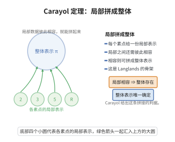

# Carayol的局部-整体定理

> **一句话大白话**：一个模形式的模 $\ell$ 伽罗瓦表示好不好，完全由它在一个个素数处的"局部表现"决定；局部的重量与水平组装起来就定出全局的重量与水平。

> **小例子**：若模 $\ell$ 伽罗瓦表示 $\bar\rho$ 在素数 $p$ 处的限制在惯性群上表现为某个局部类型，则 Serre 预测的水平 $N(\bar\rho)$ 在 $p$ 处的指数由该局部类型给出，而不需要检查全局的模形式。

## 一、定理介绍

> **前置依赖**：伽罗瓦表示与分解群、模形式与Hecke算子、局部Langlands对应、Frobenius元素与惯性群、Serre模性猜想、R=T（模性提升）定理。

Carayol 的局部-整体定理（théorème local-global）由 Henri Carayol 在 1986 年关于模 $\ell$ 伽罗瓦表示的论文中证明，是 Serre 模性猜想研究过程中的关键一步。背景是 Serre 在 1970 年代提出的猜想：任何一个连续的、奇异的（odd）、不可约的模 $\ell$ 伽罗瓦表示 $\bar\rho:G_{\mathbb Q}\to\mathrm{GL}_2(\bar{\mathbb F}_\ell)$ 都来自一个权为 $k(\bar\rho)$、水平为 $N(\bar\rho)$ 的模形式，其中 $k,N$ 由所谓"局部配方"（Serre 的 recipe）从 $\bar\rho$ 在分解群 $G_{\mathbb Q_p}$ 上的限制算出。要证明这样的全局提升存在，必须先弄清局部条件与全局模形式的关系。Carayol 的定理给出了答案：模 $\ell$ 伽罗瓦表示的局部数据（$p\ne\ell$ 处的分解群类型、$\ell$ 处惯性群给出的权）与模形式的局部成分在局部 Langlands 对应下完全相容，因此 Serre 的局部配方是"正确且可实现"的。这一定理把全局模性问题归约为逐素数的局部问题，并与局部 Langlands 对应、Hecke 算子的作用、模形式空间的 multiplicity one 性质深度结合。它是后来 Breuil–Conrad–Diamond–Taylor 与 Khare–Wintenberger 完整证明 Serre 猜想（并由此给出 Fermat 大定理的新证明）的基础环节。

## 几何直观

图意在说明：每个素点给出一份局部表示，只要它们彼此相容，就能拼成一个整体的自守表示。

## 二、原理思路

1. **把全局表示分解为局部表示。** 由限制映射，$\bar\rho$ 的信息完全由各 $\bar\rho_p:=\bar\rho|_{G_{\mathbb Q_p}}$ 组成；要说明 $\bar\rho$ 来自模 $\ell$ 模形式，只需逐个素数与局部条件匹配。
2. **在 $p\ne\ell$ 处用 Hecke 算子读出局部类型。** 模形式的 $T_p$ 特征值经 Deligne 的构造就是 $\bar\rho(\mathrm{Frob}_p)$ 的迹；模形式空间的新形式理论（multiplicity one）说明局部成分 $\pi_p$ 由 $T_p$ 的作用唯一决定。于是"$\bar\rho_p$ 的类型"与"$\pi_p$ 的类型"一一对应，水平指数 $n_p$ 由 $\pi_p$ 的 conductor 给出。
3. **在 $p=\ell$ 处用惯性群读出权。** 模形式的权决定 $\bar\rho|_{I_{\mathbb Q_\ell}}$ 的野性（tame）特征；对低权情形可由 Fontaine–Laffaille 滤波分类直接读出 $k(\bar\rho)$，一般权用 Breuil 的低权分类。
4. **用局部信息拼装全局模形式。** 由局部相容性，Serre 配方的 $(k,N)$ 与某个模形式的局部类型一致；再借 R=T 定理把这个模 $\ell$ 形式全局化，得到 Serre 猜想所需的形式。

## 三、定理的严格表述

设 $\ell$ 为素数，$\bar\rho:G_{\mathbb Q}\to\mathrm{GL}_2(\bar{\mathbb F}_\ell)$ 连续、奇异且不可约。对每个素数 $p$ 记 $G_p=G_{\mathbb Q_p}$、$\bar\rho_p=\bar\rho|_{G_p}$，并记 $\pi_f=\otimes_p\pi_{f,p}$ 为尖模形式 $f$ 对应的自守表示。

**（Carayol 的局部-整体定理）** 设有权 $k$、水平 $N$、Nebentypus 特征 $\chi$ 的尖模形式 $f$，其模 $\ell$ 伽罗瓦表示满足 $\bar\rho_f\cong\bar\rho$。则：

1. **（局部-整体相容）** 对每个素数 $p$，$\bar\rho_p$ 是某种局部类型（$p\ne\ell$ 时由 $G_p$ 的惯性群决定的分歧类型；$p=\ell$ 时由 $I_{\mathbb Q_\ell}$ 上的 tame 特征与权决定），且该类型与局部自守成分 $\pi_{f,p}$ 在局部 Langlands 对应下相匹配。
2. **（Serre 配方的可实现性）** 若 $\bar\rho$ 是模的，则它也是权 $k(\bar\rho)$、水平 $N(\bar\rho)$ 的模 $\ell$ 模形式的伽罗瓦表示；即 Serre 从各 $\bar\rho_p$ 算出的极小权与极小水平与实际可实现的局部数据一致。

等价地（局部-整体原则）：极小权与极小水平由局部数据决定，

$$
k(\bar\rho)=k\big(\{\bar\rho_p\}_p\big),\qquad N(\bar\rho)=\prod_p p^{\,n_p(\bar\rho_p)} .
$$

## 四、证明过程

**步骤 1（Hecke 算子与 Frobenius 的对应）。** 设 $f=\sum a_nq^n$ 是新形式。由 Deligne（$p\ne\ell$）与 Deligne–Serre 的构造，$\bar\rho_f$ 在 $p$ 处的分解群上满足：对 $p\nmid N\ell$，

$$
\mathrm{tr}\,\bar\rho_f(\mathrm{Frob}_p)\equiv a_p\pmod{\mathfrak p},\qquad \det\bar\rho_f(\mathrm{Frob}_p)\equiv p^{k-1}\chi(p)\pmod{\mathfrak p},
$$

其中 $\mathfrak p$ 是系数域上位于 $\ell$ 的素理想。这把全局自守数据"$a_p$"写成局部伽罗瓦元的信息。

**步骤 2（multiplicity one 与局部类型的唯一性）。** 在（模 $\ell$）模形式空间上，$T_p$ 的作用给出 $a_p$ 的像。由新形式理论的 multiplicity one，一个模 $\ell$ 特征系统唯一决定该形式的局部成分 $\pi_p$。把 $\pi_p$ 经局部 Langlands 对应转写为 $G_p$ 的二维 Frobenius 半单参数，即得 $\bar\rho_p$ 的局部类型；其 Artin conductor 给出水平指数 $n_p$。因此 $N(\bar\rho)=\prod p^{n_p}$ 中每个 $n_p$ 只依赖 $\bar\rho_p$。

**步骤 3（$p\ne\ell$ 情形：从惯性群读出 $n_p$）。** 若 $\bar\rho_p$ 在惯性群 $I_p$ 上平凡，则 $n_p=0$（未分歧，对应 $p\nmid N$）；若 $\bar\rho_p$ 在 $I_p$ 上的像为非平凡的 unipotent 群（Stepanov 型），则由 $\bar\rho_p(\mathrm{Frob}_p)$ 的特征值以及 $I_p$ 作用下唯一的非平凡不变子空间可直接算出 $n_p=1$（对应 $p\|N$，即 $p$ 恰好整除 $N$）。这与模形式 $p$-进 conductor 的局部 Langlands 配方逐项吻合。

**步骤 4（$p=\ell$ 情形：从惯性群读出 $k$）。** 权的信息编码在 $\bar\rho|_{I_{\mathbb Q_\ell}}$ 上。当 $2\le k\le\ell+1$ 时，$\bar\rho_\ell$ 落在 Fontaine–Laffaille 滤波的范畴内，可读出 Hodge–Tate 型的权 $k(\bar\rho)$；一般 $k$ 用 Breuil 的低权分类。模形式 $f$ 的权与其 $\bar\rho_f$ 的惯性表示之间的对应正是 Serre 的 $k(\bar\rho)$ 配方（$\ell=2$ 等边界情形需特殊处理）。

**步骤 5（Serre 配方的可实现性与局部-整体原则）。** 由步骤 1–4，$\bar\rho$ 的每个局部数据 $\bar\rho_p$ 都决定唯一的候选 $(k_p,n_p)$，Serre 配方给出 $k(\bar\rho)$、$N(\bar\rho)$。若 $\bar\rho$ 已由某个模形式 $f$ 实现，则 $f$ 的各局部成分必须与这些 $(k_p,n_p)$ 相容（步骤 2、3），由 multiplicity one 该相容性唯一确定局部类型，故 $\bar\rho$ 必由权 $k(\bar\rho)$、水平 $N(\bar\rho)$ 的模形式实现。反之，若局部数据相容，则 Serre 配方的形式空间非空，可借 R=T 定理（Taylor–Wiles 型论证）完成全局提升。于是局部-整体原则成立。

$\square$

## 五、应用与意义

- **Serre 模性猜想**：局部-整体相容性是 Khare–Wintenberger 证明该猜想的组成部分，进而给出 Fermat 大定理的新证明。
- **模性提升**：把模 $\ell$ 的局部提升问题转化为全局模形式的构造，是 R=T 定理应用的前提。
- **局部 Langlands 对应的整体实现**：Carayol 的结果给出局部 Langlands 对应在模形式情形下的一个显式整体实现。
- **算术几何**：控制椭圆曲线模 $\ell$ 表示的水平与权，用于 Frey 曲线与 Ribet 水平降低的论证。

## 课堂问答

**老师**：Carayol 的局部-整体定理要解决 Serre 配方中的什么核心问题？

**学生**：它证明模 $\ell$ 伽罗瓦表示 $\bar\rho$ 的极小权 $k(\bar\rho)$ 与极小水平 $N(\bar\rho)=\prod_p p^{n_p}$ 完全由各局部限制 $\bar\rho_p=\bar\rho|_{G_{\mathbb Q_p}}$ 决定，并与模形式的局部自守成分在局部 Langlands 对应下相容。换言之，Serre 从局部数据算出的 $(k,N)$ 配方是"正确且可实现"的，从而把全局模性问题归约为逐素数的局部问题。

**老师（追问）**：这些局部信息分别从哪里读出来？

**学生**：$p\ne\ell$ 处，由 Deligne 构造 $\operatorname{tr}\bar\rho_f(\operatorname{Frob}_p)\equiv a_p$，新形式理论的 multiplicity one 使局部成分 $\pi_p$ 唯一，水平指数 $n_p$ 由 Artin conductor 给出：$I_p$ 上平凡则 $n_p=0$，$I_p$ 上为非平凡 unipotent 型则 $n_p=1$（对应 $p\|N$）。$p=\ell$ 处，权信息编码在 $\bar\rho|_{I_{\mathbb Q_\ell}}$ 的 tame 特征里，低权用 Fontaine-Laffaille 滤波分类直接读出 $k(\bar\rho)$，一般权用 Breuil 的低权分类。

**老师（拓展）**：常见误区与它的历史地位？

**学生**：误区是把"局部相容"当成自动的——它恰恰需要逐素数的精密匹配，这正是定理的内容。有了局部-整体相容，再配合 $R=\mathbb T$ 定理完成全局提升，就构成 Khare-Wintenberger 证明 Serre 猜想（并由此给出 Fermat 大定理新证明）的基础环节，也是局部 Langlands 对应在模形式情形下的显式整体实现。

## 相关条目

- [Artin互反律](./Artin互反律.md)：伽罗瓦表示与自守对象对应的最早范例，是局部-整体思想的历史起点。
- [Frey曲线与Ribet水平降低定理](./Frey曲线与Ribet水平降低定理.md)：依赖模 $\ell$ 表示的水平控制，是 Serre 猜想的应用场景。
- [R=T定理](../第143级-椭圆曲线与模形式/R=T定理.md)：把模 $\ell$ 的局部提升全局化的关键工具。
- [模形式的Hecke算子](../第143级-椭圆曲线与模形式/模形式的Hecke算子.md)：提供从 $a_p$ 读出 $\bar\rho(\mathrm{Frob}_p)$ 的机制。
- [局部Langlands对应](../第141级-朗兰兹纲领/局部Langlands对应.md)：Carayol 定理的另一半，把局部自守成分与局部伽罗瓦参数对应起来。
