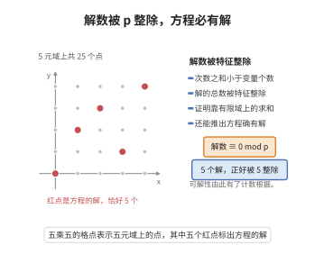

# Chevalley-Warning 定理

> **一句话大白话**：有限域上若干多项式方程，只要它们的次数加起来还没超过变量个数，就一定有公共零点，而且解的总数是域特征的倍数（模 $p$ 为零）——"方程不够多、次数不够高"就管不住解的存在性。
>
> **小例子**：$q=2$、方程 $f=x_1^2+x_2^2+x_3^2$（次数 $2<3=$ 变量数），必有非零解 $(1,1,0)$；一般地 $\mathbb F_2$ 上任一奇数个变量的二次型都有非平凡零点。

## 一、定理介绍

> **前置依赖**：有限域 $\mathbb F_q$（$q=p^k$）与 $p$-幂特征、多元多项式环与总次数、有限域上的特征和 $\sum_{x\in\mathbb F_q}x^m$、费马小定理、置换与计数的组合恒等式

Chevalley–Warning 定理由 Claude Chevalley（1935）提出猜测、Ewald Warning（1935）证明，是有限域代数几何中最基本的计数定理之一。它断言：设 $f_1,\dots,f_r\in\mathbb F_q[x_1,\dots,x_n]$ 且

$$
\sum_{i=1}^r\deg f_i<n,
$$

则它们在 $\mathbb F_q^n$ 中的公共零点个数 $N$ 满足 $N\equiv0\pmod p$（$q=p^k$）。特别地，若方程组有平凡解（如全零）且 $r\ge1$、$\sum\deg f_i<n$，则必存在非平凡公共零点，且解的个数至少为 $p$。

它的地位在于：把"多项式方程组在有限域上是否有解"这一朴素的计数问题，转化为一个只需检查次数的判据，是数论与组合代数几何的入门定理。它是 Chevalley 关于 $C_1$ 域（拟代数闭域）定理的基础，后者断言有限域上齐次多项式方程总有非平凡解；它也是 Kneser、Schanuel 工作与加法组合学的起点之一，并被用于有限几何、编码理论与有限域上的代数几何码的构造。

## 几何直观

图意在说明：方程次数之和小于变量个数时，解的总数必被特征整除，解的存在性由计数直接推出。

## 二、原理思路

证明的核心是一个关于有限域求和的初等恒等式。对 $x\in\mathbb F_q$ 与非负整数 $m$，

$$
\sum_{x\in\mathbb F_q}x^m=
\begin{cases}
0, & m=0\ \text{？ — 实为}\ q,\ m=0;\\
0, & 0<m\ \text{且}\ (q-1)\nmid m;\\
-1, & m>0\ \text{且}\ (q-1)\mid m.
\end{cases}
$$

（$\mathbb F_q^\times$ 是 $q-1$ 阶循环群：非零元的 $m$ 次幂和当 $(q-1)\nmid m$ 时为零，当 $(q-1)\mid m$ 时为 $-1$，再把 $x=0$ 加上。）

有了它，可以用一个"指示多项式"来数公共零点：对单变量情形，$1-x^{q-1}$ 在 $x=0$ 处为 $1$、在 $x\ne0$ 处为 $0$，从而 $\prod_i(1-f_i(x)^{q-1})$ 在 $f_1=\cdots=f_r=0$ 处为 $1$、否则为 $0$。于是

$$
N\equiv\sum_{x\in\mathbb F_q^n}\prod_{i=1}^r\big(1-f_i(x)^{q-1}\big)\pmod p.
$$

接着只看右端多项式的次数：它 $\le(q-1)\sum\deg f_i<(q-1)n$。而一个多元单项式 $x_1^{a_1}\cdots x_n^{a_n}$ 在 $\mathbb F_q^n$ 上的求和只有在"每个 $a_j$ 都为正的 $(q-1)$ 的倍数"时才可能非零，此时其总次数 $\ge(q-1)\cdot n$。既然整个多项式的次数严格小于 $(q-1)n$，那么所有能贡献非零和的单项式都不可能出现，故右端求和为 $0$（在 $\mathbb F_q$ 中精确为 $0$，模 $p$ 亦然），从而 $N\equiv0\pmod p$。整条思路就是"指示多项式 + 次数比较"。

## 三、定理的严格表述

**（Chevalley–Warning 定理）** 设 $q=p^k$，$f_1,\dots,f_r\in\mathbb F_q[x_1,\dots,x_n]$，且

$$
\sum_{i=1}^r\deg f_i<n.
$$

记 $V=\{x\in\mathbb F_q^n:\ f_1(x)=\cdots=f_r(x)=0\}$，$N=|V|$。则

$$
N\equiv0\pmod p.
$$

**推论 1（零点存在性）**：若 $r\ge1$ 且 $\sum\deg f_i<n$，则 $V\ne\varnothing$：由 $N\equiv0\pmod p$ 及平凡解 $0\in V$ 知 $N\ge p$。

**推论 2（Chevalley 定理）**：设 $f\in\mathbb F_q[x_1,\dots,x_n]$ 是次数 $d<n$ 的齐次多项式，则 $f$ 有非平凡零点。特别地，$\mathbb F_q$ 是 $C_1$ 域。

**推论 3（Warning 第二定理）**：若 $\sum\deg f_i<n-? $（相应减弱条件），则 $N\ge p$；一般地 $N$ 或为 $0$ 或至少为 $p$。

## 四、证明过程

**步骤 1：有限域求和恒等式。**

设 $m\ge0$。若 $m=0$，则 $\sum_{x\in\mathbb F_q}x^0=q$。若 $m>0$：$x=0$ 项为 $0$，其余为 $\mathbb F_q^\times=\langle g\rangle$ 上的和

$$
\sum_{x\in\mathbb F_q^\times}x^m=\sum_{j=0}^{q-2}g^{mj}.
$$

当 $(q-1)\nmid m$ 时 $g^m\ne1$，等比求和得 $\dfrac{g^{m(q-1)}-1}{g^m-1}=0$；当 $(q-1)\mid m$ 时每项为 $1$，和为 $q-1\equiv-1\pmod p$。故

$$
\sum_{x\in\mathbb F_q}x^m=\begin{cases}q,&m=0,\\0,&m>0,\ (q-1)\nmid m,\\-1,&m>0,\ (q-1)\mid m.\end{cases}
$$

**步骤 2：构造指示多项式。**

对 $y\in\mathbb F_q$，$1-y^{q-1}$ 当 $y=0$ 时为 $1$（约定 $0^0=1$），当 $y\ne0$ 时为 $1-1=0$。故对 $x\in\mathbb F_q^n$，

$$
P(x):=\prod_{i=1}^r\big(1-f_i(x)^{q-1}\big)=\begin{cases}1,&x\in V,\\0,&x\notin V.\end{cases}
$$

于是 $N=\sum_{x\in\mathbb F_q^n}P(x)$。

**步骤 3：把 $P$ 视为多项式并估计次数。**

$P$ 是 $\mathbb F_q[x_1,\dots,x_n]$ 中的多项式（次数按各单项式总次数计）。由于每个 $f_i^{q-1}$ 的次数为 $(q-1)\deg f_i$，展开后

$$
\deg P\le\sum_{i=1}^r(q-1)\deg f_i=(q-1)\sum_{i=1}^r\deg f_i<(q-1)n.
$$

**步骤 4：单项式求和的判别。**

把 $P$ 写成 $P=\sum_{a}c_a x^a$（$x^a=x_1^{a_1}\cdots x_n^{a_n}$）。由步骤 1，

$$
\sum_{x\in\mathbb F_q^n}x^a=\prod_{j=1}^n\Big(\sum_{x_j\in\mathbb F_q}x_j^{a_j}\Big),
$$

该乘积非零（在 $\mathbb F_q$ 中）的必要条件是每个因子的和都非零，由步骤 1，这要求每个 $a_j>0$ 且 $(q-1)\mid a_j$。此时 $\deg x^a=\sum_j a_j\ge n(q-1)$。

**步骤 5：次数比较给出结论。**

若 $P$ 中含有使 $\sum_{x}x^a\ne0$ 的单项式 $x^a$，则由步骤 4 得 $\deg x^a\ge n(q-1)$，与步骤 3 的 $\deg P<n(q-1)$ 矛盾。因此所有这样的单项式都不出现，故

$$
N=\sum_{x\in\mathbb F_q^n}P(x)=\sum_a c_a\sum_{x\in\mathbb F_q^n}x^a=0\quad\text{在 }\mathbb F_q\text{ 中}.
$$

特别地 $N$ 作为整数被 $\mathrm{char}\,\mathbb F_q=p$ 整除，即 $N\equiv0\pmod p$。$\square$

**步骤 6：推论的证明。**

由步骤 5，$N\equiv0\pmod p$。若 $r\ge1$，$x=0$ 是公共零点（因 $f_i(0)=0$ 对 $f_i$ 无常数项时成立；若有常数项则先平移），故 $N\ge1$ 且 $N\equiv0\pmod p$，从而 $N\ge p$，特别是存在非平凡公共零点。取 $r=1$、$f$ 齐次次数 $d<n$，得 Chevalley 定理。$\square$

**注**：次数条件 $\sum\deg f_i<n$ 是最优的：$n$ 个变量上的方程 $x_i^{q-1}-1=0$（$i=1,\dots,n$，总次数 $n(q-1)$）恰有 $N=(q-1)^n\not\equiv0$ 个解，说明条件不能被削弱到 $\ge(q-1)n$。

## 五、应用与意义

**理论意义**：Chevalley–Warning 定理是"局部-整体"原则在有限域上的初等体现：只需检查次数即可知解的存在性。它表明有限域是 $C_1$ 域，即每个次数小于变量数的齐次多项式有非平凡零点，这是 Artin 猜想（关于 $C_i$ 域）的第一个重要特例。

**应用领域**：
1. **有限域上代数几何**：Chevalley 定理给出射影空间中有理点的存在性，是有限域上代数簇有理点计数（Weil 猜测方向）的起点。
2. **编码理论**：代数几何码与有限域上的 Reed–Muller 型码的构造与最小距离估计用到有限域多项式方程解数。
3. **组合与加法数论**：由 Chevalley–Warning 推出 Erdős–Ginzburg–Ziv 定理、Kemnitz 型结论以及有限域上加法问题的解存在性。
4. **计算代数与密码学**：直接证明某些有限域方程系统必有解，用于构造布尔函数与 S-盒，也用于椭圆曲线配对与有限域离散对数问题的结构分析。
5. **模型论与域论**：$C_i$ 域与拟代数闭域（PAC 域）理论的基本工具。

**推广**：Warning 第二定理给出 $N\ne0$ 时 $N\ge p$ 的下界；Ax–Katz 定理用类似的特征和方法对有限域上代数簇的有理点数目给出深层估计；这些结果共同构成有限域上代数几何的算术基础。

## 课堂问答

**老师**：只需检查什么条件就能断定有限域上方程组有非平凡解？为什么这条件够用？

**学生**：若 $f_1,\dots,f_r\in\mathbb F_q[x_1,\dots,x_n]$ 满足 $\sum_{i=1}^r\deg f_i<n$，则公共零点数 $N\equiv0\pmod p$（$q=p^k$），从而有平凡解时就必有非平凡解。工具是指示多项式 $P=\prod_{i=1}^r(1-f_i^{q-1})$：它在全为零处取 1、否则取 0，于是 $N=\sum_{x\in\mathbb F_q^n}P(x)$。

**老师（追问）**：次数比较究竟是怎么把求和压成 0 的？

**学生**：先看单变量恒等式：$\sum_{x\in\mathbb F_q}x^m$ 在 $m>0$ 时非零仅当 $(q-1)\mid m$，此时等于 $-1$。于是单项式 $x_1^{a_1}\cdots x_n^{a_n}$ 的求和要非零，必须每个 $a_j>0$ 且 $(q-1)\mid a_j$，其总次数 $\ge n(q-1)$。而 $\deg P\le(q-1)\sum\deg f_i<(q-1)n$，所有能贡献非零和的单项式都不出现，故 $N=0$（在 $\mathbb F_q$ 中），特别地被 $p$ 整除。

**老师（拓展）**：条件是最优的吗？有哪些误区与推广？

**学生**：条件最优：$x_i^{q-1}-1=0$（$i=1,\dots,n$）总次数恰为 $n(q-1)$，却有 $(q-1)^n\not\equiv0$ 个解，说明不能放宽到 $\ge(q-1)n$。推论是次数 $d<n$ 的齐次多项式必有非平凡零点，即 $\mathbb F_q$ 是 $C_1$ 域（Artin 猜想的首个重要特例）。误区是以为它对任意次数之和都成立，或忽略常在证明中先平移去掉常数项以保证零解存在。

## 相关条目

- [Hasse-Minkowski定理](./Hasse-Minkowski定理.md)：二次型在局部域与全局域上的局部-整体原则，与有限域上的零点存在性互补。
- [数域与整数环](./数域与整数环.md)：代数数论的基本舞台，Chevalley–Warning 也在局部域（有限域上的函数域类比）中发挥作用。
