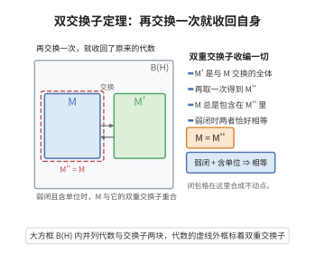

# von Neumann 代数与双交换子定理

> **一句话大白话**：一个含单位、对取伴随封闭的算子代数，只要在弱（强）拓扑下闭合，就"等于它自己的双重交换子"——它把自己能"看住"的一切算子全都收编进来，不再遗漏。
>
> **小例子**：$M=B(H)$ 时 $M'=\mathbb C I$，故 $M''=B(H)=M$；而对 $M=\{\text{对角算子}\}\subset B(\ell^2)$，$M'$ 也是对角算子（对角矩阵互相交换），$M''=M$，于是 $M$ 是 von Neumann 代数。

## 一、定理介绍

> **前置依赖**：Hilbert 空间与有界算子、弱算子拓扑与强算子拓扑、交换子 $M'$ 与双重交换子 $M''$、$*$-代数与含单位子代数、正交投影、$M\xi$ 的闭包与不变子空间、超有限维（放大）技巧

von Neumann 双交换子定理（bicommutant theorem，1929 年由 John von Neumann 证明）是 von Neumann 代数理论的奠基定理。它断言：对 Hilbert 空间 $H$ 上含单位元、对伴随封闭的子代数 $M\subseteq B(H)$，以下三条等价：

$$
M\ \text{弱闭}\ \iff\ M\ \text{强闭}\ \iff\ M=M'',
$$

其中 $M'=\{T\in B(H):TS=ST,\ \forall S\in M\}$ 是交换子（commutant），$M''=(M')'$。因此**von Neumann 代数**可以等价地定义为"满足 $M=M''$ 的含单位 $*$-子代数"，或"弱（强）闭的含单位 $*$-子代数"。

这一定理的意义在于把 von Neumann 代数的定义从"拓扑闭合性"解放为"代数自反性 $M=M''$"：$M''$ 纯粹由交换关系刻画，所以 von Neumann 代数完全由它的交换子决定。它是 von Neumann 代数分类（因子、类型 I/II/III）、Tomita–Takesaki 模理论、以及量子力学中"可观测代数"框架的起点，也是 GNS 构造、可测算子理论与冯·诺依曼代数与测度论类比（因子 = 遍历论中的遍历变换）的技术基础。

## 几何直观

图意在说明：交换子记录了能与代数交换的算子，再取一次交换子就把代数原样收回。

## 二、原理思路

证明的关键在于**用一个投影把"拓扑闭合"翻译成"代数交换"**。

三条等价中，$(i)\Rightarrow(ii)$ 与 $(ii)\Rightarrow(iii)$ 都不难：强拓扑比弱拓扑强，强闭必弱闭；又对任何 $*$-子代数总有 $M\subseteq M''$，而 $M''$ 作为交换子的交换子一定是弱（强）闭的，故 $M$ 弱闭时 $M=M''$。

真正的核心是 $(iii)\Rightarrow(ii)$：若 $M=M''$，要证 $M$ 强闭，只需证 $M$ 在 $M''$ 中强稠密。为此先把"逼近一个向量"想清楚：任给 $T\in M''$、向量 $\xi\in H$ 与 $\epsilon>0$，要找 $A\in M$ 使 $\|(T-A)\xi\|<\epsilon$。

技巧是考察 $M\xi$ 的闭包 $\overline{M\xi}$ 与其正交投影 $P$。由于每个 $A\in M$ 都保持 $\overline{M\xi}$，故 $AP=PA$，即 $P\in M'$。既然 $T\in M''$ 与 $P$ 交换，就有 $T\xi=TP\xi=P(T\xi)\in\overline{M\xi}$——这正是所需的逼近！多个向量同时逼近，用"放大"技巧把 $H$ 换成 $H^{\oplus n}$、$M$ 换成 $M\otimes I_n$，把单向量结论一次性推广。

## 三、定理的严格表述

**（von Neumann 双交换子定理）** 设 $H$ 是复 Hilbert 空间，$M\subseteq B(H)$ 是含单位元 $I$、对伴随运算封闭（$A\in M\Rightarrow A^*\in M$）的子代数。则以下命题等价：

1. $M$ 在弱算子拓扑下闭；
2. $M$ 在强算子拓扑下闭；
3. $M=M''$。

**（von Neumann 代数的定义）** 满足上述任一条的 $M$ 称为 $H$ 上的 **von Neumann 代数**。其核心性质是 $M=M''$，故 $M$ 由其交换子 $M'$ 完全决定。

**（因子）** von Neumann 代数 $M$ 若满足 $M\cap M'=\mathbb C I$（中心平凡），称为**因子**（factor）。

## 四、证明过程

**步骤 1：$(i)\Rightarrow(ii)$。**

弱拓扑比强拓扑弱，故强闭集合必弱闭（更强拓扑下的闭集在更弱拓扑下也闭）。于是弱闭蕴含强闭。

**步骤 2：$(ii)\Rightarrow(iii)$。**

对任意 $*$-子代数 $M$ 有 $M\subseteq M''$（因 $M$ 中元素与 $M'$ 中元素都交换）。而 $M''=(M')'$ 是两个交换子的交，交换子总是弱（从而强）闭的（固定的 $ST-TS=0$ 是弱连续条件的交），故 $M''$ 强闭。若 $M$ 强闭且 $M\subseteq M''$，还需 $M''\subseteq M$。由 $M$ 强闭、$M''$ 是包含 $M$ 的强闭集，需证 $M''\subseteq M$：这一步由下面的 $(iii)\Rightarrow(ii)$ 与"$M''$ 强稠密于 $M''$"配合得到（实际论证中常把三条一起循环证明）。以下先证核心方向，再回填。

**步骤 3：核心——$M$ 在 $M''$ 中强稠密（单向量情形）。**

设 $T\in M''$，$\xi\in H$，$\epsilon>0$。考虑

$$
K=\overline{M\xi}=\overline{\{A\xi: A\in M\}}\subseteq H,
$$

$K$ 是闭子空间，$P$ 为其正交投影。

- **$P\in M'$**：任取 $A\in M$，由 $A(M\xi)\subseteq M\xi$（$M$ 是代数）与 $A$ 的连续性，$A(K)\subseteq K$，即 $A(I-P)=0$？更直接：$K$ 是 $A$-不变子空间，故 $A$ 与 $P$ 交换（不变子空间与其正交补均不变）。又 $M$ 对 $*$ 封闭，同样得 $A^*$ 与 $P$ 交换，从而 $AP=PA$。$A$ 任意，故 $P\in M'$。
- **$T\xi\in K$**：因 $T\in M''$ 与 $P\in M'$ 交换，$T\xi=TP\xi=P(T\xi)\in K$。

于是存在 $A\in M$ 使 $\|T\xi-A\xi\|<\epsilon$。单向量逼近成立。

**步骤 4：多向量情形（放大技巧）。**

给定 $\xi_1,\dots,\xi_n\in H$ 与 $\epsilon>0$，在 $H^n=H\oplus\cdots\oplus H$ 上考虑

$$
\tilde M=\big\{A\oplus\cdots\oplus A:\ A\in M\big\}\subseteq B(H^n).
$$

可验证 $\tilde M$ 是含单位、$*$-闭的子代数，且其双重交换子为

$$
\tilde M''=\big\{T\oplus\cdots\oplus T:\ T\in M''\big\}\ \text{（因}\ \tilde M'=M'\otimes M_n(\mathbb C)\text{，从而}\ \tilde M''=M''\otimes I_n\text{ 的对角部分）}.
$$

对向量 $\vec\xi=(\xi_1,\dots,\xi_n)\in H^n$ 与算子 $T\oplus\cdots\oplus T\in\tilde M''$，用步骤 3 得 $\tilde A=A\oplus\cdots\oplus A\in\tilde M$ 使

$$
\sum_{i=1}^n\|(T-A)\xi_i\|^2=\|(T\oplus\cdots\oplus T-\tilde A)\vec\xi\|^2<\epsilon^2.
$$

**步骤 5：强稠密性与强闭性。**

由步骤 3–4，对任意有限向量组与 $\epsilon>0$，存在 $A\in M$ 在每个方向上逼近 $T$。这正是强算子拓扑下 $A\to T$ 的定义，故 $M$ 在 $M''$ 中强稠密，即 $\overline{M}^{\,\text{强}}=M''$。

**步骤 6：完成 $(iii)\Rightarrow(ii)$ 与回填 $(ii)\Rightarrow(iii)$。**

若 $M=M''$，则 $\overline{M}^{\,\text{强}}=M''=M$，故 $M$ 强闭，得 $(iii)\Rightarrow(ii)$。反之若 $M$ 强闭，则 $M=\overline{M}^{\,\text{强}}=M''$，得 $(ii)\Rightarrow(iii)$。结合步骤 1 得 $(i)\Leftrightarrow(ii)\Leftrightarrow(iii)$。$\square$

**推论**：von Neumann 代数 $M$ 中的元素可由 $M$ 在弱/强拓扑下逼近；且 $M=M''$ 说明 $M$ 与 $M'$ 互为对方的交换子（$M'=M'''$）。

## 五、应用与意义

**理论意义**：双交换子定理把 von Neumann 代数从"拓扑对象"变为"代数自反对象"，使人们可以直接用交换子计算来讨论代数结构。它确立了 von Neumann 代数作为"量子力学可观测量代数"（与 Hilbert 空间表示的弱闭性相容）的合理性。

**应用领域**：
1. **von Neumann 代数分类**：因子分为类型 I、II$_1$、II$_\infty$、III，其分类（Murray–von Neumann）从 $M=M''$ 出发。
2. **Tomita–Takesaki 模理论**：在因子中由态构造模算子与模群，其基础是 $M'$ 与 $M$ 的对应。
3. **量子统计与 KMS 态**：热平衡态的代数刻画（KMS 条件）以 von Neumann 代数为舞台。
4. **遍历论与测度论**：交换 von Neumann 代数（$M=M'$）对应测度空间 $L^\infty(X,\mu)$，因子对应遍历变换，Murray–von Neumann 的维数理论对应测度的"可加性"。
5. **量子信息与纠缠**：$M$ 与 $M'$ 的相互关系刻画复合系统的纠缠结构。

**推广**：在序单位空间（JBW 代数、Jordan 代数）与 $C^*$-代数上有相应的"双交换子"与"包络"定理（如 Sherman–Takeda 定理刻画 JBW 代数），把 von Neumann 的原始结果提升到更一般的有序代数框架。

## 课堂问答

**老师**：为什么 von Neumann 代数可以等价地定义为 $M=M''$？

**学生**：结论：三个条件等价：弱算子拓扑闭 $\iff$ 强算子拓扑闭 $\iff$ $M=M''$。核心是证明 $M$ 在 $M''$ 中强稠密，于是把"拓扑闭"翻译成"代数自反"。

**老师（追问）**：稠密性怎么证？

**学生**：对 $T\in M''$、向量 $\xi$，取 $K=\overline{M\xi}$ 及其正交投影 $P$。由 $K$ 是 $M$-不变子空间得 $P\in M'$，而 $T$ 与 $P$ 交换，故 $T\xi=TP\xi=P(T\xi)\in K$，即 $T$ 可被 $M$ 逼近；多向量用 $H^{\oplus n}$ 放大技巧。常见误区：以为需要范数闭，弱闭或强闭即可。

**老师（拓展）**：这带来什么好处？

**学生**：结论：定义从"拓扑闭"解放为"代数自反 $M=M''$"，$M$ 完全由交换子 $M'$ 决定。因子 $M\cap M'=\mathbb C I$ 的分类与 Tomita-Takesaki 模理论都以 $M$ 与 $M'$ 的对应为起点。

## 相关条目

- [vonNeumann代数基础](./vonNeumann代数基础.md)：系统介绍 von Neumann 代数的定义、弱拓扑与交换子，双交换子定理是其核心结果。
- [GNS构造](./GNS构造.md)：从 $C^*$-代数与态构造 Hilbert 空间表示，是讨论 von Neumann 代数与其交换子的标准框架。
