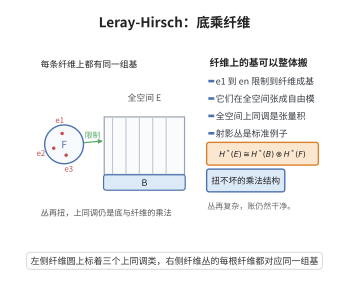

# Leray-Hirsch 定理

> **一句话大白话**：如果纤维丛的全空间里存在几组上同调类，它们在每条纤维上都恰好构成纤维上同调的基，那么全空间的上同调就是"底空间的上同调"与"这几组类"的张量积——丛再怎么扭，上同调也只是"底 × 纤维"的干净乘法。
>
> **小例子**：射影丛 $\mathbb{CP}^{n-1}\hookrightarrow\mathbb P(E)\to M$ 中，重言线丛的第一陈类 $\xi$ 在每条纤维 $\mathbb{CP}^{n-1}$ 上生成 $H^*(\mathbb{CP}^{n-1})$，且 $1,\xi,\dots,\xi^{n-1}$ 构成限制基，于是 $H^*(\mathbb P(E))\cong H^*(M)\otimes\{1,\xi,\dots,\xi^{n-1}\}$——这正是 Chern 类能用射影丛关系定义的原因。

## 一、定理介绍

> **前置依赖**：拓扑K理论定义、Swan定理、覆盖同伦定理、谱序列、射影丛与重言线丛、上同调环、Gysin序列、沿纤维积分

Leray–Hirsch 定理（Leray 1946；Hirsch 1948）是纤维丛上同调计算的基本定理。它回答的问题是：**纤维丛的全空间上同调如何由底空间与纤维的上同调算出？** 一般情形下这需要 Serre 谱序列的全部信息；但如果在全空间上能"预先找到"一组类，其沿每条纤维的限制给出纤维上同调的一组基，那么答案就异常简单：全空间上同调是底空间上同调上的自由模，基就是这组类。

这条定理的重要性在于它把"丛的扭曲"与"上同调的加性结构"解耦：扭曲只体现在这些基类之间的乘法关系（例如由一个关系式 $\xi^n+c_1\xi^{n-1}+\cdots+c_n=0$ 刻画），而不影响模结构。因此它是**特征类理论的技术基石**：射影丛定理（Grothendieck 用以定义 Chern 类）、Thom 同构与 Gysin 序列、Euler 类的定义、以及 K 理论中 Chern 特征标的构造，都以它为出发点。

在代数拓扑的谱序列语言中，Leray–Hirsch 定理等价于"Serre 谱序列在 $E_2$ 页退化"的一个可验证判据；在层论语言中，它是"某些层的高阶直像消失"的具体表现。

## 几何直观

图意在说明：若有一组类在每条纤维上都构成基，则全空间上同调就是底空间与纤维上同调的张量积。

## 二、原理思路

设 $\pi:E\to B$ 是以 $F$ 为纤维的纤维丛（$B$ 为路径连通的 CW 复形或仿紧空间），系数取交换环 $A$。假设存在类

$$
c_1,\dots,c_n\in H^*(E;A)
$$

使得对某点 $b_0\in B$，限制映射 $i^*:H^*(E;A)\to H^*(F;A)$（$i:F=\pi^{-1}(b_0)\hookrightarrow E$）把 $c_1,\dots,c_n$ 送成 $H^*(F;A)$ 的一组 $A$-基。由于 $B$ 路径连通，不同纤维的同伦型一致，这个条件与 $b_0$ 的选择无关。

**构造映射。** 定义 $\pi^*$-模同态

$$
\Phi:H^*(B;A)\otimes_A M\longrightarrow H^*(E;A),\qquad
\Phi\Bigl(\sum_j b_j\otimes c_j\Bigr)=\sum_j \pi^*(b_j)\cup c_j,
$$

其中 $M$ 是以 $c_1,\dots,c_n$ 为基的自由 $A$-模。$H^*(B;A)\otimes_AM$ 是自由 $H^*(B;A)$-模。定理断言 $\Phi$ 是环同构（更准确地说，是 $H^*(B;A)$-模同构）。

**验证思路。** $\Phi$ 显然与 $H^*(B)$-作用交换。只需证 $\Phi$ 是双射。两条标准路线：

1. **谱序列路线**：Serre 谱序列 $E_2^{p,q}=H^p(B;\mathcal H^q(F;A))\Rightarrow H^{p+q}(E;A)$。假设使 $c_j$ 都是**永久循环**，并且它们限制到纤维上已经是一组基，于是 $\{c_j\}$ 在 $E_2$ 页给出 $H^*(B;H^*(F))$ 的一组自由生成元；所有微分 $d_r$ 作用在这组生成元上必须为零（因为 $c_j$ 是永久循环且底空间的类给出 $E_2$ 左因子），从而 $d_r\equiv0$、谱序列退化。

2. **骨架归纳路线**：对 $B$ 的骨架作归纳，用圆盘丛对 $(D^k,S^{k-1})$ 的 Thom 同构与五引理逐步把结论从低维推到高维。

两条路线的共同点是：**"限制到纤维为基"这一假设把"是否存在新类"的问答完全解决**，剩下的只是形式化的同调代数步骤。

## 三、定理的严格表述

**（Leray–Hirsch 定理）** 设 $\pi:E\to B$ 是以 $F$ 为纤维的纤维丛，$B$ 为路径连通、具有有限型（例如有限 CW 复形或紧致流形）。设 $A$ 为交换环。假设存在类 $c_1,\dots,c_n\in H^*(E;A)$，使得对纤维包含 $i:F\hookrightarrow E$，元素

$$
i^*(c_1),\dots,i^*(c_n)
$$

构成 $A$-模 $H^*(F;A)$ 的一组基（从而 $H^*(F;A)$ 是有限生成自由 $A$-模）。则映射

$$
\Phi:H^*(B;A)\otimes_A M\xrightarrow{\ \cong\ }H^*(E;A),\qquad b\otimes c_j\mapsto\pi^*(b)\cup c_j
$$

是 $H^*(B;A)$-模同构，其中 $M=\bigoplus_{j=1}^n A\,c_j$。等价地，$H^*(E;A)$ 是自由 $H^*(B;A)$-模，以 $c_1,\dots,c_n$ 为基。

**（推论：射影丛定理）** 设 $E\to M$ 是秩 $n$ 复向量丛，$\pi:\mathbb P(E)\to M$ 为射影丛，$\mathcal O(1)$ 为重言线丛的对偶，$\xi=c_1(\mathcal O(1))$。则

$$
H^*\bigl(\mathbb P(E);\mathbb Z\bigr)\cong H^*(M;\mathbb Z)\otimes\mathbb Z[\xi]\big/\bigl(\xi^{n}+c_1(E)\xi^{n-1}+\cdots+c_n(E)\bigr)
$$

是自由 $H^*(M)$-模，基为 $1,\xi,\dots,\xi^{n-1}$。

**（推论：沿纤维积分的存在性）** 在定理的假设下，存在 $H^*(B;A)$-线性的"沿纤维积分" $\pi_*:H^*(E;A)\to H^*(B;A)$，满足投影公式

$$
\pi_*\bigl(\pi^*(a)\cup\Phi(b\otimes c_j)\bigr)=a\cup\pi_*(\Phi(b\otimes c_j)),
$$

且 $\pi_*\circ\pi^*=\mathrm{id}$，故 $\pi^*:H^*(B;A)\to H^*(E;A)$ 是单射（分裂单射）。

## 四、证明过程

**步骤 1：把定理化为"某组类的限制给出基"。**

设 $i_b:\pi^{-1}(b)\hookrightarrow E$ 为纤维包含。因为 $B$ 路径连通，转移映射的同伦保证 $i_b^*(c_j)$ 在"纤维的同调/上同调模"意义下对一切 $b$ 都是基。约定记号 $h^q=\dim_A H^q(F;A)<\infty$。

**步骤 2：$\Phi$ 是满射。**

对 $B$ 的骨架归纳。设 $B^{(k)}$ 是 $k$-骨架，$\pi_k:E_k=\pi^{-1}(B^{(k)})\to B^{(k)}$ 是限制丛，断言 $\Phi_k:H^*(B^{(k)})\otimes M\to H^*(E_k)$ 是满射。

$k=0$ 情形：$B^{(0)}$ 是离散点集，$E_0=\bigsqcup_b F_b$，$H^*(F_b)$ 的一对一限制基给出 $H^*(E_0)=\bigoplus_b H^*(F)$，而 $H^*(B^{(0)})=\bigoplus_b A$，$\Phi_0$ 就是这些分量的直和，显然是满射。

归纳步：把一对 $(k+1)$-胞腔 $e$ 的附着 $S^k\to B^{(k)}$ 提升为圆盘丛对 $(D^{k+1}\text{-丛},S^k\text{-丛})\to$ 相应部分。圆盘丛是**同伦等价于底空间的**（$D^{k+1}$ 可缩，投影是同伦等价），故 $H^*(D\text{-丛})\cong H^*(e\text{-的底})$，$\Phi$ 在其上显然满。对球丛部分用 Thom 同构/相对情形：由五引理与相对形式的归纳假设，$\Phi_{k+1}$ 在每个新胞腔上满。归纳完成，故 $\Phi$ 满。

**步骤 3：$\Phi$ 是单射。**

用次数与 $A$-秩的手数。令 $H^*(F;A)$ 的 Poincaré 型"总秩"为 $\sum_q h^q=n$。记 $b_q=\dim_A H^q(B;A)$（在有限型下有限）。

**（3a）** 由步骤 2，$\Phi$ 满射，故 $\operatorname{rank}_A H^*(E;A)\le\sum_{p,q}b_p h^q$（以 $H^*(B)$-自由模的秩计）。另一方面，考虑 Serre 谱序列 $E_2^{p,q}=H^p(B;A)\otimes_A H^q(F;A)\Rightarrow H^{p+q}(E;A)$：其 $E_2$ 页的总 $A$-秩恰为 $\sum_{p,q}b_ph^q$。谱序列的收敛给出 $\sum_i \operatorname{rank}_A H^i(E;A)\le\sum_{p,q}b_ph^q$（当 $A$ 为域时等号且 $E_2$ 退化；一般 $A$ 用有限型与自由性处理）。与 (3a) 比较，知满射 $\Phi$ 的两侧 $A$-秩相等，故 $\Phi$ 单射。

**（3b）** 更显式地：若 $\sum_j\pi^*(b_j)\cup c_j=0$，对纤维限制得 $\sum_j i^*(b_j)\cdot i^*(c_j)=0$；由于 $i^*(c_j)$ 是基，而 $i^*(b_j)=b_j\cdot1$（$H^0(F)=A$），得 $b_j=0$ 于 $H^*(F)$ 层面；再用"限制到纤维为单射的底类"（由 $\pi_*$ 的存在，见步骤 4）得 $b_j=0$。故 $\Phi$ 单射。

**步骤 4：构造 $\pi_*$。**

由步骤 2 的满射性，每个 $x\in H^*(E;A)$ 可唯一地写成 $x=\sum_j\pi^*(b_j)\cup c_j$。定义

$$
\pi_*(x)=\sum_j b_j\cup e_j,\qquad e_j=
\begin{cases}1,&j=n_0\ (\text{最高次且限制为 }1\text{ 的那个 }c_j),\\ 0,&\text{其他},\end{cases}
$$

其中 $e_j$ 是把 $\Phi$ 的"底坐标"读出来的归一化因子（在射影丛情形即 $\pi_*(\xi^{n-1})=1$、$\pi_*(\xi^i)=0\ (i<n-1)$）。由 $\Phi$ 的双射性，$\pi_*$ 良定义且为 $H^*(B)$-线性，投影公式由 $\Phi$ 的模同态性直接得到；$\pi_*\circ\pi^*=\mathrm{id}$ 由定义，故 $\pi^*$ 单射。

由步骤 2–4，$\Phi$ 是 $H^*(B;A)$-模同构，且 $\pi^*$ 是分裂单射。$\square$

**步骤 5：射影丛情形。**

$\mathbb P(E)\to M$ 的纤维为 $\mathbb{CP}^{n-1}$，$H^*(\mathbb{CP}^{n-1};\mathbb Z)=\mathbb Z[h]/(h^n)$，$h$ 为超平面类的生成元。重言线丛的对偶 $\mathcal O(1)$ 限制到纤维上给出 $\mathcal O(1)|_{\mathbb{CP}^{n-1}}$，其第一 Chern 类 $h$ 生成 $H^2$，故 $1,\xi,\dots,\xi^{n-1}$（$\xi=c_1(\mathcal O(1))$）限制到纤维上恰为 $1,h,\dots,h^{n-1}$，是基。由定理，$H^*(\mathbb P(E))$ 是自由 $H^*(M)$-模以 $1,\xi,\dots,\xi^{n-1}$ 为基；再补上关系 $\xi^n+c_1(E)\xi^{n-1}+\cdots+c_n(E)=0$（由 Chern 类的射影丛定义），即得推论。$\square$

## 五、应用与意义

**1. 特征类理论的起点。** Grothendieck 用射影丛定理定义 Chern 类：$c_i(E)$ 就是 $H^*(\mathbb P(E))$ 中 $\xi$ 的关系式系数。随后"分裂原理"（见[Chern 类与分裂原理](./Chern类与分裂原理.md)）通过迭代射影丛构造旗丛，把一般丛化归为线丛直和；每一步都依赖 Leray–Hirsch 给出的自由模结构与 $\pi^*$ 单射。

**2. Thom 同构与 Gysin 序列。** 对球丛 $S(E)\to M$，Gysin 序列与沿纤维积分 $\pi_*$ 的存在性给了计算 Lefschetz 数、Euler 类 $e(E)=\pi_*(\text{Thom 类})$ 的直接途径；这是指标定理与 Poincaré–Hopf 定理的现代证明的一部分。

**3. 向量丛与 $K$ 理论。** 在 K 理论中，定义 Chern 特征标需要"丛的 K 类如何在上同调中展开"，Leray–Hirsch 的自由模结构使这一展开成为形式幂级数运算；Swan 定理把向量丛与投射模对应起来后，同一套结构又给出代数 K 理论的相应结论。

**4. 谱序列与一般系数。** Leray–Hirsch 是"谱序列退化"最常见的可验证判据；在层上同调、等变上同调、群上同调（Lyndon–Hochschild–Serre 谱序列的退化情形）中都有类似表述。

**5. 代数几何与示性类。** 旗流形、Grassmann 丛、Schubert 演算中的"胞腔分解 + 自由模基"结构本质上都是 Leray–Hirsch 型结论；Borel 的 $H^*(G/B)$ 描述与 Weyl 特征标公式的拓扑证明都用到它。

## 课堂问答

**老师**：什么条件下全空间上同调能干净地等于底空间与纤维上同调的"乘法"？

**学生**：结论：若存在 $c_1,\dots,c_n\in H^*(E)$ 使其限制到纤维上构成 $H^*(F)$ 的一组基，则 $H^*(E)$ 是以这些类为基的自由 $H^*(B)$-模，$\Phi(b\otimes c_j)=\pi^*(b)\cup c_j$ 是同构。

**老师（追问）**：为什么这一条假设就够了？

**学生**：因为"限制到纤维为基"把"有没有新类"的问题解决了，配合沿纤维积分 $\pi_*$（$\pi_*\circ\pi^*=\mathrm{id}$）立得双射；等价地，Serre 谱序列在 $E_2$ 页退化。常见误区：以为丛的扭曲会影响加性结构，其实扭曲只体现在基类之间的乘法关系。

**老师（拓展）**：最重要的推论是什么？

**学生**：结论：射影丛定理 $H^*(\mathbb P(E))\cong H^*(M)\otimes\mathbb Z[\xi]/(\xi^n+c_1\xi^{n-1}+\cdots+c_n)$，基为 $1,\xi,\dots,\xi^{n-1}$。Grothendieck 正是用它定义 Chern 类，Thom 同构与 Euler 类的定义也源自这条自由模结构。
