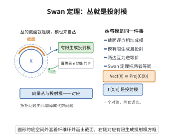

# Swan 定理

> **一句话大白话**：紧空间上的向量丛与它上面"连续函数环"上的有限生成投射模是同一件事——丛的连续截面构成一个模，反过来每一个这样的模都唯一地来自一个丛。

> **小例子**：取单点空间 $X=\{pt\}$，则 $C(X)=\mathbb{C}$，向量丛就是有限维复向量空间，有限生成投射 $\mathbb{C}$-模也不过是有限维复向量空间，两边显然一一对应。Swan 定理就是这一平凡对应的"拓扑加扭曲"版本。

## 一、定理介绍

> **前置依赖**：向量丛与截面、紧 Hausdorff 空间上的连续函数环 $C(X)$、有限生成投射模、单位分解、向量丛分类定理、拓扑 K 理论。

Swan 定理（Swan's theorem，全称 Serre–Swan 定理）由 Richard Swan 于 1962 年在论文《Vector bundles and projective modules》中证明，它把向量丛的拓扑理论与环上的模论联系起来，是"非交换拓扑"与算子 K 理论的思想源头。

定理的动机来自两方面。其一是 Serre 在 1955 年提出的猜想（后来由 Quillen 与 Suslin 独立证明的 Quillen–Suslin 定理）：多项式环上的有限生成投射模都是自由模——这与"$\mathbb{C}^n$ 上的代数向量丛都平凡"是同一现象的不同侧面，说明"投射模 = 向量丛"这一字典的确有其拓扑根据。其二是 Grothendieck 与 Atiyah 建立拓扑 K 理论时，需要把 $K^0(X)$ 落实为一个纯代数对象。

定理的结论是：在紧 Hausdorff 空间 $X$ 上，"向量丛及其丛映射"与"$C(X)$ 上的有限生成投射模及其模同态"构成等价范畴。于是向量丛的直和、张量积、拉回等运算分别对应模的直和、张量积与基变换，拓扑 K 群 $K^0(X)$ 同构于代数 K 群 $K_0(C(X))$。这一字典使人们可以用纯代数的语言处理旋量丛、指标定理中的 $K$ 理论元素，也直接启发了 C*-代数与算子代数上的 K 理论（把 $C(X)$ 换成一般 C*-代数），成为现代非交换几何的支柱之一。

## 几何直观

图意在说明：向量丛的连续截面构成有限生成投射模，而每个这样的模都唯一来自一个丛。

## 二、原理思路

**核心字典**：向量丛 $E\mapsto$ 截面模 $\Gamma(E)$；纤维 $E_x\mapsto \Gamma(E)/\mathfrak{m}_x\Gamma(E)$，其中 $\mathfrak{m}_x=\{f\in C(X):f(x)=0\}$ 是 $C(X)$ 中对应于点 $x$ 的极大理想。

1. **从丛到模（有限生成投射性）**：截面集 $\Gamma(E)$ 天然是 $C(X)$-模（逐点相乘）。关键是把它嵌入一个自由模并作为直和项：取 $E$ 的一个有限局部平凡覆盖与从属于它的单位分解，可构造从 $E$ 到平凡丛 $X\times\mathbb{C}^N$ 的单射丛映射；配上纤维上的 Hermite 内积，即可把 $E$ 实现为平凡丛的直和项。于是 $\Gamma(E)$ 是自由模 $C(X)^N$ 的直和项，即有限生成投射模。

2. **从模到丛（纤维的构造）**：给定有限生成投射模 $P$，取 $P\oplus Q\cong C(X)^n$，等价地 $P\cong\mathrm{im}\,e$，其中 $e\in M_n(C(X))$ 是幂等矩阵（$e^2=e$）。定义 $E_x=e(x)\mathbb{C}^n\subseteq\mathbb{C}^n$。由于 $x\mapsto\mathrm{tr}\,e(x)$ 连续且取值于整数，纤维维数局部常值；再用连续选取基与 Gram–Schmidt 正交化即可得到局部平凡化。这样的 $E$ 是向量丛，且 $E_x\cong P/\mathfrak{m}_xP$，$\Gamma(E)\cong P$。

3. **互逆与函子性**：丛映射 $E\to F$ 与模同态 $\Gamma(E)\to\Gamma(F)$ 之间的自然映射是双射（一个丛映射由其在截面上的作用唯一决定，且模同态在每一点给出纤维间的线性映射），故两范畴等价。

## 三、定理的严格表述

**定理（Swan, 1962）**：设 $X$ 是紧 Hausdorff 空间，$\mathbb{K}=\mathbb{R}$ 或 $\mathbb{C}$，$C(X)=C(X;\mathbb{K})$ 是带上确界范数的连续函数环。记 $\mathbf{Vect}(X)$ 为 $X$ 上有限秩 $\mathbb{K}$-向量丛与丛映射构成的范畴，$\mathbf{Proj}(C(X))$ 为有限生成投射 $C(X)$-模与模同态构成的范畴。则截面函子

$$\Gamma:\mathbf{Vect}(X)\longrightarrow\mathbf{Proj}(C(X)),\qquad E\longmapsto\Gamma(E),$$

是范畴等价。特别地，

$$K^0(X)\ \cong\ K_0\bigl(C(X)\bigr).$$

**依赖的概念**：单位分解、极大理想、幂等元与投射模、局部平凡化、连续函数环。

## 四、证明过程

**步骤 1（把丛嵌入平凡丛，从而截面模投射）。** 由 $X$ 紧与 $E$ 有限秩，存在有限开覆盖 $\{U_1,\dots,U_N\}$ 与局部平凡化 $\phi_i:E|_{U_i}\to U_i\times\mathbb{K}^{r_i}$。取从属于 $\{U_i\}$ 的单位分解 $\{\rho_i\}$（$\sum_i\rho_i\equiv1$，$\mathrm{supp}\,\rho_i\subset U_i$）。在 $E$ 上取一个纤维 Hermite 内积（由单位分解拼贴局部内积得到），于是可把每个 $\phi_i$ 视为取值为 $\mathbb{K}^{r_i}$ 的映射。定义

$$\Phi:E\longrightarrow X\times\mathbb{K}^{N\cdot r},\qquad \Phi(v)=\sum_i \rho_i(x)\,\phi_i\bigl(v|_{x}\bigr),$$

（约定 $x\notin U_i$ 时该项为 $0$）。对每个 $x$，至少有一个 $\rho_i(x)>0$，而对应的 $\phi_i$ 在纤维上单射，故 $\Phi|_{\text{fiber }x}$ 单射，从而 $\Phi$ 是单射丛映射，$E$ 同构于平凡丛的一个子丛。

再由纤维内积作正交投影 $p:X\times\mathbb{K}^{Nr}\to E$，得 $p\circ\Phi=\mathrm{id}_E$、$\Phi\circ p$ 为幂等的丛自同态，故 $E$ 是平凡丛的直和项。对截面取 $\Gamma$，即得 $\Gamma(E)$ 是自由模 $C(X)^{Nr}$ 的直和项（一个幂等自同态的像），故为有限生成投射模。

**步骤 2（有限生成投射模都是幂等的像）。** 设 $P$ 为有限生成投射 $C(X)$-模。由投射性与有限生成性，存在满模同态 $\pi:C(X)^n\twoheadrightarrow P$ 及右逆 $s:P\to C(X)^n$（$\pi\circ s=\mathrm{id}_P$）。令 $e=s\circ\pi\in\mathrm{End}(C(X)^n)\cong M_n(C(X))$，则 $e^2=s\pi s\pi=s\pi=e$ 是幂等元，且 $\mathrm{im}\,e\cong P$。反之幂等元的像显然投射（是自由模的直和项）。故 $P\cong\mathrm{im}\,e$ 对某个幂等 $e\in M_n(C(X))$ 成立。

**步骤 3（由幂等元造丛）。** 设 $e\in M_n(C(X))$，$e^2=e$，$P=\mathrm{im}\,e$。定义

$$E=\{(x,v)\in X\times\mathbb{C}^n:\ v=e(x)v\},\qquad E_x=e(x)\mathbb{C}^n\subseteq\mathbb{C}^n.$$

先证明纤维维数局部常值。对每个 $x$，$e(x)$ 是 $\mathbb{C}^n$ 上的幂等矩阵，故 $\mathrm{rank}\,e(x)=\mathrm{tr}\,e(x)$；而 $x\mapsto\mathrm{tr}\,e(x)$ 是连续函数且取整数值，在连通的 $X$ 附近必为常数，于是存在 $x$ 的邻域 $W$ 使 $\mathrm{rank}\,e(y)=k$ 对一切 $y\in W$。

再构造局部平凡化。取 $E_{x_0}$ 的一组基 $w_1,\dots,w_k$，把它们视为常向量并令 $\tilde w_j(y)=e(y)w_j$（$y\in W$）。在 $W$ 上对 $\{\tilde w_j(y)\}$ 施以连续版本的 Gram–Schmidt 正交化（用连续函数环中函数的连续性保证分母不消失，必要时缩小 $W$），得到逐点线性无关的连续向量场 $u_1(y),\dots,u_k(y)$，它们在每点张成 $E_y$。于是 $E|_W\cong W\times\mathbb{C}^k$，$E$ 是秩 $k$ 向量丛。

**步骤 4（纤维与截面还原模，并得出结论）。** 对上面构造的 $E$，考察每点求值映射 $\mathrm{ev}_x:\Gamma(E)\to E_x$。点 $x$ 对应的极大理想是 $\mathfrak{m}_x=\{f:f(x)=0\}$，且 $\mathfrak{m}_x\Gamma(E)=\ker\mathrm{ev}_x$，故

$$E_x\cong\Gamma(E)/\mathfrak{m}_x\Gamma(E)\cong P/\mathfrak{m}_xP,$$

且截面作为 $C(X)$-模与 $P$ 同构。另一方面，丛映射 $F:E\to F'$ 由它在截面上的作用唯一决定；反过来，任一 $C(X)$-模同态 $\Gamma(E)\to\Gamma(E')$ 在每个 $x$ 给出纤维间的线性映射（因为它在 $\mathfrak{m}_x\Gamma(E)$ 上的像落在 $\mathfrak{m}_x\Gamma(E')$），从而给出丛映射。因此自然映射

$$\mathrm{Hom}_{\mathbf{Vect}}(E,E')\longrightarrow\mathrm{Hom}_{C(X)}\bigl(\Gamma(E),\Gamma(E')\bigr)$$

是双射。结合步骤 1 至 3，$\Gamma$ 既本质满又全忠实，故是范畴等价。取 Grothendieck 群即得 $K^0(X)\cong K_0(C(X))$。$\square$

## 五、应用与意义

- **拓扑 K 理论的代数化**：$K^0(X)\cong K_0(C(X))$ 使拓扑 K 理论可用环论、模论的语言计算，是 Atiyah–Hirzebruch 谱序列与指标定理代数证明的出发点。
- **算子代数 K 理论**：把 $C(X)$ 换成一般 C*-代数，Swan 定理的形式被推广为"有限生成投射模 ↔ 稳定有限维向量丛"，成为非交换几何与 Kasparov KK 理论的基础。
- **Quillen–Suslin 定理**：Swan 的字典把"代数向量丛"问题翻译为拓扑问题，为 Serre 猜想的解决提供了动机。
- **旋量丛与指标定理**：指标定理中的 K 理论类常常就是某些截面模，Swan 定理保证它们可以"几何地"实现。

## 课堂问答

**老师**：Swan 定理建立了哪两边的等价？

**学生**：结论：紧 Hausdorff 空间 $X$ 上向量丛范畴 $\mathbf{Vect}(X)$ 与 $C(X)$ 上有限生成投射模范畴 $\mathbf{Proj}(C(X))$ 等价，截面函子 $\Gamma$ 给出 $K^0(X)\cong K_0(C(X))$。

**老师（追问）**：两个方向分别怎么走？

**学生**：丛到模：用单位分解把 $E$ 嵌入平凡丛并作正交投影，得 $\Gamma(E)$ 是自由模 $C(X)^N$ 的直和项，即投射。模到丛：$P=\mathrm{im}\,e$（$e^2=e$），令 $E_x=e(x)\mathbb C^n$，纤维维数 $\mathrm{tr}\,e(x)$ 连续取整故局部常值。常见误区：以为投射模都自由，$P$ 只是自由模的直和项。

**老师（拓展）**：为什么这条定理重要？

**学生**：结论：它把拓扑 K 理论代数化，并直接启发了把 $C(X)$ 换成一般 C*-代数的算子 K 理论，成为 Kasparov KK 理论与非交换几何的基础；同时为 Quillen-Suslin 定理（多项式环上投射模皆自由）提供了动机。

## 相关条目

- [向量丛分类定理](./向量丛分类定理.md)：把向量丛同构类化为分类映射的同伦类，刻画了 $\mathbf{Vect}(X)$ 的拓扑一侧。
- [拓扑K理论定义](./拓扑K理论定义.md)：Swan 定理给出 $K^0(X)\cong K_0(C(X))$，是 K 群的两种等价定义。
- [代数K理论](./代数K理论.md)：$K_0$ 的投射模定义正是本定理右侧的对象。
- [Chern特征标](./Chern特征标.md)：把 K 理论类送到上同调，需先把丛实现为模，Swan 定理提供这一实现。
- [覆盖同伦定理](./覆盖同伦定理.md)：丛映射的补丁构造依赖同伦提升性质，与本定理的全忠实性相容。
