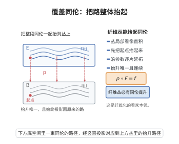

# 覆盖同伦定理

> **一句话大白话**：纤维丛具有"提升同伦"的能力——把底空间里一段连续移动的路子，连同它在丛里给定的起始位置，一起连续地"抬"到丛上去，抬升后的轨道始终投影回原来的移动。
>
> **小例子**：$S^1\to S^1,\ z\mapsto z^2$ 是叠覆（纤维 $S^0$ 的两点丛）。给定底空间一段路径及起点，路径提升定理给出唯一的抬升。高维纤维丛同理，这就是"覆盖同伦"。

## 一、定理介绍

> **前置依赖**：纤维丛（局部平凡化）、丛的拉回、同伦与同伦提升性质（HLP，即纤维化/fibration）、Serre 纤维化与 Hurewicz 纤维化、仿紧空间与单位分解、neighborhood 收缩、拉回丛的同构

覆盖同伦定理（covering homotopy theorem，Hurewicz–Steenrod）断言：**底空间仿紧的纤维丛都是纤维化（fibration）**，即具有同伦提升性质。具体地说，若 $p:E\to B$ 是纤维丛，$H:X\times I\to B$ 是任意同伦，且 $X\times\{0\}$ 上已给定一个提升 $\tilde H_0:X\to E$（满足 $p\circ\tilde H_0=H(\cdot,0)$），则存在同伦 $\tilde H:X\times I\to E$ 使
$$p\circ\tilde H=H,\qquad \tilde H(\cdot,0)=\tilde H_0.$$

这个定理是几何拓扑与代数拓扑的基本工具。它的直接推论是**拉回丛的同伦不变性**：若 $f_0\simeq f_1:M\to B$，则 $f_0^{*}E\cong f_1^{*}E$。由此，向量丛的等价类只依赖底空间的同伦型，从而 $K$ 理论（以向量丛为起点）成为同伦不变量；特征类（Chern 类、Pontryagin 类）也随之为同伦不变量。定理还与覆盖空间理论紧密相关：$S^0$ 纤维的丛（叠覆）的路径提升唯一性正来自此定理在离散纤维下的加强。

## 几何直观

图意在说明：给定起点后，底空间中的整段同伦可以唯一地抬到丛上，并始终投影回原来的路。

## 二、原理思路

证明由"局部"与"整体"两部分构成。

1. **局部（平凡丛）情形**：若 $E=B\times F$ 是平凡丛，提升是显式的。给定 $H:X\times I\to B$ 与 $\tilde H_0(x)=(H(x,0),g(x))$，直接令
$$\tilde H(x,t)=\bigl(H(x,t),\,g(x)\bigr).$$
这是连续映射且满足要求，故平凡丛具有 HLP。

2. **局部平凡化**：对一般丛，取局部有限的平凡化覆盖 $\{U_\alpha\}$（底空间 $B$ 仿紧保证存在，并可取从属于它的单位分解）。在每片 $U_\alpha$ 上 $E|_{U_\alpha}\cong U_\alpha\times F$，故 $E|_{U_\alpha}\to U_\alpha$ 具有 HLP。

3. **局部到整体**：证明"HLP 在底空间上是局部性质"——若 $\{U_\alpha\}$ 为 $B$ 的开覆盖且每个 $E|_{U_\alpha}\to U_\alpha$ 有 HLP，则 $E\to B$ 有 HLP。证明机制是：把同伦 $H$ 沿 $I$ 方向（紧）切成有限段，使每一段落在某个平凡化片内；在每段上用平凡化显式延拓提升，从而"从 $t=0$ 一路抬到 $t=1$"。$B$ 的仿紧性提供局部有限的平凡化覆盖与单位分解，使上述构造与选择无关并保持连续性；在 CW/仿紧框架下，这一点也可等价地由截面延拓的障碍消失来表述（见证明步骤 5）。

## 三、定理的严格表述

**（覆盖同伦定理）** 设 $p:E\to B$ 是以 $F$ 为纤维的纤维丛，$B$ 仿紧（paracompact）。则 $p$ 具有**同伦提升性质**（HLP）：对任意拓扑空间 $X$、任意同伦
$$H:X\times I\to B$$
以及任意提升 $\tilde H_0:X\to E$（即 $p\circ\tilde H_0=H(\cdot,0)$），存在同伦
$$\tilde H:X\times I\to E\quad\text{使}\quad p\circ\tilde H=H,\qquad \tilde H(\cdot,0)=\tilde H_0.$$
因此 $p$ 是（Hurewicz）纤维化；特别地也是 Serre 纤维化。

**（推论 1：拉回丛的同伦不变性）** 若 $f_0,f_1:M\to B$ 同伦，则拉回丛同构
$$f_0^{*}E\cong f_1^{*}E.$$
*证明*：设 $H:M\times I\to B$ 是 $f_0$ 到 $f_1$ 的同伦。考虑 $H^{*}E\to M\times I$；在 $M\times\{0\}$ 上 $H^{*}E|_{M\times\{0\}}=f_0^*E$，在 $M\times\{1\}$ 上为 $f_1^*E$。由 HLP，$H^*E\to M\times I$ 是纤维化，特别地沿 $I$ 方向的"截面拉回"给出同构 $f_0^*E\cong f_1^*E$（等价地：$H^*E$ 在 $M\times I$ 上平凡，限制到两端给出同构）。

**（推论 2：K 理论与特征类的同伦不变性）** 复（实）向量丛的等价类集合 $\mathrm{Vect}_{\mathbb C}^{n}(M)$ 只依赖 $M$ 的同伦型；故 $K^0(M)$、Chern 类 $c_i(E)$、Pontryagin 类等均为同伦不变量。

**（推论 3：主丛的覆盖同伦）** 若 $P\to B$ 是以拓扑群 $G$ 为结构群的主丛，则 HLP 可由 $G$ 的右作用显式实现，且当 $F=G$ 为连通群时提升在给定起点下唯一。

## 四、证明过程

**步骤 1：平凡丛具有 HLP（显式公式）。**

设 $E=B\times F$，$p=\mathrm{pr}_1$。给定 $H:X\times I\to B$ 与 $\tilde H_0:X\to B\times F$，记 $\tilde H_0(x)=(H(x,0),g(x))$，其中 $g=\mathrm{pr}_2\circ\tilde H_0:X\to F$ 连续。定义
$$\tilde H(x,t)=\bigl(H(x,t),\,g(x)\bigr).$$
则 $p\circ\tilde H=\mathrm{pr}_1\circ\tilde H=H$，且 $\tilde H(x,0)=(H(x,0),g(x))=\tilde H_0(x)$。由 $H$ 与 $g$ 连续知 $\tilde H$ 连续。故平凡丛具有 HLP。$\square$

**步骤 2：局部平凡化给出局部 HLP。**

取 $B$ 的局部有限平凡化覆盖 $\{U_\alpha\}$，即每个 $E|_{U_\alpha}\to U_\alpha$ 有平凡化同构 $\phi_\alpha:E|_{U_\alpha}\to U_\alpha\times F$，且 $\{\mathrm{supp}\,\rho_\alpha\}$ 的局部有限性与从属单位分解 $\{\rho_\alpha\}$（$\sum_\alpha\rho_\alpha=1$，$\mathrm{supp}\,\rho_\alpha\subset U_\alpha$）由 $B$ 仿紧保证。由步骤 1，每个 $E|_{U_\alpha}\to U_\alpha$ 具有 HLP。

**步骤 3：HLP 是底空间上的局部性质（核心引理）。**

**引理**：设 $\{U_\alpha\}$ 是 $B$ 的开覆盖，且每个限制 $E|_{U_\alpha}\to U_\alpha$ 有 HLP。则 $E\to B$ 有 HLP。

*证明*：设 $H:X\times I\to B$、$\tilde H_0$ 给定，记 $W_\alpha=H^{-1}(U_\alpha)$，则 $\{W_\alpha\}$ 是 $X\times I$ 的开覆盖。
定义
$$\mathcal T=\Bigl\{t_0\in[0,1]\ :\ \exists\ \text{提升}\ \tilde H\ \text{于}\ X\times[0,t_0],\ \tilde H(\cdot,0)=\tilde H_0\Bigr\}.$$
$\mathcal T\ne\emptyset$（含 $0$）。我们证明 $\mathcal T$ 在 $[0,1]$ 中既开又闭；则 $\mathcal T=[0,1]$，取 $t_0=1$ 即得整体提升。

*（i）$\mathcal T$ 开*：设 $t_0\in\mathcal T$，取提升 $\tilde H$ 于 $X\times[0,t_0]$。因 $I$ 紧、$H$ 连续，对每点 $x\in X$ 存在开邻域 $N_x\subset X$ 与 $\epsilon_x>0$，使
$$H\bigl(N_x\times[t_0,t_0+\epsilon_x]\bigr)\subset U_{\alpha(x)}$$
对某个指标 $\alpha(x)$ 成立（用 $H(x,t_0)\in U_{\alpha}$ 与 $H$ 的连续性、$U_\alpha$ 开）。令 $\epsilon=\tfrac12\inf\dots$（在局部有限覆盖下取正下界 $\epsilon>0$，由覆盖 $\{W_\alpha\}$ 在紧集 $H(K\times\{t_0\})$ 上的 Lebesgue 数保证，$K$ 取 $X$ 的紧子集；对一般 $X$ 用局部有限性与单位分解逐点处理）。
在 $N_x\times[t_0,t_0+\epsilon]$ 上，借助平凡化 $\phi_{\alpha(x)}$ 定义
$$\tilde H(x',t)=\phi_{\alpha(x)}^{-1}\Bigl(H(x',t),\ \mathrm{pr}_2\,\phi_{\alpha(x)}\bigl(\tilde H(x',t_0)\bigr)\Bigr).$$
这是 $N_x\times[t_0,t_0+\epsilon]$ 上的连续提升，且在 $t=t_0$ 处等于已给定的 $\tilde H$。不同的 $x$ 所给局部提升在重叠处可**相容地粘合**：二者都等于 $\tilde H$ 在 $t_0$ 处的值，而在 $X$ 的每一点附近，用从属于 $\{N_x\}$ 的局部有限单位分解把"选择哪个平凡化"连续化，即得 $X\times[t_0,t_0+\epsilon]$ 上的整体提升（因 $X\times\{t_0\}$ 上的提升已给定，局部选择可沿 $X$ 连续拼接）。故 $t_0+\epsilon\subseteq\mathcal T$ 的成员存在，$\mathcal T$ 开。

*（ii）$\mathcal T$ 闭*：设 $t_0\in\overline{\mathcal T}$，取 $t_n\in\mathcal T$，$t_n\to t_0^-$，对应提升 $\tilde H_n$ 于 $X\times[0,t_n]$。由步骤（i）的局部延拓论证，各 $\tilde H_n$ 在 $X\times[0,t_0]$ 上给出同一提升（在 $X\times\{0\}$ 上一致，且局部延拓由平凡化显式给出、与已得的提升在已知区域上一致）。于是 $\tilde H(x,t)=\lim_n\tilde H_n(x,t)$ 在 $X\times[0,t_0]$ 上良定义且连续（局部一致收敛），是所需提升，故 $t_0\in\mathcal T$。

由 (i)(ii)，$\mathcal T=[0,1]$，引理得证。$\square$

**步骤 4：完成定理证明。**

由步骤 2，$\{U_\alpha\}$ 满足引理条件，故 $E\to B$ 有 HLP，即覆盖同伦定理成立。$\square$

**步骤 5：等价表述（障碍论视角）。**

把提升问题化为拉回丛 $H^{*}E\to X\times I$ 上截面的延拓问题：给定截面 $s_0$ 于 $X\times\{0\}$，求延拓到 $X\times I$。当 $X$（从而 $X\times I$）为 CW 复形或仿紧的 ANR 时，截面延拓的障碍位于相对上同调群
$$H^{k+1}\bigl(X\times I,\ X\times\{0\};\ \{\pi_k(F)\}\bigr),$$
而 $X\times I$ 沿 $I$ 方向形变收缩到 $X\times\{0\}$，故该相对群在正次数为零，全部障碍消失，截面存在且可逐步构造。这把"局部平凡"升级为"整体同伦提升"的机制清楚地显示出来：**$I$ 的可缩性是关键**。$\square$

## 五、应用与意义

**理论意义**：
1. **纤维化框架**：把纤维丛纳入同伦论（fibration、long exact sequence of homotopy groups）的语言，使纤维丛可用 $\pi_*$ 长正合列计算。
2. **同伦不变性原理**：拉回丛只依赖映射的同伦类，从此"特征类"、"K 理论"、"配边"等同伦不变量得以建立。
3. **覆盖空间理论**：当纤维离散时，HLP 与提升唯一性一起给出路径提升与单值化（monodromy）理论。

**应用领域**：
1. **K 理论与向量丛分类**：由同伦不变性得 $K^0(M)$ 只依赖 $M$ 的同伦型，进而向量丛分类定理 $K^0(X)\cong[X,BU\times\mathbb Z]$ 得以成立。
2. **特征类**：Chern 类、Pontryagin 类、Stiefel–Whitney 类的同伦不变性直接来自本定理。
3. **主丛与联络**：主丛上的联络给出平行的水平提升；覆盖同伦定理给出其存在的拓扑基础，是纤维丛上示性类与 Chern–Weil 理论的前提。
4. **代数拓扑与同调论**：Serre 谱序列、谱序列计算中的纤维化假设，以及 Postnikov 塔的构造都依赖 HLP。

**推广**：
- **Serre 纤维化与 Hurewicz 纤维化**：本定理给出"丛必为纤维化"，而一般的纤维化（如路径空间纤维化）则是更广的概念。
- **同伦提升性质的弱化**：把 $I$ 换成圆盘 $D^n$ 得到 Serre 纤维化，把 $X$ 换为 CW 复形得到 CW 纤维化。
- **层与拓扑斯中的对应**：在层论/模型范畴中，纤维丛的 HLP 对应"fibration 的右提升性质"的公理化，是抽象同伦论（Quillen 模型范畴）的原型之一。

## 课堂问答

**老师**：覆盖同伦定理的核心断言是什么？

**学生**：结论：底空间仿紧的纤维丛都是纤维化，即具有同伦提升性质：给定 $H:X\times I\to B$ 与 $X\times\{0\}$ 上的提升 $\tilde H_0$，存在 $\tilde H$ 使 $p\circ\tilde H=H$ 且 $\tilde H(\cdot,0)=\tilde H_0$。

**老师（追问）**：局部平凡如何升级为整体提升？

**学生**：平凡丛上提升显式；一般丛取局部有限平凡化覆盖，命题"HLP 是底空间的局部性质"，把紧区间 $[0,1]$ 切成有限段使每段落在一个平凡片内逐段延拓，集合 $\mathcal T=\{t_0:\text{可提升到 }t_0\}$ 既开又闭故等于 $[0,1]$。常见误区：以为依赖 $X$ 紧性，关键其实是 $I$ 的可缩性使障碍群消失。

**老师（拓展）**：最直接的推论是什么？

**学生**：结论：拉回丛具同伦不变性，$f_0\simeq f_1\Rightarrow f_0^*E\cong f_1^*E$，故 $K^0(M)$、Chern 类、Pontryagin 类都是同伦不变量；当纤维离散时，还给出路径提升与单值化理论。
