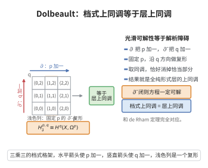

# Dolbeault 定理

> **一句话大白话**：复流形上"$\bar\partial$-闭模掉 $\bar\partial$-恰当"给出的档式上同调，和"整体全纯 $p$-形式"的层上同调是同一回事——解析对象的整体障碍可以用光滑形式的可解性来算。
>
> **小例子**：紧 Riemann 面 $X$ 上，$H^{0,1}_{\bar\partial}(X)\cong H^1(X,\mathcal O_X)$，这正是亏格 $g$ 的复结构模（$g=\dim H^1(X,\mathcal O_X)$），与 Serre 对偶一起给出 Riemann–Roch。

## 一、定理介绍

> **前置依赖**：复流形与 $(p,q)$-形式、$\bar\partial$ 算子与 Dolbeault 复形、全纯 $p$-形式的层 $\Omega^p$、层上同调 $H^q(X,\mathcal F)$、细层（fine sheaf）与单位分解、Poincaré引理、层短正合列的长正合列

Dolbeault 定理（由 Pierre Dolbeault 于 1953 年证明）是复几何的奠基定理，它把复流形上**解析对象**（全纯形式）的整体上同调，与**光滑对象**（$\bar\partial$ 算子）的局部可解性联系起来。具体地，它断言
$$H^{p,q}_{\bar\partial}(X)\cong H^{q}(X,\Omega^{p}),$$
其中左边是 Dolbeault 上同调（$\bar\partial$-闭 $(p,q)$-形式模去 $\bar\partial$-恰当形式），右边是全纯 $p$-形式层 $\Omega^p$ 的层上同调。

这一定理是 Cauchy–Riemann 方程 $\bar\partial u=f$ 可解性理论的核心：它把"能否整体求解 $\bar\partial$"转化为层上同调的计算，从而可以调动层论（长正合列、消没定理、Serre 对偶）的全部工具。它与 de Rham 定理在光滑情形把 $H^*_{dR}(M)\cong H^*(M;\mathbb R)$ 相对应，是多复变与复代数几何中最重要的计算原理，也是 Hodge 理论（$H^k(X,\mathbb C)=\bigoplus_{p+q=k}H^{p,q}$）的组成部分。

## 几何直观

图意在说明：沿 q 方向取 ∂̄-同调，恰好消掉恰当部分，剩下的正是全纯 p-形式层的上同调。

## 二、原理思路

证明由三个部件组成。

1. **Dolbeault 复形是 $\Omega^p$ 的分解**：考虑层的复形
$$0\to\Omega^{p}\longrightarrow\mathcal A^{p,0}\xrightarrow{\ \bar\partial\ }\mathcal A^{p,1}\xrightarrow{\ \bar\partial\ }\mathcal A^{p,2}\xrightarrow{\ \bar\partial\ }\cdots,$$
其中 $\mathcal A^{p,q}$ 是光滑 $(p,q)$-形式层。零阶上同调（$\bar\partial$-闭的 $(p,0)$-形式）恰为全纯 $p$-形式，故在 $\mathcal A^{p,0}$ 处正合；而在更高阶处的正合性正是 **$\bar\partial$-Poincaré 引理**：在局部多圆盘上，$q\ge1$ 且 $\bar\partial$-闭的 $(p,q)$-形式必为 $\bar\partial$-恰当。

2. **$\mathcal A^{p,q}$ 是细层，因而是无环的**：$\mathcal A^{p,q}$ 是 $C^\infty$ 函数的模层，可用单位分解把整体截面局部化，故为细层（fine sheaf），从而
$$H^{k}(X,\mathcal A^{p,q})=0\qquad(k\ge1).$$

3. **用"逐层的长正合列"做维数移动（dimension shifting）**：记 $\mathcal Z^{p,q}=\ker(\bar\partial:\mathcal A^{p,q}\to\mathcal A^{p,q+1})$ 为 $\bar\partial$-闭形式层，则 $\mathcal Z^{p,0}=\Omega^{p}$，并有短正合列
$$0\to\mathcal Z^{p,q}\longrightarrow\mathcal A^{p,q}\xrightarrow{\ \bar\partial\ }\mathcal Z^{p,q+1}\to 0.$$
由 $\mathcal A^{p,q}$ 无环，其长正合列给出 $H^{p,m}_{\bar\partial}(X)\cong H^{1}(X,\mathcal Z^{p,m-1})$，并逐次上移得到
$$H^{q}(X,\Omega^{p})=H^{q}(X,\mathcal Z^{p,0})\cong H^{q-1}(X,\mathcal Z^{p,1})\cong\cdots\cong H^{1}(X,\mathcal Z^{p,q-1})\cong H^{p,q}_{\bar\partial}(X).$$

## 三、定理的严格表述

**（Dolbeault 定理）** 设 $X$ 是复流形，$\Omega^{p}=\Omega^{p}_{X}$ 是全纯 $p$-形式层。则对一切 $p,q\ge0$ 有自然的同构
$$H^{p,q}_{\bar\partial}(X):=\frac{\ker\bigl(\bar\partial:\mathcal A^{p,q}(X)\to\mathcal A^{p,q+1}(X)\bigr)}{\bar\partial\,\mathcal A^{p,q-1}(X)}\ \cong\ H^{q}\bigl(X,\Omega^{p}\bigr).$$

**（$\bar\partial$-Poincaré 引理）** 设 $D\subset\mathbb C^{n}$ 是多圆盘（更一般地，关于某点星形的开集），$q\ge1$。若 $u\in\mathcal A^{p,q}(D)$ 满足 $\bar\partial u=0$，则存在 $v\in\mathcal A^{p,q-1}(D)$ 使
$$\bar\partial v=u.$$
等价地，逐点（茎上）复形的正合性成立。

**（细层的无环性）** 若 $\mathcal F$ 是 $X$ 上的细层（即对任意局部有限开覆盖都存在从属于它的单位分解，作用在 $\mathcal F$ 上），则
$$H^{k}(X,\mathcal F)=0\qquad(k\ge1).$$
特别地 $\mathcal A^{p,q}$ 无环。

**（推论：Hodge 分次）** 若 $X$ 是紧 Kähler 流形，则 $H^{k}(X,\mathbb C)\cong\bigoplus_{p+q=k}H^{p,q}_{\bar\partial}(X)$，且 $H^{p,q}_{\bar\partial}\cong H^{q}(X,\Omega^{p})$ 给出 Hodge 数 $h^{p,q}$ 的解析解释。

## 四、证明过程

**步骤 1：$\bar\partial$-Poincaré 引理。**

先给出 $n=1$、$q=1$ 的算例以说明机制。设 $D\subset\mathbb C$ 是含原点的圆盘，$u=f_1\,d\bar z$，$\bar\partial u=0$ 意味着 $f_1$ 全纯。定义
$$v(z)=z\int_0^1 f_1(tz)\,dt.$$
由 $f_1$ 全纯，$\bar\partial v=\left(\int_0^1 f_1(tz)dt+z\int_0^1 t f_1'(tz)\,dt\right)d\bar z$；由 $\dfrac{d}{dt}\bigl(tf_1(tz)\bigr)=f_1(tz)+tzf_1'(tz)$ 得
$$z\int_0^1 tf_1'(tz)\,dt=f_1(z)-\int_0^1 f_1(tz)\,dt,$$
代入即得 $\bar\partial v=f_1\,d\bar z=u$。

一般情形（任意 $n,p,q\ge1$）：定义同伦算子 $K:\mathcal A^{p,q}(D)\to\mathcal A^{p,q-1}(D)$
$$(K u)(z)=\sum_{|I|=q-1}\ \sum_{j=1}^{n}\left(\int_0^1 t^{\,q-1}u_{jI}(tz)\,z_j\,dt\right)d\bar z_I,\qquad u=\sum_{|J|=q}u_J\,d\bar z_J,$$
其中 $u_{jI}$ 表示把指标 $j$ 并入 $I$ 后的分量（带相应符号）。直接计算（对 $t$ 用链式法则与分部积分，与上面的算例同理）可得恒等式
$$\bar\partial K+K\bar\partial=\mathrm{id}\quad\text{于}\ \mathcal A^{p,q}(D),\ q\ge1.$$
因此 $\bar\partial u=0$ 时 $u=\bar\partial(Ku)$，即 $u$ 为 $\bar\partial$-恰当。特别地，在每一点的充分小邻域上（多圆盘）成立，故层复形
$$0\to\Omega^p\to\mathcal A^{p,0}\xrightarrow{\bar\partial}\mathcal A^{p,1}\xrightarrow{\bar\partial}\cdots$$
正合（在茎上正合，等价于层正合）。$\square$

**步骤 2：$\mathcal A^{p,q}$ 无环。**

$\mathcal A^{p,q}$ 是细层。证明 $H^k(X,\mathcal F)=0\ (k\ge1)$：取 $\mathcal F$ 的局部有限开覆盖 $\{U_\alpha\}$ 及从属于它的单位分解 $\{\rho_\alpha\}$（每个 $\rho_\alpha$ 在 $\mathcal F$ 上按截面作用）。对任意 Čech $k$-上链 $c=(c_{\alpha_0\cdots\alpha_k})$，定义上链 $s=(s_{\alpha_0\cdots\alpha_{k-1}})$ 与 $h=(h_{\alpha_0\cdots\alpha_k})$：
$$h_{\alpha_0\cdots\alpha_k}=\sum_\beta \rho_\beta\, c_{\beta\alpha_0\cdots\alpha_k},\qquad s_{\alpha_0\cdots\alpha_{k-1}}=\text{（相应组合）}.$$
由 $\sum_\beta\rho_\beta=1$ 可得 $c=(\delta h)+h'$ 型分解（更标准地：这一构造把 $c$ 同伦到其"支撑加细"后的上链，而后者在这一步可被显式地写成上边缘）。因此每个 $k$-上循环都是上边缘，故 $H^k=0$。等价地，细层是软层（soft），而软层在仿紧空间上无环。$\square$

**步骤 3：短正合列与长正合列。**

记 $\mathcal Z^{p,q}=\ker(\bar\partial:\mathcal A^{p,q}\to\mathcal A^{p,q+1})$，则 $\mathcal Z^{p,0}=\Omega^{p}$，且由步骤 1，$\bar\partial:\mathcal A^{p,q}\to\mathcal Z^{p,q+1}$ 是满射（在茎上满射即层满射），故有短正合列
$$0\to\mathcal Z^{p,q}\longrightarrow\mathcal A^{p,q}\xrightarrow{\ \bar\partial\ }\mathcal Z^{p,q+1}\to 0.$$
其层上同调长正合列片段为
$$0\to H^{0}(X,\mathcal Z^{p,q})\to H^{0}(X,\mathcal A^{p,q})\xrightarrow{\bar\partial}H^{0}(X,\mathcal Z^{p,q+1})\xrightarrow{\ \delta\ }H^{1}(X,\mathcal Z^{p,q})\to \underbrace{H^{1}(X,\mathcal A^{p,q})}_{=0}\to\cdots$$
由步骤 2 得
$$H^{1}(X,\mathcal Z^{p,q})\cong\frac{H^{0}(X,\mathcal Z^{p,q+1})}{\bar\partial H^{0}(X,\mathcal A^{p,q})}=\frac{\{(\bar\partial\text{-闭})\ (p,q+1)\text{-形式}\}}{\{(\bar\partial\text{-恰当})\ (p,q+1)\text{-形式}\}}=H^{p,q+1}_{\bar\partial}(X).$$

**步骤 4：维数移动。**

对 $m\ge2$，长正合列片段
$$\cdots\to \underbrace{H^{m-1}(X,\mathcal A^{p,q})}_{=0}\to H^{m-1}(X,\mathcal Z^{p,q+1})\to H^{m}(X,\mathcal Z^{p,q})\to \underbrace{H^{m}(X,\mathcal A^{p,q})}_{=0}\to\cdots$$
给出对一切 $m\ge2$ 的同构
$$H^{m}(X,\mathcal Z^{p,q})\cong H^{m-1}(X,\mathcal Z^{p,q+1}).$$
迭代此式：
$$H^{q}(X,\Omega^{p})=H^{q}(X,\mathcal Z^{p,0})\cong H^{q-1}(X,\mathcal Z^{p,1})\cong\cdots\cong H^{1}(X,\mathcal Z^{p,q-1}).$$
再由步骤 3（取 $q\mapsto q-1$）：
$$H^{1}(X,\mathcal Z^{p,q-1})\cong H^{p,q}_{\bar\partial}(X).$$
合并即得 $H^{q}(X,\Omega^{p})\cong H^{p,q}_{\bar\partial}(X)$。$\square$

**步骤 5：紧 Kähler 情形的 Hodge 分次（补充）。**

当 $X$ 紧 Kähler 时，$\bar\partial$-Laplace 算子 $\Delta_{\bar\partial}$ 与 Hodge Laplacian $\Delta$ 相差常数因子（Kähler 恒等式），调和 $(p,q)$-形式恰为 Dolbeault 上同调类的代表，且 $\Delta$ 保持双档 $(p,q)$，于是 $H^k(X,\mathbb C)=\bigoplus_{p+q=k}H^{p,q}_{\bar\partial}(X)$，与 Dolbeault 定理结合给出 $h^{p,q}=\dim H^{q}(X,\Omega^{p})$。$\square$

## 五、应用与意义

**理论意义**：
1. **解析与拓扑的桥梁**：$\bar\partial$ 方程的可解性（分析问题）被翻译为层上同调（代数—拓扑问题），使层论方法进入复分析。
2. **Hodge 理论的基础**：与 Hodge 分解、Serre 对偶共同构成紧 Kähler 流形上同调理论；Kodaira 消没定理、Hodge 定理（复形式）都由 Dolbeault 定理加消没估计导出。
3. **CR 几何与 $\bar\partial_b$ 理论**：Dolbeault 复形的边界对应物（tangential Cauchy–Riemann 复形）是 CR 几何与 $\bar\partial$-Neumann 问题的核心。

**应用领域**：
1. **复代数几何**：$H^q(X,\Omega^p)$ 的计算（Serre 对偶、Riemann–Roch、Kodaira 嵌入）本质上以 Dolbeault 定理为技术前提。
2. **多复变与 $\bar\partial$-估计**：Hörmander 的 $L^2$ 存在定理、$\bar\partial$-Neumann 问题、Ohsawa–Takegoshi 延拓定理都在 Dolbeault 框架下表述与求解。
3. **形变理论与模空间**：Kodaira–Spencer 形变的上同调 $H^1(X,T_X)$（由 Dolbeault 实现）刻画复结构的形变，是复结构模空间的无穷小理论。
4. **数学物理**：超对称非线性 $\sigma$ 模型、Hitchin 系统与镜像对称中，Dolbeault 上同调用于描述 BPS 态与形变族。

**推广**：
- **取值于向量丛的 Dolbeault 定理**：$H^{q}(X,\Omega^{p}\otimes E)\cong H^{p,q}_{\bar\partial}(X,E)$，是 Hodge 理论与指标定理的标准形式。
- **无穷维与 Banach 流形**：对 Fréchet 层与 Banach 解析空间有相应的 Dolbeault 型定理（需要 Nash–Moser 型的估计）。
- **非紧与 $L^2$ 版本**：以 $L^2$ 截面替换光滑截面即得 $L^2$-Dolbeault 上同调，是 $L^2$ 指标定理与非交换几何（Atiyah 覆盖指数定理）的起点。

## 课堂问答

**老师**：Dolbeault 定理把解析对象与光滑对象的整体障碍联系起来，请写出它的同构式。

**学生**：对复流形 $X$ 与全纯 $p$-形式层 $\Omega^p$，有
$$H^{p,q}_{\bar\partial}(X)\cong H^q(X,\Omega^p),$$
左边是 $\bar\partial$-闭 $(p,q)$-形式模去 $\bar\partial$-恰当形式。它与光滑情形的 de Rham 定理 $H^*_{dR}(M)\cong H^*(M;\mathbb R)$ 完全对应，是复分析版"用可解性算整体障碍"。

**老师（追问）**：证明由哪几个部件构成？细层为什么会无环？

**学生**：三个部件。一是 Dolbeault 复形 $0\to\Omega^p\to\mathcal A^{p,0}\xrightarrow{\bar\partial}\mathcal A^{p,1}\to\cdots$ 在茎上正合，即 $\bar\partial$-Poincaré 引理；二是每个 $\mathcal A^{p,q}$ 是细层，取从属于局部有限开覆盖的单位分解 $\sum_\beta\rho_\beta=1$ 可把任意上循环写成上边缘，故 $H^k(X,\mathcal A^{p,q})=0\,(k\ge1)$；三是用短正合列 $0\to\mathcal Z^{p,q}\to\mathcal A^{p,q}\xrightarrow{\bar\partial}\mathcal Z^{p,q+1}\to0$ 的长正合列做维数移动，逐次上移得 $H^q(X,\Omega^p)\cong H^1(X,\mathcal Z^{p,q-1})\cong H^{p,q}_{\bar\partial}(X)$。

**老师（拓展）**：它对紧 Kähler 流形的 Hodge 理论给出什么？

**学生**：给出 Hodge 分次 $H^k(X,\mathbb C)=\bigoplus_{p+q=k}H^{p,q}_{\bar\partial}(X)$ 与 Hodge 数的解析解释 $h^{p,q}=\dim H^q(X,\Omega^p)$。Kodaira 消没、Riemann–Roch、Kodaira–Spencer 形变 $H^1(X,T_X)$ 都以它为技术前提；取值于向量丛的版本 $H^q(X,\Omega^p\otimes E)\cong H^{p,q}_{\bar\partial}(X,E)$ 是指标定理的标准形式。
