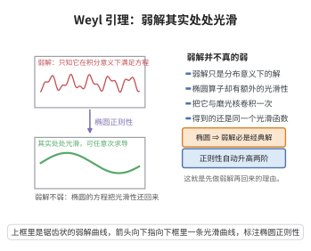

# 一致椭圆系统的 Weyl 引理

> **一句话大白话**：一个偏微分方程的"弱解"（只要在积分意义下满足方程，导数可能很糟）如果是椭圆型方程的弱解，那它其实偷偷地和真正的光滑解一样光滑——弱解不弱。

> **小例子**：$u\in L^2_{\mathrm{loc}}(D)$ 若只满足 $\int_D u\,\Delta\varphi\,dx=0$ 对一切 $\varphi\in C_c^\infty(D)$，即 $\Delta u=0$ 在分布意义下成立，则 $u$ 必可修改为 $D$ 上的光滑调和函数。这与"$u$ 二阶连续可微且 $\Delta u=0$"的经典定义完全等价。

## 一、定理介绍

> **前置依赖**：椭圆正则性定理、椭圆型方程最大值原理、Sobolev空间定义、Sobolev嵌入定理、Laplace方程

Weyl 引理（Hermann Weyl, 1940）是椭圆正则性理论的原型命题，也是"弱解即经典解"这一现代偏微分方程范式的开端。它断言：对一个一致椭圆算子 $L$，只要 $L u=f$ 在分布（弱）意义下成立，且右端 $f$ 光滑、系数光滑，那么弱解 $u$ 本身也光滑——**正则性的门槛不在解上，而在方程上**。

具体地，若 $u\in W^{1,2}_{\mathrm{loc}}$（或仅 $u\in L^2_{\mathrm{loc}}$）满足弱形式的椭圆方程，则每多二分之一的右端正则性就换来解的正则性；$f\in C^\infty$ 时 $u\in C^\infty$。Weyl 原始论证针对 $\Delta u=0$ 的"弱调和函数"，后来被 Friedrichs、Lax、Nirenberg 等人推广为一般的 $W^{k,p}$ 内估计。

在辛拓扑中，Weyl 引理是不可替代的分析基石：Gromov 可去奇点定理的最后一步要把坐标化的伪全纯方程 $\partial_{\bar z}f+q(f)\partial_z f=0$ 的解从"连续 + $W^{1,2}$"提升到光滑，所依赖的正是这里的一致椭圆系统版本。同一版本也用于 Gromov 紧性定理中气泡曲线在爆破点附近的正则性。

## 几何直观

图意在说明：椭圆方程的光滑性会自动还回来，弱解与经典解其实是同一个函数。

## 二、原理思路

证明由"先解决常系数模型，再用冻结系数法过渡到变系数"两步构成。

1. **差商法处理常系数方程**：以 $-\Delta u=f$ 为模型。对弱形式取特殊的测试函数 $\varphi=-\eta^2 D_i^{-h}D_i^{h}u$（$D_i^h$ 为差商），利用"差分算子可搬到测试函数上"的求和换序，得到对一切小 $|h|$ 一致成立的估计
$$\int\eta^2\,|D_i^h\nabla u|^2\,dx\le C\int\bigl(|f|^2+|u|^2+|\nabla u|^2\bigr)dx .$$
差商一致有界即意味着弱导数 $\nabla u$ 有一个 $L^2$ 的弱导数，于是 $u\in W^{2,2}_{\mathrm{loc}}$。

2. **冻结系数法过渡到变系数**：一般椭圆算子 $L=a^{ij}\partial_i\partial_j+\cdots$ 的最高阶部分在一点 $x_0$ 附近与常系数算子 $a^{ij}(x_0)\partial_i\partial_j$ 相差一个系数连续、可以任意小的扰动。把这一扰动项移到方程右端，用步骤 1 的估计和"小量吸收"把扰动项的最高阶部分搬回左端，即得变系数情形的 $W^{2,2}$ 正则性。

3. **自举（bootstrapping）到光滑**：步骤 2 的机制是"右端多两级可导性 ⇒ 解多两级可导性"。反复施用：$f\in C^\infty$（即对一切 $k$ 都有 $f\in W^{k,2}$）⇒ $u\in W^{k,2}$ 对一切 $k$ ⇒ 由 Sobolev 嵌入得 $u\in C^m$ 对一切 $m$ ⇒ $u\in C^\infty$。

## 三、定理的严格表述

设 $\Omega\subset\mathbb R^n$ 是开集，考虑散度型一致椭圆算子

$$Lu=\partial_i\bigl(a^{ij}(x)\,\partial_j u\bigr)+b^i(x)\,\partial_i u+c(x)\,u,$$

其中 $a^{ij}=a^{ji}\in L^\infty(\Omega)$ 满足一致椭圆条件

$$\lambda|\xi|^2\le a^{ij}(x)\xi_i\xi_j\le\Lambda|\xi|^2,\qquad \forall\,\xi\in\mathbb R^n,\ x\in\Omega,$$

且 $0<\lambda\le\Lambda<\infty$。

**定义（弱解）**：$u\in W^{1,2}_{\mathrm{loc}}(\Omega)$ 称为 $Lu=f$（$f\in L^2_{\mathrm{loc}}$）的**弱解**，若对一切 $\varphi\in C_c^\infty(\Omega)$

$$\int_\Omega\Bigl(-a^{ij}\partial_j u\,\partial_i\varphi+b^i\partial_i u\,\varphi+cu\,\varphi\Bigr)dx=\int_\Omega f\,\varphi\,dx .$$

**定理（Weyl 引理，一般形式）**：设系数 $a^{ij}\in W^{1,\infty}_{\mathrm{loc}}$（或 $a^{ij},b^i,c\in C^\infty$），$u\in W^{1,2}_{\mathrm{loc}}(\Omega)$ 是 $Lu=f$ 的弱解。

1. 若 $f\in L^2_{\mathrm{loc}}$，则 $u\in W^{2,2}_{\mathrm{loc}}(\Omega)$；
2. 若 $f\in W^{k,2}_{\mathrm{loc}}$，则 $u\in W^{k+2,2}_{\mathrm{loc}}$；
3. 特别地，若 $f\in C^\infty(\Omega)$ 且系数光滑，则 $u\in C^\infty(\Omega)$。

**推论（Weyl 1940 原文）**：若 $u\in L^2_{\mathrm{loc}}(\Omega)$ 满足 $\Delta u=0$ 于分布意义下（即 $\int_\Omega u\,\Delta\varphi=0$ 对一切 $\varphi\in C_c^\infty(\Omega)$），则 $u$ 几乎处处等于一个光滑调和函数。

**定理（系统版本）**：设 $f\in W^{1,2}_{\mathrm{loc}}(D_\rho;\mathbb C^n)$ 连续且满足

$$\partial_{\bar z}f+q(z,f)\,\partial_z f=0\quad\text（弱意义）,$$

其中 $q$ 关于其变量光滑、$q\circ f\in L^\infty$。则 $f\in C^\infty(D_\rho;\mathbb C^n)$。

## 四、证明过程

**步骤 1：差商与求和换序的模型估计。**

设 $u\in W^{1,2}_{\mathrm{loc}}(\Omega)$ 弱解 $-\Delta u=f$。取 $\eta\in C_c^\infty(\Omega)$、$0\le\eta\le1$，并记差商

$$D_i^h u(x)=\frac{u(x+he_i)-u(x)}{h}\qquad(h\ne0\ \text{充分小}).$$

弱形式为 $\int\nabla u\cdot\nabla\varphi=\int f\varphi$（对一切 $\varphi\in W^{1,2}_0$）。取

$$\varphi=-D_i^{-h}\bigl(\eta^2D_i^hu\bigr).$$

利用离散分部求和（差商把积分号内的一次"平移"换成符号）：

$$\int\nabla u\cdot\nabla D_i^{-h}v\,dx=-\int D_i^h\nabla u\cdot\nabla v\,dx+O(\|u\|_{W^{1,2}}),$$

并以 $2ab\le \epsilon a^2+\epsilon^{-1}b^2$ 估计交叉项，可得对一切充分小的 $|h|$ 一致成立

$$\int_\Omega\eta^2\,|D_i^h\nabla u|^2\,dx\le C\Bigl(\|f\|_{L^2}^2+\|u\|_{W^{1,2}}^2\Bigr),$$

其中 $C=C(n,\lambda,\Lambda,\eta)$ 与 $h$ 无关。

**步骤 2：得到 $u\in W^{2,2}_{\mathrm{loc}}$。**

对每个 $i$，序列 $\{D_i^hu\}_{h}$ 在 $L^2(\mathrm{supp}\,\eta)$ 中一致有界，且对 $\varphi\in C_c^\infty$ 有 $\int (D_i^hu)\varphi=-\int u\,D_i^{-h}\varphi\to-\int u\,\partial_i\varphi$，故 $D_i^hu$ 弱收敛到 $\partial_i u$；同一论证施于 $\nabla u$ 给出 $\partial_i\nabla u\in L^2_{\mathrm{loc}}$。因此 $\nabla u\in W^{1,2}_{\mathrm{loc}}$，即

$$u\in W^{2,2}_{\mathrm{loc}}(\Omega),\qquad -\Delta u=f\ \text{几乎处处}. \qquad\square$$

**步骤 3：冻结系数与扰动吸收。**

对一般算子 $L$ 取 $x_0\in\Omega$，记 $L_0=a^{ij}(x_0)\partial_i\partial_j$。由常系数情形的步骤 1–2（对正定对称矩阵 $a^{ij}(x_0)$ 作线性坐标变换化归为 $-\Delta$），$L_0$ 具有相同的"增益两级"性质。把方程写成

$$L_0u=f-(L-L_0)u .$$

在半径充分小的球 $B_r(x_0)$ 上，由 $a^{ij}$ 的连续性有 $|a^{ij}(x)-a^{ij}(x_0)|\le\varepsilon$，故 $(L-L_0)u$ 的最高阶项 $\le\varepsilon\,|\nabla^2u|$。取 $\varepsilon$ 充分小，把它吸收进左端（并用 $b^i,c$ 的有界性处理低阶项），即得局部估计

$$\|\eta\,\nabla^2u\|_{L^2}\le C\bigl(\|f\|_{L^2}+\|u\|_{W^{1,2}}\bigr).$$

于是 $u\in W^{2,2}_{\mathrm{loc}}$。$\square$

**步骤 4：自举与 Sobolev 嵌入。**

把方程重写为 $-\Delta u=g$，其中 $g=f-\bigl(L+\Delta\bigr)u$。若已知 $u\in W^{k,2}_{\mathrm{loc}}$（$k\ge2$）则 $g\in W^{k-2,2}_{\mathrm{loc}}$，由步骤 1–3 得 $u\in W^{k,2}_{\mathrm{loc}}$。对 $k$ 归纳：

$$f\in W^{k,2}_{\mathrm{loc}}\Longrightarrow u\in W^{k+2,2}_{\mathrm{loc}}\qquad(k=0,1,2,\ldots).$$

当 $f\in C^\infty$ 时 $f\in W^{k,2}_{\mathrm{loc}}$ 对一切 $k$ 成立，故 $u\in W^{k,2}_{\mathrm{loc}}$ 对一切 $k$ 成立。由 Sobolev嵌入定理，取 $k>m+\tfrac n2$ 得 $W^{k,2}_{\mathrm{loc}}\hookrightarrow C^m_{\mathrm{loc}}$，故 $u\in C^m$ 对一切 $m$，即 $u\in C^\infty(\Omega)$。$\square$

**步骤 5：系统的可去奇点应用。**

设 $f\in W^{1,2}_{\mathrm{loc}}$ 连续且弱满足 $\partial_{\bar z}f+q(f)\partial_zf=0$，其中 $q\circ f$ 有界。把方程写成 $\partial_{\bar z}f=-q(f)\partial_zf$：右端属于 $L^2_{\mathrm{loc}}$，故由散度型椭圆系统的 Weyl 引理（步骤 1–3 对系统逐分量施用，冻结系数后线性部分为一致椭圆的 Cauchy–Riemann 算子）得 $f\in W^{2,2}_{\mathrm{loc}}$。再由 Sobolev 嵌入 $f\in C^{0,\alpha}_{\mathrm{loc}}$，于是 $q\circ f\in C^{0,\alpha}$；对方程用 Schauder 估计得 $f\in C^{1,\alpha}$；迭代（$f\in C^{k,\alpha}\Rightarrow q\circ f\in C^{k,\alpha}\Rightarrow f\in C^{k+1,\alpha}$）即得 $f\in C^\infty$。$\square$

## 五、应用与意义

**理论意义**：Weyl 引理确立了"弱解 = 经典解"这一现代偏微分方程的基本原则：解的正则性由方程决定，而非由解的定义假设决定。它使人们可以先用能量法（Lax–Milgram、变分法）在 Sobolev 空间取得弱解，再用正则性理论把解提升为经典解，从而把"存在性"与"光滑性"分成两个独立步骤。

**应用领域**：在几何分析中，它是椭圆方程 Schauder/Calderón–Zygmund 自举的出发点，用于调和映射、极小曲面与 Yamabe 问题的正则性；在辛拓扑中，Gromov 可去奇点定理与 Gromov 紧性定理依赖系统版本的 Weyl 引理把伪全纯方程的连续弱解提升为光滑解，这是 Floer 同调中模空间光滑结构与紧化的基础；在复分析中，$\Delta u=0$ 弱意义下的正则性给出 Weyl 对"弱调和函数"的原始定理。

## 课堂问答

**老师**：Weyl 引理为何被称为"弱解不弱"？

**学生**：因为它说解的正则性由方程而非解的定义假设决定。对散度型一致椭圆算子 $Lu=\partial_i(a^{ij}\partial_ju)+b^i\partial_iu+cu$（$\lambda|\xi|^2\le a^{ij}\xi_i\xi_j\le\Lambda|\xi|^2$）的弱解 $u\in W^{1,2}_{loc}$：若 $f\in W^{k,2}_{loc}$ 则 $u\in W^{k+2,2}_{loc}$；特别地 $f\in C^\infty$ 且系数光滑则 $u\in C^\infty$。原文推论：$\Delta u=0$ 的分布解几乎处处等于光滑调和函数。常见误区是以为"弱解"意味着解本身粗糙——实际上它只是定义宽松。

**老师（追问）**：证明的两个步骤是什么？

**学生**：一是差商法处理常系数模型 $-\Delta u=f$。取测试函数 $\varphi=-D_i^{-h}(\eta^2D_i^hu)$，用离散分部求和把差商搬到测试函数上，得对一切小 $|h|$ 一致估计
$$\int\eta^2|D_i^h\nabla u|^2\le C\bigl(\|f\|_{L^2}^2+\|u\|_{W^{1,2}}^2\bigr),$$
差商一致有界即得 $u\in W^{2,2}_{loc}$。二是冻结系数过渡到变系数：$L_0u=f-(L-L_0)u$，$|a^{ij}(x)-a^{ij}(x_0)|\le\varepsilon$ 使其最高阶项可被"小量吸收"。最后自举 $+$ Sobolev 嵌入 $W^{k,2}_{loc}\hookrightarrow C^m_{loc}$ 到 $C^\infty$。

**老师（拓展）**：它在辛拓扑中的用途是什么？

**学生**：用在 Gromov 可去奇点定理的最后一步。坐标化后的伪全纯方程是系统 $\partial_{\bar z}f+q(f)\partial_zf=0$，其线性部分是 Cauchy–Riemann 算子，一致椭圆（旋转成 $-\Delta$ 型）。由系统版 Weyl 引理把 "$f$ 连续 $+$ $f\in W^{1,2}$" 提升到 $W^{2,2}_{loc}$，再配合 Schauder 估计自举到 $C^\infty$，从而完成"光滑延拓"的证明；Gromov 紧性中气泡在爆破点附近的正则性也依赖此。
