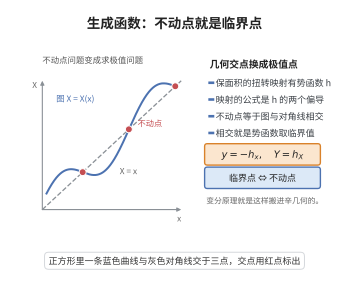

# 生成函数与变分原理

> **一句话大白话**：保面积的扭转映射可以用一个"势函数" $h$ 来记账：映射的公式就是 $h$ 的两个偏导数。于是"映射有没有不动点"这个问题，摇身一变成了"这个势函数有没有临界点"——几何问题化为求极值问题。

> **小例子**：$A=\mathbb R/\mathbb Z\times[0,1]$ 上取 $h(x,X)=\frac12(X-x)^2$。由 $y=-h_x=X-x$、$Y=h_X=X-x$ 得映射 $f(x,y)=(x+y,y)$，即沿 $x$ 方向的平移。此时 $w(x)=h(x,x)=0$ 为常数，处处是临界点，也就是说 $f$ 的不动点是每一整条水平线——与 $w$ 恒为常数时的情形完全吻合。

## 一、定理介绍

> **前置依赖**：Poincaré-Birkhoff定理、变分法基本引理、变分原理与Euler-Lagrange方程、Morse理论、辛流形基本理论

生成函数（generating function）是辛几何中把辛同胚"用一个标量函数编码"的技术，而变分原理说明：这个标量函数的临界点恰好对应原映射的不动点或周期点。二者结合，就把动力系统的存在性问题翻译成分析中的临界点问题——这正是 Poincaré–Birkhoff 定理、Arnold 猜测、Aubry–Mather 理论与 Floer 同调共同的出发点。

具体地，设环面 $A=\mathbb R/\mathbb Z\times[0,1]$ 上给出保面积映射 $f(x,y)=(X,Y)$，且满足扭转条件 $\partial X/\partial y\ne0$，则 $(x,y)\mapsto(x,X)$ 是局部微分同胚，可把 $y,Y$ 都看成 $(x,X)$ 的函数。保面积性等价于 $1$-形式

$$\theta=Y\,dX-y\,dx$$

是闭形式；在单连通的万有覆盖上它进而恰当，于是存在 $h=h(x,X)$ 使

$$dh=Y\,dX-y\,dx,\qquad\text{即}\qquad y=-\frac{\partial h}{\partial x},\quad Y=\frac{\partial h}{\partial X}.$$

这就是（第一类）生成函数。关键的一步是：$f$ 的不动点条件 $X=x$ 恰是**函数 $w(x)=h(x,x)$ 的临界点条件**，因为

$$w'(x)=h_x(x,x)+h_X(x,x)=-y+Y .$$

$w$ 在圆周 $S^1=\mathbb R/\mathbb Z$ 上良定义（由 $h(x+1,X+1)=h(x,X)+c$ 并适当归一化 $c=0$），于是"$f$ 至少有两个不动点"归结为"圆周上的连续函数至少有两个临界点"这一初等事实。

## 几何直观

图意在说明：扭转映射的图与对角线相交处正是不动点，也就是生成函数的临界点。

## 二、原理思路

1. **扭转 ⇒ 换坐标**：$h_{xX}=-\partial y/\partial X\ne0$ 等价于 $\partial X/\partial y\ne0$，保证 $(x,y)\leftrightarrow(x,X)$ 是（局部）可逆的换元，从而使"用 $h$ 的两个偏导表示 $y,Y$"成为可能。

2. **保面积 ⇒ 闭形式 ⇒ 恰当形式**：$f^*\omega=\omega$（$\omega=dx\wedge dy$）等价于 $d\theta=0$；平坦情形下由 Poincaré 引理得 $\theta=dh$。这一步是"生成函数存在"的全部内容。

3. **不动点 ⇒ 临界点**：$X=x$ 时 $w'(x)=-y+Y=0$，反之亦然。于是映射的不动点集与 $w$ 的临界点集一一对应。

4. **临界点 ⇒ 存在性（Morse/初等拓扑）**：圆周 $S^1$ 上的连续函数必有最大值与最小值；若非常数则给出两个不同的临界点。这是 Poincaré–Birkhoff 定理"至少两个不动点"分析证明的全部机制，也是 Morse 理论在 $S^1$ 上的最简版本。

5. **变分形式**：把 $h$ 看作"两点的作用量"，则 $N$ 步轨道的存在性等价于多元函数 $W(x_0,\ldots,x_N)=\sum_ih(x_i,x_{i+1})$ 的临界点存在性；这就是离散变分原理（亦称离散 Hamilton 原理），其极值点即 Aubry–Mather 意义下的极小配置。

## 三、定理的严格表述

**定义（第一类生成函数）**：设 $f:A\to A$，$f(x,y)=(X(x,y),Y(x,y))$，$A=\mathbb R/\mathbb Z\times[0,1]$，并设扭转条件 $\partial X/\partial y\ne0$ 处处成立。称光滑函数 $h:\mathbb R^2\to\mathbb R$ 为 $f$ 的**生成函数**，若把 $y,Y$ 用 $(x,X)$ 表示后有

$$y=-\frac{\partial h}{\partial x}(x,X),\qquad Y=\frac{\partial h}{\partial X}(x,X).$$

**命题（生成函数的存在性）**：若 $f$ 保面积（$f^*\omega=\omega$，$\omega=dx\wedge dy$）且满足扭转条件，则存在生成函数 $h$，且 $h$ 满足

$$\frac{\partial^2h}{\partial x\partial X}\ne0\quad(\text{扭转等价于混合二阶偏导非零}),\qquad h(x+1,X+1)=h(x,X)+c .$$

**定理（不动点–临界点对应）**：在上述设定下，令 $w(x)=h(x,x)$。则在万有覆盖的提升 $\bar f(x,y)=(X,Y)$ 中

$$X(x,y)=x\iff w'(x)=0 .$$

特别地，$f$ 在 $A$ 上的不动点与 $w$ 在 $S^1$ 上的临界点（在提升意义下）一一对应。

**推论（Poincaré–Birkhoff 的存在性版本）**：若进一步有 $h(x+1,X+1)=h(x,X)$（$c=0$），则 $w:S^1\to\mathbb R$ 良定且连续，故至少有两个临界点，从而 $f$ 至少有两个不动点。

**定理（离散变分原理）**：给定生成函数 $h$，称序列 $(x_0,\ldots,x_N)$（$x_i\in\mathbb R$）是 $h$ 的**临界序列**，若

$$h_X(x_{i-1},x_i)+h_x(x_i,x_{i+1})=0,\qquad i=1,\ldots,N-1 .$$

则临界序列与 $f$ 的轨道段一一对应：由 $(x_i,y_i)$ 生成的轨道满足 $x_{i+1}=X(x_i,y_i)$、$y_{i+1}=Y(x_i,y_i)$，且 $y_i=h_X(x_{i-1},x_i)$。临界序列正是多元函数 $W(x_0,\ldots,x_N)=\sum_{i=0}^{N-1}h(x_i,x_{i+1})$ 的临界点。

## 四、证明过程

**步骤 1：扭转条件 ⇒ 换元可逆。**

设 $f(x,y)=(X(x,y),Y(x,y))$ 满足 $\partial X/\partial y\ne0$。考虑映射 $\Phi(x,y)=(x,X(x,y))$，其 Jacobi 矩阵的行列式为 $\partial X/\partial y\ne0$，故 $\Phi$ 在每点局部微分同胚。于是在局部（及万有覆盖上整体）可用 $(x,X)$ 作为坐标，$y$ 与 $Y$ 都是 $(x,X)$ 的光滑函数。此时 $h_{xX}=-\partial y/\partial X$，故扭转条件等价于 $h_{xX}\ne0$。

**步骤 2：保面积 ⇔ $\theta$ 闭 ⇒ 存在 $h$。**

记 $\theta=Y\,dX-y\,dx$，在 $(x,X)$ 坐标下它可写成 $\theta=-\tilde y(x,X)\,dx+\tilde Y(x,X)\,dX$。直接微分：

$$d\theta=\Bigl(\frac{\partial\tilde y}{\partial X}+\frac{\partial\tilde Y}{\partial x}\Bigr)dx\wedge dX .$$

另一方面，$f$ 保面积意味着 $f^*(dx\wedge dy)=dX\wedge dY=dx\wedge dy$。而 $X,Y$ 通过 $\Phi$ 成为 $(x,y)$ 的函数，用 $dX=X_xdx+X_ydy$、$dY=Y_xdx+Y_ydy$ 代入即得

$$X_xY_y-X_yY_x=1 .$$

把 $y=y(x,X)$ 代入上式（沿 $X$ 固定求 $x$ 的导数），可将其改写为 $\partial\tilde Y/\partial x+\partial\tilde y/\partial X=0$，即 $d\theta=0$。故 $\theta$ 是闭 $1$-形式。

万有覆盖 $\mathbb R\times[0,1]$（或 $\mathbb R^2$）单连通，由 Poincaré 引理存在 $h$ 使 $\theta=dh$，即

$$\frac{\partial h}{\partial x}=-\tilde y=-y,\qquad \frac{\partial h}{\partial X}=\tilde Y=Y .$$

**步骤 3：周期性 $h(x+1,X+1)=h(x,X)+c$。**

$f$ 同伦于恒同（或保持边界圆周不变）意味着提升满足 $X(x+1,y)=X(x,y)+1$、$Y(x+1,y)=Y(x,y)$。因此 $\theta=Y\,dX-y\,dx$ 在平移 $(x,X)\mapsto(x+1,X+1)$ 下不变：利用 $d(X+1)=dX$、$X\mapsto X+1$ 时 $Y$ 不变、$x\mapsto x+1$ 时 $y$ 不变，得 $\theta$ 不变，从而 $dh$ 不变，故 $h(x+1,X+1)-h(x,X)$ 是常数 $c$。适当选取 $h$ 的常数（或对 $h$ 减去 $\frac c2(x+X)$ 型的线性项不改变二阶导数）可归一化为 $c=0$。$\square$

**步骤 4：不动点 ⇔ 临界点。**

设 $(x,y)$ 是提升 $\bar f$ 的不动点，即 $X(x,y)=x$ 且 $Y(x,y)=y$。由步骤 1–2 的生成函数关系（在 $X=x$ 处）

$$y=-\frac{\partial h}{\partial x}(x,x),\qquad Y(x,y)=\frac{\partial h}{\partial X}(x,x).$$

因 $Y=y$，两式相加给出 $h_x(x,x)+h_X(x,x)=0$；而 $w(x)=h(x,x)$ 的导数为 $w'(x)=h_x(x,x)+h_X(x,x)$，故不动点条件恰为 $w'(x)=0$。

反之若 $w'(x)=0$，则 $X=x$ 时 $Y=h_X(x,x)=-h_x(x,x)=y$ 自动成立，即该点是不动点。$\square$

**步骤 5：临界点存在 ⇒ 至少两个不动点。**

由步骤 3，$w(x+1)=h(x+1,x+1)=h(x,x)=w(x)$，故 $w$ 下降为 $S^1=\mathbb R/\mathbb Z$ 上的连续函数。若 $w$ 非常数，它在紧致连通集 $S^1$ 上取到最大值与最小值，二位置互异，故至少两个临界点；若 $w\equiv$ 常数，则处处 $w'=0$，不动点集无穷（至少两个）。两种情形都由步骤 4 给出 $A$ 上至少两个互异的不动点。$\square$

**步骤 6：离散变分原理与轨道的对应。**

设 $(x_i,y_i)$ 是 $\bar f$ 的轨道，即 $x_{i+1}=X(x_i,y_i)$、$y_{i+1}=Y(x_i,y_i)$。由生成函数关系，$y_{i+1}=h_X(x_i,x_{i+1})$（在 $X=x_{i+1}$ 处取值），且 $y_i=-h_x(x_i,x_{i+1})$。于是对 $1\le i\le N-1$ 计算

$$\frac{\partial W}{\partial x_i}=h_X(x_{i-1},x_i)+h_x(x_i,x_{i+1})=y_i-y_i=0 .$$

反之，若 $(x_0,\ldots,x_N)$ 使 $\partial W/\partial x_i=0$（$1\le i\le N-1$），定义 $y_i=h_X(x_{i-1},x_i)$，则同一等式给出 $y_i=-h_x(x_i,x_{i+1})$，即 $(x_i,y_i)$ 按 $f$ 递推，故序列来自一条轨道。特别地取 $N=1$、$x_0=x_1=x$ 得 $W=h(x,x)=w(x)$，回到步骤 4 的不动点–临界点对应。

**步骤 7：Morse 观点与非退化情形。**

若 $w$ 的临界点都非退化（$w''\ne0$），则圆周上的非退化临界点必交替为极大与极小，个数为偶数且至少 $2$；由 Morse理论，临界点数目下界与 $S^1$ 的 Betti 数（$\beta_0=\beta_1=1$）相配，给出"至少两个"的另一种解释。非退化性可通过对 $f$ 的小扰动达到（$C^1$-通有性），对退化情形取极限即得一般结论。这正是 Arnold 猜测"辛同胚的不动点数下界由 Morse 理论给出"的原型。$\square$

## 五、应用与意义

**理论意义**：生成函数把辛同胚（或扭转映射）的问题转化为单个标量函数的临界点问题，使辛拓扑与 Morse 理论、变分法直接对接；它与 Hamilton–Jacobi 方程、作用量泛函共同构成"经典力学 = 几何 = 变分"的现代框架。

**应用领域**：在动力系统中，它给出 Poincaré-Birkhoff定理 的变分证明并推广为 Aubry–Mather 理论（极小配置、对偶作用）；在辛几何中，它是 Arnold 猜测与 Floer 同调中作用量泛函的原型；在数值分析中，辛算法（离散 Hamilton 原理、变分积分器）由生成函数构造，其长期稳定性分析依赖这里的临界点图景。

## 课堂问答

**老师**：生成函数如何"用一个标量函数编码一个辛同胚"？需要什么条件？

**学生**：设环面 $A=\mathbb R/\mathbb Z\times[0,1]$ 上保面积映射 $f(x,y)=(X,Y)$ 满足扭转条件 $\partial X/\partial y\neq0$，则 $(x,y)\mapsto(x,X)$ 局部可逆，$y,Y$ 都是 $(x,X)$ 的函数。保面积 $f^*\omega=\omega$ 等价于 $\theta=Y\,dX-y\,dx$ 闭，在单连通覆盖上恰当，故存在 $h$ 使
$$dh=Y\,dX-y\,dx,\quad\text{即}\quad y=-\frac{\partial h}{\partial x},\quad Y=\frac{\partial h}{\partial X}.$$
常见误区是忘了扭转条件——没有它就不能换到 $(x,X)$ 坐标，生成函数无从谈起。

**老师（追问）**：为什么不动点恰好对应临界点？

**学生**：设 $w(x)=h(x,x)$。由生成函数关系，不动点 $X(x,y)=x$ 时
$$w'(x)=h_x(x,x)+h_X(x,x)=-y+Y=0,$$
反之 $w'(x)=0$ 自动给出不动点，故二者一一对应。又由 $f$ 同伦恒同得 $h(x+1,X+1)=h(x,X)$，于是 $w(x+1)=w(x)$，$w$ 是 $S^1$ 上的连续函数；非常数时必取到最大与最小两个临界点，从而 $f$ 至少两个不动点——这就是 Poincaré–Birkhoff 定理的变分证明。

**老师（拓展）**：怎样推广到多条轨道？

**学生**：离散变分原理。多元函数 $W(x_0,\dots,x_N)=\sum_{i=0}^{N-1}h(x_i,x_{i+1})$ 的临界点条件 $\partial W/\partial x_i=h_X(x_{i-1},x_i)+h_x(x_i,x_{i+1})=0$ 恰好刻画 $f$ 的轨道段；取 $N=1$、$x_0=x_1=x$ 即退回不动点对应。由此发展出 Aubry–Mather 理论（极小配置、对偶作用）与辛算法（变分积分器），其长期稳定性的嵌套不变曲线分析均以临界点图景为基础。
