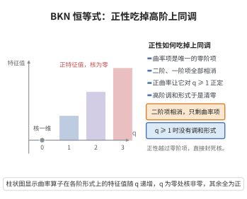

# Bochner-Kodaira-Nakano 恒等式

> **一句话大白话**：$\bar\partial$ 的 Laplacian 与"联络 Laplacian"之间只差一个由向量丛曲率决定的零阶算子；曲率正时这个差项为正，于是上同调被迫消没。
>
> **小例子**：$X$ 为 Kähler 流形、$E=\mathcal O$ 平凡线丛（曲率为零），恒等式退化为 Kähler 恒等式 $\Box_{\bar\partial}=\Delta'$，即 $\Delta_d=2\Delta_{\bar\partial}=2\Delta_{\partial}$。

## 一、定理介绍

> **前置依赖**：Hermite 全纯向量丛 $(E,h)$ 与 Chern 联络 $\nabla=\nabla^{1,0}+\nabla^{0,1}$、曲率 $\Theta(E)=\nabla^{2}$、$\bar\partial_E$ 与 $\Box_{\bar\partial}=\bar\partial\bar\partial^{*}+\bar\partial^{*}\bar\partial$、Kähler 流形 $(X,\omega)$、Lefschetz 算子 $L=\omega\wedge\cdot$ 与其伴随 $\Lambda$、Kähler 恒等式 $[\Lambda,\bar\partial]=-\sqrt{-1}\partial^{*}$、复 Laplace 算子 $\Delta'$

Bochner–Kodaira–Nakano 恒等式（BKN 恒等式，由 Bochner、Kodaira、Nakano 在 20 世纪 50 年代建立）是复几何中最重要的 Bochner 型公式。它把取值于 Hermite 全纯向量丛 $E$ 的 $\bar\partial$-Laplace 算子，分解为"联络 Laplace 算子"（纯二阶项，非负）与一个由 $E$ 的曲率决定的零阶算子：
$$\Box_{\bar\partial}=\Delta' + \bigl[\sqrt{-1}\,\Theta(E),\,\Lambda\bigr].$$

其中 $\Delta'$ 是复联络 Laplacian（在适当选取的 Hermite 标架下等于 $\sum_j\nabla_j\nabla_j^{*}$ 型的非负算子），$\Theta(E)$ 是 $E$ 的 Chern 曲率，$[\sqrt{-1}\Theta(E),\Lambda]$ 是曲率 $(1,1)$-形式与收缩算子 $\Lambda$ 的交换子，因 $\Lambda$ 降次、外乘升次，它是一个保次数的零阶（乘法型）算子。

这条恒等式是"正性 ⇒ 消没"的核心机制：对曲率为正的 $E$，$[\sqrt{-1}\Theta(E),\Lambda]$ 在 $(0,q)$-形式上（$q\ge1$）为正向算子，于是 $\Box_{\bar\partial}$ 无调和的 $(0,q)$-形式，得到 **Kodaira–Nakano 消没定理**；取 $E=K_X\otimes L$（$L$ 丰沛）得 **Kodaira 消没定理**，进而得 Kodaira 嵌入定理。它同时是 Hörmander $L^{2}$ 估计、Bochner 公式与 Weitzenböck 公式的复几何版本。

## 几何直观

图意在说明：二阶与一阶项在 Kähler 条件下全部相消，只剩下曲率交换子这一零阶项，正曲率便让正阶调和形式消失。

## 二、原理思路

BKN 恒等式源于三类算子的交换关系：

1. **Kähler 恒等式**：在 Kähler 流形上，Lefschetz 算子 $L=\omega\wedge\cdot$ 与 $\partial,\bar\partial$ 的伴随满足
$$[\Lambda,\partial]=\sqrt{-1}\,\bar\partial^{*},\qquad [\Lambda,\bar\partial]=-\sqrt{-1}\,\partial^{*}.$$
它们把 $\bar\partial^{*}$ 表达为 $[\Lambda,\partial]$，从而可以对 $\Box_{\bar\partial}$ 中的每一项作"带系数的交换"，把 $\partial$ 与 $\Lambda$ 重新排列。

2. **曲率交换子**：Chern 联络的 $(1,0)$ 与 $(0,1)$ 分量满足
$$[\nabla^{1,0}_{j},\nabla^{0,1}_{k}]=\Theta(E)_{j\bar k},$$
即二者交换子的"曲率"部分正是 Chern 曲率。这是唯一产生零阶项的地方。

3. **抵消非零阶项**：$\Box_{\bar\partial}$ 与 $\Delta'$ 都是**二阶**算子；在遍用 Kähler 恒等式与曲率交换子之后，二者的差中的二阶与一阶项全部相消（Kähler 条件保证），只剩由曲率构成的零阶项，即 $[\sqrt{-1}\Theta(E),\Lambda]$。

## 三、定理的严格表述

**（Bochner–Kodaira–Nakano 恒等式）** 设 $(X,\omega)$ 是 Kähler 流形，$(E,h)\to X$ 是 Hermite 全纯向量丛，$\nabla$ 为 Chern 联络，$\Theta(E)=\nabla^{2}\in\mathcal A^{1,1}(X,\operatorname{End}E)$ 为其曲率。记
$$\Box_{\bar\partial}=\bar\partial_{E}\bar\partial_{E}^{*}+\bar\partial_{E}^{*}\bar\partial_{E},\qquad \Delta'=\sum_{j}\nabla_{j}\nabla_{j}^{*}\ (\text{复联络 Laplacian}),$$
其中 $\{\nabla_j\}$ 是 $\nabla$ 在局部 Hermite 正交标架下的全纯方向分量。则作为作用在 $E$-值微分形式上的算子
$$\boxed{\ \Box_{\bar\partial}=\Delta'+\bigl[\sqrt{-1}\,\Theta(E),\,\Lambda\bigr]\ }$$
其中 $\Lambda=L^{*}=\omega$-收缩算子。

**（积分形式 / $L^{2}$ 形式）** 对紧支的 $E$-值 $(0,q)$-形式 $u$（在 $\bar\partial^{*}$ 的定义域内），
$$\|\bar\partial_{E}u\|^{2}+\|\bar\partial_{E}^{*}u\|^{2}=\|\nabla^{1,0}u\|^{2}+\int_{X}\bigl\langle[\sqrt{-1}\Theta(E),\Lambda]u,\,u\bigr\rangle\,d\mu,$$
且若 $\sqrt{-1}\Theta(E)\ge0$（即 $\Theta(E)$ 关于 $\omega$ 为半正定）且 $u$ 是 $\Box_{\bar\partial}$-调和的 $(0,q)$-形式（$q\ge1$），则 $u$ 必落在 $\Delta'$-核内且满足曲率项为零，从而在适当正性下 $u=0$。

**（特例：Kähler 恒等式）** 取 $E=\mathcal O$（曲率 $\Theta=0$），则
$$\Box_{\bar\partial}=\Delta',\qquad \Delta_{d}=2\Delta_{\bar\partial}=2\Delta_{\partial}.$$

**（几何意义）** 在 Chern 标架（同时对角化 $\Theta(E)$ 与 $\omega$）下，若 $\sqrt{-1}\Theta(E)$ 的特征值为 $\theta_1,\dots,\theta_r$、$\omega$ 在切空间上的特征值为 $\lambda_1,\dots,\lambda_n$，则 $[\sqrt{-1}\Theta(E),\Lambda]$ 在由 $q$ 个方向张成的 $(0,q)$-形式上的特征值为
$$-\left(\text{相应于未取方向的组合}\right),$$
特别地，当 $\sqrt{-1}\Theta(E)>0$ 时，在 $(n,q)$-形式（对偶于 $(0,q)$ 的"最高型"）上该算子 $\ge\bigl(\text{第 }1\text{ 至第 }q\text{ 小特征值之和}\bigr)>0$。

## 四、证明过程

**步骤 1：Kähler 恒等式（带系数版本）。**

在 Kähler 流形 $X$（$\omega$ 平行，$d\omega=0,\nabla\omega=0$）上，Lefschetz 算子 $L=\omega\wedge\cdot$ 的伴随是收缩 $\Lambda$。由 $\omega$ 的平行性与 $d^{c}$-算子的关系，可证（对取值于 $E$ 的形式同样成立，因 $\nabla\omega=0$）
$$[\Lambda,\partial_{E}]=\sqrt{-1}\,\bar\partial_{E}^{*},\qquad [\Lambda,\bar\partial_{E}]=-\sqrt{-1}\,\partial_{E}^{*},$$
$$[L,\Lambda]=(p+q-n)\ \text{于 }(p,q)\text{-形式上}.$$
*证明要点*：这些恒等式在局部"平坦"的 $\mathbb C^{n}$（$\omega$ 为标准形式、$E$ 局部平凡且联络平坦）上直接由 $L,\Lambda$ 的 $sl_2$-表示论验证，一般情形由 $X$ 的 Kähler 性与 $\nabla\omega=0$ 使其余项消失而得到。$\square$

**步骤 2：曲率交换子。**

Chern 联络分解为 $\nabla=\nabla^{1,0}+\nabla^{0,1}$，其中 $\nabla^{0,1}=\bar\partial_{E}$。曲率
$$\Theta(E)=\nabla^{2}=(\nabla^{1,0}+\nabla^{0,1})^{2}=\underbrace{(\nabla^{1,0})^{2}}_{=0\ (\text{全纯性})}+\underbrace{(\nabla^{0,1})^{2}}_{=0\ (\bar\partial^{2}=0)}+[\nabla^{1,0},\nabla^{0,1}].$$
故
$$[\nabla^{1,0},\nabla^{0,1}]=\Theta(E),\qquad\text{即}\qquad [\nabla^{1,0}_{j},\nabla^{0,1}_{k}]=\Theta(E)_{j\bar k}.$$
这是全纯向量丛的"结构方程"，也是 BKN 恒等式中零阶项的来源。$\square$

**步骤 3：计算 $\Box_{\bar\partial}$ 并作交换。**

记 $\bar\partial=\bar\partial_{E}$，$\bar\partial^{*}=\bar\partial_{E}^{*}=-\sqrt{-1}[\Lambda,\partial_{E}]$（步骤 1）。于是
$$\Box_{\bar\partial}=\bar\partial\bar\partial^{*}+\bar\partial^{*}\bar\partial=-\sqrt{-1}\bigl(\bar\partial[\Lambda,\partial]+\Lambda\partial\bar\partial-\partial\bar\partial\Lambda\bigr)\ \text{型}$$
逐步使用：
- $\bar\partial\partial+\partial\bar\partial=0$（$d^{2}=0$，即 $\partial\bar\partial=-\bar\partial\partial$）；
- 曲率关系 $[\nabla^{1,0},\nabla^{0,1}]=\Theta(E)$，其中 $\partial=\nabla^{1,0}$；
- Kähler 恒等式把 $[\Lambda,\partial]$ 与 $\bar\partial^{*}$、$[\Lambda,\bar\partial]$ 与 $\partial^{*}$ 互换；
- $[\Lambda,[\Lambda,\cdot]]$ 型高阶交换子在 Kähler 情形下与 $\Delta'$ 的对应项合并。

把上式整理为"二阶主部 + 零阶项"：二阶主部恰为
$$\Delta'=\sum_{j}\bigl(\nabla^{1,0}_{j}\nabla^{1,0,*}_{j}+\nabla^{0,1}_{j}\nabla^{0,1,*}_{j}\bigr)\ \text{（在形式的相应次数上）},$$
而所有含 $\partial,\bar\partial$ 的一阶项相消（这是 Kähler 条件 $[\Lambda,\partial]=\sqrt{-1}\bar\partial^{*}$ 精确成立的结果，非 Kähler 时会出现一阶"挠率"项）。剩余部分只含 $\Theta(E)$，即
$$\Box_{\bar\partial}=\Delta'+\bigl[\sqrt{-1}\,\Theta(E),\Lambda\bigr]. \square$$

**步骤 4：验证零阶项的形式。**

由 $\Theta(E)$ 是 $(1,1)$-形式、$\Lambda$ 是 $(-1,-1)$-次（在双档意义下降 $(1,1)$-次），$[\sqrt{-1}\Theta(E),\Lambda]$ 保双档 $(p,q)$，故为零阶算子。在 Chern 标架下（$\sqrt{-1}\Theta(E)=\operatorname{diag}(\theta_1,\dots,\theta_r)\sum_j\frac{\sqrt{-1}}{2}dz_j\wedge d\bar z_j$ 型的局部正规形），$\Lambda=\sum_j\iota_{\partial_{z_j}}\iota_{\partial_{\bar z_j}}$ 型的收缩给出其在各次形式上的特征值（$q$ 个方向收缩、其余保留），得到步骤 3 中所述的显式特征值。$\square$

**步骤 5：积分形式与消没定理。**

对紧支 $u$ 取 $L^{2}$ 内积，由 $\Box_{\bar\partial}=\Delta'+[\sqrt{-1}\Theta(E),\Lambda]$ 与 $\Delta'$ 的非负性（分部积分：$\langle\Delta'u,u\rangle=\|\nabla u\|^{2}\ge0$）得积分形式。

若 $u$ 是 $\Box_{\bar\partial}$-调和的，则
$$0=\langle\Box_{\bar\partial}u,u\rangle=\|\nabla u\|^{2}+\langle[\sqrt{-1}\Theta(E),\Lambda]u,u\rangle.$$
若 $\sqrt{-1}\Theta(E)\ge0$ 且 $u$ 是 $(n,q)$-形式（$q\ge1$，即"最高型"中扣除 $q$ 个方向）且 $\sqrt{-1}\Theta(E)>0$ 至少在一处，则曲率项 $\ge c\|u\|^{2}$（$c>0$ 为最小 $q$ 个特征值之和的下界），与第一项非负相加迫使 $u=0$。特别地对紧 $X$、$L$ 正（$\sqrt{-1}\Theta(L)>0$）与 $E=K_X\otimes L$ 得
$$H^{q}\bigl(X,\Omega^{n}\otimes L\bigr)=0\qquad(q\ge1),$$
即 Kodaira–Nakano 消没定理；由 Serre 对偶化为 $H^{q}(X,L)=0\ (q\ge1)$ 的 Kodaira 消没定理（对 $L=K_X\otimes L'$、$L'$ 正）。$\square$

## 五、应用与意义

**理论意义**：
1. **正性与消没的统一机制**：把"曲率正 ⇒ 上同调消没"归结为一个 Bochner 型恒等式，是复几何中"正性 ⇒ 刚性"的最标准范式。
2. **Kähler 恒等式与 Hodge 理论**：$E=\mathcal O$ 情形给出 Kähler 恒等式与 Hodge 分解、Hodge 对偶的基础。
3. **指标定理的局部版本**：与 Atiyah–Singer 指标定理的局部化证明（Chern–Weil、热核证明）密切相关。

**应用领域**：
1. **Kodaira 嵌入与消没**：Kodaira 消没定理、Kodaira 嵌入定理、射影簇的丰沛性判据。
2. **Hörmander $L^{2}$ 估计**：BKN 恒等式（带权版本）给出 $\bar\partial$ 的 $L^{2}$ 存在定理与乘子理想层的估计。
3. **Weitzenböck 与调和形式**：$E$ 为度量的张量丛时给出 Hodge Laplacian 的 Weitzenböck 分解（含 Ricci 曲率项），联系到 Bochner 公式与正质量、Ricci 流中的单调性。
4. **代数几何与模空间**：稳定性、Kodaira 维数、极小模型纲领中的消没定理。

**推广**：
- **非 Kähler 与 Hermite 情形**：一般 Hermite 流形上出现额外的一阶挠率项（"torsion"），得到 Demailly 的 BKN 型不等式。
- **向量丛与 Nakano 正性**：把 $E$ 取为高秩丛并讨论 Nakano 正性/半正性，得到 Nakano 消没定理与弱正性理论。
- **乘子理想层与 $L^{2}$ 方法**：BKN 与 Ohsawa–Takegoshi 延拓结合，是 Siu、Demailly、Hacon–McKernan 等解决代数几何中开猜想的关键工具。

## 课堂问答

**老师**：BKN 恒等式 $\Box_{\bar\partial}=\Delta'+[\sqrt{-1}\Theta(E),\Lambda]$ 里，为什么右边只剩一个零阶项？

**学生**：因为右端的二阶项与一阶项在 Kähler 条件下全部相消。用 Kähler 恒等式 $[\Lambda,\partial]=\sqrt{-1}\bar\partial^*$、$[\Lambda,\bar\partial]=-\sqrt{-1}\partial^*$ 把 $\Box_{\bar\partial}=\bar\partial\bar\partial^*+\bar\partial^*\bar\partial$ 中的 $\bar\partial^*$ 换掉，再用 $\partial\bar\partial+\bar\partial\partial=0$ 与曲率交换子 $[\nabla^{1,0},\nabla^{0,1}]=\Theta(E)$ 整理，主部恰是联络 Laplacian $\Delta'$，唯一消不掉的就是曲率项 $[\sqrt{-1}\Theta(E),\Lambda]$。它保 $(p,q)$ 型（$\Theta$ 是 $(1,1)$-形式、$\Lambda$ 降 $(1,1)$ 次），故为零阶算子。

**老师（追问）**：为什么这个零阶项是"正性导致消没"的引擎？

**学生**：对 $\Box_{\bar\partial}$-调和的 $u$ 取内积，得 $0=\langle\Box_{\bar\partial}u,u\rangle=\|\nabla u\|^2+\langle[\sqrt{-1}\Theta(E),\Lambda]u,u\rangle$。$\Delta'$ 项非负，而 $\sqrt{-1}\Theta(E)>0$ 时在 $(0,q)$-形式（$q\ge1$）上 $[\sqrt{-1}\Theta(E),\Lambda]\ge cq>0$，两项之和要为零只能 $u=0$。取 $E=K_X\otimes L$（$L$ 正）即得 Kodaira 消没。这正是 Bochner 型"曲率正蕴含刚性"的复几何范式。

**老师（拓展）**：如果流形不是 Kähler，这条恒等式会变成什么样？

**学生**：非 Kähler（一般 Hermite）时 Kähler 恒等式多出与挠率（$d\omega$）相关的项，二阶一阶项不再完全相消，于是得到带一阶 torsion 项的 Demailly 型 BKN 不等式：除曲率项外还得处理挠率，消没定理便需要额外的正性/紧性条件。把 $E=\mathcal O$（$\Theta=0$）代回，恒等式退化为 Kähler 恒等式 $\Box_{\bar\partial}=\Delta'$，即 $\Delta_d=2\Delta_{\bar\partial}=2\Delta_\partial$。
