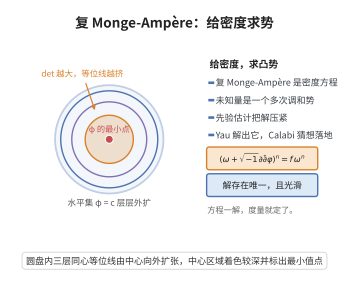

# 复 Monge-Ampère 方程

> **一句话大白话**：想知道一个 Kähler 度量的"体积密度"如何随度量的改变而改变，只需解一个把 $\det$（体积）和 $\partial\bar\partial$（曲率）绑在一起的非线性方程——这就是复 Monge–Ampère 方程。

> **小例子**：复维数 $n=1$（Riemann 面）时方程退化为 $g_{z\bar z}+\varphi_{z\bar z}=e^Fg_{z\bar z}$，即一维 Laplace 型方程 $\Delta_\omega\varphi=e^F-1$（在平坦情形）；它是线性的、可解的。复维数 $n\ge2$ 时方程是**完全非线性**的，其困难全在如何得到解的一致先验估计。

## 一、定理介绍

> **前置依赖**：Kähler恒等式、Calabi-Yau定理、椭圆正则性定理、椭圆型方程最大值原理、强极大值原理

复 Monge–Ampère 方程是 Kähler 几何中的核心非线性偏微分方程：

$$(\omega+\sqrt{-1}\partial\bar\partial\varphi)^n=e^F\,\omega^n,\qquad \omega+\sqrt{-1}\partial\bar\partial\varphi>0,$$

其中 $(X^n,\omega)$ 是紧 Kähler 流形，$\varphi\in C^\infty(X,\mathbb R)$ 是未知的实值函数（称为**Kähler 势**），$e^F$ 是给定的正函数。它的几何含义是：在所有与 $\omega$ 同调类的 Kähler 形式中，寻找一个使体积形式按预设方式改变的形式，等价地使 Ricci 形式等于给定形式。

这个方程是 Calabi 猜想（1954 年提出）的分析形式，1978 年由丘成桐在**先验估计 + 连续性方法**的框架下完全解决，其结论即为 Calabi-Yau定理。方程的历史原型是实 Monge–Ampère 方程 $\det(D^2u)=f$（Minkowski、Alexandrov 研究过），而它的解法（$C^0$、$C^2$ 估计，Evans–Krylov–Safonov 正则性，Schauder 自举）后来成为整个非线性椭圆方程理论的范式，并直接启发了 Ricci 流与 Kähler–Einstein 度量存在性（Yau–Tian–Donaldson 猜想）的研究。

## 几何直观

图意在说明：方程把势函数的复 Hessian 行列式指定为给定密度，解出一个多次调和势，度量随之确定。

## 二、原理思路

1. **从 Ricci 形式导出方程**：Ricci 形式是 $\mathrm{Ric}(\omega_\varphi)-\mathrm{Ric}(\omega)=-\sqrt{-1}\partial\bar\partial\log\det$ 型的量，把"指定 Ricci 形式"翻译为"指定 $\det(g_{ij}+\varphi_{ij})/\det(g_{ij})$"，即得到方程。

2. **椭圆性**：方程在未知函数 $\varphi$ 的二阶导数处是 $\log\det$，其线性化是算子 $L_{\varphi}=\Delta_{\omega_\varphi}=(\omega_\varphi)^{i\bar j}\partial_i\partial_{\bar j}$。$\omega_\varphi>0$ 时 $L_\varphi$ 是椭圆算子，可用最大值原理。

3. **唯一性（比较原理）**：由 $\log\det$ 在正定锥上的**凹性**，两个解之差满足一个单侧不等式，配合最大值原理即得唯一性。

4. **存在性（连续性方法）**：把方程嵌入单参数族，证明解集非空、既开（由隐函数定理/线性椭圆理论）又闭（由一致的先验估计），从而解到参数 $1$。全部工作量在于 $C^0$ 与 $C^2$ 先验估计。

## 三、定理的严格表述

设 $(X^n,\omega)$ 是紧 Kähler 流形，$g_{i\bar j}$ 是 $\omega$ 的局部系数，局部写

$$\omega=\sqrt{-1}g_{i\bar j}\,dz^i\wedge d\bar z^j,\qquad \omega_\varphi=\omega+\sqrt{-1}\partial\bar\partial\varphi .$$

**方程（复 Monge–Ampère）**：求 $\varphi\in C^\infty(X,\mathbb R)$ 满足

$$(\omega+\sqrt{-1}\partial\bar\partial\varphi)^n=e^F\,\omega^n,\qquad \omega+\sqrt{-1}\partial\bar\partial\varphi>0,\qquad \sup_X\varphi=0,$$

局部坐标下即为 $\det\bigl(g_{i\bar j}+\varphi_{i\bar j}\bigr)=e^F\det(g_{i\bar j})$（这里 $e^F$ 已按体积归一化 $\int_Xe^F\omega^n=\int_X\omega^n$ 选定）。

**定理（解的存在唯一性，Calabi–Yau）**：设 $F\in C^\infty(X,\mathbb R)$ 满足 $\int_Xe^F\omega^n=\int_X\omega^n$。则存在唯一的 $\varphi\in C^\infty(X,\mathbb R)$（归一化 $\sup_X\varphi=0$）满足上述方程，从而 $\omega_\varphi$ 是 $[\omega]$ 中唯一以 $e^F\omega^n/n!$ 为体积形式、且 $\mathrm{Ric}(\omega_\varphi)$ 为指定形式的 Kähler 度量。

**定理（唯一性/比较原理）**：设 $\varphi,\psi$ 是两个解（或更一般地满足 $(\omega+\sqrt{-1}\partial\bar\partial\varphi)^n\ge(\omega+\sqrt{-1}\partial\bar\partial\psi)^n$ 的上解/下解对），归一化使 $\sup_X(\varphi-\psi)=0$。则 $\varphi=\psi$。

**命题（$C^2$ 估计）**：存在只依赖 $n,(X,\omega),\|F\|_{C^2}$ 的常数 $C$，使任一解满足

$$\Delta_\omega\varphi\le C,\qquad \omega_\varphi\ge C^{-1}\omega .$$

## 四、证明过程

**步骤 1：从 Ricci 形式导出方程。**

局部取 $\omega_\varphi=\sqrt{-1}(g_{i\bar j}+\varphi_{i\bar j})dz^i\wedge d\bar z^j$。Kähler 度量下 Ricci 形式由 $\mathrm{Ric}(\omega)=-\sqrt{-1}\partial\bar\partial\log\det(g_{i\bar j})$ 给出。于是

$$\mathrm{Ric}(\omega_\varphi)-\mathrm{Ric}(\omega)=-\sqrt{-1}\partial\bar\partial\log\frac{\det(g_{i\bar j}+\varphi_{i\bar j})}{\det(g_{i\bar j})}.$$

要求 $\mathrm{Ric}(\omega_\varphi)=\alpha$（$\alpha$ 是代表 $2\pi c_1(X)$ 的给定闭 $(1,1)$-形式），则 $\mathrm{Ric}(\omega)-\alpha$ 是 $\sqrt{-1}\partial\bar\partial$-恰当的（它是闭的实 $(1,1)$-形式且同调类为零，由 $\partial\bar\partial$-引理可写为 $\sqrt{-1}\partial\bar\partial F$）。故 $\log\det$ 的比值必等于 $F$ 加常数；再用体积条件 $\int\omega_\varphi^n=\int\omega^n$ 定出该常数，即得

$$\log\frac{\det(g_{i\bar j}+\varphi_{i\bar j})}{\det(g_{i\bar j})}=F,\qquad\text{即}\qquad(\omega+\sqrt{-1}\partial\bar\partial\varphi)^n=e^F\omega^n .$$

（常数被吸收进 $F$ 的归一化 $\int_Xe^F\omega^n=\int_X\omega^n$；特别地 $F=\text{const}$ 即 Ricci 平坦情形，$c_1(X)=0$。）$\square$

**步骤 2：椭圆性。**

设 $\varphi$ 满足 $\omega_\varphi>0$，即矩阵 $[g_{i\bar j}+\varphi_{i\bar j}]$ 在每个点正定。方程左端为 $A(\varphi):=\log\det(g_{i\bar j}+\varphi_{i\bar j})$。对扰动 $\delta\varphi$ 作一阶变分，用 $\delta\log\det M=\mathrm{tr}(M^{-1}\delta M)$ 得

$$DA(\varphi)[\delta\varphi]=(\omega_\varphi)^{i\bar j}\partial_i\partial_{\bar j}\delta\varphi=\Delta_{\omega_\varphi}\delta\varphi,$$

其中 $(\omega_\varphi)^{i\bar j}$ 是 $[g_{i\bar j}+\varphi_{i\bar j}]$ 的逆矩阵。因 $[g_{i\bar j}+\varphi_{i\bar j}]>0$，其二阶导数的系数矩阵正定，故 $L_\varphi=\Delta_{\omega_\varphi}$ 是椭圆算子；由 $\omega_\varphi$ 与 $\omega$ 在紧流形上等价（后文由 $C^2$ 估计给出 $C^{-1}\omega\le\omega_\varphi\le C\omega$），它还是**一致**椭圆的，从而可用椭圆型方程最大值原理。$\square$

**步骤 3：唯一性与比较原理。**

利用 $\log\det$ 在正定 Hermite 矩阵锥上的凹性：对任意 $A,B\succ0$ 有 $\log\det B-\log\det A\le\mathrm{tr}\bigl(A^{-1}(B-A)\bigr)$。

设 $\varphi,\psi$ 是两个解，取 $A=[g_{i\bar j}+\varphi_{i\bar j}]$、$B=[g_{i\bar j}+\psi_{i\bar j}]$。两解给出 $\det A=\det B=e^F\det g$，故左端为 $0$，于是 $0\le\mathrm{tr}\bigl(A^{-1}(B-A)\bigr)=(\omega_\varphi)^{i\bar j}(\psi_{i\bar j}-\varphi_{i\bar j})=\Delta_{\omega_\varphi}(\psi-\varphi)$。

另一方面，直接计算（用 $\varphi_{i\bar j}=(g_\varphi)_{i\bar j}-g_{i\bar j}$）得

$$\Delta_{\omega_\varphi}(\varphi-\psi)=\mathrm{tr}\bigl(A^{-1}(A-B)\bigr),$$

它与上式互为相反数，故 $\Delta_{\omega_\varphi}(\varphi-\psi)\le0$。即 $w:=\varphi-\psi$ 关于 $\omega_\varphi$ 是**上调和**的（$L_\varphi w\le0$）。

现在归一化使 $\sup_Xw=0$（两解都可加常数而不改变 $\omega_\varphi$，故这一归一化不损失一般性）。对满足 $L_\varphi w\le0$ 的 $w$ 施用椭圆型方程最大值原理：若上调和函数在某内点取到最大值，则它是常数。因 $X$ 紧致，$w$ 必在某点取到最大值 $\sup_Xw=0$，故 $w\equiv0$，即 $\varphi=\psi$。若 $w$ 非常数则最大值只在边界取得，而 $\partial X=\varnothing$，矛盾。唯一性得证。$\square$

**步骤 4：$C^0$ 估计（思路）。**

面积/体积条件给出体积的控制：$\int_X\omega_\varphi^n=\int_X\omega^n$，且由方程 $\omega_\varphi^n=e^F\omega^n$ 与 $\sup_X\varphi=0$ 可得 $\inf_X\varphi$ 的界（比较原理的定量版本：把 $\varphi$ 与"极值势函数"比较，用 $\omega$ 的容量/Green 函数估计）。标准论证（Aubin–Yau 的 $C^0$ 估计，后由 Błocki 化简）为：取使 $\varphi$ 最小的点并用方程在此点附近的积分估计，得到

$$\sup_X|\varphi|\le C\bigl(n,(X,\omega),\|F\|_\infty\bigr).$$

这一步是技术性最强的一环，其允许使用本仓库其余工具（最大值原理、Kähler恒等式给出的 $\Delta$ 与 $\mathrm{tr}$ 的关系式）逐项控制。

**步骤 5：$C^2$ 估计（思路）。**

设 $u=\mathrm{tr}_\omega\omega_\varphi=g^{i\bar j}(g_{i\bar j}+\varphi_{i\bar j})=n+\Delta_\omega\varphi$。Yau 的关键计算是在 $\omega_\varphi$ 的法坐标下把 $\Delta_{\omega_\varphi}\log u$ 化为含曲率与 $\mathrm{tr}_{\omega_\varphi}\omega$ 的表达式，得到 Chern–Lu 型不等式

$$\Delta_{\omega_\varphi}\log u\ge -C_1\,\mathrm{tr}_{\omega_\varphi}\omega-C_2 .$$

由方程 $A(\varphi)=F$ 与代数不等式 $(\mathrm{tr}_\omega\omega_\varphi)^{n-1}\ge C\,\mathrm{tr}_{\omega_\varphi}\omega\cdot\det$ 型估计（AM–GM 与 $\det$ 固定的约束），$\mathrm{tr}_{\omega_\varphi}\omega$ 被 $u^{n-1}e^{-F}\cdot(\text{常数})$ 控制。把 $\log u-A\varphi$ 作为辅助函数（$A$ 取大常数以吸收 $F$ 的项）在其最大值点用 $\Delta_{\omega_\varphi}(\log u-A\varphi)\le0$ 得

$$u\le C\bigl(1+\sup_X|\varphi|\bigr)^{\alpha},$$

结合步骤 4 的 $C^0$ 界给出 $\Delta_\omega\varphi\le C$。最后由方程

$$\frac{\det(g_{i\bar j}+\varphi_{i\bar j})}{\det(g_{i\bar j})}=e^F\ge\delta>0$$

与"一阶特征值 $\le C$、行列式 $\ge\delta$"推出 $\omega_\varphi\ge C^{-1}\omega$，即 $g_{i\bar j}+\varphi_{i\bar j}$ 的特征值被双向控制。$\square$

**步骤 6：高阶估计与连续性方法。**

由步骤 5 得 $C^{-1}\omega\le\omega_\varphi\le C\omega$，方程此时成为**一致椭圆**的完全非线性方程；由 Evans–Krylov–Safonov 定理得 $\|\varphi\|_{C^{2,\alpha}}\le C$，再用椭圆正则性定理（Schauder 自举）得 $\|\varphi\|_{C^{k,\alpha}}\le C_k$。

把方程嵌入单参数族 $(\omega+\sqrt{-1}\partial\bar\partial\varphi_t)^n=(1-t+t\,e^F)\,\omega^n$，$t\in[0,1]$（$t=0$ 有解 $\varphi_0=0$）。设解集 $S\subseteq[0,1]$：由线性化算子的椭圆性与隐函数定理，$S$ 开；由步骤 4–5 的一致先验界，解序列可取收敛子列，$S$ 闭。故 $S=[0,1]$，$t=1$ 给出目标方程的解 $\varphi$。$\square$

关于一般 Ric 目标与推论：对一般的 $\mathrm{Ric}(\omega_\varphi)=\alpha$（$[\alpha]=2\pi c_1(X)$），把右端改为 $e^{F-\varphi}$ 型的项，$C^0$ 估计中多出的 $e^{-\varphi}$ 由方程本身直接给出 $\varphi$ 的下界控制；其余步骤不变，即得 Calabi-Yau定理 的完整陈述。特别地 $c_1(X)=0$ 时取 $\alpha=0$，得到 $[\omega]$ 中唯一的 Ricci 平坦 Kähler 度量——这就是 Calabi–Yau 流形的定义性结论。$\square$

## 五、应用与意义

复 Monge–Ampère 方程是 Kähler 几何的非线性中心：它的可解性等价于 Calabi 猜想，即 Calabi-Yau定理；由此得到 Ricci 平坦 Kähler 度量的存在唯一性，成为 Calabi–Yau 流形、弦论紧化与镜像对称的几何基础。其方法（先验估计 + 连续性方法 + 完全非线性椭圆正则性）后来被推广到 Kähler–Einstein 度量存在性（Yau–Tian–Donaldson 纲领）、复 Hessian 方程、退化复 Monge–Ampère 方程与测度传输问题，是现代几何分析与非线性 PDE 的共同范式。

## 课堂问答

**老师**：复 Monge-Ampère 方程为何是"完全非线性"的？它的线性化是什么？

**学生**：方程是 $(\omega+\sqrt{-1}\partial\bar\partial\varphi)^n=e^F\omega^n$，即 $\det(g_{i\bar j}+\varphi_{i\bar j})=e^F\det(g_{i\bar j})$。因为未知函数 $\varphi$ 的二阶导数 $\varphi_{i\bar j}$ 出现在 $\det$ 内且非线性，故是完全非线性。线性化用 $\delta\log\det M=\mathrm{tr}(M^{-1}\delta M)$ 得 $DA(\varphi)[\delta\varphi]=(\omega_\varphi)^{i\bar j}\partial_i\partial_{\bar j}\delta\varphi=\Delta_{\omega_\varphi}\delta\varphi$；只要 $\omega_\varphi>0$，系数矩阵正定，算子就一致椭圆，可用最大值原理。

**老师（追问）**：唯一性怎么证？为什么盯住 $\log\det$ 的凹性？

**学生**：$\log\det$ 在正定 Hermite 矩阵锥上凹：$\log\det B-\log\det A\le\mathrm{tr}(A^{-1}(B-A))$。令 $A=[g_{i\bar j}+\varphi_{i\bar j}]$、$B=[g_{i\bar j}+\psi_{i\bar j}]$ 为两解，则 $\det A=\det B$，得 $\Delta_{\omega_\varphi}(\psi-\varphi)\ge0$；反向计算给 $\Delta_{\omega_\varphi}(\varphi-\psi)\le0$，即 $w=\varphi-\psi$ 关于 $\omega_\varphi$ 上调和。归一化 $\sup w=0$ 后用最大值原理（上调和函数在内点取最大必为常数），又 $X$ 紧无边，故 $w\equiv0$。这正是比较原理。

**老师（拓展）**：存在性为什么最难？"先验估计加连续性方法"的核心缺口在哪？

**学生**：连续性方法把方程嵌入 $(\omega+\sqrt{-1}\partial\bar\partial\varphi_t)^n=(1-t+te^F)\omega^n$：解集开性靠隐函数定理与线性椭圆理论，闭性靠一致先验界，难点全在 $C^0$、$C^2$ 估计。Yau 的关键是在 $\omega_\varphi$ 的法坐标下计算 $\Delta_{\omega_\varphi}\log u$（$u=\mathrm{tr}_\omega\omega_\varphi$），得 Chern-Lu 型不等式 $\Delta_{\omega_\varphi}\log u\ge-C_1\mathrm{tr}_{\omega_\varphi}\omega-C_2$，配合辅助函数 $\log u-A\varphi$ 的最大值原理得 $\Delta_\omega\varphi\le C$，反推 $\omega_\varphi\ge C^{-1}\omega$，最后由 Evans-Krylov-Safonov 与 Schauder 自举到 $C^\infty$。
