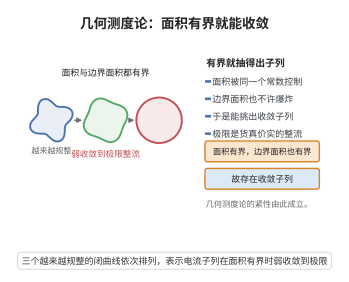

# 几何测度论紧性定理

> **一句话大白话**：只要一族"广义曲面"（整流电流）的面积和它们边界的面积被同一个数控制住，就一定可以从这族里挑出一个子列，让它们收敛到一个货真价实的广义曲面。

> **小例子**：$\mathbb{R}^n$ 中一族质量与边界质量一致有界的球面电流，存在子列在平坦范数下收敛；这正是 Federer–Fleming 定理中"变分直接法能够取到极限"的关键一步。

## 一、定理介绍

> **前置依赖**：整流电流与质量测度、平坦范数与弱收敛、有界变差函数（BV）的紧性、Banach–Alaoglu 定理、Rellich–Kondrachov 紧嵌入定理。

几何测度论紧性定理（compactness theorem for integral currents）由 Herbert Federer 与 Wendell Fleming 在 1960 年的奠基性论文《Normal and integral currents》中提出并证明。在此之前，极小曲面的存在性只能借助参数化方法（Douglas、Radó、Courant）或共形映射工具；对于高维、允许奇异、甚至不是流形的一般"定向曲面"，经典方法完全失效。Federer 与 Fleming 的动机正是要建立一个足够宽泛的"曲面"概念，使得面积泛函的变分直接法能够真正运行。

他们提出的整流电流（integral current）把 $m$ 维定向曲面理解为作用在 $m$ 次微分形式上的连续线性泛函，其质量 $\mathbf{M}$ 推广了曲面面积，边界算子 $\partial$ 推广了带定向的边界。在框架下，面积最小化问题的解应当在某个紧性定理保证的极限点处取得。紧性定理说明：质量与边界质量的一致有界性正是所需的先验估计，它使极小化序列收敛到同样是整系数的极限对象。

该定理与 Almgren 的大正则性理论、De Giorgi 的 BV 紧性、Simon 的紧性推广一起，构成了面积最小化理论的技术基础，并直接支撑 Plateau 问题、等周问题、肥皂膜奇点分析等核心问题，是几何分析被广泛引用的一条"硬定理"。

## 几何直观

图意在说明：面积与边界面积同时受控，就能抽出弱收敛子列，极限仍是广义曲面。

## 二、原理思路

证明紧性定理的整体策略是把一般整流电流近似成分片常值（polyhedral）对象，再在有限维空间中抽取收敛子列，最后用对角化把子列搬回原空间。分点如下：

1. **形变定理（Deformation Theorem）把对象"规则化"**：对任意整流电流 $T$，可以把它分解为与立方网格贴合的 polyhedral 部分 $P$、很小的余项 $R$ 与一个边界 $\partial Q$，其中余项与 $Q$ 的质量由网格尺度 $\varepsilon$ 控制。这一步把无限维的收敛问题化归为有限维。

2. **有限维紧性**：在固定网格尺度下，polyhedral 链由有限多个系数刻画，而质量与边界质量的一致有界性给出这些系数的一致界，于是由 Bolzano–Weierstrass 定理可抽取收敛子列。

3. **网格细化与对角化**：取网格尺度 $\varepsilon_j \to 0$，对每个尺度抽取子列（余项越来越小），用对角线法取出公共子列，使其在平坦范数下成为 Cauchy 列。

4. **极限仍是整流电流**：证明极限对象是整系数的（rectifiable）电流，其质量与边界质量满足下半连续性，且边界算子与极限相容，即 $\partial(\lim T_j) = \lim \partial T_j$。

## 三、定理的严格表述

**定义（整流电流与质量）**：设 $T$ 是 $\mathbb{R}^{n+k}$ 上的 $m$ 维电流，可表示为
$$T(\omega) = \int_M \theta(x)\,\langle \omega(x), \xi(x)\rangle\, d\mathcal{H}^m(x),$$
其中 $M$ 是 $m$ 维可数 rectifiable 集，$\theta$ 是整数值的重数函数，$\xi$ 是定向，$\mathcal{H}^m$ 为 $m$ 维 Hausdorff 测度。定义其质量测度与质量分别为
$$\|T\|(A) = \int_{M\cap A} |\theta|\, d\mathcal{H}^m, \qquad \mathbf{M}(T) = \|T\|(\mathbb{R}^{n+k}).$$
若 $\partial T$ 也整系数，则称 $T$ 为整流电流（integral current）。

**定义（平坦范数）**：对 $m$ 维电流 $T$，定义
$$\mathcal{F}(T) = \inf\{\mathbf{M}(A) + \mathbf{M}(B) : T = A + \partial B,\ A,B \text{ 为电流}\}.$$
平坦范数比质量范数弱，正适合表述紧性；且 $\mathcal{F}(T_j - T) \to 0$ 蕴含弱收敛。

**定理（Federer–Fleming 紧性定理，1960）**：设 $\{T_j\}$ 是 $\mathbb{R}^{n+k}$ 中一列 $m$ 维整流电流，全部支撑包含在同一个紧集 $K \subset \mathbb{R}^{n+k}$ 内，且满足一致界
$$\sup_{j}\bigl(\mathbf{M}(T_j) + \mathbf{M}(\partial T_j)\bigr) < \infty.$$
则存在子列（不妨仍记为 $T_j$）与 $m$ 维整流电流 $T$，使得
$$\mathcal{F}(T_j - T) \to 0, \qquad \partial T_j \to \partial T \quad (\text{在平坦范数下}),$$
并且质量满足下半连续性
$$\mathbf{M}(T) \le \liminf_{j\to\infty}\mathbf{M}(T_j), \qquad \mathbf{M}(\partial T) \le \liminf_{j\to\infty}\mathbf{M}(\partial T_j).$$

**推论（存在性形式）**：设 $S$ 是 $(m-1)$ 维整流电流且 $\partial S = 0$，则面积最小化问题
$$\inf\{\mathbf{M}(T) : T \text{ 为 } m \text{ 维整流电流},\ \partial T = S\}$$
有解。

## 四、证明过程

**步骤 1（形变定理分解）。** 取尺度 $\varepsilon > 0$ 的立方网格。形变定理断言：存在网格上的 polyhedral $m$ 链 $P$、polyhedral $(m+1)$ 链 $Q$ 与电流 $R$，使
$$T = P + R + \partial Q,$$
且估计
$$\mathbf{M}(P) \le C\,\mathbf{M}(T), \qquad \mathbf{M}(R) \le C\varepsilon\,\mathbf{M}(\partial T), \qquad \mathbf{M}(Q) \le C\varepsilon\,\mathbf{M}(T).$$
理由在于：先用 $m$ 维立方单形的中心投影把 $T$ 推到网格骨架上，投影的 Jacobi 行列式一致有界，得到 $P$；投影误差沿径向补出一个 $(m+1)$ 维"锥"即 $Q$；剩下的 $R$ 只出现在那些被边界穿过的格胞上，其总质量被 $\varepsilon\,\mathbf{M}(\partial T)$ 控制。

**步骤 2（有限维紧性）。** 固定 $\varepsilon$。网格的每个 $m$ 维格胞至多有限个，故 $P$ 由有限多个实系数 $(c_\alpha)$ 决定。由步骤 1 的估计 $\mathbf{M}(P) \le C \cdot \sup_j \mathbf{M}(T_j)$，每个格胞上的系数满足一致界 $|c_\alpha| \le C'$。于是 $(c_\alpha)$ 落在 $\mathbb{R}^{N}$ 的一个有界闭集中，由 Bolzano–Weierstrass 定理可抽取收敛子列，对应的 polyhedral 链 $P_j$ 在质量范数下收敛。

**步骤 3（网格细化与对角化）。** 取序列 $\varepsilon_i = 2^{-i}$ 与网格 $\mathcal{G}_i$。对 $i=1$，抽取子列使 $P_j^{(1)}$ 收敛；对 $i=2$，从该子列再抽子列使 $P_j^{(2)}$ 收敛；依此类推，用对角线法取出公共子列 $\{T_{j_k}\}$。对任意固定 $i$，该子列对应的 $P^{(i)}$ 收敛，而由 $\mathbf{M}(R^{(i)}) \le C\varepsilon_i\, \mathbf{M}(\partial T) \to 0$ 与 $\mathbf{M}(\partial Q^{(i)}) \le \mathbf{M}(Q^{(i)}) \le C\varepsilon_i \mathbf{M}(T) \to 0$，可知
$$\mathcal{F}(T_{j_k} - P^{(i)}_{j_k}) \le \mathbf{M}(R^{(i)}_{j_k}) + \mathbf{M}(Q^{(i)}_{j_k}) \le C\varepsilon_i \bigl(\mathbf{M}(T) + \mathbf{M}(\partial T)\bigr).$$
对 $\varepsilon$ 与 $k$ 取双重极限，得 $\{T_{j_k}\}$ 在平坦范数下是 Cauchy 列。

**步骤 4（极限为整流电流）。** 由 $\mathcal{F}$-Cauchy 性，存在电流 $T$ 使 $\mathcal{F}(T_{j_k}-T)\to 0$。因为平坦收敛蕴含弱收敛，而整流电流族在弱极限下保持"整系数 + rectifiable"（重数函数取整、支撑可数 rectifiable 由闭性定理保证），故 $T$ 是整流电流。又 $\partial$ 关于平坦范数连续，故 $\partial T_{j_k} \to \partial T$。质量关于弱收敛下半连续，即得两个 $\liminf$ 不等式。$\square$

**步骤 5（推论的证明）。** 取极小化序列 $T_j$ 使 $\mathbf{M}(T_j) \to \inf$。由于所有 $T_j$ 分享同一边界 $\partial T_j = S$，$\mathbf{M}(\partial T_j) = \mathbf{M}(S)$ 一致有界；再用等周不等式可把 $\mathbf{M}(T_j)$ 的一致界换成支撑包含于某个紧球内（否则超出部分可被切除而不增面积）。由步骤 1–4 得子列 $T_{j_k}\to T$，且 $\mathbf{M}(T)\le\liminf \mathbf{M}(T_{j_k}) = \inf$，故 $T$ 即极小元。$\square$

## 五、应用与意义

- **极小曲面存在性（Plateau 问题）**：以整流电流为容许类，用本定理保证面积最小化序列的极限存在，得到面积最小的整流电流，再研究其正则性（Almgren、De Lellis–Spadaro）。

- **等周不等式与肥皂膜**：区域里给定体积的面积最小化边界可由同一套紧性加下半连续性论证得到，解释了肥皂膜为什么总能绷出面积最小的形状。

- **平均曲率流与奇点分析**：流的单调性公式与紧性定理结合，把奇点处的爆破极限刻画为面积最小的锥（tangent cone），是 Brakke 流与 Ilmanen 部分正则性理论的基础。

- **广义相对论**：Schoen–Yau 证明正质量定理时，先在渐近平坦时空中用几何测度论方法构造稳定极小曲面，紧性定理保证该构造可行。

- **调和映射与变分问题**：在能量泛函的极小化序列可能发生"泡泡"爆破时，紧性/缺陷测度分析提供了统一的极限描述框架。

- **图像处理与自由边界问题**：BV 与电流框架下，"面积最小 + 数据保真"的变分模型依赖同样的紧性机制来保证解的存在。

## 课堂问答

**老师**：Federer–Fleming 紧性定理的条件与结论是什么？

**学生**：设 $\mathbb R^{n+k}$ 中一列 $m$ 维整流电流 $\{T_j\}$ 支撑在同一紧集 $K$ 内，且 $\sup_j(\mathbf M(T_j)+\mathbf M(\partial T_j))<\infty$，则存在子列与整流电流 $T$ 使 $\mathcal F(T_j-T)\to0$、$\partial T_j\to\partial T$，并满足下半连续性 $\mathbf M(T)\le\liminf\mathbf M(T_j)$、$\mathbf M(\partial T)\le\liminf\mathbf M(\partial T_j)$。

**老师（追问）**：为什么要用平坦范数而不是质量范数来表述收敛？

**学生**：质量范数太强，$T=\partial Q$ 型对象可以在小质量余项下"漂移"掉，紧性会失败。平坦范数 $\mathcal F(T)=\inf\{\mathbf M(A)+\mathbf M(B):T=A+\partial B\}$ 更弱，且平坦收敛蕴含弱收敛、$\partial$ 关于它连续，正好与"允许一个边界型的修正"这一几何直观匹配。

**老师（拓展）**：证明的核心技术是什么？

**学生**：形变定理把 $T$ 分解为贴合网格的 polyhedral 链 $P$、小余项 $R$ 与边界 $\partial Q$：$T=P+R+\partial Q$，且 $\mathbf M(R)\le C\varepsilon\,\mathbf M(\partial T)$、$\mathbf M(Q)\le C\varepsilon\,\mathbf M(T)$。固定网格后 $P$ 由有限多个系数刻画，用 Bolzano–Weierstrass 抽子列；再把网格尺度 $\varepsilon_i=2^{-i}\to0$ 细化并作对角线法，得 $\mathcal F$-Cauchy 列。常见误区是只控制 $\mathbf M(T_j)$ 而不控制 $\mathbf M(\partial T_j)$——那样余项无法被 $\varepsilon$ 压小，紧性也就无从谈起。

## 相关条目

- [极小曲面理论](./极小曲面理论.md)：本定理是其中面积最小化整流电流存在性的核心工具。
- [调和映射存在性](./调和映射存在性.md)：能量泛函的极小化序列同样依赖紧性与缺陷测度分析。
- [曲率估计与单调公式](./曲率估计与单调公式.md)：与紧性定理联合用于刻画几何流奇点的爆破极限。
- [Uhlenbeck紧性定理](../第62级-低维拓扑/Uhlenbeck紧性定理.md)：规范理论中"曲率一致有界蕴含子列收敛"的平行结论。
