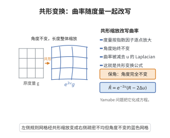

# 标量曲率的共形变换公式

> **一句话大白话**：把度量按 $e^{2u}$ 缩放后，新的标量曲率等于原标量曲率减去 $u$ 的 Laplacian 与梯度平方的线性组合——这解释了"共形变形能改变标量曲率"，也是 Yamabe 问题把它化成非线性椭圆方程的原因。
>
> **小例子**：$n=2$ 时公式退化为 $\tilde R=e^{-2u}(R-2\Delta u)$，即曲面上的经典 Gauss 曲率共形变换公式（局部共形坐标下的 $\Delta\log\lambda$ 公式）。

## 一、定理介绍

> **前置依赖**：Riemann 度量与共形等价 $\tilde g=e^{2u}g$、Levi-Civita 联络与 Christoffel 符号的变换、Riemann 曲率张量与 Ricci 曲率的共形变换、Laplace–Beltrami 算子 $\Delta_g$ 与梯度平方 $|\nabla u|^{2}_g$、Sobolev 临界指数、Yamabe 问题

标量曲率的共形变换公式描述：当度量作共形缩放 $\tilde g=e^{2u}g$ 时，标量曲率 $R$ 如何变化。对 $n=\dim X\ge3$，
$$\tilde R=e^{-2u}\Bigl(R-2(n-1)\Delta_{g}u-(n-1)(n-2)|\nabla u|^{2}_{g}\Bigr).$$
对 $n=2$（此时 $|\nabla u|$ 项消失），退化为经典公式
$$\tilde R=e^{-2u}\bigl(R-2\Delta_{g}u\bigr).$$
若写成 $g_u=u^{\frac{4}{n-2}}g$（$n\ge3$，即 $e^{2f}=u^{4/(n-2)}$，$f=\frac{2}{n-2}\log u$，$u>0$），则
$$R_{g_u}=u^{-\frac{n+2}{n-2}}\Bigl(-4\,\frac{n-1}{n-2}\,\Delta_{g}u+R_{g}\,u\Bigr).$$

这最后一个形式是 **Yamabe 问题**的核心：求与给定度量共形、且标量曲率为常数 $R_0$ 的度量，等价于解半线性椭圆方程
$$-4\frac{n-1}{n-2}\Delta_{g}u+R_{g}u=R_{0}\,u^{\frac{n+2}{n-2}},\qquad u>0,$$
其中指数 $\frac{n+2}{n-2}$ 是 Sobolev 临界指数，导致紧性失效与"气泡"现象。此公式也是共形几何、共形不变量（Weyl 张量、Paneitz 算子）与几何分析中一切共形变分问题的起点。

## 几何直观

图意在说明：度量乘上指数因子后角度不变、长度改变，标量曲率则减去 u 的 Laplacian 项。

## 二、原理思路

公式来自 Christoffel 符号在共形变换下的显式变换。

1. **联络的变换**：令 $\tilde g_{ij}=e^{2u}g_{ij}$。由 Koszul 公式（或 Christoffel 符号的定义）直接计算得
$$\tilde\Gamma^{k}_{ij}=\Gamma^{k}_{ij}+\delta^{k}_{i}\,\partial_{j}u+\delta^{k}_{j}\,\partial_{i}u-g_{ij}\,g^{kl}\,\partial_{l}u.$$

2. **Ricci 的变换**：把上式代入 Ricci 张量的定义 $\tilde R_{ij}=\partial_k\tilde\Gamma^{k}_{ij}-\partial_j\tilde\Gamma^{k}_{ik}+\tilde\Gamma^{k}_{kl}\tilde\Gamma^{l}_{ij}-\tilde\Gamma^{k}_{jl}\tilde\Gamma^{l}_{ik}$，整理得
$$\tilde R_{ij}=R_{ij}-(n-2)\bigl(\nabla_i\nabla_j u-\partial_i u\,\partial_j u\bigr)-g_{ij}\bigl(\Delta u+(n-2)|\nabla u|^{2}\bigr).$$

3. **缩并**：用 $\tilde g^{ij}=e^{-2u}g^{ij}$ 缩并上式即可得到标量曲率变换公式。逐项计算会看到 $\Delta u$ 项给出 $-2(n-1)e^{-2u}\Delta u$、$|\nabla u|^{2}$ 项给出 $-(n-1)(n-2)e^{-2u}|\nabla u|^{2}$。

## 三、定理的严格表述

**（标量曲率的共形变换公式）** 设 $(X^{n},g)$ 是 $n$ 维光滑 Riemann 流形，$u\in C^{\infty}(X)$，$\tilde g=e^{2u}g$。则
$$\tilde R=e^{-2u}\Bigl(R-2(n-1)\Delta_{g}u-(n-1)(n-2)|\nabla u|^{2}_{g}\Bigr),$$
其中 $\Delta_{g}$ 是 Laplace–Beltrami 算子（本文取 $\Delta_g u=g^{ij}\nabla_i\nabla_j u=\operatorname{div}\,\nabla u$，即正算子），$|\nabla u|^{2}_{g}=g^{ij}\partial_i u\,\partial_j u$。

**（Ricci 张量的共形变换公式）** 记号同上，
$$\tilde R_{ij}=R_{ij}-(n-2)\bigl(\nabla_i\partial_j u-\partial_i u\,\partial_j u\bigr)-g_{ij}\bigl(\Delta_{g}u+(n-2)|\nabla u|^{2}_{g}\bigr).$$

**（Yamabe 形式）** 设 $n\ge3$，$u>0$，令 $g_{u}=u^{\frac{4}{n-2}}g$（故 $\tilde g=g_u$，$e^{2f}=u^{4/(n-2)}$，$f=\frac{2}{n-2}\log u$）。则
$$R_{g_{u}}=u^{-\frac{n+2}{n-2}}\Bigl(-4\frac{n-1}{n-2}\Delta_{g}u+R_{g}\,u\Bigr).$$
因此"$R_{g_u}\equiv R_0$ 常数"等价于
$$-4\frac{n-1}{n-2}\Delta_{g}u+R_{g}u=R_{0}\,u^{\frac{n+2}{n-2}},\qquad u>0.$$

**（共形 Laplacian 形式）** 定义共形 Laplacian
$$L_{g}:=-\frac{4(n-1)}{n-2}\Delta_{g}+R_{g}\qquad(n\ge3),$$
则 $L_{g}u=R_{g_u}\,u^{\frac{n+2}{n-2}}$，而 $L$ 的共形协变性为
$$L_{\,\tilde g}(\varphi)=e^{-2u}L_{g}\bigl(e^{u}\varphi\bigr)\quad\text{型（权重 } \tfrac{n-2}{2}\text{ 的协变）}.$$

## 四、证明过程

**步骤 1：Christoffel 符号的变换。**

设 $\tilde g_{ij}=e^{2u}g_{ij}$，$\tilde g^{ij}=e^{-2u}g^{ij}$。Christoffel 符号
$$\tilde\Gamma^{k}_{ij}=\frac{1}{2}\tilde g^{kl}\bigl(\partial_i\tilde g_{jl}+\partial_j\tilde g_{il}-\partial_l\tilde g_{ij}\bigr).$$
代入 $\partial_i\tilde g_{jl}=e^{2u}(\partial_ig_{jl}+2g_{jl}\partial_iu)$，得
$$\tilde\Gamma^{k}_{ij}=\frac{1}{2}e^{-2u}g^{kl}e^{2u}\bigl[\bigl(\partial_ig_{jl}+\partial_jg_{il}-\partial_lg_{ij}\bigr)+2\bigl(g_{jl}\partial_iu+g_{il}\partial_ju-g_{ij}\partial_lu\bigr)\bigr],$$
第一括号给出 $\Gamma^{k}_{ij}$，第二括号化简（用 $g^{kl}g_{jl}=\delta^{k}_{j}$ 等）得
$$\tilde\Gamma^{k}_{ij}=\Gamma^{k}_{ij}+\delta^{k}_{i}\partial_ju+\delta^{k}_{j}\partial_iu-g_{ij}g^{kl}\partial_lu. \square$$

**步骤 2：Ricci 张量的变换（计算概要）。**

把步骤 1 代入 $\tilde R_{ij}=\partial_{k}\tilde\Gamma^{k}_{ij}-\partial_{j}\tilde\Gamma^{k}_{ik}+\tilde\Gamma^{k}_{k\ell}\tilde\Gamma^{\ell}_{ij}-\tilde\Gamma^{k}_{j\ell}\tilde\Gamma^{\ell}_{ik}$。逐项整理：

- 一阶导数项 $\partial_k(\delta^k_i\partial_ju+\delta^k_j\partial_iu-g_{ij}g^{kl}\partial_lu)$ 中，$\partial_k\delta^k_i=0$ 型项给出 $\partial_i\partial_ju$、$\partial_j\partial_iu$ 与 $-\Delta u\,g_{ij}$ 及 Christoffel 修正，合并为 $\nabla_i\partial_ju$ 型项。
- 二次项 $\tilde\Gamma\tilde\Gamma$ 中的线性部分（含一个 $\partial u$）与上述项合并，把普通导数组合成协变导数并产生梯度平方项 $\partial_iu\partial_ju-|\nabla u|^{2}g_{ij}$ 型项；不含 $\partial u$ 的部分给出 $R_{ij}$。
- 关键抵消：$\partial_i\partial_j u$ 与 Christoffel 修正合并为协变 Hessian $\nabla_i\nabla_ju$；系数 $(n-2)$ 来自缩并中的维度。

整理得
$$\tilde R_{ij}=R_{ij}-(n-2)\bigl(\nabla_i\partial_j u-\partial_iu\,\partial_ju\bigr)-g_{ij}\bigl(\Delta_gu+(n-2)|\nabla u|^{2}_{g}\bigr). \square$$

**步骤 3：缩并得标量曲率。**

用 $\tilde g^{ij}=e^{-2u}g^{ij}$：
$$\tilde R=e^{-2u}g^{ij}\tilde R_{ij}=e^{-2u}\Bigl[R-(n-2)\bigl(\underbrace{g^{ij}\nabla_i\partial_ju}_{=\Delta_gu}-\underbrace{g^{ij}\partial_iu\partial_ju}_{=|\nabla u|^{2}}\bigr)-n\bigl(\Delta_gu+(n-2)|\nabla u|^{2}\bigr)\Bigr].$$
合并同类项：
$$\tilde R=e^{-2u}\Bigl[R-\bigl((n-2)+n\bigr)\Delta_gu+\bigl((n-2)-n(n-2)\bigr)|\nabla u|^{2}\Bigr]=e^{-2u}\Bigl[R-2(n-1)\Delta_gu-(n-1)(n-2)|\nabla u|^{2}\Bigr]. \square$$
（此处 $-(n-2)+ (n-2) = 0$ 型合并与 $|\nabla u|^2$ 的系数 $-(n-1)(n-2)$ 来自 $(n-2)-n(n-2)=-(n-2)(n-1)$。）

**步骤 4：$n=2$ 的特例。**

$n=2$ 时 $(n-1)(n-2)=0$，故
$$\tilde R=e^{-2u}\bigl(R-2\Delta_gu\bigr).$$
这正是曲面共形变换下 Gauss 曲率的经典公式（当局部写成 $\tilde g=e^{2u}g$ 时）；它也解释了 Gauss–Bonnet 定理中 $\int R\,d\mu$ 的共形不变性：$\int\tilde R\,d\tilde\mu=\int(R-2\Delta u)d\mu=\int R\,d\mu$（散度项积分为零）。$\square$

**步骤 5：Yamabe 形式。**

令 $g_{u}=u^{4/(n-2)}g$，即 $\tilde g=e^{2f}g$，$f=\frac{2}{n-2}\log u$。则
$$\partial_i f=\frac{2}{n-2}\frac{\partial_iu}{u},\qquad |\nabla f|^{2}=\frac{4}{(n-2)^{2}}\frac{|\nabla u|^{2}}{u^{2}},$$
$$\Delta_g f=\frac{2}{n-2}\left(\frac{\Delta_gu}{u}-\frac{|\nabla u|^{2}}{u^{2}}\right).$$
代入步骤 3 的公式，乘以 $e^{-2f}=u^{-\frac{4}{n-2}}$：
$$R_{g_u}=u^{-\frac{4}{n-2}}\Bigl[R-2(n-1)\cdot\frac{2}{n-2}\left(\frac{\Delta_gu}{u}-\frac{|\nabla u|^{2}}{u^{2}}\right)-(n-1)(n-2)\frac{4}{(n-2)^{2}}\frac{|\nabla u|^{2}}{u^{2}}\Bigr].$$
合并 $|\nabla u|^{2}/u^{2}$ 项：系数为 $\frac{4(n-1)}{n-2}-\frac{4(n-1)}{n-2}=0$，恰好抵消！于是
$$R_{g_u}=u^{-\frac{4}{n-2}}\Bigl[R-\frac{4(n-1)}{n-2}\frac{\Delta_gu}{u}\Bigr]=u^{-\frac{n+2}{n-2}}\Bigl(Ru-\frac{4(n-1)}{n-2}\Delta_gu\Bigr). \square$$
（用 $u^{-\frac{4}{n-2}}\cdot\frac{1}{u}=u^{-\frac{n+2}{n-2}}$，因 $\frac{4}{n-2}+1=\frac{n+2}{n-2}$。）

**步骤 6：Yamabe 方程。**

令 $R_{g_u}\equiv R_0$，步骤 5 的等式两边乘以 $u^{\frac{n+2}{n-2}}$：
$$-4\frac{n-1}{n-2}\Delta_gu+R_gu=R_0\,u^{\frac{n+2}{n-2}}.$$
这正是 Yamabe 方程；$n\ge3$ 时指数 $\frac{n+2}{n-2}$ 为 Sobolev 临界指数。$\square$

## 五、应用与意义

**理论意义**：
1. **共形几何的核心计算**：一切共形协变量（Weyl 张量、Cotton 张量、Paneitz 算子、共形 Laplacian）的变换公式都由本公式衍生。
2. **Yamabe 问题**：把共形类中标量曲率为常数的几何问题化为半线性椭圆方程，是几何分析的经典范例；Yamabe、Trudinger、Aubin、Schoen 的工作围绕其紧性与气泡分析展开。
3. **共形不变量与指标**：$n=2$ 情形与 Gauss–Bonnet、$n=4$ 情形与 Gauss–Bonnet–Chern 公式联系，说明标量曲率的共形变换与示性数紧密相关。

**应用领域**：
1. **Yamabe 流与 Yamabe 不变量**：共形类中最小标量曲率的定义与计算。
2. **正质量定理与共形方法**：Schoen–Yau 的正质量定理证明中，用共形变形把质量化为可分析的标量曲率问题。
3. **共形紧化与 Conformal Blow-up**：CR 几何、共形球面 $S^n$ 与 AdS/CFT 中的共形边界分析。
4. **Ricci 流与共形流**：Yamabe 流是 Ricci 流的共形简化模型，其分析（尤其临界指数与气泡）为 Ricci 流提供模型。

**推广**：
- **Paneitz 算子与 $Q$-曲率**：$n\ge5$ 时标量曲率由四阶 Paneitz 算子与 $Q$-曲率取代，有相应的共形变换公式（GJMS 算子的一般框架）。
- **带边与 CR 情形**：带边流形上的 Yamabe 问题（Escobar 问题）与 CR 流形上的 Tanaka–Webster 曲率共形变换公式。
- **一般共形变分**：$\int R\,d\mu$ 的共形变分（Einstein–Hilbert 作用的共形模）给出 Yamabe 不变量与 Yamabe 泛函的变分结构。

## 课堂问答

**老师**：把度量共形缩放成 $\tilde g=e^{2u}g$ 后，标量曲率如何变化？

**学生**：$\tilde R=e^{-2u}\left(R-2(n-1)\Delta_gu-(n-1)(n-2)|\nabla u|_g^2\right)$。它来自 Christoffel 符号的显式变换 $\tilde\Gamma^k_{ij}=\Gamma^k_{ij}+\delta^k_i\partial_ju+\delta^k_j\partial_iu-g_{ij}g^{kl}\partial_lu$，再算 Ricci 张量、用 $\tilde g^{ij}=e^{-2u}g^{ij}$ 缩并。

**老师（追问）**：怎样把它整理成 Yamabe 问题的形式？

**学生**：令 $g_u=u^{\frac{4}{n-2}}g$，即 $e^{2f}=u^{4/(n-2)}$，$f=\frac{2}{n-2}\log u$。代入后 $|\nabla u|^2/u^2$ 的系数为 $\frac{4(n-1)}{n-2}-\frac{4(n-1)}{n-2}=0$ 恰好抵消，得 $R_{g_u}=u^{-\frac{n+2}{n-2}}\left(-4\frac{n-1}{n-2}\Delta_gu+R_gu\right)$。

**老师（拓展）**：为什么出现临界指数，又为何 $n=2$ 是特例？

**学生**：令 $R_{g_u}\equiv R_0$ 即得 $-4\frac{n-1}{n-2}\Delta_gu+R_gu=R_0\,u^{\frac{n+2}{n-2}}$，指数 $\frac{n+2}{n-2}$ 正是 Sobolev 临界指数，故紧性失效、出现气泡。常见误区是照搬 $n\ge3$ 公式到 $n=2$：此时 $(n-1)(n-2)=0$，退化到 $\tilde R=e^{-2u}(R-2\Delta_gu)$，这正是曲面 Gauss 曲率的共形公式，也解释了 Gauss–Bonnet 中 $\int R\,d\mu$ 的共形不变性。
