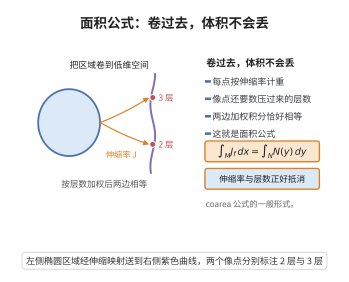

# 面积公式

> **一句话大白话**：把一个区域"卷"到低维空间去时，区域上的积分不会凭空消失：按每一点的伸缩率 $J_f$ 加权后，它恰好等于在像空间上做积分、而每一处像点按"被压过来的层数"再乘上纤维的 $(m-n)$ 维面积。

> **小例子**：$f(x)=\lvert x\rvert$ 把 $\mathbb R^n$ 压到 $\mathbb R_{\ge0}$，$\lvert\nabla f\rvert=1$、$J_f=1$，纤维 $f^{-1}(t)=tS^{n-1}$，于是 $\int_{\mathbb R^n}g\,dx=\int_0^\infty\big(\int_{\lvert x\rvert=t}g\,d\mathcal H^{n-1}\big)dt$，即球坐标公式；而 $f(x)=(x,u(x))$ 给出曲面面积 $\mathcal H^m(\mathrm{graph}\,u)=\int_{\mathbb R^m}\sqrt{1+\lvert\nabla u\rvert^2}\,dx$。

## 一、定理介绍

> **前置依赖**：coarea公式、Hausdorff测度与维数、Rademacher定理、几何测度论紧性定理。

面积公式（area formula）是几何测度论中与 coarea 公式并列的基本积分公式，由 Federer 在 1944 年的曲率测度研究与 1959 年的《Geometric Measure Theory》中系统化。它讨论 Lipschitz 映射 $f:\mathbb R^m\to\mathbb R^n$（$m\ge n$）的"换元"：与经典的 $\mathbb C^1$ 换元公式相比，它把两个困难一并解决——映射可以只有 Lipschitz 正则性（几乎处处可微但不处 处可微），并且可以不单射（必须按重数计数）。

公式的两端分别是：定义域上的积分，用每一点的 Jacobian $J_f=\sqrt{\det(Df\,Df^{\mathsf T})}$（即微分在单位立方体上造成的 $m$ 维体积伸缩率）加权；像空间上的积分，其被积函数是纤维 $f^{-1}(y)$ 上的 $(m-n)$ 维 Hausdorff 测度积分。当 $m=n$ 时纤维退化为点，公式就是"带重数的换元公式"。

面积公式的意义在于：它使"把曲面参数化后计算面积"这件直观的事情获得了只依赖 Lipschitz 正则性的严格形式，从而成为极小曲面、几何测度论（可求长集、rectifiable current 的面积与紧性）、以及椭圆方程弱解理论（Sobolev 映射的换元）的基础工具。面积公式与 coarea 公式互为"对偶"：一个把 $m$ 维测度推到像空间（用 $J_f$），一个沿水平集分解测度（用 $\lvert\nabla f\rvert$）。

## 几何直观

图意在说明：区域上的伸缩率加权积分等于像空间上按层数加权的积分，体积不会凭空消失。

## 二、原理思路

1. **先做线性情形**：设 $f(x)=Ax+b$，$A:\mathbb R^m\to\mathbb R^n$ 线性满射。用奇异值分解 $A=U\Sigma V^{\mathsf T}$，$\Sigma=\mathrm{diag}(\sigma_1,\dots,\sigma_n,0,\dots,0)$。正交变换保持 Lebesgue 测度与 Hausdorff 测度，故可归结为 $A=\Sigma$；而 $\Sigma$ 的纤维是最后 $m-n$ 个坐标方向的平移，于是 Fubini 定理直接给出公式，$\sigma_1\cdots\sigma_n=\sqrt{\det(AA^{\mathsf T})}=J_f$。

2. **局部线性化**：对 Lipschitz $f$，由 Rademacher 定理 $f$ 几乎处处可微。在可微点附近，$f$ 与其仿射近似 $x\mapsto f(x_0)+Df(x_0)(x-x_0)$ 的误差是 $o(\lvert x-x_0\rvert)$，因此在小尺度上线性情形给出一条带相对误差 $\to0$ 的恒等式。

3. **用覆盖与重数把小块拼起来**：把定义域用充分小的球（或方体）覆盖，在每个小块上套用线性情形；关键是要控制"重数函数" $N(y)=\#(f^{-1}(y)\cap E)$ 的有限性（由 Lipschitz 常数的 $\mathcal H^m$ 与 $\mathcal H^n$ 体积比较给出）与"坏点集"（不可微点、重数无穷点）的测度为零。

4. **两个方向的不等式收拢**：一方面线性近似给出 $\int_EgJ_f\le\int(\int_{f^{-1}(y)}g\,d\mathcal H^{m-n})dy$ 的上界；另一方面对每一点追踪它被"送到"哪里，得到反向不等式；合起来即得等式。

## 三、定理的严格表述

**定理（面积公式）.** 设 $f:\mathbb R^m\to\mathbb R^n$ 是 Lipschitz 映射（$m\ge n$），$g:\mathbb R^m\to[0,+\infty]$ 是 Borel 可测函数，$J_f(x)=\sqrt{\det\big(Df(x)\,Df(x)^{\mathsf T}\big)}$（在 $f$ 可微点处定义，由 Rademacher 定理几乎处处存在）。则

$$
\int_{\mathbb R^m}g(x)\,J_f(x)\,dx=\int_{\mathbb R^n}\Big(\int_{f^{-1}(y)}g(x)\,d\mathcal H^{m-n}(x)\Big)dy .
$$

**推论 1（带重数的换元公式）.** 取 $m=n$，则 $J_f=\lvert\det Df\rvert$，且对几乎所有的 $y$，$f^{-1}(y)$ 是有限点集，于是

$$
\int_{\mathbb R^n}g(x)\,\lvert\det Df(x)\rvert\,dx=\int_{\mathbb R^n}\sum_{x\in f^{-1}(y)}g(x)\,dy .
$$

**推论 2（参数曲面的面积）.** 若 $f:A\subset\mathbb R^m\to\mathbb R^n$ 是单射 Lipschitz 映射，则 $f$ 的像的 $m$ 维 Hausdorff 测度满足

$$
\mathcal H^m\big(f(A)\big)\le\int_AJ_f(x)\,dx ,
$$

且在 $A$ 上几乎处处 $J_f>0$ 时取等。

**推论 3（图与球坐标）.** 对 $u:\Omega\subset\mathbb R^m\to\mathbb R$，图 $F(x)=(x,u(x))$ 满足 $J_F=\sqrt{1+\lvert\nabla u\rvert^2}$，故 $\mathcal H^m(\mathrm{graph}\,u)=\int_\Omega\sqrt{1+\lvert\nabla u\rvert^2}dx$；对 $f(x)=\lvert x\rvert$ 得球坐标公式。

## 四、证明过程

**步骤 1（线性情形：$f(x)=Ax+b$）。** 由 $J_f(x)\equiv\sqrt{\det(AA^{\mathsf T})}$ 为常数，且平移 $b$ 不改变测度，只需证 $A$ 满射时的结论。取奇异值分解 $A=U\Sigma V^{\mathsf T}$，其中 $U,V$ 正交、$\Sigma=\mathrm{diag}(\sigma_1,\dots,\sigma_n)$ 与 $A$ 同型（后 $m-n$ 列为零）。

先设 $A=P$ 为正交投影 $(x_1,\dots,x_m)\mapsto(x_1,\dots,x_n)$。此时 $J_P=1$，纤维 $P^{-1}(y)=\{y\}\times\mathbb R^{m-n}$，且 $dx=dy\otimes dz$，故对 $g$ 作 Fubini 分解

$$
\int_{\mathbb R^m}g(x)\,dx=\int_{\mathbb R^n}\Big(\int_{\mathbb R^{m-n}}g(y,z)\,dz\Big)dy=\int_{\mathbb R^n}\Big(\int_{P^{-1}(y)}g\,d\mathcal H^{m-n}\Big)dy .
$$

在此坐标下，一般情形即为 $\Sigma$：$\Sigma(x)=(\sigma_1x_1,\dots,\sigma_nx_n,0,\dots,0)$。其纤维仍是最后 $m-n$ 个坐标方向的平移，$(m-n)$ 维 Hausdorff 测度不受前 $n$ 个坐标缩放的影响；而像空间 $\mathbb R^n$ 测度被伸缩因子 $\sigma_1\cdots\sigma_n=\sqrt{\det(AA^{\mathsf T})}=J_A$ 放大。于是对任意非负 $h$，

$$
\int_{\mathbb R^m}h\,dx=J_A^{-1}\int_{\mathbb R^n}\Big(\int_{\Sigma^{-1}(y)}h\,d\mathcal H^{m-n}\Big)dy ,
$$

即 $\int h\,J_A=\int\big(\int h\,d\mathcal H^{m-n}\big)dy$。再由 $U,V$ 正交（保持 $dx$、$\mathcal H^k$ 与 $J$）把结论搬运回 $A=U\Sigma V^{\mathsf T}$，得线性情形的等式。

**步骤 2（局部仿射近似）。** 设 $f$ Lipschitz。固定紧集 $E$ 与 $\varepsilon>0$。由 Rademacher 定理，$f$ 在 $\mathcal L^m$-几乎处处的点可微；再由可微性的一致版本（Egorov 型），可取 $E$ 中全体可微点，并存在 $\rho>0$，使得对每个 $x_0$ 与 $\lvert z\rvert\le\rho$，

$$
f(x_0+z)=f(x_0)+Df(x_0)z+R(x_0,z),\qquad \lvert R(x_0,z)\rvert\le\varepsilon\lvert z\rvert .
$$

于是 $f$ 在尺度 $\rho$ 的球内被仿射映射 $A_{x_0}=Df(x_0)$ 以相对误差 $\varepsilon$ 逼近。这一步把非线性问题在局部变成步骤 1 的线性问题。

**步骤 3（覆盖、重数与极限）。** 取 $\rho$ 与有限多个互不相交的球 $B_i=B(x_i,r_i)$（$r_i$ 充分小）覆盖 $E$ 的几乎全部。由 Lipschitz 性质，$\mathcal H^m(f(B_i))\le(\mathrm{Lip}\,f)^m\mathcal H^m(B_i)$，可得出重数 $N(y)=\#(f^{-1}(y)\cap E)$ 有限且局部可积；再由步骤 2 在每个 $B_i$ 上比较 $f$ 与 $A_{x_i}$，得到

$$
\left\lvert\int_{B_i}g\,J_f-\int_{\mathbb R^n}\int_{f^{-1}(y)\cap B_i}g\,d\mathcal H^{m-n}dy\right\rvert\le C(\varepsilon)\,\mathcal H^m(B_i) .
$$

其中常数的关键来源是：$\mathcal H^{m-n}$ 与像空间 Lebesgue 测度的"体积"在 $f$ 下最多被放大一个依赖 $\mathrm{Lip}\,f$ 的常数倍（这同时保证了 $\int(\int_{f^{-1}(y)}g\,d\mathcal H^{m-n})dy$ 的加性），而线性近似把伸缩率误差控制在 $(1\pm\varepsilon)$ 之内。对 $i$ 求和（$B_i$ 互不相交，重数可加），再令 $\varepsilon\downarrow0$ 并用 $E$ 的任意性逼近 $\mathbb R^m$，去掉坏点集（不可微点与重数无穷点，二者测度为零），即得

$$
\int_{\mathbb R^m}g\,J_f\,dx=\int_{\mathbb R^n}\Big(\int_{f^{-1}(y)}g\,d\mathcal H^{m-n}\Big)dy ,
$$

这即是面积公式。

**步骤 4（推论）。** 取 $m=n$：此时 $\det(DfDf^{\mathsf T})=(\det Df)^2$，$J_f=\lvert\det Df\rvert$；纤维是一维离散点集，$\mathcal H^0$ 是计数量度，于是 $\int_{f^{-1}(y)}g\,d\mathcal H^0=\sum_{x\in f^{-1}(y)}g(x)$，得到推论 1。若 $f$ 在 $A$ 上单射，则 $N\le1$，故

$$
\mathcal H^m(f(A))=\int_{\mathbb R^n}N(y)\,dy\le\int_{f(A)}1\,dy\cdot\sup N\le\int_AJ_f\,dx ,
$$

即推论 2；当 $J_f>0$ 几乎处处时 $f$ 局部一一，$N\equiv1$ 于 $f(A)$，取等。推论 3 是对 $F(x)=(x,u(x))$ 直接计算

$$
D F=\begin{pmatrix}I_m\\ \nabla u^{\mathsf T}\end{pmatrix},\qquad
J_F=\sqrt{\det(I_m+\nabla u\,\nabla u^{\mathsf T})}=\sqrt{1+\lvert\nabla u\rvert^2},
$$

代入公式即得图的面积公式；对 $f(x)=\lvert x\rvert$（此时 $J_f=1$、纤维为球面）代入即得球坐标公式。$\square$

## 五、应用与意义

- **参数曲面与图的面积**：推论 2、3 给出曲线弧长、参数曲面面积与图面积公式的严格版本，是变分法与极小曲面理论中"面积泛函"的定义基础。
- **几何测度论**：面积公式是 rectifiable current 的面积测度与质量 $\mathbf M$ 的定义来源，也是证明可求长集可被 Lipschitz 图像覆盖、以及 [几何测度论紧性定理](./几何测度论紧性定理.md) 中切片与紧性论证的标准工具。
- **Sobolev 映射与弱形式**：$W^{1,p}$ 映射的换元、$\mathcal H^{m-n}$ 上的迹定理与等周不等式都依赖面积公式只在几乎处处可微点表达（这正是 [Rademacher定理](../第17级-实分析/Rademacher定理.md) 的作用）。
- **与 coarea 公式的对偶**：[coarea公式](./coarea公式.md) 用 $\lvert\nabla f\rvert$ 沿水平集分解，面积公式用 $J_f$ 把测度推到像空间；对 $f=(f_1,\dots,f_n)$ 逐次对每个分量用 coarea 即得一般形式，两者共同构成"测度按正交分解搬动"的完整语言。

## 课堂问答

**老师**：面积公式与经典换元公式相比，放宽了哪些条件？

**学生**：面积公式为 $\int_{\mathbb R^m}g\,J_f\,dx=\int_{\mathbb R^n}\left(\int_{f^{-1}(y)}g\,d\mathcal H^{m-n}\right)dy$，其中 $J_f=\sqrt{\det(Df\,Df^{\mathsf T})}$，$m\ge n$。它只要求 $f$ 是 Lipschitz（几乎处处可微），并且允许 $f$ 非单射——用纤维上的 $\mathcal H^{m-n}$ 与重数来处理。

**老师（追问）**：证明的骨架是什么？

**学生**：先在 $f(x)=Ax+b$ 的线性情形，用奇异值分解 $A=U\Sigma V^{\mathsf T}$ 把纤维化为最后 $m-n$ 个坐标方向的平移，Fubini 定理直接给出等式，且 $\sigma_1\cdots\sigma_n=\sqrt{\det(AA^{\mathsf T})}=J_f$。一般情形由 Rademacher 定理保证 $f$ 几乎处处可微，局部用仿射近似一致逼近（误差 $o(|z|)$），再用球覆盖把小块拼起来；重数函数由 Lipschitz 常数控制其有限性与可积性，坏点集（不可微点、重数无穷点）测度为零，两个方向的不等式收拢即得等式。

**老师（拓展）**：它与 coarea 公式是什么关系？

**学生**：两者互为对偶：coarea 用 $|\nabla f|$ 沿水平集分解测度（$n=1$ 的特例），面积公式用 $J_f$ 把测度推到像空间。常见误区是把它当成简单的换元：若 $f$ 不单射，必须按 $\mathcal H^{m-n}$ 纤维与重数计数；取 $m=n$ 时 $\mathcal H^0$ 是计数量度，得带重数的换元公式，而图 $F(x)=(x,u(x))$ 给 $J_F=\sqrt{1+|\nabla u|^2}$，正是面积泛函的定义基础。

## 相关条目

- [coarea公式](./coarea公式.md)：与本文互为对偶的分解公式。
- [几何测度论紧性定理](./几何测度论紧性定理.md)：可求长性、切片与紧性理论。
- [第一变分公式](./第一变分公式.md)：面积泛函的一阶变分。
- [极小曲面理论](./极小曲面理论.md)：面积公式给出面积泛函的具体表达式。
- [Hausdorff测度与维数](../第32级-高等实分析/Hausdorff测度与维数.md)：面积公式中 $\mathcal H^{m-n}$ 的定义与性质。
- [Rademacher定理](../第17级-实分析/Rademacher定理.md)：Lipschitz 映射几乎处处可微。
