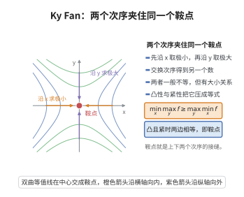

# Ky Fan 极小极大不等式

> **一句话大白话**：不要求函数对两个变量一凹一凸，也不要求上半连续，只要"对第二个变量拟凹、对第一个变量下半连续"，就一定有 $\inf_x\sup_y\varphi(x,y)\le\sup_y\varphi(y,y)$——它把鞍点存在性从凸-凹框架里解放出来，只靠拓扑。

> **小例子**：取 $X=[0,1]$ 与 $\varphi(x,y)=-(y-x)^2$。它对 $y$ 是凹函数（故拟凹），对 $x$ 连续（故下半连续），于是 $\inf_x\sup_y\varphi(x,y)=0=\sup_y\varphi(y,y)$，且 $\varphi(x,x)=0\le0$，与不等式的"零右侧"形式一致。

## 一、定理介绍

> **前置依赖**：极小极大定理、弱极小极大不等式、凸函数与凸集、凸集与Mazur定理、Brouwer不动点定理。

Ky Fan 极小极大不等式由 Ky Fan（樊畿）在 1972 年的论文《A minimax inequality and applications》中提出，是 1961 年他将经典的 Knaster–Kuratowski–Mazurkiewicz（KKM）原则推广到任意 Hausdorff 拓扑向量空间（即"Fan 引理"）之后的直接应用。

定理的形式非常"节省假设"：通常的 von Neumann–Sion 型极小极大定理要求泛函对第一个变量凸（或拟凸）、对第二个变量凹、并配合半连续性与紧性；而 Ky Fan 不等式只要求**对第二个变量拟凹、对第一个变量下半连续**，并给出一个（单侧）不等式而非等式。正因为假设薄弱、结论仍然有力，它成为非线性分析中应用最广的工具之一：变分不等式解的存在性、对策论的 Nash 均衡、数理经济学的价格均衡、鞍点型变分问题（见 [对偶变分原理](./对偶变分原理.md)）都建立在其上。

定理的"代价"是它只断言 $\inf_x\sup_y\varphi\le\sup_y\varphi(y,y)$，而不是等号。但当对角项 $\varphi(x,x)\le0$ 恒成立（这正是变分不等式与均衡问题的典型情形）时，右端为 $0$，于是得到 $\inf_x\sup_y\varphi(x,y)\le0$ 这类可直接使用的存在性结论。

## 几何直观

图意在说明：先极小后极大与先极大后极小给出两个数，凸紧条件下二者相等，交点就是鞍点。

## 二、原理思路

1. **把不等式化为"集合相交"**：令 $\gamma=\sup_{y\in X}\varphi(y,y)$，对每个 $y$ 定义 $F(y)=\{x\in X:\varphi(x,y)\le\gamma\}$。只要证明 $\bigcap_{y\in X}F(y)\ne\varnothing$，取出 $x_0$ 就有 $\sup_y\varphi(x_0,y)\le\gamma$，不等式立刻成立。
2. **闭性来自半连续性**：由 $x\mapsto\varphi(x,y)$ 下半连续，$\{x:\varphi(x,y)\le\gamma\}$ 是闭集，故每个 $F(y)$ 闭。
3. **KKM 条件来自拟凹性**：对任意有限 $y_1,\dots,y_m$ 与其凸组合 $y_0=\sum\lambda_iy_i$，若 $y_0\notin F(y_i)$ 对一切 $i$ 成立，则 $\varphi(y_0,y_i)>\gamma$；由对第二个变量的拟凹性，$\{y:\varphi(y_0,y)\ge\mu\}$（$\mu$ 取稍大于 $\gamma$ 且不超过各 $\varphi(y_0,y_i)$）是含全部 $y_i$ 的凸集，故含 $y_0$，于是 $\varphi(y_0,y_0)>\gamma$，与 $\gamma$ 的定义矛盾。这表明 $\{F(y)\}$ 满足 KKM 条件。
4. **用 Fan 引理收口**：紧凸集上满足 KKM 条件的闭集族必有非空交，这正是 Fan 引理；而 Fan 引理与 Fan 截面定理、Brouwer 不动点定理在紧凸情形等价，证明核心是"单位分解 + Brouwer"。

## 三、定理的严格表述

设 $X$ 是 Hausdorff 拓扑向量空间 $E$ 中的非空紧凸集，$\varphi:X\times X\to\mathbb R$ 满足：

(i) 对每个 $x\in X$，$y\mapsto\varphi(x,y)$ 是**拟凹**的，即对每个 $\lambda$，上水平集 $\{y\in X:\varphi(x,y)\ge\lambda\}$ 是凸集；

(ii) 对每个 $y\in X$，$x\mapsto\varphi(x,y)$ 是**下半连续**的。

**定理（Ky Fan 极小极大不等式）.** 在上述假设下，

$$
\inf_{x\in X}\sup_{y\in X}\varphi(x,y)\le\sup_{y\in X}\varphi(y,y).
$$

特别地，若 $\varphi(x,x)\le0$ 对一切 $x\in X$ 成立，则

$$
\inf_{x\in X}\sup_{y\in X}\varphi(x,y)\le0 .
$$

**定理（Fan 截面定理，几何形式）.** 设 $A\subset X\times X$ 满足：(a) 对每个 $x\in X$，截面 $\{y\in X:(x,y)\in A\}$ 是开集；(b) 对每个 $y\in X$，截面 $\{x\in X:(x,y)\in A\}$ 是非空凸集。则存在 $x_0\in X$ 使 $(x_0,x_0)\in A$。

**引理（KKM / Fan 引理）.** 设 $\{F(x)\}_{x\in X}$ 是 $X$ 的一族闭子集，满足 KKM 条件：对任意有限 $\{x_1,\dots,x_m\}\subset X$，

$$
\mathrm{conv}\{x_1,\dots,x_m\}\subset\bigcup_{i=1}^mF(x_i).
$$

则 $\bigcap_{x\in X}F(x)\ne\varnothing$。

这三条命题在紧凸情形互相等价，也都等价于 Brouwer 不动点定理。

## 四、证明过程

**步骤 1（Fan 截面定理的证明：单位分解 + Brouwer）。** 对每个 $y\in X$，由 (b) 可取 $x_y$ 使 $(x_y,y)\in A$，故 $y\in\{y':(x_y,y')\in A\}$；于是开集族 $\{A_x\}_{x\in X}$（$A_x=\{y:(x,y)\in A\}$）覆盖紧集 $X$，存在有限子覆盖 $X=A_{x_1}\cup\cdots\cup A_{x_m}$。取从属于它的单位分解 $\{\alpha_i\}$：$\alpha_i\ge0$ 连续、$\sum_i\alpha_i\equiv1$、$\mathrm{supp}\,\alpha_i\subset A_{x_i}$。定义

$$
p:X\to X,\qquad p(y)=\sum_{i=1}^m\alpha_i(y)\,x_i .
$$

$p$ 连续，且像含于 $\mathrm{conv}\{x_1,\dots,x_m\}$（有限维闭凸集）。由 Brouwer 不动点定理，存在 $y_0\in X$ 使 $p(y_0)=y_0$。令 $I=\{i:\alpha_i(y_0)>0\}$，则 $y_0\in A_{x_i}$（$(x_i,y_0)\in A$）对每个 $i\in I$ 成立。由 (b)，$\{x:(x,y_0)\in A\}$ 是凸集且含全部 $\{x_i\}_{i\in I}$，故含其凸组合

$$
y_0=\sum_{i\in I}\alpha_i(y_0)\,x_i\in\{x:(x,y_0)\in A\},
$$

即 $(y_0,y_0)\in A$，取 $x_0=y_0$ 即得结论。$\square$

**步骤 2（KKM / Fan 引理的证明）。** 反设 $\bigcap_{x\in X}F(x)=\varnothing$。由 $X$ 紧、各 $F(x)$ 闭，存在有限个 $x_1,\dots,x_m$ 使 $F(x_1)\cap\cdots\cap F(x_m)=\varnothing$。置 $K=\mathrm{conv}\{x_1,\dots,x_m\}$，则 $\{K\setminus F(x_i)\}_{i=1}^m$ 是 $K$ 的开覆盖（因 $\bigcap_i(K\cap F(x_i))=\varnothing$）。取从属单位分解 $\{\alpha_i\}$：$\alpha_i\ge0$、$\sum\alpha_i\equiv1$、$\alpha_i$ 在 $K\setminus F(x_i)$ 外为 $0$（即 $\alpha_i>0$ 处必有 $x\in K\setminus F(x_i)$）。由 Brouwer 定理，$p(y)=\sum_i\alpha_i(y)x_i$ 有不动点 $y_0\in K$。令 $I=\{i:\alpha_i(y_0)>0\}$，则对 $i\in I$ 有 $y_0\in K\setminus F(x_i)$，即 $y_0\notin F(x_i)$。另一方面 $y_0=\sum_{i\in I}\alpha_i(y_0)x_i\in\mathrm{conv}\{x_i:i\in I\}$，由 KKM 条件

$$
\mathrm{conv}\{x_i:i\in I\}\subset\bigcup_{i\in I}F(x_i),
$$

故 $y_0\in F(x_j)$ 对某个 $j\in I$ 成立，与其 $y_0\notin F(x_j)$ 矛盾。因此 $\bigcap_{x\in X}F(x)\ne\varnothing$。$\square$

**步骤 3（由 KKM 引理推极小极大不等式）。** 令

$$
\gamma=\sup_{y\in X}\varphi(y,y),\qquad F(y)=\{x\in X:\varphi(x,y)\le\gamma\}\quad(y\in X).
$$

由假设 (ii)，$\varphi(\cdot,y)$ 下半连续，故 $\{x:\varphi(x,y)\le\gamma\}$ 是闭集（下半连续等价于每个下水平集闭）。

验证 KKM 条件。取有限 $y_1,\dots,y_m$ 与任意凸组合 $y_0=\sum_i\lambda_iy_i$（$\lambda_i\ge0$、$\sum\lambda_i=1$）。若 $y_0\notin F(y_i)$ 对一切 $i$ 成立，则 $\varphi(y_0,y_i)>\gamma$；取 $\mu$ 满足 $\gamma<\mu\le\min_i\varphi(y_0,y_i)$。由假设 (i)（对 $x=y_0$，$y\mapsto\varphi(y_0,y)$ 拟凹），集合 $\{y:\varphi(y_0,y)\ge\mu\}$ 是凸集，且含全部 $y_i$，故含其凸组合 $y_0$，于是 $\varphi(y_0,y_0)\ge\mu>\gamma$，与 $\gamma=\sup_y\varphi(y,y)$ 矛盾。故 $y_0\in\bigcup_iF(y_i)$，KKM 条件成立。

由步骤 2 的 KKM 引理，$\bigcap_{y\in X}F(y)\ne\varnothing$：存在 $x_0$ 使 $\varphi(x_0,y)\le\gamma$ 对一切 $y$ 成立。于是

$$
\inf_{x\in X}\sup_{y\in X}\varphi(x,y)\le\sup_{y\in X}\varphi(x_0,y)\le\gamma=\sup_{y\in X}\varphi(y,y).
$$

又 $x\mapsto\sup_y\varphi(x,y)$ 作为下半连续函数族 $\{\varphi(\cdot,y)\}_y$ 的上确界仍下半连续，$X$ 紧故下确界可取到，所以上式左端可写成 $\min_x\sup_y\varphi(x,y)$。当 $\varphi(x,x)\le0$ 时 $\gamma\le0$，即得 $\inf_x\sup_y\varphi(x,y)\le0$。$\square$

**步骤 4（等价性与推广）。** 步骤 3 只用到"KKM 引理 + 拟凹性 + 下半连续"，而步骤 1、2 表明 Fan 截面定理与 KKM 引理都由"单位分解 + Brouwer"导出；反过来，取 $\varphi(x,y)=\lvert x-y\rvert^2-1$ 之类的函数可由极小极大不等式推出 Brouwer 型不动点结论，故在紧凸情形三者与 Brouwer 不动点定理等价。若把拟凹性加强为凹性、下半连续加强为上半连续并把紧性条件放松（只要求一个变量所在集合紧），即得到 Sion 型等式形式的极小极大定理（见 [极小极大定理](../第66级-数学优化与凸优化/极小极大定理.md) 与 [弱极小极大不等式](../第66级-数学优化与凸优化/弱极小极大不等式.md)）。

## 五、应用与意义

- **鞍点与对偶变分**：在 [对偶变分原理](./对偶变分原理.md) 中，把 $\varphi(x,y)=L(x,y)-\gamma$ 代入本不等式即可证 Sion 型极小极大等式，从而得到原问题与对偶问题临界值的关系。
- **变分不等式与均衡**：$\varphi(x,x)\le0$ 形式直接给出"存在 $x_0$ 使 $\sup_y\varphi(x_0,y)\le0$"，即变分不等式与 Ky Fan 点存在定理的标准陈述，用于 Nash 均衡与价格均衡的存在性。
- **不动点理论的统一入口**：KKM 引理、Fan 截面定理、角谷（Kakutani）型集值不动点定理与 [Brouwer不动点定理](../第34级-代数拓扑/Brouwer不动点定理.md) 构成同一技术族，本不等式是其中"分析形式"的代表。
- **非线性分析的工具箱**：它与 Ekeland 变分原理、山路引理、Brezis–Nirenberg–Stampacchia 型结果一起，构成研究非线性方程可解性、多解性与均衡问题的基础工具集。

## 课堂问答

**老师**：Ky Fan 不等式的假设这么弱——只要拟凹加下半连续——怎么还够用？

**学生**：因为它只需"单侧"结论 $\inf_x\sup_y\varphi(x,y)\le\sup_y\varphi(y,y)$，不需要鞍点等式。证明把它化为集合相交：令 $\gamma=\sup_y\varphi(y,y)$、$F(y)=\{x:\varphi(x,y)\le\gamma\}$，只要 $\bigcap_yF(y)\neq\varnothing$，取出的 $x_0$ 即满足 $\sup_y\varphi(x_0,y)\le\gamma$。下半连续保证每个 $F(y)$ 闭；拟凹性保证 $\{F(y)\}$ 满足 KKM 条件；再用 Fan 引理（紧凸集上 KKM 闭集族有非空交）收口。

**老师（追问）**：KKM 条件那一步是怎么从拟凹性推出来的？

**学生**：取有限 $y_1,\dots,y_m$ 与凸组合 $y_0=\sum_i\lambda_iy_i$，反设 $y_0\notin F(y_i)$ 对一切 $i$，则 $\varphi(y_0,y_i)>\gamma$，取 $\mu$ 使 $\gamma<\mu\le\min_i\varphi(y_0,y_i)$。由对第二个变量的拟凹性，$\{y:\varphi(y_0,y)\ge\mu\}$ 是含全部 $y_i$ 的凸集，故含 $y_0$，于是 $\varphi(y_0,y_0)\ge\mu>\gamma$，与 $\gamma$ 的定义矛盾。所以 $y_0\in\bigcup_iF(y_i)$，KKM 条件成立。

**老师（拓展）**：这套论证与 Brouwer、Sion、变分不等式的关系如何？

**学生**：在紧凸情形，KKM 引理、Fan 截面定理、Ky Fan 不等式与 Brouwer 不动点定理互相等价，证明核心都是"单位分解加 Brouwer"。把拟凹加强为凹、下半连续加强为上半连续并放松紧性，就得到 Sion 型等式极小极大定理，用于鞍点存在；而当 $\varphi(x,x)\le0$ 时右端为 $0$，直接给出变分不等式与 Nash 均衡、价格均衡的存在性。它也是由对偶变分原理证明 Sion 等式的桥梁。

## 相关条目

- [对偶变分原理](./对偶变分原理.md)：用本不等式证明 Sion 型极小极大等式。
- [凸集与Mazur定理](./凸集与Mazur定理.md)：紧凸集与凸包的基本性质，是证明中"有限维化"的依据。
- [极小极大定理](../第66级-数学优化与凸优化/极小极大定理.md)：凹-凸框架下的等式形式极小极大定理。
- [弱极小极大不等式](../第66级-数学优化与凸优化/弱极小极大不等式.md)：本不等式的等价/推广形式。
- [Brouwer不动点定理](../第34级-代数拓扑/Brouwer不动点定理.md)：单位分解论证所需的有限维不动点定理。
- [角谷不动点定理](../第120级-博弈论/角谷不动点定理.md)：集值形式的推广与博弈论应用。
